# IMTECH INFO — Plateforme de gestion de formation
## Document de référence : architecture, flux et évolutions

> Ce document est le **support de référence** du projet : il décrit le fonctionnement de
> l'application (qui fait quoi, comment les données circulent, règles métier, sécurité) et
> l'historique des évolutions apportées pendant la revue de code (section 12).
> Il sert de base pour le mémoire de stage et la soutenance.
>
> - Liste exhaustive des routes de l'API : voir [`backend-imtech/api.md`](backend-imtech/api.md)
> - Scénarios de test pour la recette et la soutenance : voir [`SCENARIOS-TESTS.md`](SCENARIOS-TESTS.md)
> - Aide-mémoire React / Node / MySQL du projet (démarrage, ajout d'une fonctionnalité, requêtes, dépannage) : voir [`CHEAT-SHEET.md`](CHEAT-SHEET.md) ; syntaxe générale : [`cheat-sheets/`](cheat-sheets/) (Node, React, MySQL)
>
> **Lecture conseillée pour le mémoire** : section 6 (chaque écran, de l'action jusqu'aux tables :
> *page → action → fonctions métier → base de données*), puis section 7 pour les règles métier.
>
> Les schémas sont écrits en **Mermaid** : ils s'affichent directement dans VS Code
> (extension *Markdown Preview Mermaid Support*) ou sur GitHub, et peuvent être exportés
> en image pour le mémoire via <https://mermaid.live>.

---

## Sommaire

1. [Présentation générale](#1-présentation-générale)
2. [Architecture technique](#2-architecture-technique)
3. [Architecture du backend en couches](#3-architecture-du-backend-en-couches)
4. [Acteurs, rôles et droits](#4-acteurs-rôles-et-droits)
5. [Modèle de données](#5-modèle-de-données)
6. [Flux par page (page → action → fonctions métier → base de données)](#6-flux-par-page)
7. [Règles métier détaillées](#7-règles-métier-détaillées)
8. [Sécurité](#8-sécurité)
9. [Gestion des erreurs](#9-gestion-des-erreurs)
10. [Qualité et tests](#10-qualité-et-tests)
11. [Organisation du code](#11-organisation-du-code)
12. [Évolutions apportées pendant la revue](#12-évolutions-apportées-pendant-la-revue)
13. [Limites et perspectives](#13-limites-et-perspectives)
14. [Glossaire](#14-glossaire)
---

## 1. Présentation générale

IMTECH INFO est un centre de formation. La plateforme numérise l'ensemble du parcours
d'un apprenant :

```
Création du dossier étudiant → Inscription à une formation → Échéancier de paiement
→ Paiements → Documents officiels (fiche, facture, attestation) → Suivi des cours (supports)
```

Elle se compose de **trois applications** qui partagent une même API :

| Application | Public | Usage principal |
|---|---|---|
| **Application web** (back-office) | Super Admin, Accueil, Formateur | Gestion des étudiants, formations, inscriptions, paiements, documents, tableau de bord |
| **Application mobile** | Étudiant (et Super Admin) | Consulter ses formations et supports, commenter, réagir, payer ses échéances, recevoir des notifications |
| **API REST** (backend) | Les deux applications | Règles métier, sécurité, accès à la base de données, génération des PDF, envoi des e-mails |

---

## 2. Architecture technique

### 2.1 Vue d'ensemble

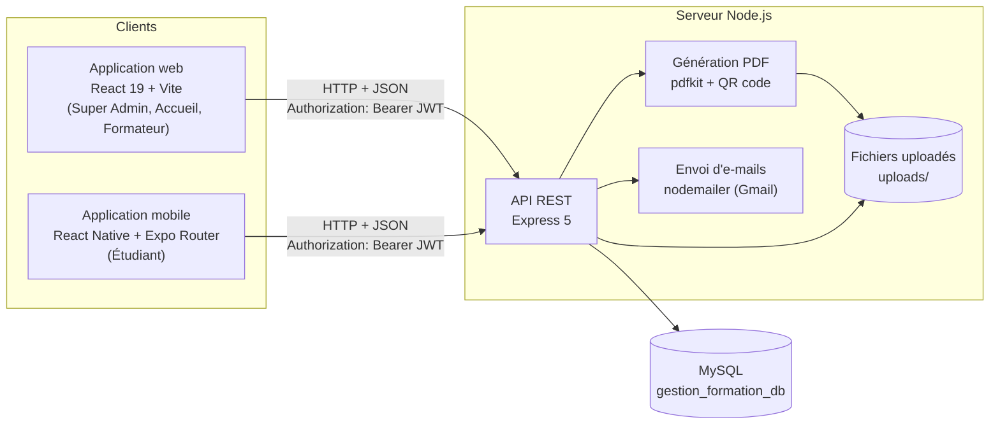

### 2.2 Technologies

| Couche | Technologie | Rôle |
|---|---|---|
| Base de données | MySQL (pilote `mysql2`, pool de connexions) | Stockage relationnel, transactions |
| Backend | Node.js 22, Express 5 | API REST |
| Authentification | JSON Web Token (`jsonwebtoken`) + table `sessions` | Identification et révocation des connexions |
| Mots de passe | `bcryptjs` (hachage) | Les mots de passe ne sont jamais stockés en clair |
| Fichiers | `multer` | Upload (photos, pièces justificatives, supports de cours) |
| Documents | `pdfkit`, `qrcode` | Fiche d'inscription, facture, attestation avec QR code de vérification |
| Protection des documents | `pdf-lib`, `sharp` | Filigrane dynamique (nom, e-mail, date) ajouté aux PDF et images au moment de leur consultation |
| E-mails | `nodemailer` | Réinitialisation du mot de passe, factures, relances |
| Web | React 19, React Router 7, Vite | Interface d'administration |
| Mobile | React Native 0.86, Expo 57, Expo Router, TypeScript | Application étudiant |
| Lecteur mobile | `react-native-webview` + pdf.js, `expo-screen-capture` | Affichage des supports dans l'app, captures d'écran bloquées |
| Tests | Runner intégré de Node (`node --test`) | Tests automatisés du backend |

### 2.3 Communication client ↔ serveur

Toutes les requêtes passent par une **seule fonction** côté client (`apiRequest`, présente
dans `web/src/utils/api.js` et `mobile/src/utils/api.ts`) qui :

1. ajoute automatiquement le token (`Authorization: Bearer <token>`) ;
2. envoie du JSON, ou un `FormData` pour les fichiers ;
3. lit la réponse, même si elle n'est pas du JSON ;
4. **si le serveur répond 401** (session expirée ou révoquée) : efface la session locale et
   renvoie l'utilisateur à l'écran de connexion ;
5. transforme toute réponse d'erreur en exception avec le message du serveur.

Format commun des réponses de l'API :

```json
{ "status": "success", "data": { } }
{ "status": "error", "message": "Explication lisible par l'utilisateur" }
```

---

## 3. Architecture du backend en couches

### 3.1 Les couches

Le backend suit une architecture **en couches**, chaque couche ayant une seule responsabilité :

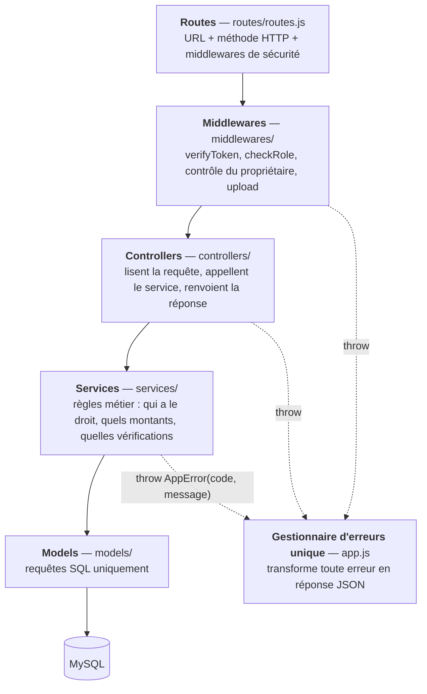

| Couche | Ce qu'elle fait | Ce qu'elle ne fait **pas** |
|---|---|---|
| Routes | Associe une URL à un controller et déclare les rôles autorisés | Aucune logique |
| Middlewares | Authentification, rôle, propriétaire, upload de fichiers | Accès métier aux données |
| Controllers | Extraient les champs de la requête, vérifient les champs obligatoires, formatent la réponse | SQL, règles métier |
| Services | Règles métier, transactions, contrôles de propriété | SQL brut, `req` / `res` |
| Models | Requêtes SQL paramétrées (`?`) | Décisions métier |

### 3.2 Cycle de vie d'une requête

Exemple : un étudiant consulte son tableau de paiement.

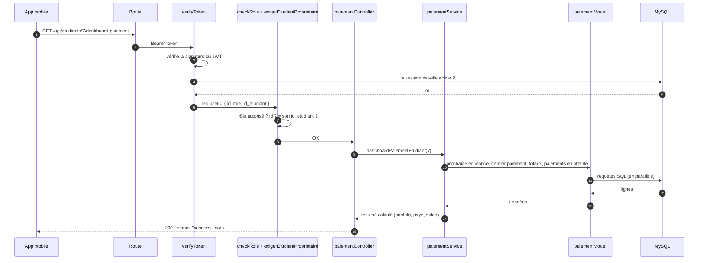

Si une étape échoue (token absent, session révoquée, mauvais étudiant, erreur SQL), l'étape
**lève une erreur** et le gestionnaire unique de `app.js` renvoie la réponse adaptée
(voir [§9](#8-gestion-des-erreurs)).

---

## 4. Acteurs, rôles et droits

### 4.1 Les acteurs

| Rôle | Application | Responsabilités |
|---|---|---|
| **Super Admin** | Web (+ mobile) | Gère tout : utilisateurs, rôles, formations, et toutes les actions de l'Accueil |
| **Accueil** | Web | Crée les dossiers étudiants, inscrit, encaisse, **valide les paiements reçus depuis le mobile**, envoie les rappels et les attestations, **résout les demandes d'assistance** |
| **Formateur** | Web | Consulte ses formations et ses étudiants, publie des supports de cours (tout de suite ou **à une heure programmée**), modère les commentaires, **fixe la note d'attestation** (à partir de la note suggérée) |
| **Étudiant** | Mobile | Consulte ses formations et supports, commente, réagit, **paie ses échéances** (paiement à valider), **écrit à l'assistance**, reçoit des notifications |

### 4.2 Matrice des droits (résumé)

| Fonction | Super Admin | Accueil | Formateur | Étudiant |
|---|:-:|:-:|:-:|:-:|
| Gérer les comptes utilisateurs et les rôles | ✅ | — | — | — |
| Modifier son propre profil | ✅ | ✅ | ✅ | ✅ |
| Créer / modifier un dossier étudiant | ✅ | ✅ | — | — |
| Créer / modifier une formation | ✅ | — | — | — |
| Voir les étudiants d'une formation | ✅ | ✅ | ses formations | — |
| Inscrire un étudiant, valider une inscription | ✅ | ✅ | — | — |
| Enregistrer un paiement validé (guichet) | ✅ | ✅ | — | — |
| Envoyer un paiement (en attente) | — | — | — | sa propre échéance |
| Valider / refuser un paiement | ✅ | ✅ | — | — |
| Voir les paiements | tous | tous | — | les siens |
| Générer fiche / facture / attestation | ✅ | ✅ | — | — |
| Publier un support de cours | — | — | ses formations | — |
| Programmer / modifier / envoyer un support programmé | ✅ (modifier, envoyer) | — | les siens | — |
| Supprimer un support | ✅ | — | les siens | — |
| Commenter / répondre / réagir (dont 👎) | ✅ | — | ✅ | ✅ |
| Supprimer un commentaire | tous | — | dans ses formations | les siens |
| Tableau de bord et export CSV | ✅ | ✅ | — | — |
| Envoyer un rappel de paiement / une attestation | ✅ | ✅ | — | — |
| Envoyer une demande d'assistance | — | — | — | ✅ |
| Voir / résoudre les demandes d'assistance | ✅ | ✅ | — | les siennes (lecture) |
| Voir le classement et la note système | ✅ | ✅ | ses formations | — |
| Voir l'avis des étudiants sur les formateurs | ✅ | ✅ | — | — |
| Voir la vitrine et s'inscrire en ligne | — | — | — | visiteur non connecté |
| Noter la présentation (sur 10) | ✅ | — | ses formations | — |
| Être marqué présent (automatique) | — | — | — | ✅ |
| Recherche globale | tout sauf supports | sans comptes utilisateurs | ses formations, étudiants, supports | ses formations et supports (mobile) |

Les droits sont appliqués **côté serveur** (les menus du web et du mobile ne font que masquer
ce qui est interdit ; ils ne protègent rien). Deux niveaux de contrôle :

1. **Le rôle** (`checkRole`) : « un étudiant n'a pas accès à cette route ».
2. **Le propriétaire** (`exigerEtudiantProprietaire`, `exigerSoiOuAdmin`, contrôles dans les
   services) : « un étudiant a accès à cette route, mais **seulement pour ses propres données** ».

Côté web, chaque rôle n'ouvre que les pages de **son menu**, même en tapant l'adresse
(`utils/navigation.js` : `NAVIGATION` liste les pages et leurs rôles, `peutOuvrir(role, page)`) :
un Accueil qui tape `/dashboard/utilisateurs`, ou un formateur `/dashboard/paiements`, revient au
tableau de bord. C'est du confort d'utilisation : la vraie protection reste le contrôle du serveur.

---

## 5. Modèle de données

### 5.1 Schéma simplifié


### 5.2 Conventions

| Convention | Signification |
|---|---|
| `etat` (booléen) | **Suppression logique** : une ligne « supprimée » passe à `etat = false` mais reste en base (historique, intégrité des paiements et factures) |
| `paiement.statut` | **Cycle de validation** d'un paiement (ajouté pendant la revue, voir [§7.6](#66-paiement-dune-échéance-par-létudiant-mobile--validation-par-laccueil)) |
| `sessions.actif` | Une connexion ; passer à `0` déconnecte réellement l'appareil |
| `alerte_envoyee` | Mémorise les alertes automatiques déjà envoyées à l'Accueil (une seule fois chacune) |
| Montants | `DECIMAL(10,2)` en Ariary (MGA) |

### 5.3 Scripts SQL

| Fichier | Usage |
|---|---|
| `backend-imtech/base.sql` | Création complète de la base (schéma à jour) |
| `backend-imtech/donneesTest.sql` | Jeu de données de démonstration complet (voir ci-dessous) ; mot de passe de tous les comptes : `admin123` |
| `backend-imtech/scripts/fichiersDemo.js` | Fichiers des données de démonstration : photos de profil (téléchargées sur randomuser.me), pièces de dossier factices, supports PDF générés |
| `backend-imtech/alter2.sql` | Toutes les évolutions du schéma (blocs 001 à 007, puis les suivantes à la fin), à appliquer sur une base existante |
| `backend-imtech/reinit.sql` | Vide **toutes** les tables et remet les compteurs à 1 (structure conservée) |

`alter2.sql` est le **seul** fichier d'évolution du schéma (l'ancien dossier `migrations/` y a été
regroupé). Chaque évolution est un bloc numéroté (001, 002...) exécuté une seule fois ; une nouvelle
évolution s'ajoute à la fin, et seul ce nouveau bloc est exécuté sur une base existante. `base.sql`
est mis à jour en même temps pour les nouvelles installations.

#### Remettre la base en état de démonstration

```bash
cd backend-imtech
mysql -u root -p < reinit.sql          # vide toutes les tables
mysql -u root -p < donneesTest.sql     # recharge les données de démonstration
node scripts/fichiersDemo.js           # photos, pièces du dossier, supports (relançable)
```

`reinit.sql` coupe les contrôles de clés étrangères le temps du vidage (`SET FOREIGN_KEY_CHECKS = 0`),
l'ordre des tables n'a donc pas d'importance. Toute nouvelle table doit y être ajoutée.

Les dates de `donneesTest.sql` sont **relatives au jour d'exécution** (`CURDATE()`, `NOW()`) : les
retards, les échéances proches et la formation terminée restent réalistes quel que soit le jour du
chargement. Les échéances sont calculées en SQL avec la même formule que
`echeanceService.calculerEcheancier` (tranche n à J + n × durée / nb, la dernière absorbe l'arrondi).

| Comptes (mot de passe `admin123`) | Rôle |
|---|---|
| `tljelia374@gmail.com` (Elia) | Super Admin |
| `hanitra.rasoanaivo@imtech.test`, `mamy.andriamanana@imtech.test` | Accueil |
| `tiana.randrianarisoa@imtech.test`, `voahangy.rakotomalala@imtech.test`, `hery.rajaonarison@imtech.test`, `lalaina.razafindrabe@imtech.test` | Formateurs |
| `prenom.nom@imtech.test` (Andry Rakotoarisoa, Miora Randriamampionona, Toky Ravelojaona…) | 12 étudiants |

Les adresses en `.test` (domaine réservé, RFC 2606) garantissent qu'aucun e-mail de test ne part
chez une vraie personne.

| Scénario de démonstration | Données |
|---|---|
| Avis sur les formateurs | Tiana et Voahangy « Compétent », Hery « Non compétent », Lalaina « Pas assez d'avis » |
| Paiements | Validés, 3 en attente (2e tranche de Sitraka payée sur mobile, 2 inscriptions en ligne), 1 refusé (Toky) |
| Retards | Toky (Développement web) et Fano (Réseaux) : 2e tranche échue non payée |
| Inscriptions à valider | Mahery et Miora (en ligne, paiement déclaré), Haja (Accueil, pas encore payé) |
| Fin de formation | Fitiavana a terminé Bureautique (attestation à envoyer) ; Nomena termine dans 4 jours |
| Supports | 10 PDF + 1 image ; « Projet : site vitrine » programmé dans 2 jours à 8 h |
| Échanges | Fils de discussion avec réponses et mentions, 5 demandes d'assistance (3 en attente), notifications |
| Présence | Jours ouvrés depuis la première inscription, assiduité différente par étudiant (de 3 à 10 jours sur 10) |

---

## 6. Flux par page

**Page → action → fonctions métier → base de données.**

Cette section décrit l'application **écran par écran**. Pour chaque action de l'utilisateur, on
suit le chemin complet d'une requête, de l'interface jusqu'aux tables MySQL. Les règles métier
détaillées (barèmes, cas particuliers, choix techniques) sont expliquées dans la section 7.

### 6.1 Comment lire les tableaux

```
Page (web / mobile)  →  Action  →  Route API  →  Fonctions métier  →  Tables
                                    (rôles)      controller → service → model     L = lecture, É = écriture
```

- **Page** : écran React (web) ou React Native (mobile), qui appelle l'API par un *hook*
  (`web/src/hooks/useXxx.js`, `mobile/src/hooks/use-xxx.ts`).
- **Route API** : préfixe `/api` omis ; entre crochets, les rôles autorisés (SA = Super Admin,
  AC = Accueil, FO = Formateur, ET = Étudiant, *public* = sans connexion, *connecté* = tout rôle).
- **Fonctions métier** : la fonction du **service** (là où sont les règles), puis celles du
  **model** (requêtes SQL). Le controller ne fait que lire la requête et appeler le service.
- **Tables** : **L** = lues, **É** = écrites. Toute route protégée lit aussi `sessions`
  (vérification du token à chaque requête, `authMiddleware`).
- **Adresse (web)** : entre parenthèses après le nom de la page, l'URL de chaque vue quand elle
  en a une (ex. fiche étudiant `/dashboard/etudiants/:id`, voir [§7.19](#719-fiches-dans-lurl-web)).
- **Liste paginée** : `?page=&limite=` dans la route = le serveur ne renvoie qu'une page de
  20 lignes et le total (voir [§7.20](#720-pagination-côté-serveur)).

Exemple complet — un étudiant paie une échéance depuis le mobile :

```
Mobile « Paiements »  →  « Payer »  →  POST /paiements [SA, AC, ET]
  → paiementController.enregistrerPaiementController
  → paiementService.enregistrerPaiement   (montant imposé, échéance de l'étudiant, pas de double paiement)
  → paiementModel.getEcheanceAvecSituation, paiementModel.insererPaiement (statut « en attente »)
  → notifModel.insertNotificationsInApp (l'Accueil est prévenu)
  → Tables : L echeance, inscription · É paiement, notification_inapp
```

### 6.2 Pages communes (web et mobile)

**Connexion** (`web/src/pages/auth/Login.jsx`, `mobile/src/app/login.tsx`)

| Action | Route API | Fonctions métier | Tables |
|---|---|---|---|
| Se connecter | `POST /auth/login` [public, 5 échecs / 15 min par compte, 20 par IP] | `limiteRequetes` (échecs seulement) → `authService.authentifier` (bcrypt, JWT) → `userModel.findUserByEmail`, `etudiantModel.getIdEtudiantByUtilisateur`, `userModel.createSession` | L utilisateur, role, etudiant · É sessions |
| Mot de passe oublié | `POST /auth/forgot-password` [public, 5 / h par IP] | `limiteRequetes` → `userService.demanderReinitialisation` → `userModel.insertResetToken` + e-mail (`utils/mailer`) | L utilisateur · É reset_password |
| Nouveau mot de passe | `POST /auth/reset-password` [public, 10 échecs / 15 min par IP] | `limiteRequetes` (échecs seulement) → `userService.reinitialiserMotDePasse` → `findValidResetToken`, `updatePasswordHash`, `marquerTokenUtilise`, `deactivateAllSessions` | É reset_password, utilisateur, sessions |
| Se déconnecter | `POST /auth/logout` [connecté] | `authService.deconnecter` → `userModel.deactivateSession` | É sessions |
| Vérification de session (toutes les minutes) | `GET /auth/profil` [connecté] | `authService.recupererProfil` → `userModel.findUserById` ; 401 → retour à la connexion | L sessions, utilisateur |

**Profil** (fenêtre « Mon profil »)

| Action | Route API | Fonctions métier | Tables |
|---|---|---|---|
| Voir son profil | `GET /utilisateurs/:id` [soi-même ou SA] | `userService.recupererUtilisateur` → `userModel.findUserById` | L utilisateur, role |
| Modifier (nom, photo…) | `PUT /utilisateurs/:id` [soi-même ou SA] | `userService.modifierUtilisateur` → `userModel.updateUser` (photo dans `uploads/utilisateurs`) | É utilisateur |

**Paramètres > Sécurité**

| Action | Route API | Fonctions métier | Tables |
|---|---|---|---|
| Changer le mot de passe | `PUT /auth/change-password` [connecté] | `authService.changerMotDePasse` → `findUserWithPassword`, `updatePasswordHash`, `deactivateAllExcept` | É utilisateur, sessions |
| Voir les sessions / dernière connexion | `GET /auth/sessions`, `GET /auth/last-login` | `userModel.findSessionsByUser`, `findLastActiveSession` (le token n'est jamais renvoyé) | L sessions |
| Se déconnecter partout | `PUT /auth/logout-all` [connecté] | `userModel.deactivateAllExcept` (garde la session courante) | É sessions |

**Notifications** (web : tous les rôles du personnel ; mobile : étudiant)

| Action | Route API | Fonctions métier | Tables |
|---|---|---|---|
| Lister | `GET /notifications` [connecté] | `notifService.listerNotifications` → `notifModel.notifFindByUtilisateur` | L notification_inapp |
| Marquer comme lue / supprimer | `PUT /notifications/:id/lu`, `DELETE /notifications/:id` | `notifService.marquerCommeLue`, `supprimerNotification` (seulement les siennes) | É notification_inapp |

### 6.3 Web — Super Admin et Accueil

**Tableau de bord** (`components/dashboard/DashboardContent.jsx`)

| Action | Route API | Fonctions métier | Tables |
|---|---|---|---|
| Indicateurs (encaissé, reste à payer, retards…) | `GET /dashboard/kpi` [SA, AC] | `dashboardService.recupererKPI` → `dashboardModel.getKPI` (paiements **validés** seulement) | L paiement, echeance, formation |
| Courbe des encaissements | `GET /dashboard/evolution?periode=` | `recupererEvolution` → `getEvolution`, `getEvolutionParJour` | L paiement |
| Inscriptions par mois / top formations | `GET /dashboard/inscriptionParMois`, `/topInscription` | `dashboardModel.getDonneesInscriptionsParMois`, `getTopInscriptions` | L inscription, formation |
| Export CSV | `GET /dashboard/export-csv` | `dashboardService.genererExportCSV` | L inscription, etudiant, utilisateur, formation |
| Avis sur les formateurs | `GET /formateurs/avis` [SA, AC] | `reactionService.avisFormateurs` → `reactionModel.getReactionsParFormateur` | L reaction, support, utilisateur |

**Étudiants** (`pages/etudiants/` ; liste `/dashboard/etudiants`, fiche `/dashboard/etudiants/:id`, création `/nouveau`, modification `/:id/modifier`)

| Action | Route API | Fonctions métier | Tables |
|---|---|---|---|
| Lister / rechercher (20 par page) | `GET /etudiants?page=&limite=&recherche=` [SA, AC, FO] | `etudiantService.listerEtudiants` → `etudiantModel.getAllEtudiants` (`LIMIT / OFFSET`) + `compterEtudiants` (total) ; recherche dans nom, prénom, e-mail, téléphone | L etudiant, utilisateur |
| Fiche | `GET /etudiants/:id`, `GET /etudiants/:id/formations` | `recupererEtudiant`, `recupererFormationsEtudiant` | L etudiant, utilisateur, inscription, formation |
| Créer un dossier (+ pièces) | `POST /etudiants` [SA, AC] | `etudiantService.creerEtudiant` → `etudiantModel.insertUtilisateurEtEtudiant` (compte + dossier, fichiers dans `uploads/etudiants`) | É utilisateur, etudiant |
| Modifier / supprimer | `PUT` / `DELETE /etudiants/:id` | `modifierEtudiant` → `updateEtudiant` ; `supprimerEtudiant` → `deleteEtudiant` (suppression logique) | É etudiant, utilisateur |

**Utilisateurs** (Super Admin seulement, `pages/users/` ; liste `/dashboard/utilisateurs`, modification `/:id/modifier`)

| Action | Route API | Fonctions métier | Tables |
|---|---|---|---|
| Lister | `GET /utilisateurs` [SA] | `userService.listerUtilisateurs` → `userModel.findAllUsers` | L utilisateur, role |
| Créer un compte (Accueil, Formateur…) | `POST /utilisateurs` [SA] | `userService.creerUtilisateur` (mot de passe haché) → `userModel.insertUser` | É utilisateur |
| Désactiver | `DELETE /utilisateurs/:id` [SA] | `supprimerUtilisateur` → `deleteUser`, `deactivateAllSessions` | É utilisateur, sessions |

**Formations** (`pages/formations/` ; liste `/dashboard/formations`, fiche `/:id`, création `/nouvelle`, modification `/:id/modifier`)

| Action | Route API | Fonctions métier | Tables |
|---|---|---|---|
| Lister / fiche / étudiants | `GET /formations`, `/formations/:id`, `/formations/:id/etudiants` | `formationService.listerFormations`, `recupererFormation`, `recupererEtudiantsFormation` (un FO : seulement les siennes) | L formation, utilisateur, inscription, etudiant |
| Créer / modifier | `POST /formations`, `PUT /formations/:id` [SA] | `creerFormation` / `modifierFormation` (durée en jours vérifiée) → `insertFormation` / `updateFormation` | É formation |
| Image de couverture | `PUT /formations/:id/image` [SA] | `modifierImageFormation` → `updateImageFormation` (`uploads/formations`, public) | É formation |
| Désactiver | `DELETE /formations/:id` [SA] | `supprimerFormation` → `deleteFormation` (suppression logique) | É formation |

**Inscriptions** (`pages/inscriptions/` ; liste `/dashboard/inscriptions`, fiche `/:id`, création `/nouvelle`)

| Action | Route API | Fonctions métier | Tables |
|---|---|---|---|
| Lister (20 par page ; recherche, validée ou non, accueil / en ligne) | `GET /inscriptions?page=&recherche=&valide=oui\|non&origine=accueil\|en_ligne` [SA, AC] | `inscriptionService.listerInscriptions` → `getAllInscriptions` + `compterInscriptions` | L inscription, etudiant, utilisateur, formation, echeance, paiement |
| Inscrire un étudiant | `POST /inscriptions` [SA, AC] | `inscriptionService.creerInscription` (transaction) → `findFormationActive`, `inscriptionActiveExiste`, `insertInscription` + **échéancier** (1 à 4 tranches) | L formation, tranche · É inscription, echeance |
| Valider (premier paiement) | `POST /inscriptions/:id/valid` [SA, AC] | `validerInscription` → `setInscriptionValidee`, `validerPaiementDeclare` ou `insererPaiement` | É inscription, paiement |
| Échéancier d'une inscription | `GET /inscriptions/:id/echeances` | `echeanceService.listerEcheancesInscription` | L echeance, tranche |
| Fiche d'inscription (PDF) | `POST /fiche/:id_inscription/generer` | `documentService.creerFiche` → `documentModel.findInscriptionPourFiche` + `utils/pdf` | L inscription, etudiant, formation |
| Annuler | `DELETE /inscriptions/:id` | `supprimerInscription` → `deleteInscription` | É inscription |

**Paiements** (`pages/paiements/`)

| Action | Route API | Fonctions métier | Tables |
|---|---|---|---|
| Lister (20 par page ; statut, mode, recherche) | `GET /paiements?page=&statut=&mode=&recherche=` [SA, AC, ET] | `paiementService.listerPaiements` (un ET : seulement les siens) → `paiementModel.getAllPaiements` + `compterPaiements` (total, et nombre **en attente** sur toute la base pour le bandeau « à valider ») | L paiement, mode_paiement, echeance, inscription, etudiant, utilisateur, formation |
| Enregistrer au guichet | `POST /paiements` [SA, AC] | `enregistrerPaiement` (montant ≤ reste, pas de double paiement) → `getEcheanceAvecSituation`, `insererPaiement` | L echeance · É paiement |
| Valider / refuser un paiement en attente | `PUT /paiements/:id/valider` · `/refuser` [SA, AC] | `traiterPaiementEnAttente` → `paiementModel.changerStatutPaiementEnAttente` + notification à l'étudiant | É paiement, notification_inapp |
| Facture (PDF + QR) | `POST /factures/:id_paiement/generer` | `documentService.creerFacture` → `findPaiementPourFacture`, `insertFacture` | L paiement… · É facture |

**Échéances** (`pages/echeances/`)

| Action | Route API | Fonctions métier | Tables |
|---|---|---|---|
| Lister (20 par page ; recherche, couleur de suivi) | `GET /echeances?page=&recherche=&statut=VERT\|JAUNE\|ROUGE` [SA, AC] | `echeanceService.listerToutesEcheances` → `getAllEcheances` (couleur calculée en SQL) + `compterEcheances` | L echeance, inscription, etudiant, utilisateur, formation, paiement |
| Modifier date / montant | `PUT /echeances/:id` | `modifierEcheance` → `updateEcheance` | É echeance |
| Rappeler l'étudiant | `POST /echeances/:id/rappeler` | `rappelerEcheance` → `getEcheancePourRappel`, `marquerRappelEnvoye` + notification + e-mail | É echeance, notification_inapp |

**Documents, Assistance, Notifications envoyées, Paramètres**

| Page | Action | Route API | Fonctions métier | Tables |
|---|---|---|---|---|
| Documents | Lister / déposer / supprimer | `GET`, `POST /documents`, `DELETE /documents/:id` | `documentService.obtenirDocuments`, `creerDocument`, `supprimerDocument` | L/É document_administratif |
| Documents | Attestation (générer / envoyer) | `POST /attestations/:id/generer`, `/envoyer` | `creerAttestation` (note finale /20 calculée) → `getActiviteFormation`, `insertAttestation` | L presence, paiement · É attestation |
| — (QR code) | Vérifier une attestation | `GET /verification/:uuid` [public] | `documentService.verifierAuthenticite` → `findAttestationParUuid` | L attestation, inscription, formation |
| Assistance | Lister / résoudre une demande | `GET /assistances`, `PUT /assistances/:id/resoudre` | `assistanceService.listerDemandes`, `resoudreDemande` → `resoudreAssistance` + notification à l'étudiant | L/É assistance, notification_inapp |
| Notifications | Envoyer (in-app, e-mail, pièce jointe) | `POST /notifications/in-app`, `/email`, `/email/piece-jointe` [SA, AC] | `notifService.notifierInApp`, `notifierEmail`, `notifierEmailAvecPieceJointe` | É notification_inapp, notification_email |
| Paramètres (SA) | Fond de la vitrine mobile | `PUT` / `DELETE /vitrine/fond` [SA] | `vitrineService.modifierFondVitrine`, `reinitialiserFondVitrine` → `parametreModel.setParametre` | É parametre_application |

**Recherche globale** (bouton du header ou Ctrl+K, `components/recherche/RechercheGlobale.jsx`)

| Action | Route API | Fonctions métier | Tables |
|---|---|---|---|
| Chercher, puis ouvrir un résultat (adresse de la fiche : `utils/navigation.cheminResultat`) | `GET /recherche?q=` [SA, AC, FO ; ET : voir 6.5] | `rechercheService.rechercher` (groupes selon le rôle) → `rechercheModel.chercherEtudiants`, `chercherFormations`, `chercherInscriptions`, `chercherUtilisateurs` (SA), `chercherSupports` (FO) | L etudiant, utilisateur, role, formation, inscription, support |

### 6.4 Web — Formateur

**Espace formateur** (`pages/formateur/AccueilFormateur.jsx`)

| Action | Route API | Fonctions métier | Tables |
|---|---|---|---|
| Voir ses formations et leurs étudiants (fenêtre) | `GET /formations`, `GET /formations/:id/etudiants` [FO] | `formationService.recupererEtudiantsFormation` (seulement ses formations) | L formation, inscription, etudiant, utilisateur |
| Classement et note système | `GET /formations/:id/classement` | `classementService.classementFormation` → `getActiviteFormation`, `enregistrerSuggestions` | L presence, paiement, echeance, inscription · É inscription (note suggérée) |
| Noter la présentation (/10) | `PUT /inscriptions/:id/note` [SA, FO] | `classementService.definirNote` (≤ 10, sa formation) → `setNotePresentation` | É inscription |

**Supports** (`pages/formateur/SupportsFormateur.jsx`)

| Action | Route API | Fonctions métier | Tables |
|---|---|---|---|
| Publier ou programmer | `POST /supports` [FO] | `supportService.creerSupports` (HTML nettoyé par `utils/contenuRiche`, fichier 50 Mo max) → `createSupport` + notifications aux inscrits | É support, notification_inapp |
| Lister ses supports | `GET /formations/:id/supports` | `listerSupportsFormation` → `getSupportsByFormation` (recherche, filtres, tri côté navigateur) | L support, formation, utilisateur |
| Supprimer | `DELETE /supports/:id` [FO, SA] | `supprimerSupport` (auteur seulement) → `deleteSupport` | É support |
| Commenter / répondre / mentionner | `GET /supports/:id/commentaires`, `POST /commentaires` | `commentaireService.creerCommentaire` → `insertCommentaire`, `insertMentions` + notifications | L/É commentaire, commentaire_mention, notification_inapp |
| Réagir 👍 / 👎 | `POST` / `DELETE /supports/:id/reactions` | `reactionService.ajouterOuModifReaction` → `ajouterOuModifierReaction` | É reaction |

**Supports programmés** (`pages/formateur/ProgrammesFormateur.jsx`)

| Action | Route API | Fonctions métier | Tables |
|---|---|---|---|
| Lister | `GET /supports/programmes` [FO, SA] | `listerSupportsProgrammes` → `getSupportsProgrammes` | L support, formation |
| Modifier (titre, texte, heure, fichier) | `PUT /supports/:id` | `modifierSupportProgramme` → `updateSupportProgramme` | É support |
| Envoyer maintenant | `POST /supports/:id/envoyer` | `envoyerMaintenant` → `publierSupport` (mise à jour atomique) + notifications | É support, notification_inapp |

### 6.5 Mobile — Étudiant et visiteur

| Écran | Action | Route API | Fonctions métier | Tables |
|---|---|---|---|---|
| Découvrir (`app/decouvrir.tsx`, sans compte) | Voir la vitrine | `GET /public/vitrine` [public] | `vitrineService.contenuVitrine` → `getFormationsPubliques`, `getReactionsParFormateur`, `getModesPaiement`, `getParametre` | L formation, inscription, reaction, mode_paiement, parametre_application |
| Découvrir | S'inscrire en ligne (1 à n formations) | `POST /public/inscriptions` [public, 5 / h / IP] | `vitrineService.inscriptionEnLigne` (une transaction : compte, inscriptions, échéanciers, 1ᵉʳ paiement **en attente**) | É utilisateur, etudiant, inscription, echeance, paiement, notification_inapp |
| Accueil (`app/(tabs)/index.tsx`) | Résumé des paiements | `GET /etudiants/:id/dashboard-paiement` [ET : le sien] | `paiementService.dashboardPaiementEtudiant` | L paiement, echeance, inscription, formation |
| Formations | Mes formations / détail | `GET /etudiants/:id/formations`, `GET /formations/:id` | `recupererFormationsEtudiant`, `recupererFormation` | L inscription, formation |
| Documents (supports) | Liste, détail, commentaires, réactions | `GET /formations/:id/supports`, `/supports/:id`, `/supports/:id/commentaires`, `POST /commentaires`, `POST /supports/:id/reactions` | comme en 6.4 (l'étudiant ne voit que ses formations) | L support · É commentaire, reaction |
| Lecteur (`app/lecteur.tsx`) | Ouvrir un PDF / une image | `GET /supports/<fichier>?token=` | `fichierMiddleware` : droits (`fichierModel.etudiantPeutVoirSupport`) puis **filigrane** (`utils/filigrane`) | L sessions, inscription, support |
| Paiements (`app/paiements.tsx`) | Payer une échéance | `POST /paiements` [ET] | `paiementService.enregistrerPaiement` (montant imposé, **en attente**) + notification à l'Accueil | L echeance · É paiement, notification_inapp |
| Assistance (`app/assistance.tsx`) | Envoyer / suivre une demande | `POST /assistances` [ET], `GET /assistances` | `assistanceService.creerDemande` → `insertAssistance` + notification à l'Accueil | É assistance, notification_inapp |
| En-tête (🔍 de l'Accueil et de chaque écran, `components/recherche/recherche-globale.tsx`) | Recherche globale : écrans de l'app (sur place), ses formations, ses supports | `GET /recherche?q=` [ET] | `rechercheService.rechercher` → `rechercheModel.chercherFormationsEtudiant`, `chercherSupportsEtudiant` (supports **publiés** des inscriptions **validées**) | L formation, inscription, support |
| Notifications, Profil, Paramètres | voir 6.2 | | | |

### 6.6 Traitements automatiques (sans page)

| Déclencheur | Fonctions métier | Tables |
|---|---|---|
| Chaque requête d'un étudiant | `authMiddleware.authentifier` → `presenceModel.marquerPresence` (un jour = une ligne) | É presence |
| Vérification périodique des supports programmés | `supportProgrammeService.verifierSupportsProgrammes` → `getSupportsAAnnoncer` (annonce 1 h avant), `getSupportsAPublier`, `publierSupport` | É support, notification_inapp |
| Vérification périodique des alertes | `alerteService` → `getEcheancesARappeler`, `getFormationsTerminees` (une seule alerte par objet) | É alerte_envoyee, notification_inapp |

---

## 7. Règles métier détaillées

Chaque flux indique : les acteurs, les étapes, les règles appliquées et, le cas échéant,
**ce qui a changé** pendant la revue.

### 7.1 Connexion, session et déconnexion

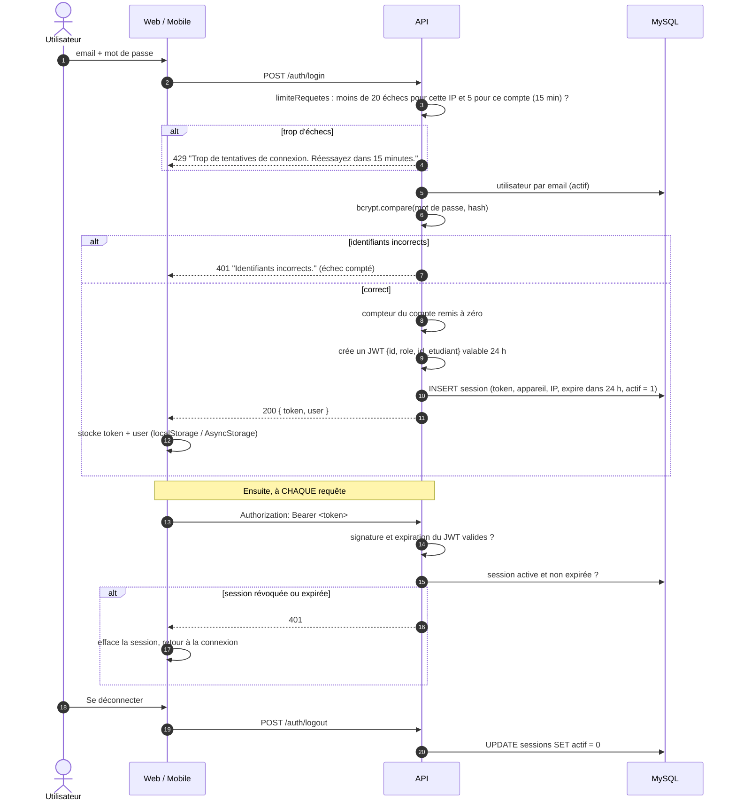

**Fonctions associées :**
- *Paramètres → Sessions* : liste des appareils connectés (navigateur, IP, date) ; la session
  courante est signalée, **les tokens ne sont jamais renvoyés**.
- *Déconnecter les autres appareils* (`PUT /auth/logout-all`) : désactive toutes les sessions
  sauf la courante. Les appareils déconnectés le voient **dans la minute** : le web et l'application
  mobile vérifient la session (`GET /auth/profil`) toutes les minutes et au retour au premier plan ;
  le 401 renvoie à l'écran de connexion (sur mobile, avec l'alerte « Session fermée »).
  Deux onglets du même navigateur partagent la même session : ils ne comptent pas comme
  « autres appareils ».
- *Changer le mot de passe* : vérifie l'ancien, enregistre le nouveau (8 caractères min.)
  et **déconnecte les autres appareils**.

> **Ce qui a changé.** Avant, le serveur vérifiait seulement la signature du JWT : un token
> restait utilisable 24 h même après une déconnexion ou un « déconnecter les autres appareils ».
> Désormais chaque requête vérifie la table `sessions`, la déconnexion est réelle, la durée de
> la session est alignée sur celle du JWT, et `/auth/sessions` ne divulgue plus les tokens.

#### Limite des essais de connexion

*Ajouté le 11/10/2026.*

Objectif : empêcher d'essayer des mots de passe à l'infini (attaque par **force brute**) sans
gêner un utilisateur qui se trompe une ou deux fois.

| Route | Limite | Ce qui est compté | Regroupement |
|---|---|---|---|
| `POST /auth/login` | **5** échecs / 15 min | Seulement les **échecs** (réponse 4xx / 5xx) ; une connexion réussie remet le compteur à zéro | Adresse IP **+ e-mail** (un compte visé) ; l'e-mail est mis en minuscules et sans espaces |
| `POST /auth/login` | **20** échecs / 15 min | Seulement les échecs | Adresse IP seule (plusieurs comptes essayés depuis le même poste) |
| `POST /auth/forgot-password` | **5** demandes / heure | **Toutes** les demandes (chacune envoie un e-mail) | Adresse IP |
| `POST /auth/reset-password` | **10** échecs / 15 min | Seulement les échecs (code invalide ou expiré) | Adresse IP |

Au-delà : réponse **429** avec un message clair (« Trop de tentatives de connexion. Réessayez dans
15 minutes. »), affiché tel quel par l'écran de connexion web et mobile. La limite par compte
seule ne suffirait pas (l'attaquant change d'e-mail), la limite par IP seule bloquerait trop vite
tout un bureau qui partage la même adresse : les deux sont combinées.

```
Requête  →  limiteRequetes (IP)  →  limiteRequetes (IP + e-mail)  →  auth.login
                 │ 20 échecs ?            │ 5 échecs ?                    │
                 └──────── 429 ───────────┘                               └→ 401 : échec compté
                                                                             200 : compteur remis à zéro
```

- Middleware : `middlewares/limiteRequetes.js`, le même que pour l'inscription en ligne
  ([§7.17](#717-vitrine-publique-et-inscription-en-ligne)), avec deux options en plus : `cle(req)`
  (regroupement des essais) et `echecsSeulement` (le résultat est lu à la fin de la réponse,
  `res.on('finish')`).
- Les compteurs sont **en mémoire** et nettoyés régulièrement (une adresse dont tous les essais
  ont expiré est oubliée : pas de fuite de mémoire). Ils repartent à zéro au redémarrage du
  serveur (voir [§13](#13-limites-et-perspectives)).
- Déclarées dans `routes/routes.js` ; testées dans `tests/limiteConnexion.test.js`.

> **Ce qui a changé.** Avant, `/auth/login`, `/auth/forgot-password` et `/auth/reset-password`
> n'avaient aucune limite : un script pouvait tester des milliers de mots de passe sur un compte,
> ou envoyer des centaines d'e-mails de réinitialisation.

### 7.2 Mot de passe oublié

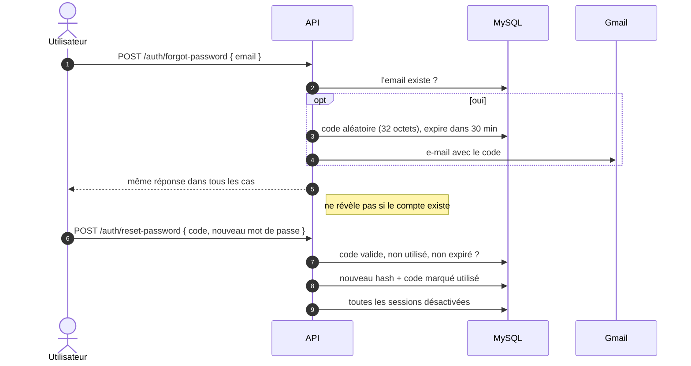

Les deux routes sont limitées (5 demandes / heure, 10 codes invalides / 15 min par adresse IP,
réponse 429) : voir *Limite des essais de connexion* en [§7.1](#71-connexion-session-et-déconnexion).

### 7.3 Création d'un dossier étudiant (Accueil)

1. L'Accueil remplit le formulaire : identité, e-mail, mot de passe initial, photo et pièces
   justificatives (photos, certificat de résidence, copie de CIN).
2. `POST /etudiants` (multipart) : `multer` enregistre les fichiers (types autorisés : images,
   PDF, Office, texte ; taille limitée).
3. Le service crée **dans une même transaction** le compte `utilisateur` et le profil `etudiant`.
4. Le rôle **Étudiant** est imposé par le serveur.

> **Ce qui a changé.** Le rôle était lu depuis le formulaire (`id_role`) : un compte Accueil
> pouvait ainsi créer un Super Admin. La modification d'un dossier ne vide plus les champs
> non envoyés.

### 7.4 Inscription à une formation et génération de l'échéancier

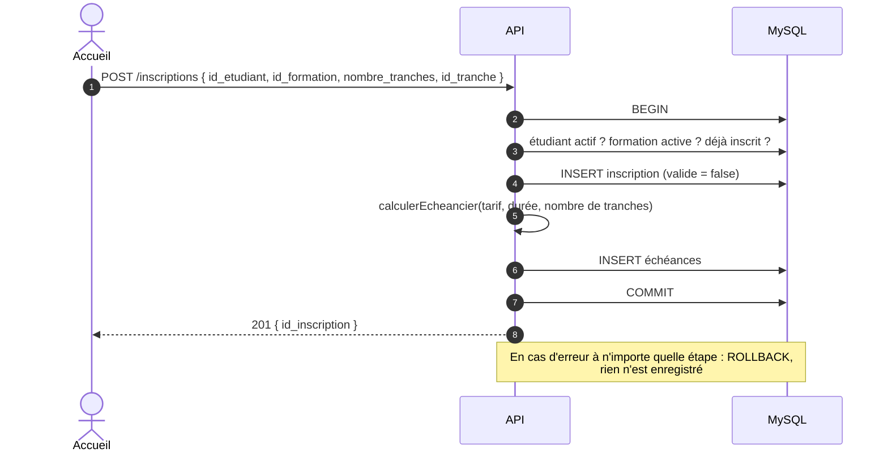

**Règle de calcul de l'échéancier** (`services/echeanceService.js → calculerEcheancier`) :

- montant d'une tranche = tarif ÷ nombre de tranches, arrondi au centime ;
- la **dernière tranche absorbe l'écart d'arrondi** : la somme est toujours exactement égale au tarif ;
- échéance n° *n* = date du jour + *n* × (durée de la formation en jours ÷ nombre de tranches).

*Exemple :* formation à 100 000 MGA sur 90 jours en 3 tranches :

| Tranche | Montant | Date |
|---|---|---|
| 1 | 33 333,33 | J + 30 |
| 2 | 33 333,33 | J + 60 |
| 3 | 33 333,34 | J + 90 |
| **Total** | **100 000,00** | |

> **Ce qui a changé.** L'inscription était créée hors de la transaction de l'échéancier
> (risque d'inscription sans échéances) et l'arrondi faisait perdre des centimes.
> Le calcul est désormais une fonction pure, couverte par des tests automatisés.

### 7.5 Validation de l'inscription et premier paiement

1. L'Accueil clique sur *Valider* et choisit le mode de paiement (espèces, virement…).
2. `POST /inscriptions/:id/valid` : dans **une transaction**, l'inscription passe à
   `valide = true` **et** le paiement de la première échéance est enregistré (statut `valide`).
3. Une inscription déjà validée est refusée (409) : impossible de payer deux fois la première échéance.
4. Le web envoie la confirmation à l'étudiant (notification in-app + e-mail).

### 7.6 Paiement d'une échéance par l'étudiant (mobile) → validation par l'Accueil

C'est le flux qui a le plus évolué pendant la revue.

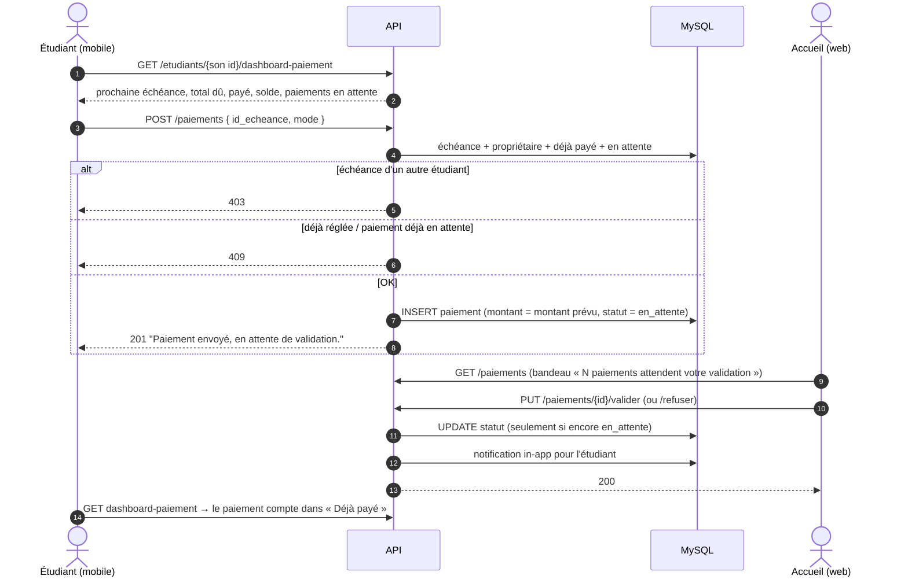

**Cycle de vie d'un paiement :**

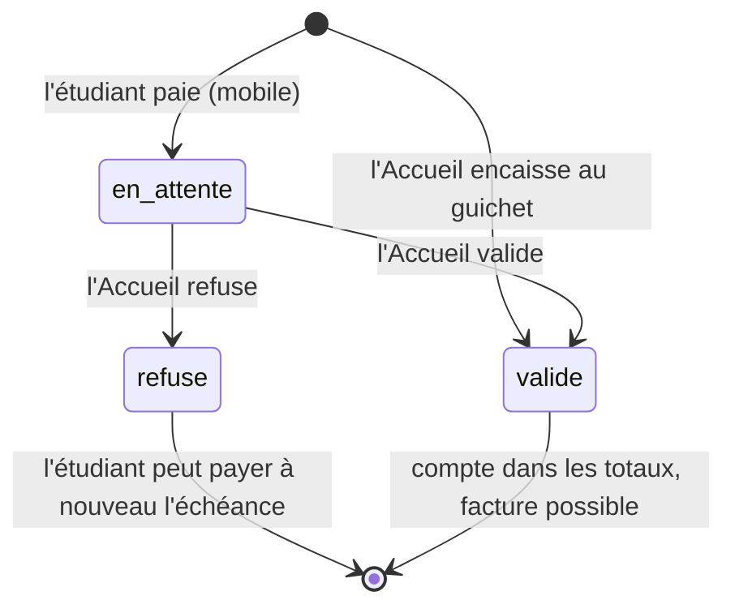

**Règles métier :**

| Règle | Étudiant | Accueil / Super Admin |
|---|---|---|
| Sur quelle échéance ? | Uniquement **la sienne** | Toutes |
| Montant | **Imposé** par le serveur (montant prévu) | Libre, paiement partiel autorisé, **plafonné au reste à payer** |
| Statut créé | `en_attente` | `valide` |
| Double paiement | Refusé si un paiement est déjà en attente | Refusé si l'échéance est soldée |

**Seuls les paiements `valide`** sont pris en compte dans : le total payé et le solde de
l'étudiant, la vue des échéances (Vert / Orange / Rouge), les indicateurs du tableau de bord
et la génération des factures.

> **Ce qui a changé.** Avant, un étudiant pouvait enregistrer lui-même un paiement **déjà
> validé**, avec **le montant de son choix**, et sur **n'importe quelle échéance** ; il pouvait
> aussi lister les paiements de tous les étudiants. Ajout de la colonne `paiement.statut`, des
> routes de validation/refus, de la section « En attente de validation » sur le mobile et des
> boutons Valider / Refuser sur le web.

### 7.7 Suivi des échéances et rappels de paiement

La page *Échéances* calcule pour chaque échéance le montant payé (paiements validés), le reste
et une couleur :

| Couleur | Condition |
|---|---|
| 🟢 VERT « À jour » | Payée (paiement envoyé, même en attente de validation), ou date d'échéance encore loin (plus de 2 jours) |
| 🟡 JAUNE « À rappeler » | Non soldée, à J-2, J-1 ou le jour J → **le système notifie l'Accueil** |
| 🔴 ROUGE « En retard » | Date dépassée et non soldée |

Le rappel se fait **en deux temps** : le système prévient l'Accueil, puis l'Accueil décide d'envoyer
le rappel à l'étudiant.

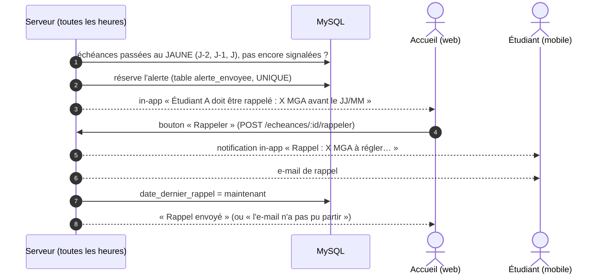

Un paiement **envoyé** par l'étudiant compte dès son envoi pour la couleur, les alertes et le critère
« paie à temps » : l'étudiant n'est ni en retard, ni signalé, ni rappelé pendant que l'Accueil le
valide (mention « Payé, à valider » sur la page Échéances). Les **montants encaissés** (totaux,
reste à payer, tableau de bord, factures) ne comptent, eux, que les paiements **validés**.

Le bouton **« Rappeler »** est disponible sur toute échéance non soldée (mis en évidence en JAUNE
et ROUGE) ; le bouton « Rappeler » du tableau de bord mène à la page Échéances.

> **Ce qui a changé.** Avant, la page Échéances envoyait **automatiquement** une relance à chaque
> fois qu'un membre de l'Accueil l'ouvrait (l'étudiant pouvait recevoir plusieurs e-mails par jour),
> et les statuts mélangeaient VERT / ORANGE (jour J seulement) / « À relancer bientôt » (J-2 seulement).
> Désormais : 3 couleurs claires, une seule règle pour le statut et l'alerte (`ECHEANCE_PROCHE` dans
> `models/echeanceModel.js`), alerte unique à l'Accueil, puis envoi volontaire avec « Rappeler ».

### 7.8 Documents officiels

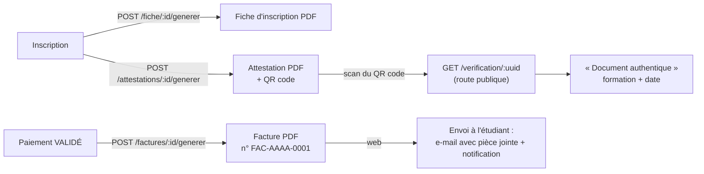

- Les PDF sont générés par `pdfkit` et enregistrés dans `uploads/documents/`.
- L'attestation contient un **identifiant unique (UUID)** et un QR code ; n'importe qui (un
  employeur par exemple) peut vérifier son authenticité sans compte.
- Une facture ne peut être émise que pour un paiement **validé**.
- **Attestation de fin de formation** : quand la formation est terminée (date d'inscription + durée
  en jours), le système prévient l'Accueil « Étudiant A a fini sa formation, envoyez-lui son
  attestation ». L'Accueil clique sur **« Attestation »** (page Inscriptions) : la note est
  recalculée, le PDF est généré avec la ligne « Note obtenue : X / 20 », puis envoyé à l'étudiant
  (notification in-app + e-mail avec le PDF en pièce jointe).
- Les PDF sont maintenant écrits **entièrement** avant d'être renvoyés ou envoyés par e-mail
  (correction d'un risque de pièce jointe incomplète).

### 7.9 Supports de cours, commentaires, mentions et réactions

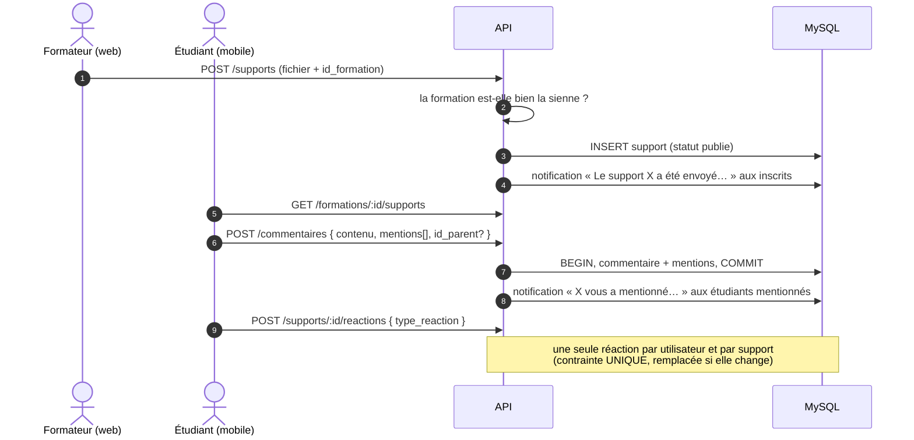

**Modération :** le Super Admin peut supprimer tout commentaire, un formateur ceux des
supports de ses formations, un étudiant uniquement les siens.

> **Ce qui a changé.** Un formateur pouvait publier dans n'importe quelle formation et
> supprimer les supports des autres. Les notifications de mention ne partaient jamais (bug) :
> elles fonctionnent et sont envoyées après l'enregistrement définitif du commentaire.

L'envoi d'un support peut aussi être **programmé** : voir [6.15](#615-envoi-programmé-des-supports).
Fil de discussion (réponses), réaction 👎 et avis sur les formateurs : voir [6.16](#616-fil-de-discussion-réaction--je-naime-pas--et-avis-sur-les-formateurs).

### 7.10 Notifications

| Événement | Étudiant (mobile) | Accueil / Super Admin (web) | Déclenchement |
|---|---|---|---|
| Inscription confirmée | in-app + e-mail | — | Accueil valide l'inscription |
| Paiement envoyé depuis le mobile | — | in-app « Étudiant A a payé X MGA… à valider » | automatique |
| Paiement validé / refusé | in-app | — | Accueil valide / refuse |
| Échéance passée au JAUNE (J-2) | — | in-app « Étudiant A doit être rappelé » | automatique (toutes les heures) |
| Rappel de paiement | in-app + e-mail | — | bouton « Rappeler » |
| Facture | in-app + e-mail (PDF) | — | Accueil génère la facture |
| Formation terminée | — | in-app « Étudiant A a fini sa formation, envoyez-lui son attestation » | automatique |
| Attestation | in-app + e-mail (PDF avec la note) | — | bouton « Attestation » |
| Mention dans un commentaire | in-app | — | automatique |
| Nouvelle demande d'assistance | — | in-app « Étudiant A a envoyé une demande d'assistance » | automatique |
| Demande d'assistance résolue | in-app | — | bouton « Résoudre » |

- Les notifications « personnel » sont envoyées à **tous** les comptes Accueil et Super Admin actifs.
- Si l'e-mail ne peut pas partir, la notification in-app est quand même envoyée et l'interface le signale.
- Chaque utilisateur ne voit, ne marque comme lues et ne supprime **que ses propres** notifications.
- Le web et le mobile déduisent la catégorie (Paiement, Attestation, Assistance…) du texte du message
  pour choisir l'icône et la couleur.

### 7.11 Tableau de bord (Super Admin, Accueil)

| Indicateur | Calcul |
|---|---|
| Montant encaissé | Somme des paiements **validés** |
| Reste à encaisser | Somme des échéances − montant encaissé |
| Paiements en retard | Échéances dépassées dont la **somme** des paiements validés est inférieure au montant prévu |
| Évolution | Encaissements par jour (semaine), mois ou année |
| Inscriptions par mois, top des formations | Statistiques d'inscription |
| Export CSV | Export des inscriptions |

### 7.12 Assistance

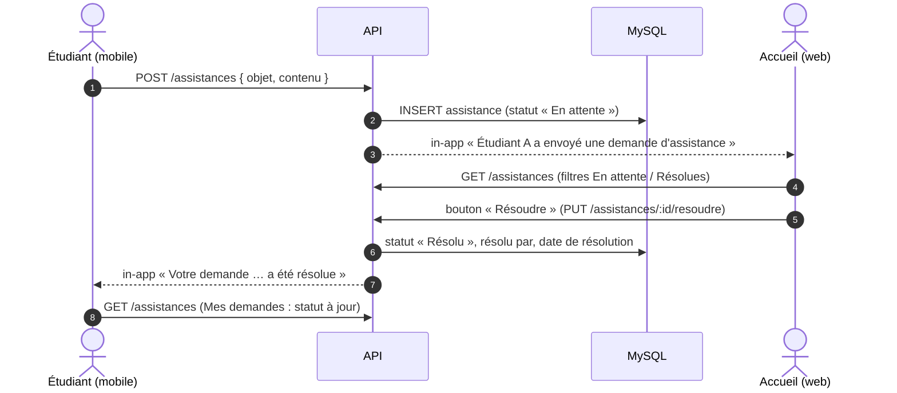

- Sur le mobile : menu ⋮ → **Assistance** : formulaire + liste « Mes demandes » avec leur statut.
- Sur le web : page **Assistance** (Accueil, Super Admin) : liste, détail, bouton **Résoudre**.
- Une demande déjà résolue ne peut pas l'être à nouveau (409).

### 7.13 Présence, classement et note d'attestation

Objectif : noter l'étudiant **sur 20** à la fin de sa formation. La moitié de la note est
calculée par le système à partir de deux critères objectifs (**paiement** et **présence**),
l'autre moitié est donnée librement par le formateur (**présentation**).

> Évolution (10/10/2026) : l'ancien barème (commentaires, réactions, paiement → 14 à 19) est
> remplacé par celui-ci. Les commentaires et réactions ne comptent plus dans la note.

#### a) Présence automatique

Il n'y a pas d'appel à faire : **un étudiant qui utilise l'application un jour est présent ce
jour-là**. À chaque requête authentifiée d'un étudiant, le serveur enregistre une ligne
`(étudiant, jour)` dans la table `presence` (une seule par jour : contrainte `UNIQUE`).

Pourquoi une table `presence` plutôt que la table `sessions` ? Une session n'est créée qu'à la
**connexion** et reste valable 24 h : un étudiant qui se connecte lundi à 18 h et rouvre
l'application mardi matin ne crée pas de nouvelle session, il ne serait donc pas compté présent
mardi. L'historique des sessions a été repris dans `presence` lors de la migration.

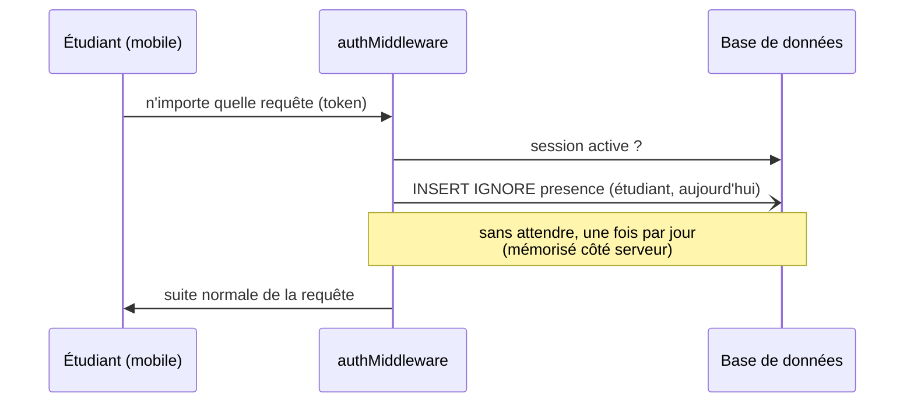

#### b) Jours de cours

La formation commence à la **date d'inscription** et dure `duree_jours` jours. Seuls les jours
**du lundi au vendredi** comptent (week-ends retirés), aussi bien pour les jours de cours que
pour les présences.

Les week-ends sont comptés **sur les vraies dates** et non par une estimation : 3 mois ne font pas
exactement 4 semaines × 3 = 12 semaines, mais environ 12,9 semaines.

| Exemple : formation de 90 jours commençant un lundi | Jours |
|---|:-:|
| Jours calendaires | 90 |
| Week-ends (12 semaines complètes × 2 + 1 samedi) | 25 |
| **Jours de cours** | **65** |
| Moitié des jours de cours | 32,5 |
| Jours de cours jusqu'à 2 semaines (14 jours) avant la fin | 55 |

(L'estimation 90 − 2 × 4 × 3 = 66 donne un jour de trop ; selon le jour de début, il y a 25 ou 26
jours de week-end dans 90 jours.)

#### c) Barème

| Partie | Condition | Points |
|---|---|:-:|
| **Paiement** | régulier : aucune échéance déjà due impayée ou payée après sa date (**date d'envoi** du paiement, même en attente de validation ; refusé = ignoré) | **5** |
| | sinon | **2** |
| **Présence** | moins de la moitié des jours de cours | **+2** |
| | au moins la moitié, mais pas présent jusqu'à 2 semaines avant la fin | **+3** |
| | présent au moins autant de jours que les jours de cours jusqu'à 2 semaines avant la fin | **+5** |
| = **Note système** | calculée, sur 10 (de 4 à 10) | **/10** |
| **Présentation** | libre, donnée par le formateur | **/10** |
| = **Note d'attestation** | note système + présentation | **/20** |

Si le formateur saisit plus de 10, le système refuse : *« Vous devez attribuer une note de 10 au
maximum : les 10 autres points sont calculés par le système (paiement et présence). »*

**Classement :** par note système, puis par nombre de présences. Des étudiants à égalité
partagent le même rang.

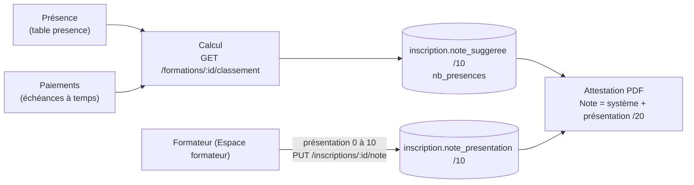

- La note système est recalculée à chaque consultation et juste avant la génération d'une
  attestation ; elle est **enregistrée en base**.
- L'attestation **ne peut pas être générée** tant que le formateur n'a pas noté la présentation
  (erreur 409 avec un message clair).
- Dans l'Espace formateur, le tableau affiche pour chaque étudiant : rang, jours présents / jours
  de cours, points de paiement et de présence, note système, saisie de la présentation
  (bouton **Effacer** pour la retirer) et note finale sur 20.
- Un formateur ne voit et ne note que les étudiants **de ses formations**.

### 7.14 Consultation sécurisée des documents

Objectif : les documents d'IMTECH (supports de cours, documents administratifs, pièces des
étudiants) ne doivent être lisibles **que par les personnes autorisées**, et une fuite hors
d'IMTECH doit être **difficile et traçable**.

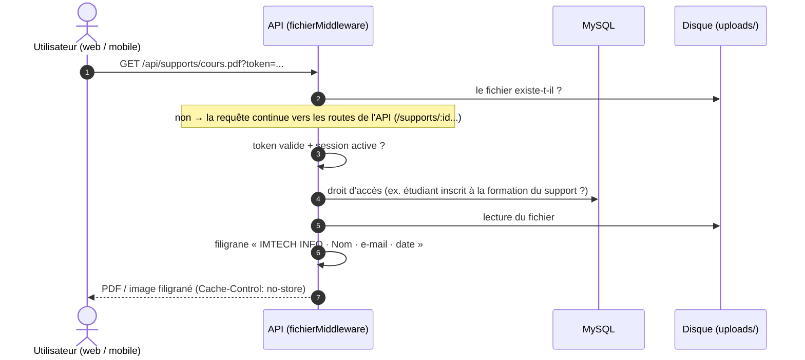

**1. Accès protégé.** Les fichiers ne sont plus servis en statique : `middlewares/fichierMiddleware.js`
garde les mêmes URL (`/api/supports/...`, `/api/documents/...`) mais exige d'être connecté.
Le token peut être passé dans l'URL (`?token=...`), car un lien, une image ou une WebView ne
peuvent pas envoyer l'en-tête `Authorization`. Les fonctions `getFileUrl` / `fileUrl` (web et
mobile) l'ajoutent automatiquement. Un lien copié ne marche plus après la déconnexion.

| Dossier | Qui peut ouvrir le fichier | Filigrane |
|---|---|:-:|
| `supports/` | Personnel et formateurs ; un **étudiant uniquement s'il est inscrit** à la formation du support | Oui |
| `documents/` | Super Admin, Accueil, Formateur | Oui, sauf fiches, factures et attestations générées par IMTECH (documents officiels remis à l'étudiant) |
| `etudiants/` (CIN, certificats, photos) | Super Admin, Accueil ; l'étudiant pour **ses propres** pièces | Oui |
| `utilisateurs/` (photos de profil) | Tout utilisateur connecté | Non |

**2. Filigrane dynamique** (`utils/filigrane.js`). Au moment où le fichier est envoyé, le serveur
écrit en diagonale, sur toute la page, le nom, l'e-mail de la personne qui consulte et la date.
Le fichier sur le disque n'est jamais modifié. Si une capture ou une photo circule hors
d'IMTECH, on sait d'où elle vient. C'est la seule protection qui fonctionne aussi contre une
photo de l'écran prise avec un autre téléphone.

**3. Formats des supports.** Un support doit être un **PDF ou une image** (PNG, JPEG, WEBP, GIF) :
ce sont les formats que l'on sait filigraner et afficher dans le lecteur sécurisé. Un autre
format est refusé à l'upload (400).

**4. Lecteur sécurisé sur le mobile** (`app/lecteur.tsx`). Le support s'ouvre **dans l'application**
(WebView) et non plus dans le navigateur externe, qui permettait de le télécharger :
- PDF affiché page par page avec pdf.js, image affichée directement ;
- le fond autour du document suit le thème clair / sombre de l'application (couleur passée à la page HTML du lecteur) ;
- pas de téléchargement, pas d'appui long « Enregistrer l'image », pas de navigation vers une autre page ;
- **captures d'écran et enregistrements vidéo bloqués** tant que le lecteur est ouvert
  (`usePreventScreenCapture`) : écran noir sur Android, bloqué sur iOS 13+ ;
- aucun cache : rien n'est conservé sur le téléphone après la lecture.
- dans la version navigateur de l'app mobile (Expo web, utilisée pour le développement), la WebView
  n'existe pas : le lecteur passe par une `<iframe>`, et les captures ne peuvent pas y être bloquées.

**Pas de consultation hors ligne** pour l'instant : elle demanderait de stocker le fichier sur
le téléphone (chiffré, dans un lecteur natif), ce qui est prévu en perspective ([§13](#12-limites-et-perspectives)).

> **Ce qui a changé.** Avant, `express.static` servait tous les fichiers uploadés **sans
> authentification** : il suffisait de connaître l'URL d'une copie de CIN ou d'un support pour
> la télécharger, même sans compte. Sur le mobile, les supports s'ouvraient dans le navigateur,
> d'où l'étudiant pouvait les enregistrer et les partager.

### 7.15 Envoi programmé des supports

Objectif : le formateur prépare un support à l'avance et choisit l'heure à laquelle il sera
envoyé. Les étudiants sont **prévenus une heure avant** pour se préparer.

*Ajouté le 10/10/2026.*

**Cycle de vie d'un support**

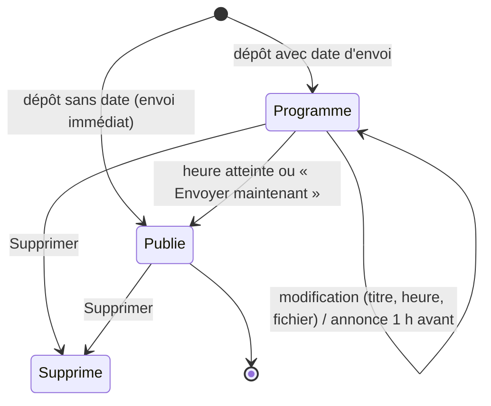

- **Programmé** (`support.statut = 'programme'`) = **brouillon** : invisible pour les étudiants
  (liste, détail, fichier, commentaires, réactions). Le formateur le voit dans le panneau
  « Supports programmés » de son espace et peut le **modifier** (titre, heure, fichier),
  l'**envoyer maintenant** ou le **supprimer**.
- **Publié** (`'publie'`) : visible par les étudiants inscrits ; il ne peut plus être modifié (409).

**Planificateur.** Au démarrage du serveur puis **chaque minute**, `supportProgrammeService`
vérifie les supports programmés :

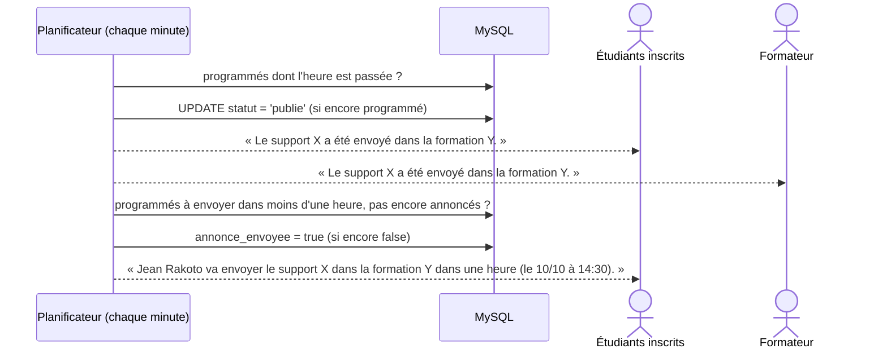

| Notification | Quand | Destinataires |
|---|---|---|
| « *Formateur* va envoyer le support « X » dans la formation Y **dans une heure** (le … à …) » | 1 h avant l'heure prévue (ou dès la programmation si l'envoi est dans moins d'une heure : « dans 20 minutes ») | Étudiants inscrits |
| « Le support « X » a été envoyé dans la formation Y. » | À l'envoi automatique | Étudiants inscrits **et** formateur |
| Même message | Envoi immédiat ou « Envoyer maintenant » | Étudiants inscrits |

- **Pas de doublon** : l'annonce et l'envoi sont « réservés » par un `UPDATE ... WHERE` qui ne
  réussit qu'une seule fois, même si deux vérifications se chevauchent.
- **Heure modifiée** après l'annonce : l'annonce repart avec la nouvelle heure.
- L'heure saisie dans le navigateur est convertie en **ISO (UTC)** avant l'envoi : le serveur
  reçoit l'instant exact, quel que soit son fuseau.
- Si le serveur était arrêté à l'heure prévue, le support part à la **première vérification**
  après le redémarrage.

### 7.16 Fil de discussion, réaction « Je n'aime pas » et avis sur les formateurs

*Ajouté le 10/10/2026.*

#### a) Commentaires en fil de discussion

Les commentaires d'un support s'affichent **comme sur les réseaux sociaux** : un commentaire
principal, et en dessous un lien « **Voir les N réponses** » qui déplie les réponses liées.

- `commentaire.id_parent` : `NULL` pour un commentaire principal, sinon l'id du commentaire
  principal auquel il répond.
- **Un seul niveau** de réponses : répondre à une réponse la rattache au même commentaire
  principal, avec « @Prénom Nom » pré-rempli (comme Facebook).
- L'API renvoie directement le fil : commentaires principaux **du plus récent au plus ancien**,
  chacun avec `reponses` (dans l'ordre chronologique) et `nb_reponses`.
- Web : 3 commentaires principaux affichés, puis « **Voir plus de commentaires** » ; les
  réponses sont repliées par défaut. Mobile : réponses repliées, bandeau « Réponse à X » au-dessus
  du champ de saisie (croix pour annuler).
- L'auteur du commentaire reçoit une notification « *X* a répondu à votre commentaire sur le
  support … ».
- Supprimer un commentaire principal supprime aussi ses réponses (elles ne s'affichent plus).

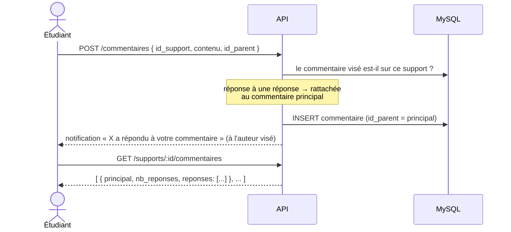

#### b) Réaction « Je n'aime pas » (👎)

Quatrième type de réaction (`type_reaction.nom = 'dislike'`), à côté de 👍 J'aime, ❤️ J'adore
et 💡 Utile. Les applications envoient désormais le **nom** du type (`{ type_reaction: 'dislike' }`)
plutôt que son id, qui pouvait varier d'une base à l'autre. On ne peut réagir qu'à un support
**publié**.

#### c) Avis des étudiants sur les formateurs (back-office)

Sur le **tableau de bord** (Super Admin, Accueil), le panneau « Avis des étudiants sur les
formateurs » liste chaque formateur avec les réactions reçues sur ses supports publiés.

| Indicateur | Calcul |
|---|---|
| Réactions positives | 👍 + ❤️ + 💡 |
| Réactions négatives | 👎 |
| % positif | positives / (positives + négatives) |
| **Compétent** | au moins **5 réactions** et au moins **60 %** de positives |
| **Non compétent** | au moins 5 réactions et moins de 60 % de positives |
| **Pas assez d'avis** | moins de 5 réactions : on ne conclut pas |

Présentation (même tableau que la page Paiements, composants communs `Tableau` et `SearchFilterBar`) :

| Colonne | Contenu |
|---|---|
| # | Rang dans le classement affiché |
| Formateur | Photo, nom, nombre de supports publiés |
| Réactions | Pastilles 👍 ❤️ 💡 👎 avec leur nombre (👎 en rouge) |
| Total | Nombre total de réactions |
| Positif | Barre de progression + % (vert ≥ 60 %, orange ≥ 40 %, rouge en dessous) |
| Avis | Badge Compétent (vert) / Non compétent (rouge) / Pas assez d'avis (gris) |

- Tri par défaut : compétents, puis non compétents, puis pas assez d'avis (à avis égal : meilleur %).
- Barre au-dessus du tableau : recherche d'un formateur, filtre par avis, tri par type de réaction
  (👍, ❤️, 💡, 👎), par % positif, par nombre de réactions ou de supports ; bouton Réinitialiser.
- Les seuils sont des constantes (`AVIS_MINIMUM`, `TAUX_COMPETENT` dans `services/reactionService.js`).

### 7.17 Vitrine publique et inscription en ligne

*Ajouté le 10/10/2026.*

Objectif : une personne **non inscrite** qui ouvre l'application mobile découvre l'offre
d'IMTECH INFO (comme la page d'accueil de Wattpad) et peut s'inscrire seule, à une ou plusieurs
formations. L'inscription suit **la même méthode que l'Accueil** : compte, inscription +
échéancier, premier paiement, puis **validation par l'Accueil**.

#### a) La vitrine (`app/decouvrir.tsx`, sans connexion)

C'est le premier écran de l'application quand personne n'est connecté (lien « Se connecter »
en haut ; l'écran de connexion renvoie aussi vers la vitrine).

| Bloc | Contenu | Source |
|---|---|---|
| Bandeau | Logo, slogan, présentation, nombre de formations et de formateurs reconnus | `config/vitrine.js` (.env) |
| Formations disponibles | Couvertures colorées en carrousel : nom, formateur, tarif, badge « Formateur compétent » ; « + » pour en choisir plusieurs | `GET /public/vitrine` |
| Fiche d'une formation | Description, formateur et % d'avis positifs, durée, tarif, **engagement de disponibilité du formateur** ; boutons « Ajouter à ma sélection » et « S'inscrire » | `formation.engagement_formateur` (saisi dans le back-office) |
| Formateurs les mieux notés | Formateurs jugés **compétents** (voir 7.16) et leurs formations | `reactionService.avisFormateurs` |
| Notre engagement | Disponibilité, supports dans l'app, attestation vérifiable, paiement en tranches | texte fixe |
| Nous contacter | Facebook, e-mail, WhatsApp (ouverts dans l'application correspondante) | `.env` : `IMTECH_FACEBOOK_URL`, `IMTECH_EMAIL`, `IMTECH_WHATSAPP`... |

Aucune donnée personnelle d'étudiant n'est exposée (seulement le nombre d'inscrits).

#### b) L'inscription en ligne (une ou plusieurs formations)

```mermaid
sequenceDiagram
    actor V as Visiteur (mobile)
    participant API
    participant DB as MySQL
    actor A as Accueil (web)
    V->>API: POST /public/inscriptions { identité, mot de passe, formations[], mode, référence }
    API->>API: formulaire valide ? e-mail libre ? (5 essais / heure / appareil)
    API->>DB: BEGIN
    API->>DB: compte utilisateur + dossier étudiant
    loop pour chaque formation choisie
        API->>DB: inscription (origine en_ligne, non validée) + échéancier (même fonction que l'Accueil)
        API->>DB: premier paiement EN ATTENTE (montant de la 1re échéance)
    end
    API->>DB: COMMIT (tout ou rien)
    API-->>A: notification « Nouvelle inscription en ligne… »
    API-->>V: « Inscription envoyée » + total à payer ; il peut se connecter
    A->>API: Inscriptions → filtre « En ligne » → Valider (pour CHAQUE inscription)
    API->>DB: inscription validée + paiement déclaré validé (pas de second paiement)
```

- **Même fonction que l'Accueil** : `inscriptionService.creerInscriptionDans` (inscription +
  échéancier) est appelée en boucle, une fois par formation, dans une seule transaction.
- **Chaque inscription est validée séparément** par l'Accueil (bouton « Valider » habituel).
  À la validation, le paiement déclaré est validé (mode et référence corrigeables) au lieu
  d'enregistrer un second paiement.
- **Compte créé tout de suite** : l'étudiant peut se connecter (e-mail pré-rempli) ; ses
  formations affichent « En attente de validation par l'accueil » et **les fichiers des supports
  ne s'ouvrent qu'après la validation**.
- Les pièces du dossier (CIN, certificat de résidence, photos) ne sont pas demandées en ligne :
  l'Accueil les complète lors de la validation.
- Une même formation choisie deux fois ne compte qu'une fois ; 1 à 4 tranches par formation ;
  mot de passe de 8 caractères minimum ; e-mail déjà utilisé → 409.

#### c) Images de la vitrine

*Ajouté le 11/10/2026.*

- Le bandeau du haut affiche le titre **« Découvrir »** sur une image de réseau de neurones
  (`mobile/assets/images/fond-decouvrir.jpg`, embarquée dans l'application), sous un voile bleu
  nuit qui garde le texte lisible. Il remplit tout le haut de l'écran, barre d'état comprise.
- **Fond modifiable par le Super Admin** : web, Paramètres > Apparence > « Fond de la vitrine
  mobile » → `PUT /vitrine/fond` (image enregistrée dans `uploads/vitrine/`, chemin gardé dans la
  table `parametre_application`, clé `fond_vitrine`). « Par défaut » → `DELETE /vitrine/fond`.
  `GET /public/vitrine` renvoie ce chemin dans `presentation.fond` ; l'application mobile l'affiche,
  ou l'image embarquée si `fond` est `null`. Contrairement au logo du web (gardé dans le navigateur),
  le fond est stocké sur le serveur, car c'est l'application mobile qui l'affiche.
- Chaque formation a une **photo de couverture** : colonne `formation.image`
  (`formations/xxx.jpg` dans `uploads/`). Le Super Admin la choisit dans le formulaire de la
  formation (web) → `PUT /formations/:id/image`. Sans image, la couverture reste une couleur avec
  les initiales.
- Les couvertures sont **publiques** : la vitrine est consultée sans connexion, le dossier
  `uploads/formations` (et `uploads/vitrine` pour le fond) est donc servi sans token ni filigrane
  (contrairement aux supports et documents).
- Images de démonstration : photos libres de droits de Wikimedia Commons, téléchargées et
  recadrées par `node scripts/fichiersDemo.js`.

| Image | Fichier Wikimedia Commons | Auteur | Licence |
|---|---|---|---|
| Fond « Découvrir » (`mobile/assets/images/fond-decouvrir.jpg`) | Neural network - Midjourney and Grok.png | Midjourney (prompt suggéré par Grok) | Domaine public |
| Développement web | Colorful code (Unsplash).jpg | Markus Spiske | CC0 |
| Bureautique | Working in open office space (Unsplash).jpg | Crew | CC0 |
| Réseaux informatiques | EthernetSwitch.jpg | Raysonho (Open Grid Scheduler) | CC0 |
| Infographie | Math tools utensils (Unsplash).jpg | Jazmin Quaynor | CC0 |
| Python pour débutants | Laptop coding programs (Unsplash).jpg | Tirza van Dijk | CC0 |
| Excel avancé | Desktop with laptop and calculator (Unsplash).jpg | Auteur inconnu | CC0 |

### 7.18 Supports mis en forme : texte riche, audio, vidéo et liens

*Ajouté le 11/10/2026.*

Objectif : le formateur publie un support comme dans un petit CMS. Un support contient un
**titre**, et au choix un **texte mis en forme**, une **pièce jointe** (PDF, image, audio, vidéo),
ou les deux. L'envoi immédiat ou programmé ([§7.15](#615-envoi-programmé-des-supports)), les
commentaires et les réactions ne changent pas.

#### Recherche globale (web et mobile)

Dans la barre du haut de chaque page : bouton **Rechercher…** (ou **Ctrl+K**). Une fenêtre cherche à
la fois dans les **pages du menu** (sur place) et dans les données (`GET /recherche`, selon le rôle).
↑ ↓ pour choisir, Entrée pour ouvrir. Un résultat ouvre directement la bonne fiche : étudiant,
formation, inscription, compte utilisateur ; pour le formateur, son espace avec la fenêtre des
étudiants de la formation, ou la page Supports filtrée sur le support trouvé. Chaque fiche ayant
sa propre adresse ([§7.19](#719-fiches-dans-lurl-web)), ouvrir un résultat revient à aller à
cette adresse (`navigate(cheminResultat(resultat, role))`).

**Sur le mobile (étudiant)**, *ajouté le 11/10/2026* : la loupe 🔍 de l'Accueil et de l'en-tête de
chaque écran (`DetailHeader`) ouvre une fenêtre plein écran. Elle cherche :

| Groupe | Où | Règle | Un toucher ouvre |
|---|---|---|---|
| Écrans | Sur place (sans serveur), sans tenir compte des accents | Titre et mots-clés (« payer » → Paiements, « theme » → Paramètres) | L'écran |
| Mes formations | `GET /recherche` | Formations où l'étudiant a une inscription active, avec « En attente de validation » si l'Accueil ne l'a pas encore validée | Détail de la formation |
| Supports de cours | `GET /recherche` | Titre ou texte des supports **publiés** des formations dont l'inscription est **validée** (mêmes droits que la lecture des fichiers, [§7.14](#714-consultation-sécurisée-des-documents)) ; type (PDF, vidéo…), formation et date affichés | Fiche du support |

Comme sur le web : 2 caractères minimum, requête 250 ms après la dernière frappe, réponse
dépassée ignorée (`hooks/use-recherche.ts`), 5 résultats par groupe. Un étudiant sans fiche
étudiant ne reçoit rien, et il ne voit jamais les groupes du personnel (étudiants, inscriptions,
comptes).

#### a) Rédaction (web, page « Supports » du formateur)

Le menu du formateur sépare trois pages : **Espace formateur** (formations, étudiants en fenêtre,
classement et notes d'attestation), **Supports** (publication + supports publiés avec recherche,
filtres et tri) et **Supports programmés** (brouillons en attente d'envoi).

1. Le formateur choisit la formation et saisit le titre.
2. Il rédige dans l'éditeur (`components/editeur/EditeurTexte.jsx`) : **gras**, *italique*,
   souligné, barré, titre / sous-titre, listes à puces ou numérotées, citation, **lien** (sur le
   texte sélectionné ; `www.site.com` devient `https://www.site.com`).
3. Il joint éventuellement un fichier (50 Mo max) : PDF, image, audio (MP3, M4A, OGG, WAV) ou
   vidéo (MP4, WEBM, MOV).
4. Le formulaire envoie `titre`, `contenu` (le HTML de l'éditeur) et `fichier` à `POST /supports`.
   Un brouillon programmé se modifie de la même façon (`PUT /supports/:id`).

#### b) Contrôles du serveur

```
contenu (HTML du navigateur)
   │  utils/contenuRiche.js — sanitize-html, liste blanche
   ▼
<p> <br> <strong> <em> <u> <s> <h2> <h3> <ul> <ol> <li> <blockquote> <a href="http(s)|mailto">
   │  tout le reste supprimé (script, style, attributs on*, images, iframes, javascript:...)
   ▼
support.contenu (MEDIUMTEXT)   ← HTML toujours propre en base
```

- Il faut un texte **ou** un fichier ; sans fichier, le titre est obligatoire. Un texte vide
  laissé par l'éditeur (`<p><br></p>`) compte comme « pas de texte ».
- Un brouillon sans fichier ne peut pas perdre son texte.
- Pourquoi nettoyer côté serveur : le texte est affiché chez **tous** les étudiants de la
  formation. Sans liste blanche, un `<script>` glissé dans le texte (formateur malveillant ou
  compte volé) s'exécuterait chez eux (faille **XSS**) et pourrait voler leur session.

#### c) Lecture

| | Web (`SupportItem` → `ContenuSupport`) | Mobile (détail du support) |
|---|---|---|
| Texte | HTML injecté tel quel (déjà nettoyé) | `TexteRiche` : balises converties en composants natifs `<Text>` / `<View>` |
| Liens | Nouvel onglet, `rel="noopener noreferrer"` | Ouverts dans le navigateur (`Linking`), http(s) / mailto seulement |
| Audio / vidéo | Lecteur intégré, sans bouton « Télécharger » ni clic droit | Lecteur sécurisé (`app/lecteur.tsx`) : lecteur HTML5 dans la WebView, captures bloquées |
| PDF / image | Inchangé (lien, fichier filigrané) | Inchangé (lecteur sécurisé, filigrane) |

Les fichiers audio / vidéo passent par le même contrôle d'accès que les autres supports
([§7.14](#614-consultation-sécurisée-des-documents)) mais **sans filigrane** (impossible à
ajouter à la volée) ; le serveur les sert par morceaux (`Range`) pour permettre d'avancer dans
la lecture. Dans la liste des documents (web), un support texte seul n'apparaît pas (pas de fichier).

### 7.19 Fiches dans l'URL (web)

*Ajouté le 11/10/2026.*

Objectif : chaque vue du back-office a **sa propre adresse**. Un rechargement (F5) garde la fiche
ouverte, le bouton « Précédent » du navigateur revient à la vue d'avant, et un lien vers une fiche
peut être envoyé à un collègue.

| Section | Liste | Fiche | Création | Modification |
|---|---|---|---|---|
| Étudiants | `/dashboard/etudiants` | `/dashboard/etudiants/12` | `/dashboard/etudiants/nouveau` | `/dashboard/etudiants/12/modifier` |
| Formations | `/dashboard/formations` | `/dashboard/formations/3` | `/dashboard/formations/nouvelle` | `/dashboard/formations/3/modifier` |
| Inscriptions | `/dashboard/inscriptions` | `/dashboard/inscriptions/40` | `/dashboard/inscriptions/nouvelle` | — |
| Utilisateurs (SA) | `/dashboard/utilisateurs` | — | `/dashboard/utilisateurs/nouveau` | `/dashboard/utilisateurs/5/modifier` |

```mermaid
flowchart LR
    URL["/dashboard/etudiants/12"] --> DL["DashboardLayout<br/>route etudiants/*"]
    DL -->|"pageAutorisee : le rôle a-t-il ce menu ?"| SR["EtudiantsRoutes<br/>(SectionsRoutes.jsx)"]
    DL -->|non| TB["retour au tableau de bord"]
    SR -->|":id numérique"| F["EtudiantDetail<br/>studentId = 12"]
    SR -->|"id invalide (abc) ou chemin inconnu"| L["liste /dashboard/etudiants"]
    F -->|"GET /etudiants/12"| API[(API)]
```

Déroulement :
1. `DashboardLayout` déclare une route par section (`etudiants/*`, `formations/*`…), toujours
   protégée par la vérification du rôle ([§4](#4-acteurs-rôles-et-droits)) : un Accueil qui tape
   `/dashboard/utilisateurs/5/modifier` revient au tableau de bord.
2. `pages/dashboard/SectionsRoutes.jsx` contient les sous-routes de chaque section (liste,
   fiche `:id`, `nouveau`, `:id/modifier`). L'identifiant est lu avec `useParams` ; s'il n'est pas
   numérique, retour à la liste.
3. Les boutons des pages (« Voir », « Modifier », « Retour ») appellent `navigate()` avec les
   adresses de `utils/navigation.js` (`CHEMINS.etudiant(id)`, `CHEMINS.modifierFormation(id)`…).
   La recherche globale ([§7.18](#718-supports-mis-en-forme--texte-riche-audio-vidéo-et-liens))
   utilise les mêmes adresses.
4. Lien ouvert **sans être connecté** : `App.jsx` envoie vers `/login` en gardant l'adresse
   demandée (`state.depuis`) ; après la connexion, on arrive directement sur la fiche.

Le serveur ne change pas : la fiche appelle les mêmes routes qu'avant (`GET /etudiants/:id`…), et
les contrôles d'accès restent côté API (un lien partagé n'ouvre rien à quelqu'un qui n'a pas le droit).

> **Ce qui a changé.** Avant, la fiche ouverte était gardée en mémoire dans `DashboardLayout`
> (`studentView`, `formationView`, `inscriptionView`, `userView`) : un F5 revenait à la liste,
> « Précédent » quittait la page et aucun lien ne menait à une fiche. Ces états sont supprimés ;
> `DashboardLayout` ne garde plus que le menu, les préférences d'affichage (`hooks/usePreferences.js`)
> et le compteur de notifications.

### 7.20 Pagination côté serveur

*Ajouté le 11/10/2026.*

Objectif : les listes les plus longues (étudiants, paiements, inscriptions, échéances) ne
chargent plus **toute la table** à chaque ouverture : le serveur renvoie une page de 20 lignes et
le nombre total. La page reste rapide avec des milliers de paiements.

```mermaid
sequenceDiagram
    autonumber
    actor A as Accueil
    participant Page as Page Paiements (web)
    participant API
    participant DB as MySQL

    A->>Page: tape « rabe » dans la recherche
    Page->>Page: useListePaginee : attend 250 ms après la dernière frappe, retour à la page 1
    Page->>API: GET /paiements?page=1&limite=20&recherche=rabe&statut=en_attente
    API->>API: lirePagination → { page 1, limite 20, offset 0 } (limite ≤ 100)
    par en parallèle
        API->>DB: SELECT … WHERE filtres ORDER BY date DESC LIMIT 20 OFFSET 0
        API->>DB: SELECT COUNT(*) … WHERE mêmes filtres
        API->>DB: COUNT(*) des paiements en attente (bandeau « à valider »)
    end
    API-->>Page: { data: [20 lignes], pagination: { page, limite, total, pages }, compteurs }
    Page->>A: tableau + « 1–20 sur 57 » + boutons de pages
```

**Règles**

| Point | Règle |
|---|---|
| Paramètres | `?page=` (1 par défaut), `?limite=` (20 par défaut, **100 au maximum**) ; une valeur invalide est corrigée (page 0 ou « abc » → page 1) |
| Réponse | `{ status, data, pagination: { page, limite, total, pages } }` (+ `compteurs` pour les paiements) |
| Sans `?page=` | La route renvoie **toute la liste comme avant** : l'application mobile et le tableau de bord n'ont pas eu à changer |
| Filtres | Appliqués **dans la requête SQL** (avant le `LIMIT`), donc le total et les pages correspondent au filtre. Une valeur de filtre inconnue est ignorée (ex. `statut=VIOLET`) |
| Recherche | `LIKE` sur nom, prénom, « prénom nom », « nom prénom » (+ e-mail et téléphone pour les étudiants, nom de la formation pour les autres listes) ; `%` et `_` tapés par l'utilisateur sont cherchés tels quels ; 100 caractères max |
| Tri | Stable (un identifiant en dernier critère) : une ligne n'apparaît pas sur deux pages |
| Étudiant | `GET /paiements` paginé reste limité à **ses** paiements |

**Filtres par liste**

| Liste | Filtres envoyés par la page | Fonctions métier |
|---|---|---|
| Étudiants | `recherche` | `etudiantService.listerEtudiants` → `etudiantModel.getAllEtudiants`, `compterEtudiants` |
| Paiements | `recherche`, `statut` (en_attente / valide / refuse), `mode` | `paiementService.listerPaiements` → `paiementModel.getAllPaiements`, `compterPaiements` |
| Inscriptions | `recherche`, `valide` (oui / non), `origine` (accueil / en_ligne) | `inscriptionService.listerInscriptions` → `inscriptionModel.getAllInscriptions`, `compterInscriptions` |
| Échéances | `recherche`, `statut` (VERT / JAUNE / ROUGE, calculé en SQL comme sur la page) | `echeanceService.listerToutesEcheances` → `echeanceModel.getAllEcheances`, `compterEcheances` |

**Côté web**
- `hooks/useListePaginee.js` : envoie la page et les filtres, revient à la page 1 quand un filtre
  change, attend 250 ms après la dernière frappe, **ignore une réponse dépassée** (filtre changé
  entre-temps) et recule d'une page si la dernière ligne d'une page est supprimée. Après une action
  (valider un paiement, supprimer…), `recharger()` redemande la page courante.
- `components/pagination/Pagination.jsx` : pied de tableau « 21–40 sur 95 » et boutons
  (`1 … 5 6 7 … 12`, calculés par `utils/pagination.numerosDePages`).
- Côté serveur, le code commun est dans `utils/pagination.js` (`lirePagination`, `clauseLimite`,
  `motifLike`, `reponsePaginee`) ; chaque model a une fonction de filtres partagée par la requête
  de la page et celle du total.
- Le formateur, dans la page Étudiants, garde l'ancien fonctionnement (seulement les étudiants de
  ses formations, chargés formation par formation).

> **Ce qui a changé.** Avant, ces quatre routes renvoyaient toutes les lignes et la page filtrait /
> découpait dans le navigateur : avec quelques milliers de paiements, chaque ouverture transférait
> et affichait toute la table. Le bandeau « paiements à valider » est maintenant compté sur toute la
> base (il ne dépend plus de la page affichée).

### 7.21 Apparence : thème clair / sombre et couleur principale

Chaque utilisateur règle son interface dans **Paramètres > Apparence** : thème clair ou sombre,
couleur principale (7 choix), taille du texte, densité, menu réduit, logo. Sur le web, les choix
sont appliqués sur `<html>` (attributs `data-*` et variables CSS) et gardés dans le navigateur
(`hooks/usePreferences.js`) ; sur le mobile, par `SettingsContext` (palette passée à tous les styles).

Règle : **aucune couleur écrite en dur** dans les pages. Tout passe par des variables du thème :

| Variable (web) / palette (mobile) | Rôle |
|---|---|
| `--accent` / `palette.accent` | Couleur principale. En sombre, une **version vive** de la couleur choisie est utilisée (Bleu IMTECH `#063a5c` → `#38bdf8`), sinon un bleu nuit sur fond sombre serait invisible (`utils/theme.js`) |
| `--on-accent` / `onAccent` | Texte posé sur un fond de couleur principale (boutons, onglets) |
| `--success`, `--danger`, `--warning` | Couleurs d'état (payé, retard, attention), avec une version claire pour le thème sombre |
| `color-scheme: dark` | Listes déroulantes, calendriers et barres de défilement du navigateur en sombre |

Contrastes mesurés en mode sombre (seuil recommandé pour un texte : 4,5:1) :

| Couleur | Avant | Après |
|---|---|---|
| Couleur principale (Bleu IMTECH) | 1,2 | **6,8** |
| Succès / Erreur | 2,9 / 2,6 | **8,4 / 5,3** |
| Texte sur bouton principal | 2,1 | **8,3** |

Le **Super Admin** choisit aussi le fond du bandeau « Découvrir » de l'application mobile
(enregistré sur le serveur, [§7.17](#717-vitrine-publique-et-inscription-en-ligne)).

---

## 8. Sécurité

| Menace | Protection mise en place |
|---|---|
| Vol de mot de passe en base | Hachage `bcrypt` ; les hashs ne sont jamais renvoyés ni journalisés |
| Utilisation d'un token après déconnexion | Vérification de la session active à chaque requête |
| Accès à une fonction non autorisée | `checkRole` sur chaque route |
| Accès aux données d'un autre utilisateur (IDOR) | Contrôles de propriétaire (étudiant, formateur, compte) |
| Élévation de privilèges | Seul le Super Admin peut changer un rôle ; rôle Étudiant imposé à la création d'un dossier |
| Fraude sur les paiements | Montant imposé, échéance vérifiée, validation humaine par l'Accueil |
| Injection SQL | Requêtes paramétrées (`?`) dans tous les models |
| Fuite d'informations techniques | Les erreurs 500 renvoient un message générique |
| Énumération des comptes | « Mot de passe oublié » renvoie la même réponse que l'e-mail existe ou non |
| Essais de mots de passe à l'infini (force brute) | 5 échecs / 15 min par compte, 20 par adresse IP ; mot de passe oublié limité à 5 demandes / heure ; réponse 429 ([§7.1](#71-connexion-session-et-déconnexion)) |
| Liste énorme demandée pour ralentir le serveur | Pagination plafonnée à 100 lignes par page ([§7.20](#720-pagination-côté-serveur)) |
| Fichiers malveillants | Liste blanche des types de fichiers et taille maximale à l'upload |
| Script injecté dans le texte d'un support (XSS) | HTML nettoyé à l'enregistrement par une liste blanche de balises (`sanitize-html`), liens http(s) / mailto uniquement ([§7.18](#618-supports-mis-en-forme--texte-riche-audio-vidéo-et-liens)) |
| Accès aux fichiers par URL | Fichiers servis uniquement à un utilisateur connecté ayant le droit de les voir ([§7.14](#614-consultation-sécurisée-des-documents)) |
| Fuite des documents hors d'IMTECH | Filigrane au nom de la personne, lecteur mobile sans téléchargement, captures bloquées sur mobile |
| Secret JWT faible ou absent | Le serveur refuse de démarrer sans `JWT_SECRET` |

> **Limite connue** : sur le **web**, un navigateur ne permet pas d'empêcher une capture d'écran.
> Le filigrane reste la protection principale. Voir [§13](#12-limites-et-perspectives).

---

## 9. Gestion des erreurs

Toutes les erreurs suivent le même chemin : la couche qui détecte le problème **lève**
une erreur, et un **gestionnaire unique** (dans `app.js`) construit la réponse.

| Code | Signification | Exemple |
|---|---|---|
| 400 | Requête invalide | Champ obligatoire manquant, montant négatif, JSON mal formé, fichier trop lourd |
| 401 | Non authentifié | Token absent, expiré, ou session révoquée |
| 403 | Interdit | Mauvais rôle, ou ressource appartenant à quelqu'un d'autre |
| 404 | Introuvable | Paiement, étudiant, formation inexistants |
| 409 | Conflit | E-mail déjà utilisé, échéance déjà réglée, paiement déjà traité, inscription déjà validée |
| 429 | Trop de requêtes | Trop d'échecs de connexion, trop de demandes « mot de passe oublié » ou d'inscriptions en ligne |
| 500 | Erreur inattendue | Message générique ; le détail est écrit uniquement dans les logs du serveur |

> **Ce qui a changé.** Chaque controller contenait son propre `try/catch` renvoyant un 500
> générique, et certains devinaient le code HTTP en lisant le texte du message d'erreur.
> Le nouveau système (`utils/errors.js` + gestionnaire unique) supprime cette duplication.

---

## 10. Qualité et tests

### 10.1 Tests automatisés du backend

Lancement : `cd backend-imtech && npm test` (101 tests, sans base de données : les models
sont remplacés par des simulations).

| Fichier | Ce qui est vérifié |
|---|---|
| `tests/echeancier.test.js` | Somme exacte des tranches, arrondi, dates, refus d'un nombre de tranches invalide |
| `tests/paiementService.test.js` | Paiement étudiant en attente au montant imposé, refus sur l'échéance d'un autre, double paiement, plafond du reste à payer, validation unique, liste limitée à l'étudiant |
| `tests/classement.test.js` | Jours de cours sans les week-ends, points de paiement (5 / 2) et de présence (2 / 3 / 5), note système de 4 à 10, note finale /20, égalités au classement |
| `tests/supportProgramme.test.js` | Annonce 1 h avant (texte, destinataires), envoi automatique (étudiants + formateur), pas de doublon, date d'envoi invalide ou passée refusée, brouillon d'un autre formateur ou déjà envoyé non modifiable |
| `tests/commentairesReactions.test.js` | Fil de discussion (ordre, réponses rattachées, réponses orphelines masquées), réponse refusée sur un autre support, réaction inconnue ou sur un support non publié refusée, 👎 enregistré, avis compétent / non compétent / pas assez d'avis et tri |
| `tests/vitrine.test.js` | Formulaire d'inscription en ligne (champs, mot de passe, tranches, doublons), inscription à 2 formations (2 inscriptions « en ligne », 2 paiements en attente, total), e-mail déjà utilisé, validation qui reprend le paiement déclaré, route publique limitée à 5 essais par heure, fond du bandeau (enregistrement, retour au fond par défaut, modification refusée sans connexion) |
| `tests/recherche.test.js` | Recherche globale : rien sous 2 caractères, `%` / `_` échappés, groupes selon le rôle (SA avec utilisateurs, Accueil sans, formateur limité à ses formations / étudiants / supports, étudiant limité à ses formations et aux supports de ses formations, étudiant sans fiche = aucun résultat), route 401 sans connexion, 200 pour un étudiant sans groupes du personnel |
| `tests/fichiers.test.js` | Fichier refusé sans connexion, support refusé à un étudiant non inscrit, PDF et image filigranés et sans cache, token accepté dans l'URL, documents administratifs refusés aux étudiants, routes `/supports/:id` toujours accessibles, `../` impossible, support Word refusé à l'upload, couverture de formation publique sans filigrane |
| `tests/contenuRiche.test.js` | Texte mis en forme : balises gardées ou converties, XSS supprimé (script, `onclick`, `javascript:`), liens en nouvel onglet, texte vide ; support texte seul, support vide ou sans titre refusé, texte d'un brouillon sans fichier non supprimable |
| `tests/limiteConnexion.test.js` | Connexion : 429 après 5 mauvais mots de passe sur un compte (même avec majuscules / espaces), autre compte encore possible, réussite qui remet le compteur à zéro, blocage de tous les comptes après 20 échecs depuis une IP ; mot de passe oublié : 429 après 5 demandes |
| `tests/pagination.test.js` | Sans `?page` : liste complète comme avant ; page et limite bornées (max 100) et converties en offset, nombre de pages ; filtres transmis au model (recherche nettoyée, statut, mode), nombre de paiements en attente, étudiant limité à ses paiements, valeurs de filtre inconnues ignorées |
| `tests/autorisations.test.js` | Tests HTTP de bout en bout : 401 sans token, session révoquée refusée, étudiant ne pouvant pas modifier un autre compte ni changer son rôle, accès au tableau de paiement d'autrui refusé, tokens jamais renvoyés, erreur 500 sans fuite |

### 10.2 Analyse statique

| Projet | Outil | Résultat |
|---|---|---|
| Web | ESLint | 0 erreur (avertissements restants : dépendances de hooks) |
| Mobile | ESLint (config Expo) + TypeScript (`tsc --noEmit`) | 0 erreur, typage valide |
| Web | Build de production (`vite build`) | OK |

---

## 11. Organisation du code

```
gestionFormation_stage/
├── FLUX-APPLICATION.md         ← ce document (support de référence)
├── SCENARIOS-TESTS.md          ← scénarios de test de chaque fonctionnalité (recette, soutenance)
├── CHEAT-SHEET.md              ← aide-mémoire du projet (sans IA)
├── cheat-sheets/               ← aide-mémoires généraux : node.md, react.md, mysql.md
├── A-FAIRE.md                  ← reste à faire
│
├── backend-imtech/             API REST (Node.js / Express 5)
│   ├── app.js                  configuration Express, fichiers protégés, gestionnaire d'erreurs
│   ├── api.md                  liste des routes et des droits
│   ├── config/
│   │   ├── db.js               pool MySQL
│   │   └── roles.js            constantes des rôles
│   ├── routes/routes.js        toutes les routes /api/...
│   ├── middlewares/            authMiddleware (token, rôle, propriétaire), docUpload (multer),
│   │                           fichierMiddleware (accès protégé aux fichiers + filigrane),
│   │                           limiteRequetes (essais de connexion, inscription en ligne)
│   ├── controllers/            un fichier par domaine (paiement, inscription, support...)
│   ├── services/               règles métier
│   ├── models/                 requêtes SQL
│   ├── utils/                  errors, transaction, mailer, pdf, qrcode, filigrane, pagination
│   ├── tests/                  tests automatisés
│   ├── scripts/fichiersDemo.js fichiers des données de démonstration
│   └── base.sql, alter2.sql, donneesTest.sql, reinit.sql
│
├── web/                        back-office (React + Vite)
│   └── src/
│       ├── utils/api.js        apiRequest + gestion de la session
│       ├── utils/navigation.js menus par rôle, adresses des fiches (CHEMINS)
│       ├── hooks/              un hook par ressource (usePaiement, useEtudiant...),
│       │                       useListePaginee (listes paginées), usePreferences (apparence)
│       ├── components/         composants réutilisables (Tableau, Modal, Filter, Sidebar, Pagination...)
│       └── pages/              une page par menu (paiements, inscriptions, échéances...)
│           ├── dashboard/SectionsRoutes.jsx  sous-routes liste / fiche / formulaire
│           └── parametres/       Parametres.jsx (menu) + un composant par onglet
│                                 (OngletApparence, OngletSecurite, FormulaireMotDePasse, FondVitrine)
│
└── mobile/                     application étudiant (React Native + Expo)
    └── src/
        ├── app/                écrans (Expo Router : navigation par fichiers)
        │   ├── (tabs)/         Accueil, Formations, Documents, Notifications, Profil
        │   ├── login.tsx, paiements.tsx, parametres.tsx
        │   ├── lecteur.tsx     lecteur sécurisé des supports (WebView, captures bloquées)
        ├── constants/api.ts    URL de l'API et liste des endpoints
        ├── context/            AuthContext (utilisateur connecté), SettingsContext (thème)
        ├── hooks/              un hook par ressource (use-paiement, use-support...)
        ├── components/         composants (modal de paiement, commentaires, réactions,
        │                       recherche/recherche-globale.tsx, detail-header avec 🔍...)
        ├── styles/             styles séparés des écrans, dépendants du thème
        └── utils/              api.ts, format.ts
```

---

## 12. Évolutions apportées pendant la revue

### 12.1 Démarche

1. **Audit** du code existant (structure, sécurité, qualité) : note initiale d'environ **6,5/10**.
2. **Priorisation** : d'abord les failles de sécurité, ensuite les bugs, enfin la qualité et les
   nouvelles fonctionnalités, par **lots** livrés et vérifiés l'un après l'autre.
3. **Décisions métier** prises avec le porteur du projet avant chaque lot (ex. paiements des
   étudiants validés par l'Accueil, barème de la note d'attestation, vitrine publique).
4. **Vérification** après chaque lot : tests automatisés, lint, build, appels réels de l'API sur
   la base locale, puis essai dans l'application.
5. **Nouvel audit** (11/10/2026) : 7/10, puis environ **8/10** après la pagination, la limite des
   essais de connexion, les fiches dans l'URL et le découpage des gros fichiers.

### 12.2 Historique des évolutions

| Étape | Évolution | Règles détaillées |
|---|---|---|
| Lot 1 (07/10) | Revue sécurité et qualité : 21 failles et 17 bugs corrigés (12.4, 12.5), architecture en couches, gestion des erreurs unique, transactions, premiers tests ; **paiements étudiants en attente de validation** | [§3](#3-architecture-du-backend-en-couches), [§7.6](#76-paiement-dune-échéance-par-létudiant-mobile--validation-par-laccueil), [§9](#9-gestion-des-erreurs) |
| Lot 2 | Assistance (étudiant → Accueil), rappels de paiement envoyés par l'Accueil, notifications | [§7.7](#77-suivi-des-échéances-et-rappels-de-paiement), [§7.10](#710-notifications), [§7.12](#712-assistance) |
| Lot 3 | Protection des documents : fichiers servis seulement aux ayants droit, filigrane, lecteur mobile intégré, captures bloquées | [§7.14](#714-consultation-sécurisée-des-documents) |
| Lot 4 (10/10) | Présence automatique et note d'attestation /20 (paiement + présence + présentation) | [§7.13](#713-présence-classement-et-note-dattestation) |
| Lot 5 (10/10) | Envoi programmé des supports (annonce 1 h avant, publication automatique) | [§7.15](#715-envoi-programmé-des-supports) |
| Lot 6 (10/10) | Fil de discussion, réaction « Je n'aime pas », avis des étudiants sur les formateurs | [§7.16](#716-fil-de-discussion-réaction--je-naime-pas--et-avis-sur-les-formateurs) |
| Lot 7 (10/10) | Vitrine publique « Découvrir » et inscription en ligne à une ou plusieurs formations | [§7.17](#717-vitrine-publique-et-inscription-en-ligne) |
| 10/10 | Un seul script d'évolution de la base (`alter2.sql`), données de démonstration réalistes | [§5.3](#53-scripts-sql) |
| 11/10 | Supports mis en forme (texte riche, audio, vidéo, liens) ; images de la vitrine et fond choisi par le Super Admin | [§7.18](#718-supports-mis-en-forme--texte-riche-audio-vidéo-et-liens), [§7.17](#717-vitrine-publique-et-inscription-en-ligne) |
| 11/10 | « Se déconnecter partout » visible en moins d'une minute (vérification périodique de la session, web et mobile) | [§7.1](#71-connexion-session-et-déconnexion) |
| 11/10 | Espace formateur réorganisé (cartes, fenêtre des étudiants, pages Supports et Supports programmés, recherche / filtres / tri) ; pages limitées au menu du rôle | [§6.4](#64-web--formateur), [§4.2](#42-matrice-des-droits-résumé) |
| 11/10 | Thème sombre lisible partout (variables de couleur, contrastes) | [§7.21](#721-apparence--thème-clair--sombre-et-couleur-principale) |
| 11/10 | Recherche globale : web (Ctrl+K) puis mobile (loupe de l'en-tête) | [§7.18](#718-supports-mis-en-forme--texte-riche-audio-vidéo-et-liens) |
| 11/10 | Limite des essais de connexion, pagination côté serveur, une adresse par fiche | [§7.1](#71-connexion-session-et-déconnexion), [§7.20](#720-pagination-côté-serveur), [§7.19](#719-fiches-dans-lurl-web) |
| 11/10 | Qualité : `DashboardLayout` (415 → 144 lignes) et `Parametres` (531 → 80 lignes, un composant par onglet) découpés | [§11](#11-organisation-du-code) |
| 11/10 | Page Paramètres (web) plus lisible : textes montés d'un cran (menu, libellés, explications, boutons de choix, formulaire), toujours réglables par « Taille du texte » | [§7.21](#721-apparence--thème-clair--sombre-et-couleur-principale) |

### 12.3 Synthèse avant / après

| Domaine | Avant | Après |
|---|---|---|
| Contrôle d'accès | Rôle vérifié, mais pas le propriétaire des données | Rôle **et** propriétaire vérifiés côté serveur |
| Comptes | Tout utilisateur pouvait modifier n'importe quel compte et son rôle | Chacun son compte ; rôles réservés au Super Admin |
| Paiements | Auto-validés par l'étudiant, montant libre | En attente puis validés par l'Accueil, montant imposé |
| Sessions | Déconnexion sans effet côté serveur | Sessions révocables, vérifiées à chaque requête |
| Données sensibles | Tokens et hash dans les logs et les réponses | Supprimés |
| Cohérence des données | Opérations liées sans transaction | Transactions (inscription + échéancier, validation + paiement, dossier étudiant) |
| Erreurs | `try/catch` copiés dans chaque controller | Gestionnaire unique, codes HTTP cohérents |
| Couches | SQL dans certains services | SQL uniquement dans les models |
| Configuration | IP et URL écrites en dur | Variables d'environnement + détection automatique |
| Fichiers | Servis à tous sans connexion, ouverts dans le navigateur sur mobile | Accès contrôlé, filigrane, lecteur intégré, captures bloquées sur mobile |
| Connexion | Essais de mots de passe illimités | 5 échecs / 15 min par compte, 20 par IP (429) |
| Listes (étudiants, paiements, inscriptions, échéances) | Toute la table chargée puis filtrée dans le navigateur | Pagination et filtres côté serveur (20 lignes par page) |
| Navigation web | Fiche gardée en mémoire : perdue au rechargement, pas de lien possible | Une adresse par fiche (`/dashboard/etudiants/12`), F5 et « Précédent » fonctionnent |
| Thème sombre | Textes d'accent quasi invisibles (contraste 1,2:1) | Couleurs du thème partout (6,8:1) |
| Tests | Aucun | 101 tests automatisés |
| Lint | 25 erreurs (web), 20 (mobile) | 0 erreur |

### 12.4 Failles de sécurité corrigées

| # | Faille | Avant | Après |
|---|---|---|---|
| 1 | `PUT /utilisateurs/:id` | N'importe quel utilisateur connecté pouvait modifier **n'importe quel compte**, se donner le rôle Super Admin ou changer le mot de passe d'un autre | Seulement son propre compte, ou le Super Admin ; un non-admin ne peut changer ni le rôle ni le mot de passe par cette route |
| 2 | `GET /utilisateurs/:id` | Tout utilisateur pouvait lire les infos de n'importe qui | Soi-même ou Super Admin |
| 3 | `POST/PUT /etudiants` | Rôle lu depuis le formulaire : un compte Accueil pouvait créer un **Super Admin** | Rôle Étudiant imposé par le serveur |
| 4 | `POST /paiements` (étudiant) | Paiement **déjà validé**, montant libre, sur n'importe quelle échéance | Sa propre échéance, montant imposé, statut « en attente », un seul paiement en attente par échéance |
| 5 | `GET /paiements` (étudiant) | Renvoyait les paiements de **tous** les étudiants | Uniquement les siens |
| 6 | `GET /paiements/:id` (étudiant) | Pouvait lire n'importe quel paiement | Uniquement les siens (404 sinon) |
| 7 | `/etudiants/:id/dashboard-paiement` | Changer l'id dans l'URL donnait les données d'un autre étudiant (IDOR) | 403 si l'id n'est pas le sien |
| 8 | `/etudiants/:id/formations` | Même problème | Même correction |
| 9 | Déconnexion / « déconnecter les autres appareils » | Le token restait valide 24 h | La session est vérifiée en base à chaque requête |
| 10 | `POST /auth/logout` | Non protégé, sans effet | Exige le token et désactive la session |
| 11 | Changement / réinitialisation du mot de passe | Les autres sessions restaient connectées | Changement : autres appareils déconnectés ; réinitialisation : tous |
| 12 | Suppression d'un utilisateur | Ses sessions restaient actives | Toutes ses sessions sont désactivées |
| 13 | `GET /auth/sessions` | Renvoyait les **tokens** de toutes les sessions | Aucun token renvoyé |
| 14 | Authentification | En-tête Authorization et token écrits dans les logs | Logs supprimés |
| 15 | Changement de mot de passe | **Hash du mot de passe** écrit dans les logs | Logs supprimés |
| 16 | Secret JWT | Valeur de secours écrite en dur dans le code | Le serveur refuse de démarrer sans `JWT_SECRET` |
| 17 | Erreurs 500 | Message technique (SQL…) renvoyé au client | Message générique, détail dans les logs du serveur |
| 18 | `DELETE /supports/:id` | Un formateur pouvait supprimer les supports des autres | Ses propres supports (le Super Admin peut tout supprimer) |
| 19 | `POST /supports` | Un formateur pouvait publier dans n'importe quelle formation | Seulement dans ses formations |
| 20 | `GET /formations/:id/etudiants` | Un formateur voyait les étudiants de toutes les formations | Seulement ceux de ses formations |
| 21 | Factures | Facture possible pour un paiement non validé | 409 si le paiement n'est pas validé |
| 22 | Fichiers (`/uploads`) | Pièces d'identité et supports accessibles à tous par leur URL | Servis seulement à un utilisateur connecté ayant le droit de les voir ([§7.14](#714-consultation-sécurisée-des-documents)) |
| 23 | `POST /auth/login`, mot de passe oublié | Essais illimités (force brute) | Limités, réponse 429 ([§7.1](#71-connexion-session-et-déconnexion)) |

### 12.5 Bugs corrigés

| Bug | Conséquence avant correction |
|---|---|
| Notification de mention : module de base de données non importé | Les notifications de mention **plantaient toujours** (erreur masquée) |
| Liste des notifications sans filtre sur les notifications supprimées | Une notification supprimée réapparaissait |
| Modification d'un utilisateur sans nouvelle photo | La photo était **effacée** ; le mot de passe saisi par l'admin n'était jamais enregistré |
| Modification de la référence d'un paiement (mauvais nom de champ) | Sans effet |
| Inscription créée hors de la transaction de l'échéancier | Inscription sans échéances possible en cas d'erreur |
| Validation d'une inscription appelable plusieurs fois | Première échéance **payée deux fois** |
| Arrondi des tranches | 100 000 en 3 tranches = 99 999,99 (la dernière tranche absorbe maintenant l'écart) |
| Retards comparés paiement par paiement au lieu de leur somme | Échéance payée en 2 fois comptée en retard |
| Mises à jour partielles | Champs non envoyés remis à vide (`COALESCE` ajouté) |
| Mise à jour d'un étudiant en 2 requêtes sans transaction | État incohérent possible |
| Notification de mention envoyée avant la validation de l'enregistrement | Notification envoyée même si le commentaire était annulé |
| Mobile : fonction d'URL de fichier importée du mauvais module | Ouvrir un support depuis le détail **plantait** |
| Web : erreurs du profil et de génération de fiche calculées mais jamais affichées | L'utilisateur ne voyait ni l'erreur ni la confirmation |
| Mobile : adresse de l'API du `.env` jamais lue, route `/echeance` inexistante | IP écrite en dur ; appel en erreur |
| Fiche étudiant (web) : longue description de formation | Le tableau s'élargissait et repoussait les documents |
| Aperçu d'un document (web) | La barre du haut restait claire au-dessus du voile sombre |
| Mobile : « Se déconnecter partout » | Le téléphone déconnecté restait sur les onglets, avec des erreurs à chaque action |
| Mobile : retour du lecteur sans écran précédent | Avertissement « GO_BACK was not handled » |
| Mobile, thème sombre : lecteur et détail d'un support | Fond gris clair et icônes bleu foncé peu lisibles |

---

## 13. Limites et perspectives

| Priorité | Limite actuelle | Piste d'amélioration |
|---|---|---|
| Moyenne | Pas de consultation des supports hors ligne sur le mobile | Téléchargement dans le stockage privé de l'app, **chiffré** (clé dans `expo-secure-store`), lu par un lecteur natif, avec une durée de validité hors ligne |
| Moyenne | Captures d'écran impossibles à bloquer sur le web, et photo de l'écran toujours possible | Le filigrane permet d'identifier l'origine d'une fuite ; journal des consultations (`acces_document`) |
| Basse | Token de session visible dans l'URL des fichiers (historique du navigateur, logs) | Liens signés de courte durée (quelques minutes) dédiés aux fichiers |
| Basse | pdf.js chargé depuis un CDN par le lecteur mobile | L'embarquer dans l'application |
| Moyenne | Paiement mobile déclaratif (aucun paiement réel en ligne) | Intégration d'un opérateur de Mobile Money avec confirmation automatique (webhook) |
| Moyenne | Chargement des données dans des `useEffect` (avertissements de lint) | Bibliothèque de gestion des requêtes (TanStack Query) : cache, rechargement, états |
| Moyenne | Pas de tests sur le web et le mobile | Vitest + React Testing Library (web), Jest (mobile) |
| Basse | Validation des entrées au cas par cas | Schémas de validation (`zod`) partagés |
| Basse | Pas de journal d'audit | Tracer qui valide / refuse un paiement et quand |
| Basse | Annonce et envoi des supports : notifications in-app seulement | Notification push sur le téléphone (Expo Notifications) pour prévenir même application fermée |
| Basse | Alertes vérifiées toutes les heures par le serveur lui-même | Planificateur dédié (cron) si l'API est déployée sur plusieurs serveurs |
| Basse | Présence = « a utilisé l'application ce jour-là », pas une vraie présence en cours | Pointage par QR code affiché en salle, ou durée minimale d'utilisation par jour |
| Basse | Jours fériés comptés comme jours de cours | Table des jours fériés retirés du calcul |
| Moyenne | Avis sur les formateurs basé uniquement sur les réactions (un étudiant peut réagir sans avoir lu le support) | Combiner avec un questionnaire de satisfaction en fin de formation ; ne compter que les réactions des étudiants inscrits |
| Moyenne | Inscription en ligne sans vérification de l'e-mail ni pièces justificatives | Code de confirmation envoyé par e-mail ; envoi des pièces depuis l'application |
| Basse | Limites anti-abus (inscription en ligne, essais de connexion) gardées en mémoire : remises à zéro au redémarrage, et propres à chaque serveur | Limiteur partagé (Redis) si l'API est déployée sur plusieurs serveurs |
| Basse | Pagination par `OFFSET` : lente au-delà de centaines de milliers de lignes ; listes formations, documents, utilisateurs, notifications encore chargées en entier | Pagination « par curseur » (après tel identifiant) si besoin ; étendre `useListePaginee` aux autres listes si elles grossissent |
| Basse | Assistance sans réponse écrite | Ajouter un message de réponse de l'Accueil, visible sur le mobile |
| Moyenne | Audio et vidéo sans filigrane (un enregistrement peut circuler sans trace de son origine) | Filigrane incrusté une fois à l'envoi (ffmpeg), ou diffusion en streaming chiffré (HLS) |
| Basse | Un support n'a qu'une pièce jointe | Table `support_fichier` pour plusieurs pièces jointes, ou insertion des médias dans le texte |
| Basse | Éditeur basé sur `document.execCommand` (ancienne API, encore prise en charge par les navigateurs) | Éditeur dédié (TipTap / ProseMirror) |
| Basse | Déploiement manuel | Intégration continue (tests + lint à chaque push) et environnement de production |

---

## 14. Glossaire

| Terme | Définition |
|---|---|
| **API REST** | Interface par laquelle les applications communiquent avec le serveur via des URL et des méthodes HTTP (GET, POST, PUT, DELETE) |
| **JWT** | *JSON Web Token* : jeton signé remis à la connexion, prouvant l'identité et le rôle de l'utilisateur |
| **Session** | Ligne de la table `sessions` représentant une connexion d'un appareil ; peut être révoquée |
| **Présence** | Jour (du lundi au vendredi) où l'étudiant a utilisé l'application, enregistré automatiquement |
| **Fil de discussion** | Commentaire principal suivi de ses réponses (un seul niveau), repliées derrière « Voir les réponses » |
| **Avis sur un formateur** | Compétent / non compétent selon la part de réactions positives reçues sur ses supports |
| **Vitrine** | Écran public de l'application mobile présentant les formations, les formateurs compétents et les contacts |
| **Inscription en ligne** | Inscription faite par l'étudiant lui-même depuis la vitrine ; validée ensuite par l'Accueil |
| **Note système** | Partie de la note d'attestation calculée par l'application (paiement + présence), sur 10 |
| **Middleware** | Fonction exécutée avant le controller (authentification, contrôle de rôle, upload) |
| **IDOR** | *Insecure Direct Object Reference* : accéder aux données d'un autre en changeant un identifiant dans l'URL |
| **Transaction** | Groupe d'opérations SQL appliquées entièrement ou pas du tout (`COMMIT` / `ROLLBACK`) |
| **Suppression logique** | Masquer une ligne (`etat = false`) au lieu de l'effacer |
| **Échéance** | Montant à payer à une date donnée pour une inscription |
| **Échéancier** | Ensemble des échéances d'une inscription |
| **Tranche** | Type de découpage d'un paiement (référentiel `tranche`) |
| **Statut de paiement** | `en_attente`, `valide` ou `refuse` |
| **Filigrane** | Texte (nom, e-mail, date) imprimé en transparence sur un document pour identifier la personne qui l'a consulté |
| **WebView** | Composant qui affiche une page web à l'intérieur de l'application mobile |
| **FLAG_SECURE** | Option Android qui rend l'écran noir dans les captures et les enregistrements vidéo |
| **Hachage (bcrypt)** | Transformation irréversible d'un mot de passe avant stockage |
| **Force brute** | Attaque qui essaie automatiquement un grand nombre de mots de passe jusqu'à trouver le bon |
| **429 (Too Many Requests)** | Code HTTP renvoyé quand un client a dépassé la limite de requêtes autorisée |
| **Pagination côté serveur** | Le serveur ne renvoie qu'une page de résultats (`LIMIT` / `OFFSET`) et le total, au lieu de toute la table |
| **Adresse (URL) d'une fiche** | Adresse web propre à une vue (ex. `/dashboard/etudiants/12`), qui permet de la recharger ou de la partager |
