# IMTECH INFO — Plateforme de gestion de formation
## Support de rédaction du mémoire (plan du modèle ITU v3r4)

> Ce document suit **le plan du modèle de mémoire de l'IT University** (`MémoireITU-v3r4.docx`) :
> avant-propos, introduction, trois chapitres, conclusion, bibliographie et annexes.
>
> Dans le chapitre 2, chaque partie de l'application est racontée dans le même ordre : **la page**
> que l'utilisateur a sous les yeux → **l'action** qu'il fait (le bouton) → **ce que le serveur
> vérifie et calcule** → **ce qui est lu ou enregistré dans la base de données**. Autrement dit, on
> suit un clic du début à la fin.
>
> Les ✍️ marquent ce qui est **à écrire par moi-même** (présentation de l'ITU et de l'entreprise,
> remerciements, avis personnel) et les 📷 l'endroit où **mettre une capture d'écran**.
>
> Autres documents utiles :
> - la liste de toutes les adresses de l'API : [`backend-imtech/api.md`](backend-imtech/api.md) ;
> - les scénarios de test pour la démonstration : [`SCENARIOS-TESTS.md`](SCENARIOS-TESTS.md) ;
> - l'aide-mémoire du projet : [`CHEAT-SHEET.md`](CHEAT-SHEET.md) et [`cheat-sheets/`](cheat-sheets/).
>
> Les schémas sont écrits avec **Mermaid**, un outil qui transforme un petit texte en dessin. On
> les voit dans VS Code (extension *Markdown Preview Mermaid Support*) ou sur GitHub, et on peut
> les enregistrer en image pour Word sur <https://mermaid.live>.

---

## Page de garde (à reporter dans le modèle Word)

| Champ du modèle | Valeur |
|---|---|
| Titre | Conception et réalisation d'une plateforme web et mobile de gestion de formation |
| Par | Tolojanahary Elia Nantenaina |
| Grade | Licence en Informatique — option ✍️ |
| Entreprise d'accueil | IMTECH INFO |
| Encadreur professionnel | M. Valisoa |
| Jury | ✍️ |
| Période du stage | du 25 août 2026 au 24 novembre 2026 (3 mois) |

---

## Table des matières

- [Liste des tableaux](#liste-des-tableaux)
- [Liste des figures](#liste-des-figures)
- [Glossaire](#glossaire)
- [Avant-propos](#avant-propos)
  - [L'IT University](#lit-university)
  - [L'entreprise d'accueil : IMTECH INFO](#lentreprise-daccueil--imtech-info)
  - [Remerciements](#remerciements)
- [Introduction](#introduction)
- [1. Présentation du projet](#1-présentation-du-projet)
  - [1.1 Objectifs du projet](#11-objectifs-du-projet)
  - [1.2 Planning de réalisation](#12-planning-de-réalisation)
  - [1.3 Technologies utilisées](#13-technologies-utilisées)
- [2. Réalisation de l'application](#2-réalisation-de-lapplication)
  - [2.1 Analyse et conception](#21-analyse-et-conception)
    - [2.1.1 Analyse de l'existant](#211-analyse-de-lexistant)
    - [2.1.2 Conception de l'application](#212-conception-de-lapplication)
      - [2.1.2.1 Conception affichage](#2121-conception-affichage)
      - [2.1.2.2 Conception métier](#2122-conception-métier)
      - [2.1.2.3 Modèle conceptuel de données](#2123-modèle-conceptuel-de-données)
  - [2.2 Développement par module](#22-développement-par-module)
    - [2.2.1 Authentification et sessions](#221-authentification-et-sessions)
    - [2.2.2 Gestion des utilisateurs](#222-gestion-des-utilisateurs)
    - [2.2.3 Dossiers étudiants](#223-dossiers-étudiants)
    - [2.2.4 Formations](#224-formations)
    - [2.2.5 Inscriptions et échéancier](#225-inscriptions-et-échéancier)
    - [2.2.6 Paiements](#226-paiements)
    - [2.2.7 Suivi des échéances et rappels](#227-suivi-des-échéances-et-rappels)
    - [2.2.8 Documents officiels](#228-documents-officiels)
    - [2.2.9 Supports de cours](#229-supports-de-cours)
    - [2.2.10 Commentaires, réactions et avis](#2210-commentaires-réactions-et-avis)
    - [2.2.11 Présence, classement et note d'attestation](#2211-présence-classement-et-note-dattestation)
    - [2.2.12 Notifications](#2212-notifications)
    - [2.2.13 Assistance](#2213-assistance)
    - [2.2.14 Vitrine publique et inscription en ligne](#2214-vitrine-publique-et-inscription-en-ligne)
    - [2.2.15 Recherche globale](#2215-recherche-globale)
    - [2.2.16 Navigation, pagination et apparence](#2216-navigation-pagination-et-apparence)
    - [2.2.17 Traitements automatiques](#2217-traitements-automatiques)
  - [2.3 États d'analyse et statistiques](#23-états-danalyse-et-statistiques)
  - [2.4 Problèmes rencontrés et solutions](#24-problèmes-rencontrés-et-solutions)
- [3. Évaluation du projet et connaissances acquises](#3-évaluation-du-projet-et-connaissances-acquises)
  - [3.1 Bilan pour l'entreprise](#31-bilan-pour-lentreprise)
  - [3.2 Bilan personnel](#32-bilan-personnel)
  - [3.3 Extension et évolution de l'application](#33-extension-et-évolution-de-lapplication)
- [Conclusion](#conclusion)
- [Bibliographie](#bibliographie)
- [Annexes](#annexes)
  - [Annexe A — Sécurité](#annexe-a--sécurité)
  - [Annexe B — Gestion des erreurs](#annexe-b--gestion-des-erreurs)
  - [Annexe C — Vérification du code](#annexe-c--vérification-du-code)
  - [Annexe D — Organisation du code](#annexe-d--organisation-du-code)
  - [Annexe E — Scripts SQL et données de démonstration](#annexe-e--scripts-sql-et-données-de-démonstration)
  - [Annexe F — Modèle logique de données complet](#annexe-f--modèle-logique-de-données-complet)

---

## Liste des tableaux

- Tableau 1 : Objectifs du projet et ce qui y répond
- Tableau 2 : Les trois parties du projet
- Tableau 3 : Les six étapes du projet
- Tableau 4 : Les outils choisis et les autres possibilités
- Tableau 5 : Les petits outils (bibliothèques) utilisés
- Tableau 6 : Comment ça se passait avant, et ce qui posait problème
- Tableau 7 : Le travail réalisé en chiffres
- Tableau 8 : Les écrans du site web
- Tableau 9 : Les écrans de l'application mobile
- Tableau 10 : Les utilisateurs de l'application
- Tableau 11 : Qui a le droit de faire quoi
- Tableau 12 : Le travail de chaque étage du serveur
- Tableau 13 : Les tables de la base, rangées par thème
- Tableau 14 : Quelques habitudes prises dans la base
- Tableau 15 : Connexion — de la page à la base
- Tableau 16 : Limites d'essais
- Tableau 17 : Utilisateurs — de la page à la base
- Tableau 18 : Étudiants — de la page à la base
- Tableau 19 : Formations — de la page à la base
- Tableau 20 : Inscriptions — de la page à la base
- Tableau 21 : Exemple : 100 000 Ar sur 90 jours, en 3 fois
- Tableau 22 : Paiements — de la page à la base
- Tableau 23 : Qui paie comment
- Tableau 24 : Échéances — de la page à la base
- Tableau 25 : Les couleurs des échéances
- Tableau 26 : Documents — de la page à la base
- Tableau 27 : Supports — de la page à la base
- Tableau 28 : Qui peut ouvrir quels fichiers
- Tableau 29 : Commentaires et réactions — de la page à la base
- Tableau 30 : Qui peut mentionner, qui est prévenu
- Tableau 31 : Présence et notes — de la page à la base
- Tableau 32 : Exemple : formation de 90 jours qui commence un lundi
- Tableau 33 : Comment la note sur 20 est calculée
- Tableau 34 : Notifications — de la page à la base
- Tableau 35 : Qui est prévenu, et quand
- Tableau 36 : Assistance — de la page à la base
- Tableau 37 : Vitrine — de la page à la base
- Tableau 38 : Ce qu'on trouve sur l'écran Découvrir
- Tableau 39 : Origine des images de démonstration
- Tableau 40 : Recherche — de la page à la base
- Tableau 41 : Ce que l'étudiant trouve sur le téléphone
- Tableau 42 : Adresses des fiches du site
- Tableau 43 : Règles des listes page par page
- Tableau 44 : Ce que le serveur fait tout seul
- Tableau 45 : Les chiffres du tableau de bord
- Tableau 46 : Comment l'avis sur un formateur est calculé
- Tableau 47 : Les colonnes du tableau des avis
- Tableau 48 : Problèmes rencontrés et solutions
- Tableau 49 : Ce qui manque encore, et comment l'ajouter
- Tableau 50 : Les risques et ce qui protège contre eux
- Tableau 51 : Les codes de réponse du serveur
- Tableau 52 : Vérification du code
- Tableau 53 : Les fichiers de la base de données
- Tableau 54 : Les comptes de démonstration
- Tableau 55 : Les situations prévues dans la démonstration

## Liste des figures

- Figure 1 : Diagramme de Gantt des six étapes
- Figure 2 : Les trois parties de la plateforme et leurs échanges
- Figure 3 : Diagramme de cas d'utilisation
- Figure 4 : Les étages du serveur
- Figure 5 : Le trajet d'une demande, de l'écran à la base
- Figure 6 : Modèle conceptuel de données (principales tables et leurs liens)
- Figure 7 : Connexion, vérification et déconnexion
- Figure 8 : Récupérer un mot de passe oublié
- Figure 9 : Inscrire un étudiant et créer ses dates de paiement
- Figure 10 : Payer depuis le téléphone, puis confirmation par l'accueil
- Figure 11 : Les étapes d'un paiement
- Figure 12 : Alerte automatique puis rappel envoyé par l'accueil
- Figure 13 : Les documents créés par l'application
- Figure 14 : Les étapes d'un support de cours
- Figure 15 : Envoi automatique des supports programmés
- Figure 16 : Ouvrir un fichier protégé
- Figure 17 : Commentaires, mentions et réactions
- Figure 18 : La présence notée automatiquement
- Figure 19 : D'où vient la note de l'attestation
- Figure 20 : Une demande d'aide, de l'envoi à la résolution
- Figure 21 : S'inscrire depuis la vitrine
- Figure 22 : Ouvrir une fiche à partir de son adresse
- Figure 23 : Une liste affichée page par page

---

## Glossaire

Les mots techniques qu'on ne peut pas éviter, expliqués simplement.

| Terme | Ce que ça veut dire |
|---|---|
| **API** | La partie « serveur » de l'application. Le site web et l'application mobile lui posent des questions (« donne-moi les paiements de cet étudiant ») et elle répond. |
| **Avis sur un formateur** | « Compétent » ou « non compétent », selon que les étudiants ont surtout aimé ou pas aimé ses supports de cours. |
| **Back-office** | Le site web réservé au personnel du centre (Super Admin, Accueil, Formateur). |
| **Base de données** | L'endroit où toutes les informations sont rangées dans des tableaux (appelés « tables ») : étudiants, paiements, formations… |
| **Échéance** | Une somme à payer à une date précise. |
| **Échéancier** | La liste de toutes les échéances d'une inscription (par exemple 3 paiements, un par mois). |
| **Filigrane** | Un texte écrit en transparence sur un document (ici : le nom de la personne qui le lit et la date), comme sur un billet de banque. |
| **Fil de discussion** | Un commentaire et toutes les réponses qui lui sont faites, rangées en dessous. |
| **Force brute** | Essayer des milliers de mots de passe à la suite jusqu'à tomber sur le bon. |
| **Inscription en ligne** | Une inscription faite par l'étudiant lui-même depuis son téléphone, puis confirmée par l'accueil. |
| **Jeton de connexion (JWT)** | Une sorte de badge remis à l'utilisateur quand il se connecte. Il le montre à chaque demande pour prouver qui il est. |
| **Merise** | Une méthode pour dessiner proprement la base de données avant de la créer. |
| **Mot de passe haché** | Le mot de passe transformé en une suite de caractères illisible avant d'être enregistré. Même nous ne pouvons pas le relire. |
| **Note système** | La moitié de la note finale (sur 10) calculée automatiquement à partir du paiement et de la présence. |
| **Pagination** | Afficher une longue liste page par page (20 lignes à la fois) au lieu de tout charger d'un coup. |
| **Présence** | Un jour de semaine où l'étudiant a ouvert l'application. Elle est notée toute seule. |
| **QR code** | Le petit carré noir et blanc qu'on scanne avec un téléphone. Sur l'attestation, il ouvre une page qui prouve que le document est vrai. |
| **Scrum / sprint** | Une façon de travailler par petites étapes de deux semaines environ (les « sprints »), avec une démonstration à la fin de chacune. |
| **Session** | Une connexion ouverte sur un appareil (un téléphone, un navigateur). On peut la fermer à distance. |
| **Statut d'un paiement** | « En attente » (envoyé par l'étudiant, pas encore vérifié), « validé » ou « refusé ». |
| **Suppression douce** | Au lieu d'effacer une ligne, on la cache. Elle reste dans la base pour garder l'historique. |
| **Tout ou rien** | Quand plusieurs choses doivent être enregistrées ensemble, soit tout passe, soit rien n'est gardé. Jamais à moitié. |
| **Tranche** | Une partie du prix total quand on paie en plusieurs fois. |
| **Vitrine** | L'écran de l'application mobile qui présente les formations aux personnes qui n'ont pas encore de compte. |
| **WebView** | Une petite fenêtre de navigateur placée à l'intérieur de l'application mobile. |

---

## Avant-propos

Le présent mémoire présente les résultats du travail effectué lors de mon stage de fin d'études
de Licence en Informatique de l'IT University ; stage effectué au sein de la société
**IMTECH INFO** durant **trois mois**, du **25 août 2026** au **24 novembre 2026**.

Afin de poser clairement le contexte de ce mémoire, je vais présenter succinctement d'une part
l'IT University et d'autre part mon entreprise d'accueil.

### L'IT University

✍️ *À écrire (le modèle Word contient déjà un texte de présentation de l'ITU).*

### L'entreprise d'accueil : IMTECH INFO

✍️ *À écrire (une page au maximum). Informations reprises du cahier des charges :*

| Champ | Détail |
|---|---|
| Nom | IMTECH INFO |
| Site web | www.imtechinfo.com |
| Domaines d'activité | Informatique, énergie, maintenance, langues |
| Formation | Une grande partie de l'activité : bureautique, développement web, réseaux, infographie, langues… |
| Encadreur | M. Valisoa |

### Remerciements

✍️ *À écrire (rester simple, comme l'exemple du modèle).*

---

## Introduction

Pendant ce stage, j'ai travaillé sur le thème : **« Conception et réalisation d'une plateforme
web et mobile de gestion de formation »** pour le centre de formation d'IMTECH INFO.

Dans un centre de formation, chaque étudiant suit à peu près le même chemin. Il découvre les
formations, il s'inscrit, il paie en une ou plusieurs fois, il suit ses cours et, à la fin, il
reçoit une attestation. Ce chemin paraît simple, mais il demande de suivre beaucoup de choses :
les dossiers, les dates de paiement, l'argent reçu, les documents à remettre.

Chez IMTECH INFO, tout cela se faisait **sur papier et dans des tableaux remplis à la main**. Tant
qu'il y a peu d'étudiants, ça marche. Mais personne ne sait, à un instant donné, combien d'argent
est rentré. On remarque les retards de paiement trop tard. Les attestations sont écrites une par
une et rien ne permet de prouver qu'elles sont vraies. Et l'étudiant doit venir sur place pour
savoir où il en est.

Pendant ces trois mois, j'ai réalisé :

- un **site web** pour l'équipe du centre (direction, accueil, formateurs) : étudiants,
  formations, inscriptions, paiements, documents et tableau de bord ;
- une **application mobile** Android pour les étudiants : découvrir les formations et s'inscrire,
  suivre ses cours et ses paiements, lire ses supports, poser des questions ;
- un **serveur** commun aux deux, qui applique les règles du centre, crée les documents PDF et
  envoie les e-mails ;
- une base de données de **26 tables**.

Le mémoire se découpe en trois chapitres. Le **premier** présente le projet : ses objectifs, son
planning et les outils choisis. Le **deuxième** raconte la réalisation : ce qui existait avant,
comment j'ai organisé l'application, puis chaque partie de l'application, du clic jusqu'à la base
de données. Le **troisième** fait le bilan pour l'entreprise et pour moi, et propose des idées
pour la suite.

---

## 1. Présentation du projet

### 1.1 Objectifs du projet

**Objectif général.** Créer une application qui suit l'étudiant du début à la fin de son
parcours, de la découverte des formations jusqu'à son attestation, et qui donne à l'équipe une
vue claire et à jour de ce qui se passe dans le centre.

*Tableau 1 : Objectifs du projet et ce qui y répond*
| # | Objectif | Ce qui y répond dans l'application |
|:-:|---|---|
| 1 | Tout regrouper au même endroit : formations, étudiants, inscriptions, paiements | Le site web du personnel ([§2.2.3](#223-dossiers-étudiants) à [§2.2.6](#226-paiements)) |
| 2 | Créer les documents officiels automatiquement | Fiche, facture et attestation en PDF ([§2.2.8](#228-documents-officiels)) |
| 3 | Voir d'un coup d'œil qui est en retard et prévenir avant | Échéances en vert, jaune ou rouge, alertes et rappels ([§2.2.7](#227-suivi-des-échéances-et-rappels)) |
| 4 | Permettre de payer depuis le téléphone, avec une vérification | Paiement « en attente » confirmé par l'accueil ([§2.2.6](#226-paiements)) |
| 5 | Donner aux étudiants une application pour suivre leurs cours et échanger | Supports, commentaires, réactions ([§2.2.9](#229-supports-de-cours), [§2.2.10](#2210-commentaires-réactions-et-avis)) |
| 6 | Protéger les documents contre le vol et les fuites | Accès contrôlé, nom du lecteur écrit sur le document, captures bloquées ([§2.2.9](#229-supports-de-cours)) |
| 7 | Attirer de nouveaux étudiants | Vitrine et inscription depuis le téléphone ([§2.2.14](#2214-vitrine-publique-et-inscription-en-ligne)) |
| 8 | Donner des chiffres à la direction | Tableau de bord, avis sur les formateurs, classement ([§2.3](#23-états-danalyse-et-statistiques)) |
| 9 | Que chacun n'accède qu'à ce qui le concerne | Connexion sécurisée et droits vérifiés par le serveur ([§2.2.1](#221-authentification-et-sessions), [Annexe A](#annexe-a--sécurité)) |

**Les trois parties du projet.**

*Tableau 2 : Les trois parties du projet*
| Partie | Pour qui | À quoi elle sert |
|---|---|---|
| **Site web** (back-office) | Super Admin, Accueil, Formateur | Gérer les étudiants, les formations, les inscriptions, les paiements et les documents, voir les chiffres |
| **Application mobile** | Étudiant (et visiteur sans compte) | Découvrir les formations, s'inscrire, suivre ses cours et ses paiements, recevoir des notifications, demander de l'aide |
| **Serveur** (API) | Le site et l'application | Appliquer les règles, protéger les données, créer les PDF, envoyer les e-mails |

Le chemin de l'étudiant que l'application suit :

```
Découverte (vitrine) → Dossier ou inscription en ligne → Inscription à une formation
→ Dates de paiement → Paiements → Documents (fiche, facture, attestation)
→ Cours (supports, échanges, présence) → Note et attestation vérifiable
```

**Ce que le projet ne fait pas** : la comptabilité de l'entreprise, la gestion des salaires des
formateurs, le vrai paiement en ligne (l'étudiant *dit* qu'il a payé, l'accueil vérifie), les
cours en visio, les notifications quand l'application est fermée, et la gestion de plusieurs
centres.

### 1.2 Planning de réalisation

J'ai travaillé en **six étapes** (des « sprints »). À la fin de chacune, je montrais le résultat
à mon encadreur. Le tout représente **66 jours de travail**.

*Tableau 3 : Les six étapes du projet*
| Étape | Ce que j'ai fait | Durée (jours) |
|---|---|:-:|
| I | Comprendre le besoin, prendre en main les outils, dessiner la base de données | 7,5 |
| II | Le serveur, la connexion, les comptes, les étudiants, les formations, les inscriptions | 10,5 |
| III | Les paiements, les échéances, les documents PDF, la présence et les notes, les filtres | 13,5 |
| IV | L'espace formateur, les supports de cours, l'application mobile | 13 |
| V | La vitrine et l'inscription en ligne, le tableau de bord, la recherche, les finitions | 10 |
| VI | Relecture et corrections, application Android à installer, documentation, essais avec l'équipe | 11,5 |
| **Total** | | **66** |

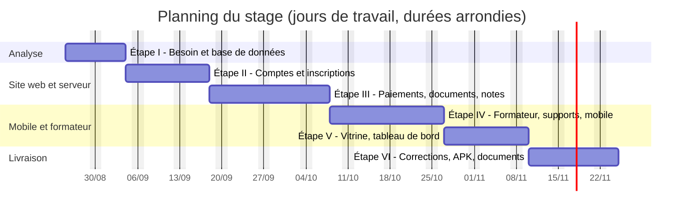

*Figure 1 : Diagramme de Gantt des six étapes*
> 💡 Pour Word : enregistrer ce schéma en image depuis mermaid.live et le mettre sur une page en
> paysage. Le détail des tâches est dans `Estimation Fiche de stage - ETU003230_v2.xlsx`.

### 1.3 Technologies utilisées

Pour chaque partie, il existait plusieurs outils possibles. J'ai choisi en pensant à trois choses
très concrètes : **je travaillais seul** sur le site, l'application et le serveur ; j'avais
**trois mois** ; et l'application gère **de l'argent**, donc les données doivent toujours rester
justes.

*Tableau 4 : Les outils choisis et les autres possibilités*
| Pour quoi | Mon choix | Autres possibilités | Pourquoi j'ai choisi celui-là |
|---|---|---|---|
| Le serveur | **Node.js avec Express** | Laravel (PHP), Spring Boot (Java) | C'est le même langage (JavaScript) que pour le site et l'application. Seul sur le projet, je n'avais pas à jongler entre deux langages. Laravel ou Spring auraient aussi marché, mais il aurait fallu en apprendre un de plus. |
| Le site web | **React** | Angular, Vue.js | On construit l'écran avec des petits blocs qu'on réutilise partout (un tableau, une fenêtre, un filtre). Très pratique pour un site rempli de listes. Et React ressemble beaucoup à React Native, utilisé pour le mobile. |
| L'application mobile | **React Native avec Expo** | Flutter, Kotlin | Je réutilise ce que je connais déjà de React. Expo facilite la création du fichier à installer sur Android. Flutter demande un autre langage (Dart) ; Kotlin ne marche que sur Android et doublerait le travail. |
| La base de données | **MySQL** | PostgreSQL, MongoDB | Elle range les données dans des tableaux reliés entre eux et garantit qu'un enregistrement se fait en entier ou pas du tout : important pour les paiements. PostgreSQL aurait convenu aussi ; MongoDB est plus souple mais protège moins bien la justesse des montants. |
| La connexion | **Badge de connexion (JWT) + liste des connexions en base** | Badge seul, ou connexion classique par cookie | Le même système marche pour le site et pour le téléphone. Garder la liste des connexions permet de vraiment déconnecter un appareil. |
| La méthode | **Merise + travail par étapes (Scrum)** | UML seul, tout planifier dès le début | Merise aide à bien dessiner la base. Les étapes courtes permettent d'ajuster avec l'encadreur au fur et à mesure. |

*Tableau 5 : Les petits outils (bibliothèques) utilisés*
| Partie | Outil | À quoi il sert |
|---|---|---|
| Base de données | MySQL (`mysql2`) | Ranger les données |
| Serveur | Node.js, Express | Répondre au site et à l'application |
| Connexion | `jsonwebtoken` + table `sessions` | Donner un badge de connexion et pouvoir le retirer |
| Mots de passe | `bcryptjs` | Rendre les mots de passe illisibles avant de les enregistrer |
| Fichiers | `multer` | Recevoir les photos, pièces d'identité et supports envoyés |
| Documents | `pdfkit`, `qrcode` | Créer la fiche, la facture et l'attestation avec son QR code |
| Protection | `pdf-lib`, `sharp` | Écrire le nom du lecteur sur le PDF ou l'image au moment où il l'ouvre |
| Texte des supports | `sanitize-html` | Retirer du texte tout ce qui pourrait être dangereux |
| E-mails | `nodemailer` (Gmail) | Envoyer les codes, factures, rappels et attestations |
| Site web | React, React Router, Vite | Construire les pages du site |
| Mobile | React Native, Expo, TypeScript | Construire l'application Android |
| Lecteur mobile | `react-native-webview`, pdf.js, `expo-screen-capture` | Afficher les supports dans l'application et bloquer les captures d'écran |
| Essais | Postman | Essayer les adresses du serveur à la main |

---
## 2. Réalisation de l'application

### 2.1 Analyse et conception

#### 2.1.1 Analyse de l'existant

Avant le projet, tout se faisait à la main : des fiches papier à l'accueil, des tableaux remplis à
la main pour les paiements, des documents écrits un par un. Pour la moindre question, l'étudiant
devait venir ou appeler.

*Tableau 6 : Comment ça se passait avant, et ce qui posait problème*
| Tâche | Comment ça se passait | Ce qui posait problème |
|---|---|---|
| Dossier et inscription | Fiche papier remplie à l'accueil | Fiches perdues, informations recopiées plusieurs fois, impossible de chercher rapidement |
| Dates de paiement et paiements | Tableau rempli à la main | Montants mal recopiés, personne ne sait combien d'argent est rentré |
| Retards | On les voit en relisant le tableau | On les voit trop tard ; les relances dépendent de la mémoire de chacun |
| Fiche, facture, attestation | Écrites une par une | Long, risque d'erreur, impossible pour un employeur de vérifier une attestation |
| Supports de cours | Donnés en classe ou envoyés par message | Les copies circulent partout, rien n'est rangé au même endroit |
| Questions des étudiants | Ils viennent ou appellent | Du temps perdu pour eux et pour l'accueil |
| Suivi de l'activité | Pas de chiffres fiables | Les décisions se prennent au feeling |

D'où la question de départ : **comment mettre tout ce parcours sur ordinateur et sur téléphone,
de l'inscription à l'attestation, de façon sûre et accessible de partout ?**

#### 2.1.2 Conception de l'application

**Pourquoi réfléchir avant de coder ?** Parce que l'application touche à de l'argent et à des
documents officiels. Une erreur dans l'organisation des données (une inscription sans ses dates de
paiement, un paiement rattaché au mauvais étudiant) est beaucoup plus difficile à réparer une fois
que l'équipe a commencé à saisir. Prendre le temps de décider **qui a le droit de faire quoi**,
**où on range chaque information** et **où on écrit chaque règle** m'a fait gagner du temps
ensuite. Ces schémas m'ont aussi servi à discuter avec mon encadreur.

**Ma façon de travailler.** J'ai d'abord dessiné la base de données avec la méthode **Merise**
(voir [Annexe F](#annexe-f--modèle-logique-de-données-complet)). Ensuite, j'ai avancé en six
étapes, avec un petit point chaque jour. Avant chaque étape, on décidait des règles avec mon
encadreur (par exemple : qui confirme un paiement fait depuis le téléphone, ou comment calculer
la note de l'attestation).

**Le projet en chiffres.** Pour donner une idée de la taille du travail :

*Tableau 7 : Le travail réalisé en chiffres*
| Élément | Nombre |
|---|:-:|
| Écrans du site web | 23 |
| Écrans de l'application mobile | 13 (+ 4 fenêtres) |
| Tables dans la base de données | 26 (aucune vue) |
| Adresses (demandes possibles) sur le serveur | 86 |
| Fichiers de règles, de lecture des demandes et d'accès à la base | 19 / 17 / 20 |
| Blocs d'écran réutilisables sur le site | 25 |
| Rôles | 4 (+ visiteur) |

La conception est présentée en trois parties : **l'affichage** (ce que l'utilisateur voit, et
comment les écrans parlent au serveur), **le métier** (qui fait quoi, et où sont écrites les
règles du centre) et **le modèle conceptuel des données** (comment les informations sont rangées).

##### 2.1.2.1 Conception affichage

**L'architecture du projet.** Le projet est fait de trois parties : le site web pour le
personnel, l'application mobile pour les étudiants, et le serveur qui garde la base de données.

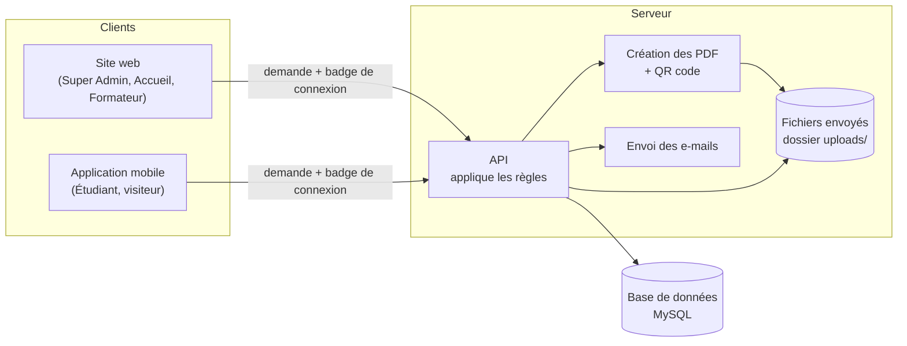

*Figure 2 : Les trois parties de la plateforme et leurs échanges*
Le site et l'application ne parlent jamais directement à la base de données. Ils passent toujours
par le serveur, et toujours par **une seule fonction**, `apiRequest` (`web/src/utils/api.js`,
`mobile/src/utils/api.ts`). C'est pratique : ce qui se répète à chaque demande est écrit une seule
fois. Cette fonction :

1. joint le badge de connexion à la demande ;
2. envoie les informations (ou les fichiers) ;
3. lit la réponse ;
4. si le serveur répond « tu n'es plus connecté », elle renvoie l'utilisateur à l'écran de
   connexion ;
5. si quelque chose ne va pas, elle récupère le message du serveur pour l'afficher à l'écran.

Le serveur répond toujours de la même façon, soit « c'est bon, voici les données », soit « erreur,
voici l'explication » :

```json
{ "status": "success", "data": { } }
{ "status": "error", "message": "Explication lisible par l'utilisateur" }
```

**Les écrans du site web.** Le site compte **23 écrans**. Après la connexion, chaque rôle ne voit
dans le menu que les pages auxquelles il a droit (`web/src/utils/navigation.js`). Pour les
étudiants, les formations et les inscriptions, chaque module a trois écrans : la **liste**, la
**fiche** et le **formulaire** (le même formulaire sert à créer et à modifier). Chaque écran a sa
propre adresse : on peut recharger la page ou partager un lien sans perdre la fiche ouverte.

*Tableau 8 : Les écrans du site web*
| Partie | Écrans | Nombre | Qui les voit |
|---|---|:-:|---|
| Hors connexion | Connexion, Mot de passe oublié | 2 | Tout le monde |
| Tableau de bord | Indicateurs et graphiques | 1 | Super Admin, Accueil |
| Étudiants | Liste, Fiche, Formulaire | 3 | Super Admin, Accueil |
| Formations | Liste, Fiche, Formulaire | 3 | Super Admin, Accueil |
| Inscriptions | Liste, Fiche, Formulaire | 3 | Super Admin, Accueil |
| Utilisateurs | Liste, Formulaire | 2 | Super Admin |
| Argent et documents | Paiements, Échéances, Documents | 3 | Super Admin, Accueil |
| Aide aux étudiants | Assistance | 1 | Super Admin, Accueil |
| Espace formateur | Accueil formateur, Supports, Supports programmés | 3 | Formateur |
| Commun | Notifications, Paramètres | 2 | Tous les rôles |
| **Total** | | **23** | |

**Les écrans de l'application mobile.** L'application compte **13 écrans** et **4 fenêtres**
qui s'ouvrent par-dessus un écran. Avec Expo Router, un écran correspond à un fichier du dossier
`mobile/src/app/`. Une fois connecté, l'étudiant passe d'un écran à l'autre avec la barre
d'onglets en bas.

*Tableau 9 : Les écrans de l'application mobile*
| Partie | Écrans | Nombre |
|---|---|:-:|
| Avant la connexion | Découvrir (la vitrine), Connexion | 2 |
| Barre d'onglets | Accueil, Formations, Fiche d'une formation, Documents, Détail d'un document, Notifications, Profil | 7 |
| Autres écrans | Paiements, Assistance, Lecteur de document, Paramètres | 4 |
| **Total des écrans** | | **13** |
| Fenêtres par-dessus un écran | Payer une échéance, S'inscrire, Détail d'une formation (vitrine), Modifier son profil | 4 |

##### 2.1.2.2 Conception métier

La conception métier répond à deux questions : **qui fait quoi** dans l'application, et **où sont
écrites les règles** du centre.

*Tableau 10 : Les utilisateurs de l'application*
| Rôle | Où | Ce qu'il fait |
|---|---|---|
| **Super Admin** | Site web | Il gère tout : les comptes, les formations, les réglages. Il peut aussi faire tout ce que fait l'accueil. |
| **Accueil** | Site web | Il crée les dossiers, inscrit les étudiants, encaisse l'argent, **confirme les paiements faits depuis le téléphone**, envoie les rappels et les attestations, **répond aux demandes d'aide**. |
| **Formateur** | Site web | Il voit ses formations et ses étudiants, publie ses supports de cours (tout de suite ou **à une heure choisie**), gère les commentaires et **donne la note de présentation**. |
| **Étudiant** | Mobile | Il suit ses formations, lit ses supports, commente, **paie ses échéances** (à confirmer par l'accueil), **demande de l'aide** et reçoit des notifications. |
| **Visiteur** | Mobile | Sans compte : il regarde les formations et peut s'inscrire. |

Le diagramme ci-dessous (diagramme de **cas d'utilisation**) montre les principales actions de
chaque utilisateur. Le Super Admin peut faire tout ce que fait l'accueil, en plus de ses propres
actions.

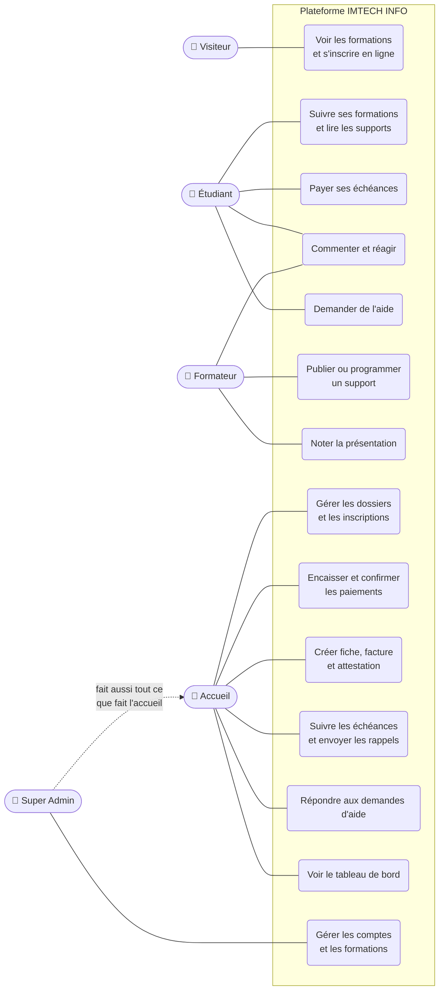

*Figure 3 : Diagramme de cas d'utilisation*
Le détail des droits de chaque rôle est dans le tableau suivant.

*Tableau 11 : Qui a le droit de faire quoi*
| Action | Super Admin | Accueil | Formateur | Étudiant |
|---|:-:|:-:|:-:|:-:|
| Gérer les comptes et les rôles | ✅ | — | — | — |
| Modifier son propre profil | ✅ | ✅ | ✅ | ✅ |
| Créer / modifier un dossier étudiant | ✅ | ✅ | — | — |
| Créer / modifier une formation | ✅ | — | — | — |
| Voir les étudiants d'une formation | ✅ | ✅ | ses formations | — |
| Inscrire un étudiant, confirmer une inscription | ✅ | ✅ | — | — |
| Encaisser un paiement au guichet | ✅ | ✅ | — | — |
| Payer depuis le téléphone (à confirmer) | — | — | — | ses échéances |
| Confirmer / refuser un paiement | ✅ | ✅ | — | — |
| Voir les paiements | tous | tous | — | les siens |
| Créer fiche / facture / attestation | ✅ | ✅ | — | — |
| Publier un support de cours | — | — | ses formations | — |
| Programmer / modifier / envoyer un support programmé | ✅ (modifier, envoyer) | — | les siens | — |
| Supprimer un support | ✅ | — | les siens | — |
| Commenter, répondre, réagir | ✅ | — | ✅ | ✅ |
| Supprimer un commentaire | tous | — | dans ses formations | les siens |
| Tableau de bord et export | ✅ | ✅ | — | — |
| Envoyer un rappel ou une attestation | ✅ | ✅ | — | — |
| Demander de l'aide | — | — | — | ✅ |
| Voir et traiter les demandes d'aide | ✅ | ✅ | — | les siennes |
| Voir le classement et la note calculée | ✅ | ✅ | ses formations | — |
| Voir l'avis des étudiants sur les formateurs | ✅ | ✅ | — | — |
| Voir la vitrine et s'inscrire | — | — | — | visiteur sans compte |
| Noter la présentation (sur 10) | ✅ | — | ses formations | — |
| Être noté présent (tout seul) | — | — | — | ✅ |
| Recherche | tout sauf supports | sans les comptes | ses formations, étudiants, supports | ses formations et supports |

Ces droits sont vérifiés **par le serveur**, pas seulement par les menus. Cacher un bouton ne
suffit pas : quelqu'un d'un peu malin peut envoyer la demande directement au serveur. Le serveur
vérifie donc deux choses à chaque fois :

1. **Le rôle** : « un étudiant n'a rien à faire ici ».
2. **À qui appartiennent les données** : « un étudiant peut voir des paiements, mais **seulement
   les siens** ».

**Où sont écrites les règles.** Le code du serveur est rangé en **étages**. Chaque étage a un
seul travail. Les règles du centre (montants, droits, dates) sont toutes au même étage, les
**services**. Quand je cherche une règle ou une requête, je sais tout de suite dans quel dossier
aller.

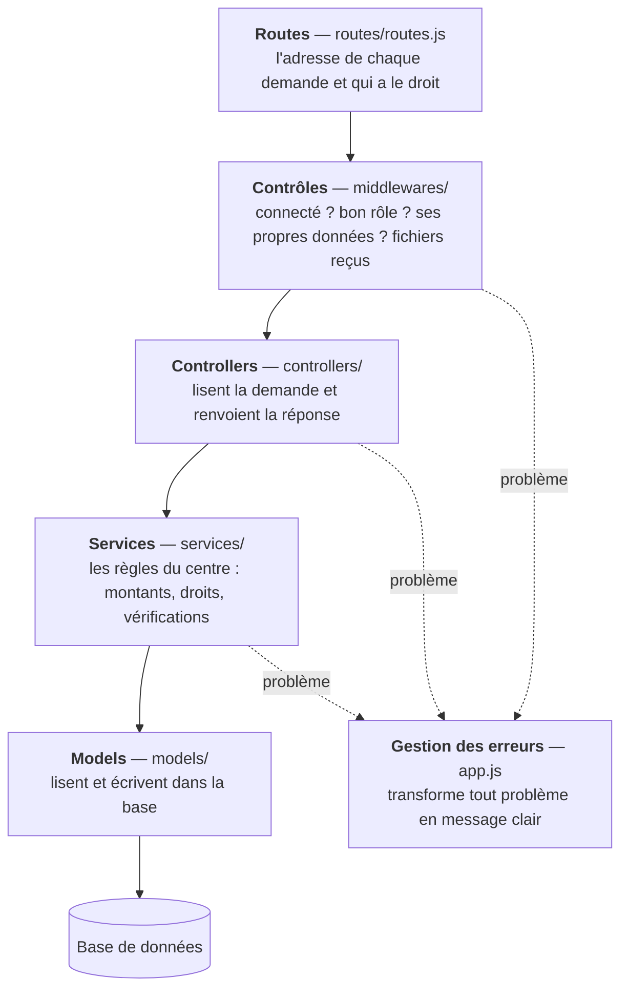

*Figure 4 : Les étages du serveur*
*Tableau 12 : Le travail de chaque étage du serveur*
| Étage | Ce qu'il fait | Ce qu'il ne fait **pas** |
|---|---|---|
| Routes | Dit quelle adresse mène où, et quels rôles y ont droit | Aucun calcul |
| Contrôles | Vérifie la connexion, le rôle, le propriétaire ; reçoit les fichiers | Pas de règles du centre |
| Controllers | Lit ce qui est envoyé, vérifie que rien ne manque, renvoie la réponse | Pas de règles, pas de base |
| Services | Applique les règles du centre (montants, droits, dates) | Ne touche pas directement à la base |
| Models | Lit et écrit dans la base | Ne prend aucune décision |

C'est ce rangement qui donne au chapitre 2.2 son fil : **la page** → **l'action** (l'adresse
appelée sur le serveur) → **les règles** (service, puis model) → **la base de données**.

**Exemple : ce qui se passe quand un étudiant ouvre l'écran de ses paiements.**

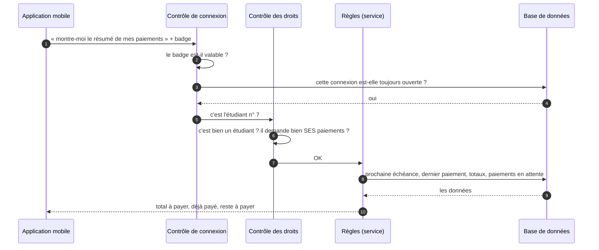

*Figure 5 : Le trajet d'une demande, de l'écran à la base*
Si quelque chose ne va pas en chemin (pas connecté, mauvais étudiant, problème de base de données),
tout s'arrête et l'utilisateur reçoit un message clair ([Annexe B](#annexe-b--gestion-des-erreurs)).

##### 2.1.2.3 Modèle conceptuel de données

La base de données (MySQL, en réalité MariaDB 10.4 fournie par XAMPP) contient **26 tables** et
**aucune vue**. Il n'y a pas non plus de procédure stockée ni de déclencheur (*trigger*) : toutes
les règles sont écrites dans le serveur Node.js, au même endroit (les services).

*Tableau 13 : Les tables de la base, rangées par thème*
| Thème | Tables | Nombre |
|---|---|:-:|
| Utilisateurs et sécurité | utilisateur, role, sessions, reset_password | 4 |
| Étudiants et formations | etudiant, formation, inscription, presence, document_administratif | 5 |
| Paiements et documents | echeance, tranche, paiement, mode_paiement, facture, attestation | 6 |
| Supports de cours | support, commentaire, commentaire_mention, reaction, type_reaction | 5 |
| Notifications et assistance | notification_inapp, notification_email, alerte_envoyee, assistance, statut | 5 |
| Réglages | parametre_application | 1 |
| **Total** | | **26** |

Le schéma ci-dessous montre les principales tables et les liens entre elles (par exemple : un
étudiant a plusieurs inscriptions, une inscription a plusieurs échéances, une échéance peut être
réglée par un ou plusieurs paiements). Les tables purement techniques (`reset_password`,
`alerte_envoyee`, `notification_email`, `parametre_application`) n'y figurent pas pour garder le
schéma lisible.

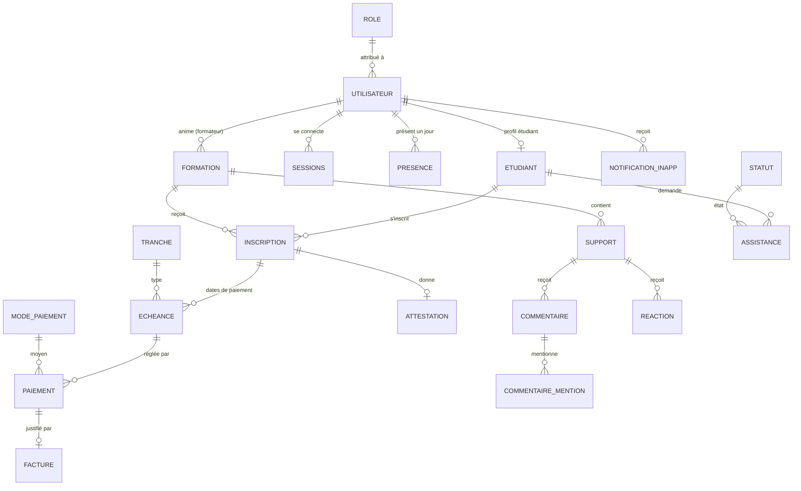

*Figure 6 : Modèle conceptuel de données (principales tables et leurs liens)*
*Tableau 14 : Quelques habitudes prises dans la base*
| Habitude | Ce que ça veut dire |
|---|---|
| Colonne `etat` | On n'efface jamais vraiment : une ligne « supprimée » est seulement cachée. On garde ainsi l'historique des paiements et des factures. |
| `paiement.statut` | Où en est un paiement : en attente, validé ou refusé ([§2.2.6](#226-paiements)) |
| `sessions.actif` | Une connexion ouverte ; la mettre à 0 déconnecte vraiment l'appareil |
| Table `alerte_envoyee` | Se souvient des alertes déjà envoyées, pour ne jamais les envoyer deux fois |
| Montants | En Ariary, avec deux chiffres après la virgule |

La base empêche aussi certains doublons toute seule : une seule réaction par personne et par
support, une seule présence par personne et par jour, une seule alerte par sujet. La liste
complète des tables est en [Annexe F](#annexe-f--modèle-logique-de-données-complet).

---

### 2.2 Développement par module

#### Comment lire ce chapitre

Chaque partie de l'application (« module ») est racontée dans le même ordre, celui du modèle de
mémoire :

1. **Ce que ça fait** ;
2. **Pourquoi c'est utile au centre** ;
3. **Un exemple concret** d'utilisation ;
4. **L'écran** (📷 capture à mettre) ;
5. **Comment ça marche** : un tableau qui suit chaque bouton de la page jusqu'à la base, puis un
   schéma et les règles à retenir.

Le tableau se lit de gauche à droite :

```
Page  →  Action (bouton)  →  Adresse appelée sur le serveur  →  Règles appliquées  →  Tables de la base
```

- **Page** : l'écran du site web ou de l'application mobile.
- **Adresse** : ce que l'écran demande au serveur (par exemple `POST /paiements` = « enregistre
  ce paiement »). Entre crochets, qui a le droit : SA = Super Admin, AC = Accueil, FO =
  Formateur, ET = Étudiant, *public* = sans être connecté.
- **Règles appliquées** : le nom des fonctions du code qui font le travail (d'abord la règle, puis
  la lecture ou l'écriture dans la base). Utile pour retrouver le code.
- **Tables** : **L** = on y lit, **É** = on y écrit.

Exemple complet : un étudiant paie une échéance depuis son téléphone.

```
Écran « Paiements » du mobile  →  bouton « Payer »  →  POST /paiements
  → règle : le montant est imposé, l'échéance doit être à lui, pas de double paiement
  → enregistrement du paiement « en attente »
  → l'accueil est prévenu
  → tables : lit echeance, inscription · écrit paiement, notification_inapp
```

#### 2.2.1 Authentification et sessions

**Ce que ça fait.** Se connecter avec son e-mail et son mot de passe (site et téléphone), se
déconnecter, récupérer un mot de passe oublié grâce à un code reçu par e-mail, changer son mot de
passe, voir les appareils où l'on est connecté et les déconnecter à distance.

**Pourquoi c'est utile.** L'application contient des pièces d'identité, de l'argent et des
documents officiels. Chacun ne doit voir que ce qui le concerne, et on doit pouvoir couper une
connexion à tout moment (téléphone perdu, employé qui part).

**Exemple.** Un étudiant s'est connecté sur l'ordinateur d'un ami et a oublié de se déconnecter.
Depuis son téléphone, il va dans *Paramètres → Sécurité* et appuie sur « Déconnecter les autres
appareils ». Moins d'une minute après, l'ordinateur de son ami revient à l'écran de connexion.

📷 *Captures : écran de connexion (site et mobile), Paramètres > Sécurité avec la liste des
appareils, message « Trop de tentatives… ».*

**Comment ça marche**

*Tableau 15 : Connexion — de la page à la base*
| Page | Action | Adresse | Règles appliquées | Tables |
|---|---|---|---|---|
| Connexion (`web/src/pages/auth/Login.jsx`, `mobile/src/app/login.tsx`) | Se connecter | `POST /auth/login` [public] | `limiteRequetes` (compte les échecs) → `authService.authentifier` (compare le mot de passe, crée le badge) → `userModel.findUserByEmail`, `etudiantModel.getIdEtudiantByUtilisateur`, `userModel.createSession` | L utilisateur, role, etudiant · É sessions |
| Connexion | Mot de passe oublié | `POST /auth/forgot-password` [public] | `limiteRequetes` → `userService.demanderReinitialisation` → `userModel.insertResetToken` + e-mail | L utilisateur · É reset_password |
| Connexion | Choisir un nouveau mot de passe | `POST /auth/reset-password` [public] | `limiteRequetes` → `userService.reinitialiserMotDePasse` → `findValidResetToken`, `updatePasswordHash`, `marquerTokenUtilise`, `deactivateAllSessions` | É reset_password, utilisateur, sessions |
| Toutes | Se déconnecter | `POST /auth/logout` | `authService.deconnecter` → `userModel.deactivateSession` | É sessions |
| Toutes | Vérifier chaque minute qu'on est toujours connecté | `GET /auth/profil` | `authService.recupererProfil` → `userModel.findUserById` ; si refusé → retour à la connexion | L sessions, utilisateur |
| Paramètres > Sécurité | Changer son mot de passe | `PUT /auth/change-password` | `authService.changerMotDePasse` → `findUserWithPassword`, `updatePasswordHash`, `deactivateAllExcept` | É utilisateur, sessions |
| Paramètres > Sécurité | Voir ses appareils connectés | `GET /auth/sessions`, `GET /auth/last-login` | `userModel.findSessionsByUser`, `findLastActiveSession` | L sessions |
| Paramètres > Sécurité | Déconnecter les autres appareils | `PUT /auth/logout-all` | `userModel.deactivateAllExcept` (garde l'appareil actuel) | É sessions |

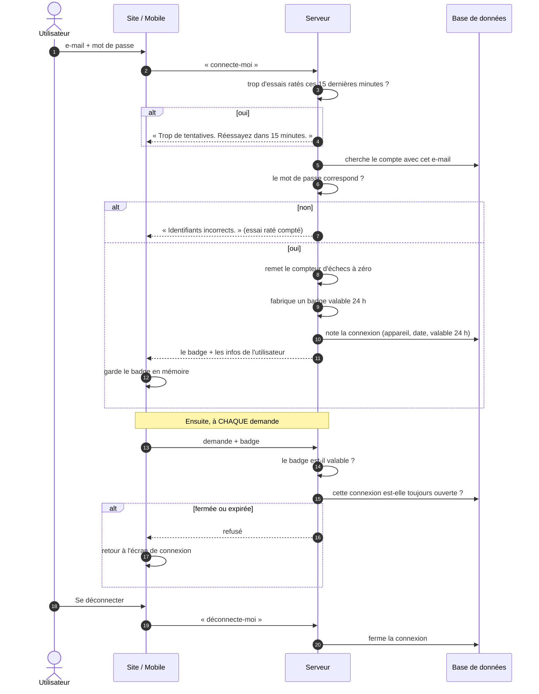

*Figure 7 : Connexion, vérification et déconnexion*
**À retenir.**
- Le badge seul ne suffit pas : il resterait valable 24 h même après une déconnexion. C'est pour
  ça que le serveur garde aussi la liste des connexions (table `sessions`) et la vérifie à chaque
  demande. Se déconnecter déconnecte vraiment.
- Dans *Sécurité*, on voit ses appareils (navigateur, adresse, date), celui qu'on utilise est mis
  en avant. Le badge lui-même n'est jamais affiché.
- *Déconnecter les autres appareils* : le site et l'application vérifient la connexion chaque
  minute et à chaque fois qu'on revient dessus. Les autres appareils sont donc renvoyés à la
  connexion en moins d'une minute.
- *Changer son mot de passe* : il faut donner l'ancien, le nouveau fait au moins 8 caractères, et
  les autres appareils sont déconnectés par précaution.

**Mot de passe oublié.**

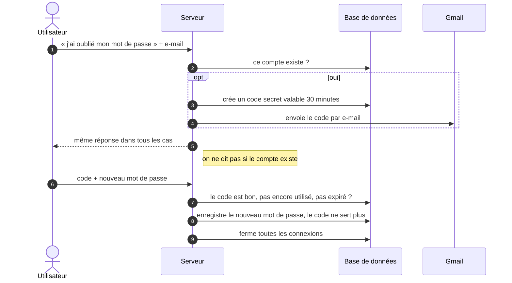

*Figure 8 : Récupérer un mot de passe oublié*
Le serveur répond la même chose que l'e-mail existe ou non. Sinon, n'importe qui pourrait s'en
servir pour savoir qui a un compte chez IMTECH.

**Limiter les essais de connexion.** Le but : empêcher quelqu'un d'essayer des milliers de mots de
passe, sans bloquer celui qui se trompe une ou deux fois.

*Tableau 16 : Limites d'essais*
| Où | Limite | Ce qui compte | Pour qui |
|---|---|---|---|
| Connexion | **5** échecs en 15 min | Seulement les essais ratés ; une connexion réussie remet à zéro | Un compte précis, depuis un appareil |
| Connexion | **20** échecs en 15 min | Seulement les essais ratés | Un appareil, tous comptes confondus |
| Mot de passe oublié | **5** demandes par heure | Toutes les demandes (chacune envoie un e-mail) | Un appareil |
| Nouveau mot de passe | **10** échecs en 15 min | Codes faux ou expirés | Un appareil |

Pourquoi deux limites ? Avec une limite par compte seulement, le pirate changerait simplement de
compte. Avec une limite par appareil seulement, tout un bureau qui partage la même connexion
internet serait bloqué à cause d'une seule personne. Les deux ensemble bloquent l'attaque sans
gêner les autres.

Ce contrôle est écrit dans `middlewares/limiteRequetes.js`. Les compteurs sont gardés en mémoire
et repartent à zéro si le serveur redémarre ([§3.3](#33-extension-et-évolution-de-lapplication)).

---

#### 2.2.2 Gestion des utilisateurs

**Ce que ça fait.** Le Super Admin crée les comptes du personnel (accueil, formateurs), les
modifie et les désactive. Chacun peut modifier son propre profil (nom, photo…). Le menu du site
change selon le rôle.

**Pourquoi c'est utile.** Le centre peut accueillir un nouvel employé ou formateur sans faire
appel à un informaticien, et couper tout de suite l'accès de quelqu'un qui part.

**Exemple.** Un nouveau formateur arrive. Le Super Admin lui crée un compte « Formateur », puis
lui donne une formation ([§2.2.4](#224-formations)). Le formateur se connecte et ne voit que ses
trois pages : Espace formateur, Supports et Supports programmés.

📷 *Captures : liste des utilisateurs, formulaire de création, menu de l'accueil à côté de celui
d'un formateur.*

**Comment ça marche**

*Tableau 17 : Utilisateurs — de la page à la base*
| Page | Action | Adresse | Règles appliquées | Tables |
|---|---|---|---|---|
| Utilisateurs (`pages/users/`) | Voir la liste | `GET /utilisateurs` [SA] | `userService.listerUtilisateurs` → `userModel.findAllUsers` | L utilisateur, role |
| Utilisateurs | Créer un compte | `POST /utilisateurs` [SA] | `userService.creerUtilisateur` (mot de passe rendu illisible) → `userModel.insertUser` | É utilisateur |
| Utilisateurs | Modifier, changer le rôle (Super Admin seulement) | `PUT /utilisateurs/:id` [soi-même ou SA] | `userService.modifierUtilisateur` → `userModel.updateUser` | É utilisateur |
| Utilisateurs | Désactiver | `DELETE /utilisateurs/:id` [SA] | `supprimerUtilisateur` → `deleteUser`, `deactivateAllSessions` | É utilisateur, sessions |
| Mon profil | Voir son profil | `GET /utilisateurs/:id` [soi-même ou SA] | `userService.recupererUtilisateur` → `userModel.findUserById` | L utilisateur, role |
| Mon profil | Modifier son nom, sa photo… | `PUT /utilisateurs/:id` [soi-même ou SA] | `userService.modifierUtilisateur` → `userModel.updateUser` | É utilisateur |

**À retenir.**
- Seul le Super Admin peut changer un rôle. Quelqu'un qui modifie son profil ne peut pas se donner
  plus de droits.
- Désactiver un compte ferme aussi **toutes ses connexions** : l'accès est coupé tout de suite.
- **Menu selon le rôle** (`web/src/utils/navigation.js`) : si un employé de l'accueil tape à la
  main l'adresse de la page Utilisateurs, il est renvoyé au tableau de bord. Ce n'est pas ça qui
  protège les données (c'est le serveur), mais ça évite de tomber sur une page vide.

---

#### 2.2.3 Dossiers étudiants

**Ce que ça fait.** L'accueil crée le dossier d'un étudiant : son identité, son e-mail, un mot de
passe de départ, sa photo et ses pièces (CIN, certificat de résidence). Il peut ensuite le
consulter, le modifier ou le désactiver. La fiche montre aussi toutes ses formations.

**Pourquoi c'est utile.** Plus de fiche papier perdue. Le dossier est créé une seule fois, avec les
pièces scannées, et sert pour toutes les inscriptions suivantes. En créant le dossier, on crée en
même temps le **compte mobile** de l'étudiant.

**Exemple.** Un étudiant arrive à l'accueil avec sa CIN et son certificat de résidence. L'accueil
remplit le formulaire, ajoute les pièces et enregistre. L'étudiant peut tout de suite se connecter
sur l'application avec l'e-mail et le mot de passe qu'on lui a donnés.

📷 *Captures : liste des étudiants, formulaire de création, fiche d'un étudiant.*

**Comment ça marche**

*Tableau 18 : Étudiants — de la page à la base*
| Page | Action | Adresse | Règles appliquées | Tables |
|---|---|---|---|---|
| Étudiants | Voir la liste, chercher (20 par page) | `GET /etudiants?page=&recherche=` [SA, AC, FO] | `etudiantService.listerEtudiants` → `etudiantModel.getAllEtudiants`, `compterEtudiants` ; recherche par nom, prénom, e-mail ou téléphone | L etudiant, utilisateur |
| Fiche étudiant | Voir la fiche et ses formations | `GET /etudiants/:id`, `GET /etudiants/:id/formations` | `recupererEtudiant`, `recupererFormationsEtudiant` | L etudiant, utilisateur, inscription, formation |
| Nouveau dossier | Créer le dossier et les pièces | `POST /etudiants` [SA, AC] | `etudiantService.creerEtudiant` → `etudiantModel.insertUtilisateurEtEtudiant` (pièces rangées dans `uploads/etudiants`) | É utilisateur, etudiant |
| Modifier | Modifier / supprimer | `PUT` / `DELETE /etudiants/:id` | `modifierEtudiant` → `updateEtudiant` ; `supprimerEtudiant` → `deleteEtudiant` (caché, pas effacé) | É etudiant, utilisateur |

**À retenir.**
1. Le compte et le dossier sont enregistrés **ensemble, tout ou rien** : jamais un compte sans
   dossier.
2. Le rôle « Étudiant » est imposé par le serveur, quoi qu'envoie le formulaire. Sinon, quelqu'un
   pourrait trafiquer la demande pour se créer un compte Super Admin.
3. Quand on modifie un dossier, seuls les champs remplis changent ; les autres restent tels quels.
4. Les pièces (CIN, certificats) ne s'ouvrent que pour le Super Admin, l'accueil et l'étudiant
   lui-même, avec son nom écrit dessus ([§2.2.9](#229-supports-de-cours)).

---

#### 2.2.4 Formations

**Ce que ça fait.** Le Super Admin crée et modifie les formations : nom, description, prix, durée
en jours, formateur, engagement du formateur, photo de couverture. Il voit les étudiants inscrits
à chacune.

**Pourquoi c'est utile.** C'est la base de tout le reste. Le prix et la durée servent à calculer
les dates de paiement ; la durée sert aussi à savoir quand la formation se termine et à compter la
présence ; la photo et l'engagement s'affichent dans la vitrine.

**Exemple.** Le centre ouvre « Python pour débutants ». Le Super Admin la crée, choisit le
formateur et ajoute une photo. Elle apparaît aussitôt dans la vitrine de l'application.

📷 *Captures : liste des formations, formulaire avec la photo, fiche d'une formation avec ses
étudiants.*

**Comment ça marche**

*Tableau 19 : Formations — de la page à la base*
| Page | Action | Adresse | Règles appliquées | Tables |
|---|---|---|---|---|
| Formations | Liste, fiche, étudiants inscrits | `GET /formations`, `/formations/:id`, `/formations/:id/etudiants` | `formationService.listerFormations`, `recupererFormation`, `recupererEtudiantsFormation` (un formateur ne voit que les siennes) | L formation, utilisateur, inscription, etudiant |
| Formulaire | Créer / modifier | `POST /formations`, `PUT /formations/:id` [SA] | `creerFormation` / `modifierFormation` → `insertFormation` / `updateFormation` | É formation |
| Formulaire | Photo de couverture | `PUT /formations/:id/image` [SA] | `modifierImageFormation` → `updateImageFormation` | É formation |
| Formations | Désactiver | `DELETE /formations/:id` [SA] | `supprimerFormation` → `deleteFormation` (cachée, pas effacée) | É formation |

**À retenir.**
- Un formateur ne voit que **ses** formations et leurs étudiants.
- La photo de couverture est visible par tout le monde, puisque la vitrine se consulte sans
  compte. Sans photo, on affiche une couleur avec les initiales de la formation.
- Désactiver une formation n'efface rien : les anciennes inscriptions et paiements restent.

---

#### 2.2.5 Inscriptions et échéancier

**Ce que ça fait.** L'accueil inscrit un étudiant à une formation en choisissant en combien de
fois il paiera (de 1 à 4). Les dates et montants de chaque paiement (l'**échéancier**) sont
calculés tout seuls. L'inscription est **confirmée** au premier paiement. On peut filtrer la liste
(confirmées ou non, faites à l'accueil ou en ligne) et imprimer la fiche d'inscription en PDF.

**Pourquoi c'est utile.** C'est le cœur de l'argent du centre. Le calcul automatique évite les
erreurs de recopie, et le total des tranches tombe **toujours** pile sur le prix de la formation.

**Exemple.** Un étudiant s'inscrit en Développement web (100 000 Ar, 90 jours) en 3 fois.
L'accueil choisit « 3 tranches » : trois échéances sont créées, dans 30, 60 et 90 jours.
L'étudiant paie la première en espèces, l'accueil clique « Valider » : l'inscription est confirmée
et le paiement enregistré.

📷 *Captures : formulaire d'inscription, liste avec les filtres, échéancier d'une inscription,
fiche d'inscription en PDF.*

**Comment ça marche**

*Tableau 20 : Inscriptions — de la page à la base*
| Page | Action | Adresse | Règles appliquées | Tables |
|---|---|---|---|---|
| Inscriptions | Liste (20 par page ; recherche, confirmée ou non, accueil / en ligne) | `GET /inscriptions?page=&recherche=&valide=&origine=` [SA, AC] | `inscriptionService.listerInscriptions` → `getAllInscriptions`, `compterInscriptions` | L inscription, etudiant, utilisateur, formation, echeance, paiement |
| Nouvelle inscription | Inscrire un étudiant | `POST /inscriptions` [SA, AC] | `inscriptionService.creerInscription` → vérifie formation et doublon, `insertInscription` + calcul de l'échéancier (`echeanceService.calculerEcheancier`) | L formation, tranche · É inscription, echeance |
| Inscriptions | Valider (premier paiement) | `POST /inscriptions/:id/valid` [SA, AC] | `validerInscription` → `setInscriptionValidee`, `validerPaiementDeclare` ou `insererPaiement` | É inscription, paiement |
| Fiche | Voir l'échéancier | `GET /inscriptions/:id/echeances` | `echeanceService.listerEcheancesInscription` | L echeance, tranche |
| Fiche | Fiche d'inscription en PDF | `POST /fiche/:id_inscription/generer` | `documentService.creerFiche` → `findInscriptionPourFiche` + création du PDF | L inscription, etudiant, formation |
| Inscriptions | Annuler | `DELETE /inscriptions/:id` | `supprimerInscription` → `deleteInscription` | É inscription |

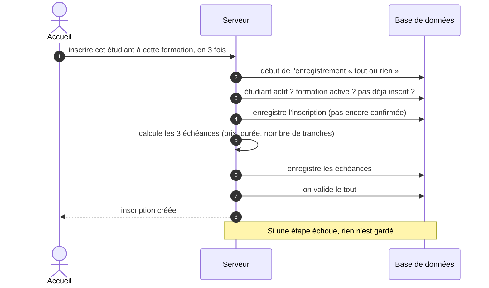

*Figure 9 : Inscrire un étudiant et créer ses dates de paiement*
**Le calcul des échéances** (`services/echeanceService.js`, fonction `calculerEcheancier`) :
- chaque tranche vaut le prix divisé par le nombre de tranches, arrondi au centime ;
- la **dernière tranche récupère les centimes qui manquent**, pour que le total soit toujours
  exact ;
- la tranche n° *n* tombe *n* fois (durée ÷ nombre de tranches) jours après l'inscription.

*Tableau 21 : Exemple : 100 000 Ar sur 90 jours, en 3 fois*
| Tranche | Montant | Date |
|---|---|---|
| 1 | 33 333,33 | dans 30 jours |
| 2 | 33 333,33 | dans 60 jours |
| 3 | 33 333,34 | dans 90 jours |
| **Total** | **100 000,00** | |

**À retenir.**
- Un étudiant ne peut être inscrit **qu'une fois** à la même formation.
- L'inscription et ses échéances sont enregistrées **ensemble, tout ou rien** : jamais d'inscription
  sans ses dates de paiement.
- **Valider** une inscription fait deux choses en même temps : l'inscription est confirmée **et**
  le premier paiement est enregistré. Si on clique deux fois, la deuxième fois est refusée : on ne
  paie pas deux fois la première tranche.
- L'étudiant reçoit une confirmation (notification + e-mail). L'accueil peut ensuite changer la
  date ou le montant d'une échéance ([§2.2.7](#227-suivi-des-échéances-et-rappels)).

---

#### 2.2.6 Paiements

**Ce que ça fait.** On peut payer de deux façons. **Au guichet** : l'accueil enregistre le
paiement, qui est tout de suite validé. **Depuis le téléphone** : l'étudiant envoie le paiement de
son échéance, qui reste « en attente » jusqu'à ce que l'accueil le confirme ou le refuse. On peut
aussi voir la liste des paiements, imprimer une facture et, sur le téléphone, voir un résumé de
ce qu'on a payé et de ce qui reste.

**Pourquoi c'est utile.** L'étudiant n'a plus besoin de venir pour payer une tranche. Mais
l'argent ne compte qu'une fois que quelqu'un de l'accueil a vérifié qu'il est bien arrivé. On ne
peut donc pas tricher en disant simplement « j'ai payé ».

**Exemple.** L'étudiant ouvre *Paiements* sur son téléphone, choisit son échéance et appuie sur
« Payer » (Mobile Money, avec la référence). Sur le site, l'accueil voit « 1 paiement attend votre
validation ». Il vérifie sur son relevé et clique « Valider ». L'étudiant reçoit une notification
et la somme passe dans « Déjà payé ».

📷 *Captures : écran Paiements du téléphone (avec « En attente de validation »), page Paiements du
site avec le bandeau et les boutons Valider / Refuser, une facture.*

**Comment ça marche**

*Tableau 22 : Paiements — de la page à la base*
| Page | Action | Adresse | Règles appliquées | Tables |
|---|---|---|---|---|
| Site — Paiements | Liste (20 par page ; statut, moyen de paiement, recherche) | `GET /paiements?page=&statut=&mode=&recherche=` [SA, AC, ET] | `paiementService.listerPaiements` (un étudiant ne voit que les siens) → `getAllPaiements`, `compterPaiements` (dont le nombre de paiements à confirmer) | L paiement, mode_paiement, echeance, inscription, etudiant, utilisateur, formation |
| Site — Paiements | Encaisser au guichet | `POST /paiements` [SA, AC] | `enregistrerPaiement` (pas plus que ce qui reste à payer) → `getEcheanceAvecSituation`, `insererPaiement` | L echeance · É paiement |
| Site — Paiements | Confirmer / refuser un paiement en attente | `PUT /paiements/:id/valider` · `/refuser` [SA, AC] | `traiterPaiementEnAttente` → `changerStatutPaiementEnAttente` + notification à l'étudiant | É paiement, notification_inapp |
| Site — Paiements | Facture en PDF | `POST /factures/:id_paiement/generer` | `documentService.creerFacture` → `findPaiementPourFacture`, `insertFacture` | L paiement · É facture |
| Mobile — Accueil | Résumé de mes paiements | `GET /etudiants/:id/dashboard-paiement` [ET : le sien] | `paiementService.dashboardPaiementEtudiant` | L paiement, echeance, inscription, formation |
| Mobile — Paiements | Payer une échéance | `POST /paiements` [ET] | `paiementService.enregistrerPaiement` (montant imposé, **en attente**) + notification à l'accueil | L echeance · É paiement, notification_inapp |

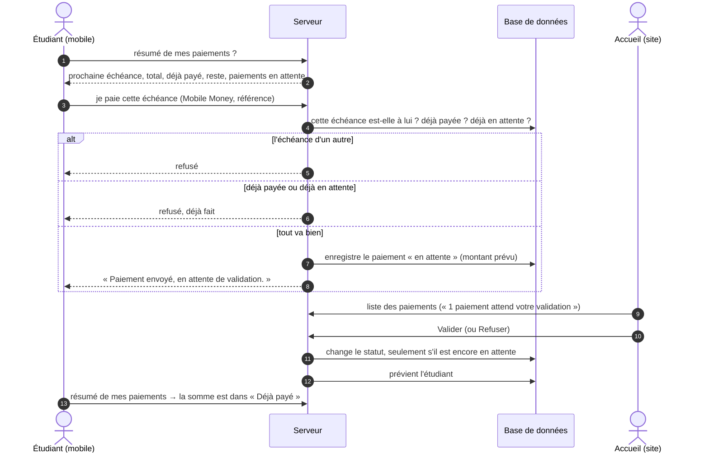

*Figure 10 : Payer depuis le téléphone, puis confirmation par l'accueil*
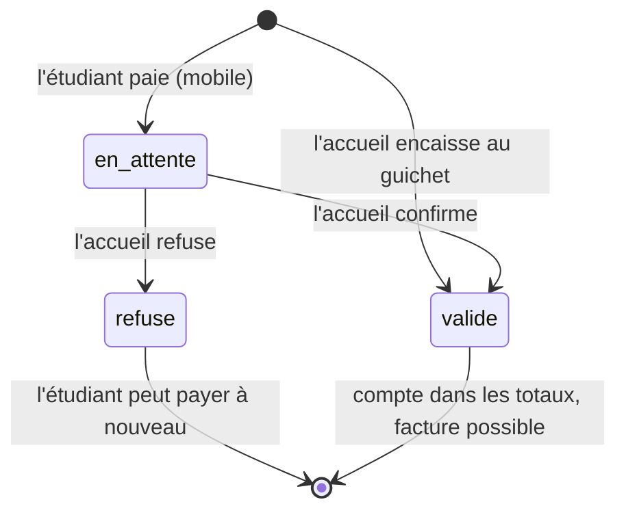

*Figure 11 : Les étapes d'un paiement*
*Tableau 23 : Qui paie comment*
| Règle | Étudiant | Accueil / Super Admin |
|---|---|---|
| Quelle échéance ? | Seulement **la sienne** | Toutes |
| Quel montant ? | **Imposé** (le montant prévu) | Libre, on peut payer une partie, mais **pas plus que ce qui reste** |
| Statut au départ | En attente | Validé |
| Payer deux fois | Refusé si un paiement est déjà en attente | Refusé si l'échéance est déjà réglée |

**À retenir.**
- Tant qu'un paiement n'est pas **validé**, il ne compte pas dans l'argent reçu : ni dans le
  « déjà payé » de l'étudiant, ni dans le tableau de bord, ni pour faire une facture. (Pour la
  couleur des échéances, en revanche, un paiement envoyé compte déjà : [§2.2.7](#227-suivi-des-échéances-et-rappels).)
- Si deux personnes de l'accueil cliquent « Valider » en même temps, une seule validation passe :
  le serveur ne change le statut que s'il est encore « en attente ».
- Un étudiant ne voit que **ses** paiements.

---

#### 2.2.7 Suivi des échéances et rappels

**Ce que ça fait.** La page *Échéances* montre toutes les échéances avec ce qui a été payé, ce qui
reste, et une **couleur**. Quand une échéance approche, le système prévient l'accueil. C'est
ensuite l'accueil qui décide d'envoyer un **rappel** à l'étudiant (notification + e-mail).
L'accueil peut aussi changer la date ou le montant d'une échéance.

**Pourquoi c'est utile.** On voit les retards **avant** qu'ils arrivent, sans relire un tableau.
Et c'est une personne qui décide d'envoyer le rappel : elle sait peut-être déjà que l'étudiant
passe payer demain.

**Exemple.** Deux jours avant l'échéance de Toky, sa ligne devient jaune et l'accueil reçoit
« Toky doit être rappelé : 33 333 Ar avant le 20/10 ». L'accueil clique « Rappeler » et Toky reçoit
la notification et l'e-mail.

📷 *Captures : page Échéances avec les trois couleurs, notification d'alerte, e-mail de rappel.*

**Comment ça marche**

*Tableau 24 : Échéances — de la page à la base*
| Page | Action | Adresse | Règles appliquées | Tables |
|---|---|---|---|---|
| Échéances | Liste (20 par page ; recherche, couleur) | `GET /echeances?page=&recherche=&statut=VERT\|JAUNE\|ROUGE` [SA, AC] | `echeanceService.listerToutesEcheances` → `getAllEcheances` (couleur calculée par la base), `compterEcheances` | L echeance, inscription, etudiant, utilisateur, formation, paiement |
| Échéances | Changer la date ou le montant | `PUT /echeances/:id` | `modifierEcheance` → `updateEcheance` | É echeance |
| Échéances | Rappeler l'étudiant | `POST /echeances/:id/rappeler` | `rappelerEcheance` → `getEcheancePourRappel`, `marquerRappelEnvoye` + notification + e-mail | É echeance, notification_inapp |
| — (tout seul, chaque heure) | Prévenir l'accueil | — | `alerteService` → `getEcheancesARappeler` (une seule alerte par échéance) | É alerte_envoyee, notification_inapp |

*Tableau 25 : Les couleurs des échéances*
| Couleur | Quand |
|---|---|
| 🟢 VERT « À jour » | Payée (même si le paiement attend encore d'être confirmé), ou date encore loin (plus de 2 jours) |
| 🟡 JAUNE « À rappeler » | Pas réglée, et la date est dans 2 jours, demain ou aujourd'hui → **l'accueil est prévenu** |
| 🔴 ROUGE « En retard » | La date est passée et ce n'est pas réglé |

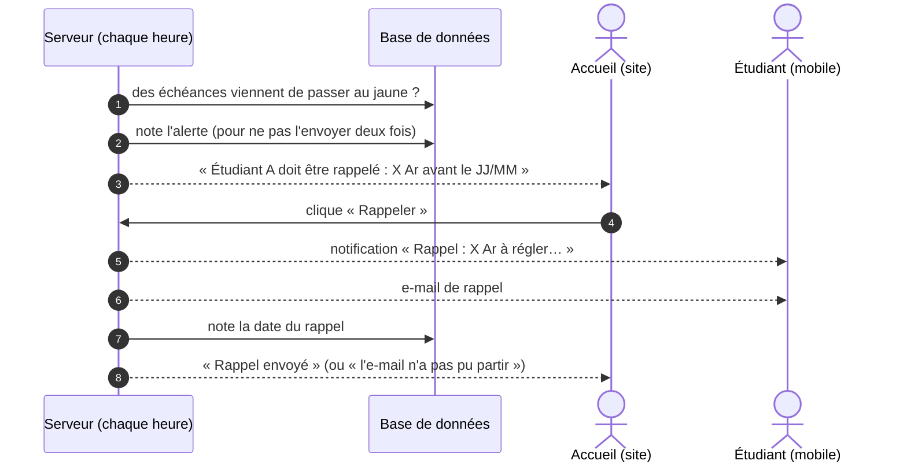

*Figure 12 : Alerte automatique puis rappel envoyé par l'accueil*
**À retenir.**
- Dès qu'un étudiant **envoie** un paiement, l'échéance passe au vert. Ce serait injuste de le
  marquer en retard juste parce que l'accueil n'a pas encore eu le temps de vérifier. La page
  affiche alors « Payé, à valider ». Mais l'**argent reçu** ne compte que les paiements validés.
- Le bouton « Rappeler » existe sur toute échéance pas encore réglée. Ouvrir la page n'envoie
  rien : un rappel part seulement quand quelqu'un clique.

---

#### 2.2.8 Documents officiels

**Ce que ça fait.** L'application crée en PDF la **fiche d'inscription**, la **facture**
(numérotée FAC-AAAA-0001) et l'**attestation de fin de formation** (avec la note sur 20 et un QR
code). Elle les envoie par e-mail et par notification. Le personnel peut aussi déposer des
documents administratifs. Une page publique permet de vérifier une attestation.

**Pourquoi c'est utile.** Ces documents étaient écrits à la main. Maintenant, un clic suffit, sans
erreur de recopie. Et grâce au QR code, un employeur peut vérifier qu'une attestation est vraie,
ce qui donne de la valeur aux formations d'IMTECH.

**Exemple.** La formation de Fitiavana est terminée. L'accueil reçoit « Fitiavana a fini sa
formation, envoyez-lui son attestation ». Il clique « Attestation » : le PDF est créé avec sa note
et lui est envoyé. Plus tard, un employeur scanne le QR code et lit « Document authentique ».

📷 *Captures : fiche d'inscription, facture, attestation avec le QR code, page de vérification
ouverte sur un téléphone.*

**Comment ça marche**

*Tableau 26 : Documents — de la page à la base*
| Page | Action | Adresse | Règles appliquées | Tables |
|---|---|---|---|---|
| Fiche d'une inscription | Fiche d'inscription | `POST /fiche/:id_inscription/generer` | `documentService.creerFiche` → `findInscriptionPourFiche` + création du PDF | L inscription, etudiant, formation |
| Paiements | Facture (créer et envoyer) | `POST /factures/:id_paiement/generer` | `documentService.creerFacture` → `findPaiementPourFacture`, `insertFacture` | L paiement · É facture |
| Inscriptions / Documents | Attestation (créer et envoyer) | `POST /attestations/:id/generer`, `/envoyer` | `creerAttestation` (recalcule la note sur 20) → `getActiviteFormation`, `insertAttestation` | L presence, paiement · É attestation |
| Documents | Voir / déposer / supprimer | `GET`, `POST /documents`, `DELETE /documents/:id` | `documentService.obtenirDocuments`, `creerDocument`, `supprimerDocument` | L/É document_administratif |
| Notifications | Envoyer un e-mail avec pièce jointe | `POST /notifications/email/piece-jointe` [SA, AC] | `notifService.notifierEmailAvecPieceJointe` | É notification_email |
| — (scan du QR code) | Vérifier une attestation | `GET /verification/:uuid` [public] | `documentService.verifierAuthenticite` → `findAttestationParUuid` | L attestation, inscription, formation |

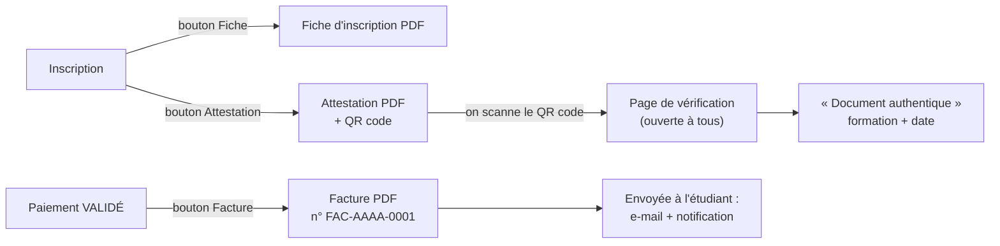

*Figure 13 : Les documents créés par l'application*
**À retenir.**
- Chaque attestation a un **numéro unique impossible à deviner** et un QR code qui y mène. La page
  de vérification est publique, mais elle ne montre aucune information personnelle sensible.
- Une facture se fait **seulement** pour un paiement **validé** : pas de facture pour de l'argent
  pas encore reçu.
- L'attestation se fait seulement quand la formation est finie **et** que le formateur a donné sa
  note de présentation. Sinon, un message explique ce qui manque
  ([§2.2.11](#2211-présence-classement-et-note-dattestation)). Le PDF indique « Note obtenue : X / 20 ».
- Le PDF est entièrement terminé avant d'être envoyé : pas de pièce jointe à moitié vide.

---

#### 2.2.9 Supports de cours

**Ce que ça fait.** Le formateur publie un **support** dans une de ses formations : un titre, un
**texte mis en forme** (gras, listes, liens…) et, s'il veut, un **fichier** (PDF, image, audio ou
vidéo). Il peut aussi le **programmer** pour plus tard : les étudiants sont prévenus une heure
avant, puis le support part tout seul. Les étudiants inscrits le lisent dans l'application, dans
un **lecteur protégé**, et leur nom est écrit en transparence sur le document.

**Pourquoi c'est utile.** Les supports, c'est le travail des formateurs : ils doivent rester chez
IMTECH. Les mettre dans l'application évite qu'ils circulent partout par message, et si un
document fuit quand même, le nom écrit dessus permet de savoir d'où il vient.

**Exemple.** Dimanche soir, le formateur prépare « Projet : site vitrine » et le programme pour
mardi 8 h. Lundi, les étudiants ne voient encore rien. Mardi à 7 h, ils reçoivent « … va envoyer
le support dans une heure ». À 8 h, le support apparaît. Ils l'ouvrent dans le lecteur : les
captures d'écran sont bloquées et leur nom est écrit sur chaque page.

📷 *Captures : page Supports du formateur (éditeur de texte), page Supports programmés, liste des
supports sur le téléphone, lecteur avec le nom en transparence.*

**Comment ça marche**

*Tableau 27 : Supports — de la page à la base*
| Page | Action | Adresse | Règles appliquées | Tables |
|---|---|---|---|---|
| Site — Supports (formateur) | Publier ou programmer | `POST /supports` [FO] | `supportService.creerSupports` (texte nettoyé par `utils/contenuRiche`, fichier de 50 Mo maximum) → `createSupport` + notification aux inscrits | É support, notification_inapp |
| Site — Supports | Voir ses supports | `GET /formations/:id/supports` | `listerSupportsFormation` → `getSupportsByFormation` | L support, formation, utilisateur |
| Site — Supports | Supprimer | `DELETE /supports/:id` [FO, SA] | `supprimerSupport` (seulement le sien) → `deleteSupport` | É support |
| Site — Supports programmés | Voir la liste | `GET /supports/programmes` [FO, SA] | `listerSupportsProgrammes` → `getSupportsProgrammes` | L support, formation |
| Site — Supports programmés | Modifier (titre, texte, heure, fichier) | `PUT /supports/:id` | `modifierSupportProgramme` → `updateSupportProgramme` | É support |
| Site — Supports programmés | Envoyer tout de suite | `POST /supports/:id/envoyer` | `envoyerMaintenant` → `publierSupport` + notifications | É support, notification_inapp |
| Mobile — Documents | Liste et détail des supports | `GET /formations/:id/supports`, `GET /supports/:id` | mêmes fonctions (l'étudiant ne voit que les supports publiés de ses formations confirmées) | L support, inscription |
| Mobile — Lecteur | Ouvrir un PDF, une image, un audio, une vidéo | `GET /supports/<fichier>` | `fichierMiddleware` : a-t-il le droit ? (`etudiantPeutVoirSupport`) puis écrit son nom dessus (`utils/filigrane`) | L sessions, inscription, support |

##### Écrire un support

1. Le formateur choisit la formation et écrit le titre.
2. Il écrit son texte dans l'éditeur : gras, italique, souligné, titres, listes, citation, liens.
3. Il peut joindre un fichier (50 Mo maximum) : PDF, image, audio (MP3, M4A, OGG, WAV) ou vidéo
   (MP4, WEBM, MOV). Les autres formats sont refusés.
4. Il clique sur Publier (ou choisit une date pour programmer).

**Pourquoi le serveur nettoie le texte.** Ce texte s'affiche chez **tous** les étudiants de la
formation. Si quelqu'un y cachait un petit programme malveillant (par exemple en volant le compte
d'un formateur), il pourrait se lancer chez chaque étudiant et voler leur connexion. Le serveur
garde donc seulement une liste précise de mises en forme autorisées (gras, listes, titres, liens…)
et supprime tout le reste avant d'enregistrer.

- Il faut au moins un texte **ou** un fichier ; sans fichier, le titre est obligatoire.
- Sur le site, le texte s'affiche avec sa mise en forme ; sur le téléphone, il est transformé en
  texte natif de l'application. Les liens s'ouvrent dans le navigateur.

##### Programmer un support

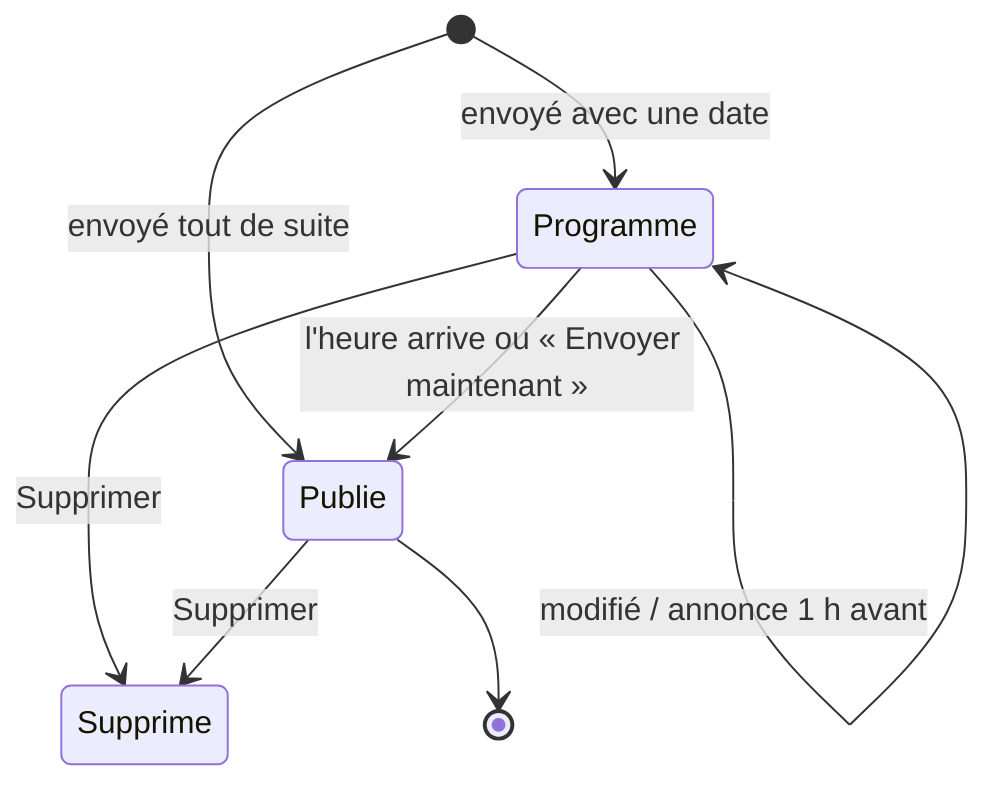

*Figure 14 : Les étapes d'un support de cours*
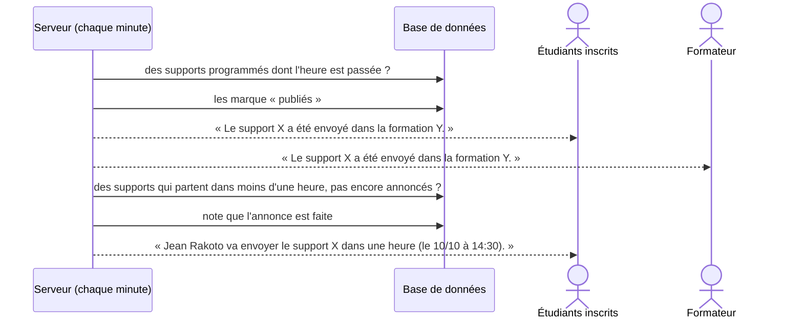

*Figure 15 : Envoi automatique des supports programmés*
- Un support **programmé** est un brouillon : les étudiants n'en voient rien du tout.
- Un support **publié** ne peut plus être modifié : ce serait déroutant pour ceux qui l'ont déjà lu.
- Les étudiants ne reçoivent jamais deux fois la même annonce. Si le formateur change l'heure
  après l'annonce, une nouvelle annonce part avec la bonne heure.
- Si le serveur était éteint à l'heure prévue, le support part dès qu'il redémarre : rien n'est
  perdu.

##### Ouvrir un fichier en toute sécurité

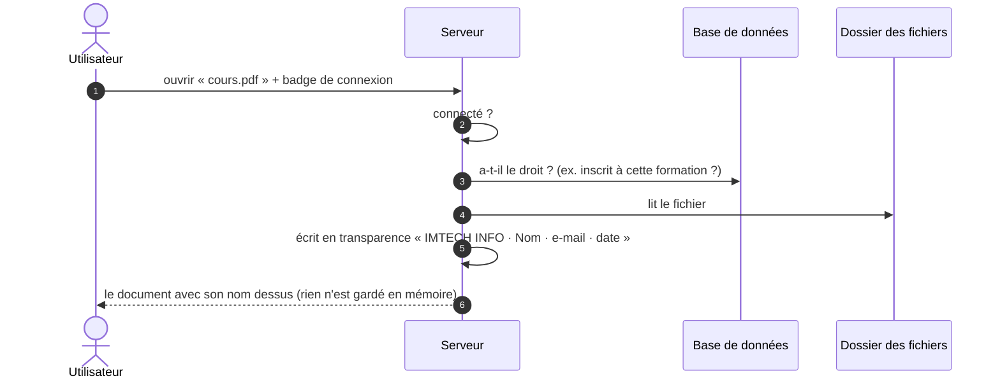

*Figure 16 : Ouvrir un fichier protégé*
1. **Il faut être connecté et avoir le droit.** Connaître l'adresse d'un fichier ne suffit pas.
   Un lien copié ne marche plus après la déconnexion.

   *Tableau 28 : Qui peut ouvrir quels fichiers*
   | Fichiers | Qui peut les ouvrir | Nom écrit dessus |
   |---|---|:-:|
   | Supports de cours | Le personnel et les formateurs ; un étudiant **seulement s'il est inscrit** (et confirmé) | Oui |
   | Documents administratifs | Super Admin, accueil, formateurs | Oui, sauf fiches, factures et attestations |
   | Pièces des étudiants (CIN, certificats) | Super Admin, accueil ; l'étudiant pour **les siennes** | Oui |
   | Photos de profil | Toute personne connectée | Non |
   | Images de la vitrine | Tout le monde | Non |

2. **Le nom du lecteur est écrit sur le document** au moment où il l'ouvre. Le fichier d'origine,
   lui, ne change pas. C'est la seule protection qui marche même si quelqu'un photographie l'écran
   avec un autre téléphone. L'audio et la vidéo sont protégés par les mêmes droits, mais sans nom
   écrit dessus.
3. **Le lecteur du téléphone** ouvre le support **dans l'application** : pas de bouton
   télécharger, pas d'« enregistrer l'image », **captures et enregistrements d'écran bloqués**
   (écran noir sur Android), rien n'est gardé sur le téléphone après la lecture.

---

#### 2.2.10 Commentaires, réactions et avis

**Ce que ça fait.** Sous chaque support, on peut **commenter** et **répondre**, comme sur Facebook.
Le formateur peut **mentionner** un étudiant avec `@`. On peut aussi **réagir** : 👍 J'aime,
❤️ J'adore, 💡 Utile ou 👎 Je n'aime pas. Ces réactions donnent un **avis sur chaque formateur**
dans le tableau de bord.

**Pourquoi c'est utile.** Les étudiants posent leurs questions là où se trouve le cours, et le
formateur répond à tout le monde en une fois. La direction a aussi un premier retour sur ses
formateurs, sans faire remplir de questionnaire.

**Exemple.** Un étudiant écrit « Je n'arrive pas à faire l'exercice 3 ». Le formateur est prévenu
et répond en mentionnant `@Miora Randriamampionona`, qui avait le même souci. Miora reçoit une
notification. Plusieurs étudiants mettent 💡 Utile sur le support.

📷 *Captures : commentaires sur le site (« Voir les 2 réponses »), liste `@` du formateur,
commentaires et réactions sur le téléphone.*

**Comment ça marche**

*Tableau 29 : Commentaires et réactions — de la page à la base*
| Page | Action | Adresse | Règles appliquées | Tables |
|---|---|---|---|---|
| Support (site ou mobile) | Lire les commentaires | `GET /supports/:id/commentaires` | `commentaireService.listerCommentairesParSupport` (range les réponses sous chaque commentaire) | L commentaire, utilisateur |
| Support | Commenter, répondre, mentionner | `POST /commentaires` [SA, FO, ET] | `commentaireService.creerCommentaire` → vérifie les mentions, enregistre + notifications | L/É commentaire, commentaire_mention, notification_inapp |
| Support (site) | Liste des étudiants pour le `@` | `GET /formations/:id/etudiants` | `formationService.recupererEtudiantsFormation` | L inscription, etudiant, utilisateur |
| Support | Supprimer un commentaire | `DELETE /commentaires/:id` | `commentaireService.supprimerCommentaire` (selon le rôle) | É commentaire |
| Support | Réagir / retirer sa réaction | `POST` / `DELETE /supports/:id/reactions` | `reactionService.ajouterOuModifReaction` | É reaction |
| Tableau de bord | Avis sur les formateurs | `GET /formateurs/avis` [SA, AC] | `reactionService.avisFormateurs` → `getReactionsParFormateur` | L reaction, support, utilisateur |

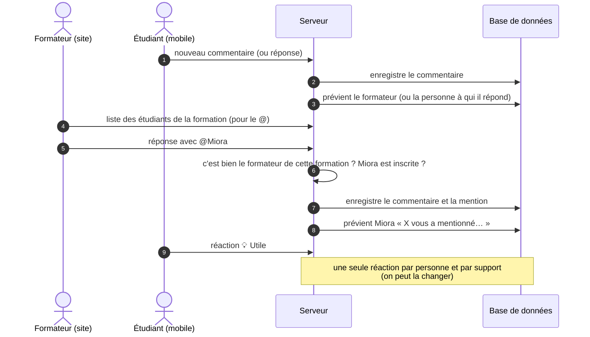

*Figure 17 : Commentaires, mentions et réactions*
*Tableau 30 : Qui peut mentionner, qui est prévenu*
| Qui écrit | Peut mentionner avec `@` ? | Comment il s'adresse à quelqu'un | Qui est prévenu |
|---|---|---|---|
| Formateur de la formation, Super Admin | Oui, **seulement** les étudiants de la formation | Il tape `@` et choisit dans la liste | Les étudiants mentionnés |
| Étudiant | **Non** | Il **répond** au commentaire | L'auteur du commentaire auquel il répond |
| Étudiant, nouveau commentaire | — | Rien à faire | Le **formateur**, automatiquement |

**À retenir.**
- **Un seul niveau de réponses**, comme sur Facebook : répondre à une réponse la range sous le même
  commentaire, avec « @Prénom Nom » déjà écrit.
- Les commentaires les plus récents s'affichent en premier ; les réponses sont repliées derrière
  « Voir les N réponses ».
- Si une personne est à la fois mentionnée et celle à qui on répond, elle ne reçoit qu'une seule
  notification.
- **Qui peut supprimer** : le Super Admin tout ; un formateur les commentaires de ses formations ;
  un étudiant les siens.
- **Réactions** : une seule par personne et par support, qu'on peut changer ou retirer. On ne peut
  réagir qu'à un support publié.
- Le calcul de l'avis sur les formateurs est expliqué en [§2.3.3](#233-statistique--avis-des-étudiants-sur-les-formateurs).

---

#### 2.2.11 Présence, classement et note d'attestation

**Ce que ça fait.** À la fin de sa formation, chaque étudiant reçoit une **note sur 20** écrite sur
son attestation. La moitié est **calculée par l'application** (a-t-il payé à temps ? a-t-il été
présent ?), l'autre moitié est donnée par le **formateur** (la présentation). La présence est
notée **toute seule**. Le formateur voit le **classement** de ses étudiants.

**Pourquoi c'est utile.** Une note qui repose sur des choses mesurables est plus juste et plus
facile à expliquer. Le formateur garde la main sur ce qui ne se calcule pas. Et plus besoin de
faire l'appel.

**Exemple.** À la fin de la formation, le formateur ouvre son Espace formateur. Il voit, pour
chaque étudiant, ses jours de présence, ses points et sa note calculée. Il tape la note de
présentation (10 maximum). L'accueil peut alors créer l'attestation.

📷 *Captures : tableau de classement dans l'Espace formateur, message si la note dépasse 10,
attestation avec « Note obtenue ».*

**Comment ça marche**

*Tableau 31 : Présence et notes — de la page à la base*
| Page | Action | Adresse | Règles appliquées | Tables |
|---|---|---|---|---|
| — (chaque fois qu'un étudiant utilise l'appli) | Le noter présent | toutes [ET] | `authMiddleware.authentifier` → `presenceModel.marquerPresence` (une ligne par jour) | É presence |
| Espace formateur | Voir ses formations et ses étudiants | `GET /formations`, `GET /formations/:id/etudiants` [FO] | `formationService.recupererEtudiantsFormation` (seulement les siennes) | L formation, inscription, etudiant, utilisateur |
| Espace formateur | Classement et note calculée | `GET /formations/:id/classement` | `classementService.classementFormation` → `getActiviteFormation`, `enregistrerSuggestions` | L presence, paiement, echeance, inscription · É inscription |
| Espace formateur | Donner la note de présentation (/10) | `PUT /inscriptions/:id/note` [SA, FO] | `classementService.definirNote` (10 maximum, sa formation) → `setNotePresentation` | É inscription |

**a) La présence se note toute seule.** Si un étudiant utilise l'application un jour, il est
considéré présent ce jour-là. Le serveur note « cet étudiant, ce jour » une seule fois par jour.

J'aurais pu utiliser la liste des connexions, mais ça ne marchait pas : une connexion dure 24 h.
Un étudiant connecté lundi à 18 h qui rouvre l'application mardi matin n'aurait pas été compté le
mardi. J'ai donc créé une table rien que pour la présence.

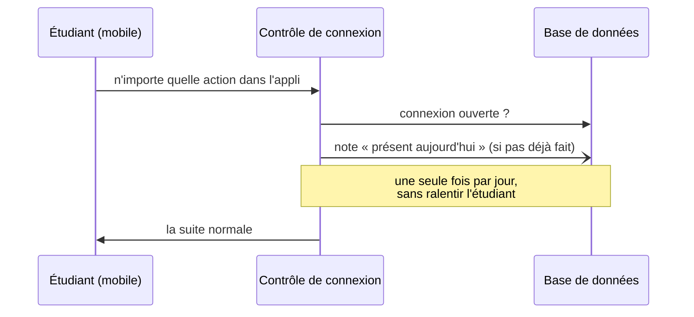

*Figure 18 : La présence notée automatiquement*
**b) Les jours de cours.** La formation commence le jour de l'inscription et dure un certain nombre
de jours. On ne compte que **du lundi au vendredi**, sur le vrai calendrier : un étudiant ne perd
pas de points parce qu'il n'a pas ouvert l'appli un dimanche.

*Tableau 32 : Exemple : formation de 90 jours qui commence un lundi*
| | Jours |
|---|:-:|
| Jours au total | 90 |
| Samedis et dimanches | 25 |
| **Jours de cours** | **65** |
| La moitié | 32,5 |
| Jours de cours jusqu'à 2 semaines avant la fin | 55 |

**c) Le barème.**

*Tableau 33 : Comment la note sur 20 est calculée*
| Partie | Condition | Points |
|---|---|:-:|
| **Paiement** | A toujours payé à temps (date d'envoi du paiement, même pas encore confirmé ; un paiement refusé ne compte pas) | **5** |
| | Sinon | **2** |
| **Présence** | Présent moins de la moitié des jours | **+2** |
| | Au moins la moitié, mais pas jusqu'au bout | **+3** |
| | Présent jusqu'à 2 semaines avant la fin | **+5** |
| = **Note calculée** | entre 4 et 10 | **/10** |
| **Présentation** | Donnée par le formateur | **/10** |
| = **Note de l'attestation** | note calculée + présentation | **/20** |

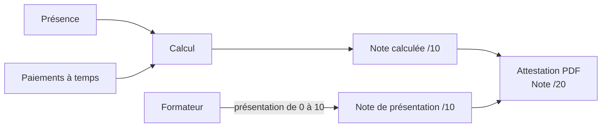

*Figure 19 : D'où vient la note de l'attestation*
**À retenir.**
- Si le formateur tape plus de 10, l'application refuse et explique : *« Vous devez attribuer une
  note de 10 au maximum : les 10 autres points sont calculés par le système (paiement et
  présence). »*
- **Classement** : par note calculée, puis par jours de présence. Deux étudiants à égalité ont le
  même rang.
- Sans note de présentation, l'attestation ne peut pas être créée.
- Les commentaires et réactions ne comptent pas : commenter beaucoup ne veut pas dire travailler
  beaucoup.

---

#### 2.2.12 Notifications

**Ce que ça fait.** Chacun reçoit des **notifications dans l'application** (une cloche avec un
chiffre sur le site, un onglet sur le téléphone) et, pour les choses importantes, des **e-mails**.
L'accueil peut aussi envoyer un message ou un e-mail lui-même.

**Pourquoi c'est utile.** Personne n'a besoin de surveiller son écran : l'information arrive à la
bonne personne au bon moment.

**Exemple.** Un étudiant paie depuis son téléphone. Chez tous les employés de l'accueil, la cloche
passe à « 1 ». Le premier disponible confirme, et l'étudiant reçoit « Votre paiement a été validé ».

📷 *Captures : cloche et page Notifications du site, onglet Notifications du téléphone.*

**Comment ça marche**

*Tableau 34 : Notifications — de la page à la base*
| Page | Action | Adresse | Règles appliquées | Tables |
|---|---|---|---|---|
| Notifications (site et mobile) | Voir ses notifications | `GET /notifications` | `notifService.listerNotifications` → `notifFindByUtilisateur` | L notification_inapp |
| Notifications | Marquer comme lue / supprimer | `PUT /notifications/:id/lu`, `DELETE /notifications/:id` | `marquerCommeLue`, `supprimerNotification` (seulement les siennes) | É notification_inapp |
| Site — Notifications | Envoyer un message ou un e-mail | `POST /notifications/in-app`, `/email`, `/email/piece-jointe` [SA, AC] | `notifierInApp`, `notifierEmail`, `notifierEmailAvecPieceJointe` | É notification_inapp, notification_email |

*Tableau 35 : Qui est prévenu, et quand*
| Ce qui se passe | Étudiant (mobile) | Accueil / Super Admin (site) | Déclenché par |
|---|---|---|---|
| Inscription confirmée | notification + e-mail | — | l'accueil |
| Paiement envoyé depuis le téléphone | — | « Étudiant A a payé X Ar… à valider » | tout seul |
| Paiement validé ou refusé | notification | — | l'accueil |
| Échéance qui passe au jaune | — | « Étudiant A doit être rappelé » | tout seul, chaque heure |
| Rappel de paiement | notification + e-mail | — | bouton « Rappeler » |
| Facture | notification + e-mail avec le PDF | — | l'accueil |
| Formation terminée | — | « … envoyez-lui son attestation » | tout seul |
| Attestation | notification + e-mail avec le PDF | — | bouton « Attestation » |
| Support annoncé ou publié | notification | (le formateur, à l'envoi) | tout seul / formateur |
| Mention ou réponse à un commentaire | notification | notification (formateur) | tout seul |
| Nouveau commentaire d'un étudiant | — | notification au **formateur** | tout seul |
| Nouvelle demande d'aide | — | notification | tout seul |
| Demande d'aide résolue | notification | — | bouton « Résoudre » |

**À retenir.**
- Les notifications pour le personnel arrivent chez **tous** les employés de l'accueil et le Super
  Admin : le premier disponible s'en occupe.
- Si l'e-mail ne part pas, la notification dans l'application part quand même et l'écran le dit.
- Chacun ne voit et ne supprime que **ses** notifications.
- Le chiffre sur la cloche montre les non lues (« 9+ » au-delà de 9) et se met à jour chaque minute.

---

#### 2.2.13 Assistance

**Ce que ça fait.** L'étudiant écrit à l'accueil depuis l'application (un objet et un message) et
voit où en est sa demande. L'accueil voit toutes les demandes et les marque comme **résolues**.

**Pourquoi c'est utile.** Les questions arrivent par écrit, au même endroit, au lieu d'appels ou
de visites. Rien ne se perd, et l'étudiant sait où en est sa demande.

**Exemple.** Un paiement validé n'apparaît pas chez Andry. Il envoie une demande depuis
*⋮ → Assistance*. L'accueil la voit, corrige le problème et clique « Résoudre ». Andry reçoit
« Votre demande … a été résolue ».

📷 *Captures : écran Assistance du téléphone (formulaire + « Mes demandes »), page Assistance du
site.*

**Comment ça marche**

*Tableau 36 : Assistance — de la page à la base*
| Page | Action | Adresse | Règles appliquées | Tables |
|---|---|---|---|---|
| Mobile — Assistance | Envoyer une demande | `POST /assistances` [ET] | `assistanceService.creerDemande` → `insertAssistance` + prévient l'accueil | É assistance, notification_inapp |
| Mobile — Assistance | Suivre ses demandes | `GET /assistances` [ET : les siennes] | `assistanceService.listerDemandes` | L assistance, statut |
| Site — Assistance | Voir les demandes (en attente / résolues) | `GET /assistances` [SA, AC] | `assistanceService.listerDemandes` | L assistance, statut, etudiant, utilisateur |
| Site — Assistance | Résoudre | `PUT /assistances/:id/resoudre` [SA, AC] | `assistanceService.resoudreDemande` → `resoudreAssistance` + prévient l'étudiant | É assistance, notification_inapp |

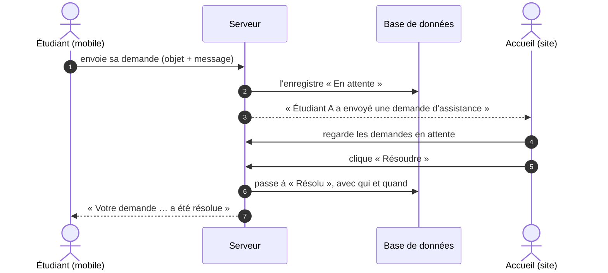

*Figure 20 : Une demande d'aide, de l'envoi à la résolution*
**À retenir.** Une demande déjà résolue ne peut pas être résolue une deuxième fois.

---

#### 2.2.14 Vitrine publique et inscription en ligne

**Ce que ça fait.** Une personne **sans compte** qui ouvre l'application découvre les formations
(écran « Découvrir ») : les formations disponibles, les formateurs les mieux notés, les
engagements du centre et les contacts. Elle peut **s'inscrire elle-même** à une ou plusieurs
formations. L'accueil confirme ensuite chaque inscription.

**Pourquoi c'est utile.** L'application devient un moyen d'**attirer de nouveaux étudiants** :
quelqu'un peut s'inscrire le soir depuis chez lui, sans attendre que l'accueil ouvre.

**Exemple.** Mahery découvre la vitrine, ajoute « Développement web » et « Python » à sa sélection,
remplit le formulaire (identité, mot de passe, moyen de paiement, référence). Il reçoit
« Inscription envoyée » et le total à payer. L'accueil filtre les inscriptions « En ligne » et
confirme les deux. Les supports s'ouvrent alors pour Mahery.

📷 *Captures : écran Découvrir, fiche d'une formation, formulaire d'inscription, liste des
inscriptions filtrée sur « En ligne ».*

**Comment ça marche**

*Tableau 37 : Vitrine — de la page à la base*
| Page | Action | Adresse | Règles appliquées | Tables |
|---|---|---|---|---|
| Mobile — Découvrir (sans compte) | Voir la vitrine | `GET /public/vitrine` [public] | `vitrineService.contenuVitrine` → formations, avis sur les formateurs, moyens de paiement, image de fond | L formation, inscription, reaction, mode_paiement, parametre_application |
| Mobile — Découvrir | S'inscrire à une ou plusieurs formations | `POST /public/inscriptions` [public, 5 par heure] | `vitrineService.inscriptionEnLigne` (compte, inscriptions, échéances et 1ᵉʳ paiement « en attente », tout ou rien) | É utilisateur, etudiant, inscription, echeance, paiement, notification_inapp |
| Site — Inscriptions | Confirmer une inscription en ligne | `POST /inscriptions/:id/valid` [SA, AC] | `validerInscription` → `validerPaiementDeclare` (pas de deuxième paiement) | É inscription, paiement |
| Site — Paramètres > Apparence | Changer l'image de fond de la vitrine | `PUT` / `DELETE /vitrine/fond` [SA] | `modifierFondVitrine`, `reinitialiserFondVitrine` | É parametre_application |

*Tableau 38 : Ce qu'on trouve sur l'écran Découvrir*
| Bloc | Contenu |
|---|---|
| Bandeau | Logo, slogan, présentation, nombre de formations et de formateurs reconnus |
| Formations disponibles | Photos qui défilent : nom, formateur, prix, badge « Formateur compétent » ; « + » pour en choisir plusieurs |
| Fiche d'une formation | Description, formateur et % d'avis positifs, durée, prix, engagement de disponibilité du formateur |
| Formateurs les mieux notés | Les formateurs jugés compétents et leurs formations |
| Notre engagement | Disponibilité, supports dans l'appli, attestation vérifiable, paiement en plusieurs fois |
| Nous contacter | Facebook, e-mail, WhatsApp |

```mermaid
sequenceDiagram
    actor V as Visiteur (mobile)
    participant API as Serveur
    participant DB as Base de données
    actor A as Accueil (site)
    V->>API: inscription : identité, mot de passe, formations choisies, paiement
    API->>API: formulaire complet ? e-mail pas déjà utilisé ? (5 essais par heure)
    API->>DB: début du « tout ou rien »
    API->>DB: crée le compte et le dossier
    loop pour chaque formation choisie
        API->>DB: inscription « en ligne » + échéances (même calcul qu'à l'accueil)
        API->>DB: premier paiement « en attente »
    end
    API->>DB: on valide le tout
    API-->>A: « Nouvelle inscription en ligne… »
    API-->>V: « Inscription envoyée » + total à payer
    A->>API: filtre « En ligne » → Valider chaque inscription
    API->>DB: inscription confirmée + paiement déclaré validé
```

*Figure 21 : S'inscrire depuis la vitrine*
**À retenir.**
- C'est **le même calcul qu'à l'accueil** qui crée l'inscription et les échéances : je n'ai pas
  réécrit la logique.
- Le compte existe tout de suite, mais les formations affichent « En attente de validation par
  l'accueil » et **les supports ne s'ouvrent qu'après confirmation**.
- Les pièces (CIN, certificat) ne sont pas demandées en ligne : l'accueil les ajoute au moment de
  la confirmation.
- Garde-fous : une formation choisie deux fois ne compte qu'une fois, 1 à 4 tranches, mot de passe
  de 8 caractères minimum, e-mail déjà utilisé refusé, 5 essais par heure.
- La vitrine est publique : elle ne montre aucune information personnelle sur les étudiants, juste
  le nombre d'inscrits.
- L'image de fond est dans l'application, mais le Super Admin peut la changer depuis le site.
  Chaque formation a sa photo. Les photos de démonstration sont libres de droits (Wikimedia
  Commons) :

*Tableau 39 : Origine des images de démonstration*
| Image | Fichier Wikimedia Commons | Auteur | Licence |
|---|---|---|---|
| Fond « Découvrir » | Neural network - Midjourney and Grok.png | Midjourney (prompt suggéré par Grok) | Domaine public |
| Développement web | Colorful code (Unsplash).jpg | Markus Spiske | CC0 |
| Bureautique | Working in open office space (Unsplash).jpg | Crew | CC0 |
| Réseaux informatiques | EthernetSwitch.jpg | Raysonho (Open Grid Scheduler) | CC0 |
| Infographie | Math tools utensils (Unsplash).jpg | Jazmin Quaynor | CC0 |
| Python pour débutants | Laptop coding programs (Unsplash).jpg | Tirza van Dijk | CC0 |
| Excel avancé | Desktop with laptop and calculator (Unsplash).jpg | Auteur inconnu | CC0 |

---

#### 2.2.15 Recherche globale

**Ce que ça fait.** Une fenêtre de recherche (bouton **Rechercher…** ou **Ctrl+K** sur le site,
loupe 🔍 sur le téléphone) cherche à la fois dans les **pages** de l'application et dans les
**données** que l'utilisateur a le droit de voir, puis ouvre directement la bonne fiche.

**Pourquoi c'est utile.** À l'accueil, retrouver un étudiant pendant qu'il attend au guichet doit
prendre deux secondes, pas trois menus.

**Exemple.** L'accueil tape « rako ». La fenêtre propose l'étudiant Rakotoarisoa, ses inscriptions
et sa formation. Entrée ouvre directement sa fiche.

📷 *Captures : fenêtre Ctrl+K sur le site avec les résultats, recherche sur le téléphone.*

**Comment ça marche**

*Tableau 40 : Recherche — de la page à la base*
| Page | Action | Adresse | Règles appliquées | Tables |
|---|---|---|---|---|
| Site — en-tête | Chercher, puis ouvrir un résultat | `GET /recherche?q=` [SA, AC, FO] | `rechercheService.rechercher` (résultats selon le rôle) → étudiants, formations, inscriptions, comptes (Super Admin), supports (formateur) | L etudiant, utilisateur, role, formation, inscription, support |
| Mobile — en-tête | Chercher un écran, une formation, un support | `GET /recherche?q=` [ET] | `rechercheService.rechercher` → ses formations, ses supports (publiés, inscriptions confirmées) | L formation, inscription, support |

*Tableau 41 : Ce que l'étudiant trouve sur le téléphone*
| Groupe | Ce qu'on y trouve | Un toucher ouvre |
|---|---|---|
| Écrans | Les écrans de l'appli, avec des mots-clés (« payer » → Paiements, « thème » → Paramètres) | L'écran |
| Mes formations | Ses formations, avec « En attente de validation » si besoin | La formation |
| Supports de cours | Les supports publiés de ses formations confirmées | Le support |

**À retenir.** Il faut taper au moins 2 lettres. La recherche part un quart de seconde après la
dernière touche (pour ne pas interroger le serveur à chaque lettre), et on voit 5 résultats par
groupe. Un étudiant ne voit jamais les autres étudiants ; un formateur ne voit que ses formations,
ses étudiants et ses supports.

---

#### 2.2.16 Navigation, pagination et apparence

**Ce que ça fait.** Trois petites choses qui rendent le site agréable : **chaque fiche a sa propre
adresse** (on peut actualiser la page ou envoyer le lien), les **longues listes s'affichent page
par page**, et chacun peut **régler l'apparence** (clair ou sombre, couleur, taille du texte).

**Pourquoi c'est utile.** Avec les années, le centre aura des milliers de paiements : les listes
doivent rester rapides. Les liens partagés facilitent le travail à plusieurs, et l'apparence
réglable, le confort de chacun.

**Exemple.** Une employée de l'accueil envoie à sa collègue le lien de la fiche d'une inscription.
La collègue, pas encore connectée, se connecte et arrive directement sur la bonne fiche. Dans la
page Paiements, la recherche « rabe » affiche « 1–20 sur 57 ».

📷 *Captures : bas d'un tableau avec les numéros de pages, Paramètres > Apparence, une page en mode
sombre.*

**Comment ça marche**

*Tableau 42 : Adresses des fiches du site*
| Partie | Liste | Fiche | Création | Modification |
|---|---|---|---|---|
| Étudiants | `/dashboard/etudiants` | `/dashboard/etudiants/12` | `/dashboard/etudiants/nouveau` | `/dashboard/etudiants/12/modifier` |
| Formations | `/dashboard/formations` | `/dashboard/formations/3` | `/dashboard/formations/nouvelle` | `/dashboard/formations/3/modifier` |
| Inscriptions | `/dashboard/inscriptions` | `/dashboard/inscriptions/40` | `/dashboard/inscriptions/nouvelle` | — |
| Utilisateurs (SA) | `/dashboard/utilisateurs` | — | `/dashboard/utilisateurs/nouveau` | `/dashboard/utilisateurs/5/modifier` |

```mermaid
flowchart LR
    URL["/dashboard/etudiants/12"] --> DL["Ce rôle a-t-il<br/>accès aux étudiants ?"]
    DL -->|oui| SR["Quelle vue ?"]
    DL -->|non| TB["retour au tableau de bord"]
    SR -->|"un numéro"| F["fiche de l'étudiant n° 12"]
    SR -->|"adresse bizarre"| L["liste des étudiants"]
    F -->|"demande au serveur"| API[(Serveur)]
```

*Figure 22 : Ouvrir une fiche à partir de son adresse*
- Si on ouvre un lien **sans être connecté**, on passe par la connexion, puis on arrive sur la
  fiche demandée.
- Partager un lien n'ouvre rien à quelqu'un qui n'a pas le droit : le serveur vérifie toujours.

**Les listes page par page.**

```mermaid
sequenceDiagram
    autonumber
    actor A as Accueil
    participant Page as Page Paiements
    participant API as Serveur
    participant DB as Base de données

    A->>Page: tape « rabe » dans la recherche
    Page->>Page: attend un quart de seconde, revient à la page 1
    Page->>API: paiements, page 1, 20 lignes, recherche « rabe »
    API->>DB: les 20 premières lignes qui correspondent
    API->>DB: combien de lignes en tout ?
    API->>DB: combien de paiements attendent une validation ?
    API-->>Page: 20 lignes + le total
    Page->>A: le tableau + « 1–20 sur 57 » + les numéros de pages
```

*Figure 23 : Une liste affichée page par page*
*Tableau 43 : Règles des listes page par page*
| Point | Règle |
|---|---|
| Taille d'une page | 20 lignes (100 au maximum) |
| Filtres et recherche | Faits par le serveur sur toute la base : le total et les pages correspondent à ce qu'on cherche |
| Recherche | Par nom, prénom, dans n'importe quel ordre (+ e-mail, téléphone ou formation selon la liste) |
| Ordre | Toujours le même : une ligne n'apparaît jamais sur deux pages |
| Étudiant | Ne voit que ses propres paiements |

Listes concernées : Étudiants, Paiements, Inscriptions, Échéances.

**L'apparence.** Dans *Paramètres > Apparence* : clair ou sombre, couleur principale (7 choix),
taille du texte, espacement, menu réduit, logo. Pour que le mode sombre marche partout, j'ai suivi
une règle simple : **aucune couleur écrite directement dans les pages**, toutes passent par le
thème. Sinon, un seul bleu oublié devient illisible sur fond sombre. En mode sombre, la couleur
principale est éclaircie automatiquement, et j'ai vérifié que les textes restent lisibles (contraste
au-dessus du minimum recommandé).

---

#### 2.2.17 Traitements automatiques

**Ce que ça fait.** Certaines choses se font sans que personne ne clique : le serveur s'en occupe
tout seul, en arrière-plan.

**Pourquoi c'est utile.** Les alertes et les envois programmés ne doivent dépendre de la mémoire de
personne.

*Tableau 44 : Ce que le serveur fait tout seul*
| Quand | Quoi | Tables |
|---|---|---|
| Chaque fois qu'un étudiant utilise l'appli | Le noter présent pour la journée (`presenceModel.marquerPresence`) | É presence |
| Chaque minute (et au démarrage) | Annoncer les supports 1 h avant, puis les publier à l'heure (`supportProgrammeService`) | É support, notification_inapp |
| Chaque heure | Prévenir l'accueil des échéances à rappeler et des formations terminées (`alerteService`), une seule fois chacune | É alerte_envoyee, notification_inapp |

---

### 2.3 États d'analyse et statistiques

Ces écrans transforment ce que l'équipe saisit chaque jour en chiffres utiles pour la direction.
📷 Pour chacun, mettre une capture prise sur les **données de démonstration**
([Annexe E](#annexe-e--scripts-sql-et-données-de-démonstration)) et **expliquer ce que montrent
les chiffres** : le modèle de mémoire insiste là-dessus.

#### 2.3.1 État : tableau de bord (Super Admin, Accueil)

*Tableau 45 : Les chiffres du tableau de bord*
| Chiffre | Comment il est calculé | D'où il vient |
|---|---|---|
| Argent reçu | Total des paiements **validés** | `GET /dashboard/kpi` → `dashboardService.recupererKPI` · tables paiement, echeance |
| Reste à recevoir | Total des échéances − argent reçu | idem |
| Paiements en retard | Échéances dont la date est passée et qui ne sont pas entièrement payées | idem |
| Évolution | Argent reçu par jour, par mois ou par année (courbe) | `GET /dashboard/evolution` · table paiement |
| Inscriptions par mois, formations les plus demandées | Nombre d'inscriptions | `GET /dashboard/inscriptionParMois`, `/topInscription` · tables inscription, formation |
| Export | Les inscriptions dans un fichier Excel (CSV) | `GET /dashboard/export-csv` |

📷 *Capture : le tableau de bord. À commenter : l'argent reçu, ce qui reste, le nombre de retards,
la forme de la courbe, la formation la plus demandée.*

#### 2.3.2 État : suivi des échéances

La page Échéances ([§2.2.7](#227-suivi-des-échéances-et-rappels)) sert aussi d'état : filtrée sur
ROUGE, elle donne la liste des retards ; sur JAUNE, la liste des personnes à rappeler.

📷 *Capture : page Échéances filtrée sur ROUGE. À commenter : le nombre de retards et les montants
(dans la démo : Toky et Fano n'ont pas payé leur 2ᵉ tranche).*

#### 2.3.3 Statistique : avis des étudiants sur les formateurs

Sur le tableau de bord, un tableau reprend chaque formateur avec les réactions que ses supports ont
reçues (`GET /formateurs/avis` → `reactionService.avisFormateurs`).

*Tableau 46 : Comment l'avis sur un formateur est calculé*
| Élément | Calcul |
|---|---|
| Réactions positives | 👍 + ❤️ + 💡 |
| Réactions négatives | 👎 |
| % positif | positives ÷ toutes les réactions |
| **Compétent** | au moins **5 réactions** et au moins **60 %** de positives |
| **Non compétent** | au moins 5 réactions et moins de 60 % de positives |
| **Pas assez d'avis** | moins de 5 réactions : on ne juge pas |

*Tableau 47 : Les colonnes du tableau des avis*
| Colonne | Contenu |
|---|---|
| # | Le rang |
| Formateur | Photo, nom, nombre de supports publiés |
| Réactions | Le nombre de 👍 ❤️ 💡 👎 (👎 en rouge) |
| Total | Toutes les réactions |
| Positif | Une barre et un pourcentage (vert, orange ou rouge) |
| Avis | Compétent (vert) / Non compétent (rouge) / Pas assez d'avis (gris) |

On peut chercher un formateur, filtrer par avis et trier par type de réaction. Les formateurs
compétents sont aussi mis en avant dans la vitrine.

📷 *Capture : le tableau des avis. Dans la démo : Tiana et Voahangy « Compétent », Hery « Non
compétent », Lalaina « Pas assez d'avis ». À commenter : avec moins de 5 réactions, on ne juge pas
un formateur, pour être juste.*

#### 2.3.4 Statistique : classement des étudiants d'une formation

Le classement de l'Espace formateur ([§2.2.11](#2211-présence-classement-et-note-dattestation))
montre le rang, les jours de présence, les points de paiement et de présence, la note calculée et
la note finale sur 20.

📷 *Capture : le classement d'une formation. À commenter : les écarts de présence entre étudiants
(de 3 à 10 jours sur 10 dans la démo) et leur effet sur la note.*

---

### 2.4 Problèmes rencontrés et solutions

Voici les problèmes les plus intéressants que j'ai rencontrés pendant le développement, et comment
je les ai résolus.

*Tableau 48 : Problèmes rencontrés et solutions*
| # | Le problème | Ma solution |
|:-:|---|---|
| 1 | Se déconnecter ne coupait pas vraiment l'accès : le badge de connexion restait valable 24 h | Le serveur garde la liste des connexions et la vérifie à chaque demande ; le site et l'appli revérifient chaque minute ([§2.2.1](#221-authentification-et-sessions)) |
| 2 | Un étudiant pouvait dire « j'ai payé » sans que l'argent soit arrivé | Le paiement reste « en attente » jusqu'à ce que l'accueil vérifie ; le montant est imposé ([§2.2.6](#226-paiements)) |
| 3 | Un double clic, ou deux employés en même temps, pouvaient valider deux fois ou envoyer deux fois la même notification | Le serveur ne change un statut que s'il est encore dans l'état attendu, et la base refuse les doublons |
| 4 | Diviser un prix en tranches laisse des centimes qui ne tombent pas juste | La dernière tranche récupère les centimes manquants ([§2.2.5](#225-inscriptions-et-échéancier)) |
| 5 | Une inscription pouvait être créée sans ses dates de paiement si une erreur arrivait au milieu | Tout ce qui va ensemble est enregistré en « tout ou rien » |
| 6 | Compter la présence avec les connexions oubliait des jours (une connexion dure 24 h) | Une table rien que pour la présence, une ligne par jour ([§2.2.11](#2211-présence-classement-et-note-dattestation)) |
| 7 | Compter « 4 week-ends par mois » faussait le nombre de jours de cours | On compte les vrais samedis et dimanches sur le calendrier |
| 8 | Un étudiant qui avait payé mais pas encore été confirmé apparaissait « en retard » | Un paiement envoyé suffit pour la couleur ; seul l'argent reçu attend la confirmation |
| 9 | Le texte d'un support pouvait cacher un programme malveillant qui se lancerait chez tous les étudiants | Le serveur ne garde que les mises en forme autorisées et supprime le reste ([§2.2.9](#229-supports-de-cours)) |
| 10 | N'importe qui connaissant l'adresse d'un fichier pouvait l'ouvrir | Il faut être connecté et avoir le droit pour ouvrir un fichier |
| 11 | Le lecteur du téléphone ne sait pas joindre le badge de connexion comme les autres demandes | Le badge est ajouté dans l'adresse du fichier ; le lien ne marche plus après la déconnexion |
| 12 | Impossible d'empêcher totalement quelqu'un de photographier son écran | Le nom du lecteur est écrit sur le document ; sur le téléphone, pas de téléchargement et captures bloquées |
| 13 | L'heure de programmation d'un support changeait selon le fuseau horaire du serveur | L'heure est envoyée dans un format universel, le même partout |
| 14 | Une pièce jointe pouvait partir avant que le PDF soit fini | On attend que le PDF soit complètement écrit avant de l'envoyer |
| 15 | Quelqu'un pouvait essayer des milliers de mots de passe | Limite d'essais ratés par compte et par appareil, puis blocage 15 minutes |
| 16 | Les longues listes deviendraient lentes avec les années | Affichage page par page, recherche faite par le serveur |
| 17 | En mode sombre, certaines couleurs devenaient illisibles | Plus aucune couleur écrite en dur : tout passe par le thème, contrastes vérifiés |
| 18 | L'adresse d'un fichier (`/api/supports/cours.pdf`) se confondait avec celle d'un support (`/api/supports/12`) | Le serveur regarde d'abord si le fichier existe ; sinon, il traite la demande normalement |

---

## 3. Évaluation du projet et connaissances acquises

### 3.1 Bilan pour l'entreprise

> ✍️ *À faire valider par mon encadreur (M. Valisoa). Propositions :*

- Tout le parcours de l'étudiant est maintenant dans l'application : dossier, inscription, dates
  de paiement, paiements, documents, cours, attestation.
- La direction voit **à tout moment** l'argent reçu, ce qui reste et les retards. Les retards sont
  signalés **avant** d'arriver.
- Les documents officiels se font en un clic, et les attestations peuvent être **vérifiées** par
  QR code : c'est un plus pour la réputation du centre.
- Les étudiants paient, lisent leurs cours et posent leurs questions depuis leur téléphone : moins
  de déplacements à l'accueil.
- La vitrine et l'inscription en ligne permettent d'attirer de nouveaux étudiants.
- Les supports des formateurs sont protégés.
- Par rapport au cahier des charges : les fonctionnalités sont testées, les montants sont justes,
  chacun n'accède qu'à ce qu'il a le droit de voir. Il
  reste à livrer l'application Android et à faire les essais avec l'équipe (`SCENARIOS-TESTS.md`).

### 3.2 Bilan personnel

> ✍️ *À écrire avec mes propres mots (sans insister sur mes lacunes). Pistes :*

- J'ai mené seul un projet complet (site, application, serveur, base de données), du cahier des
  charges jusqu'à la livraison.
- J'ai appris à dessiner une base de données avant de la créer, et à faire en sorte que les
  données restent toujours justes.
- J'ai appris à ranger mon code pour savoir où se trouve chaque chose, et à protéger une
  application (connexions, droits, documents).
- Je suis passé du site web au mobile, et j'ai découvert ce qui est propre au téléphone (captures
  d'écran, fichier à installer…).
- J'ai travaillé par étapes avec un encadreur, en testant chaque partie à la main.
- J'ai appris à transformer un besoin du centre (paiement, note d'attestation) en règles précises,
  discutées et validées avant de les coder.

### 3.3 Extension et évolution de l'application

L'application ne fait pas encore tout. Plutôt que de le cacher, voici ce qui pourrait être ajouté.

*Tableau 49 : Ce qui manque encore, et comment l'ajouter*
| Importance | Ce qui manque aujourd'hui | Ce qu'on pourrait faire |
|---|---|---|
| Moyenne | Pas de vrai paiement en ligne : l'étudiant déclare son paiement | Brancher Mobile Money, avec une confirmation automatique |
| Moyenne | Pas de lecture des supports sans internet | Garder les supports sur le téléphone, protégés par un mot de passe secret |
| Moyenne | Impossible de bloquer les captures sur le site web | Le nom écrit sur les documents aide déjà ; garder aussi la liste de qui a ouvert quoi |
| Moyenne | Pas de nom écrit sur l'audio et la vidéo | L'ajouter au moment de l'envoi |
| Moyenne | Avis sur les formateurs basé seulement sur les réactions | Ajouter un petit questionnaire de fin de formation |
| Moyenne | Inscription en ligne sans vérifier l'e-mail ni les pièces | Envoyer un code par e-mail ; permettre d'envoyer les pièces depuis le téléphone |
| Moyenne | Pas de tests automatiques : tout est vérifié à la main | Écrire des tests qui vérifient les règles importantes à chaque modification |
| Basse | Pas de notification quand l'application est fermée | Ajouter les notifications du téléphone (« push ») |
| Basse | Présence = « a ouvert l'appli ce jour-là » | Scanner un QR code affiché en classe |
| Basse | Les jours fériés comptent comme des jours de cours | Ajouter la liste des jours fériés |
| Basse | L'accueil ne peut pas répondre par écrit à une demande d'aide | Ajouter une réponse visible sur le téléphone |
| Basse | Un support n'a qu'un seul fichier | Permettre plusieurs fichiers |
| Basse | Tout tourne sur un seul serveur, installé à la main | Mettre l'application en ligne, en HTTPS, avec des vérifications automatiques à chaque modification |

Autres idées du cahier des charges : prévoir les revenus et le remplissage des formations, signer
les documents électroniquement, gérer plusieurs centres, proposer plusieurs langues.

---

## Conclusion

> ✍️ *Proposition à adapter (une page maximum). Le modèle demande : la satisfaction de l'entreprise,
> mes impressions personnelles, les perspectives, et ce que mon travail apporte par rapport à
> avant.*

Ce stage chez IMTECH INFO avait un but simple : remplacer le papier par une application qui suit
l'étudiant de la découverte des formations jusqu'à son attestation. Les objectifs du cahier des
charges sont atteints : un site pour l'équipe, une application mobile pour les étudiants et un
serveur commun qui applique les règles du centre.

Par rapport à avant, le changement est concret. Les montants sont calculés au lieu d'être
recopiés. Les retards sont signalés avant d'arriver. Les documents se font en un clic et peuvent
être vérifiés par QR code. Les supports des formateurs sont protégés. Et l'étudiant n'a plus
besoin de se déplacer pour payer ou poser une question. ✍️ *Ajouter ici l'avis de l'encadreur.*

Sur le plan personnel, ✍️ *(ce qui m'a le plus appris, ce que j'ai aimé).*

L'application peut encore grandir : un vrai paiement par Mobile Money, des notifications même
application fermée, la lecture sans internet et une mise en ligne pour que tout le centre
l'utilise au quotidien.

---

## Bibliographie

> Format du modèle : livre `NOM, Prénom initiale., Titre, Lieu : Éditeur, année.` ; site
> `Auteur, Titre [en ligne]. Disponible sur : URL (consultée le JJ-MM-AAAA)`. ✍️ *Remplacer
> « JJ-MM-2026 » par la vraie date de consultation.*

- NANCI, D., ESPINASSE, B., *Ingénierie des systèmes d'information : Merise deuxième génération*,
  4ᵉ éd., Paris : Vuibert, 2001.
- SCHWABER, K., SUTHERLAND, J., *The Scrum Guide* [en ligne], 2020. Disponible sur :
  https://scrumguides.org/scrum-guide.html (consultée le JJ-MM-2026)
- OpenJS Foundation, *Express 5.x — API Reference* [en ligne]. Disponible sur :
  https://expressjs.com/en/5x/api.html (consultée le JJ-MM-2026)
- Meta, *React — Documentation* [en ligne]. Disponible sur : https://react.dev (consultée le JJ-MM-2026)
- Meta, *React Native — Documentation* [en ligne]. Disponible sur :
  https://reactnative.dev/docs/getting-started (consultée le JJ-MM-2026)
- Expo, *Expo Documentation* [en ligne]. Disponible sur : https://docs.expo.dev (consultée le JJ-MM-2026)
- Oracle, *MySQL 8.0 Reference Manual* [en ligne]. Disponible sur :
  https://dev.mysql.com/doc/refman/8.0/en/ (consultée le JJ-MM-2026)
- JONES, M., BRADLEY, J., SAKIMURA, N., *RFC 7519 : JSON Web Token (JWT)* [en ligne], IETF, 2015.
  Disponible sur : https://www.rfc-editor.org/rfc/rfc7519 (consultée le JJ-MM-2026)
- OWASP Foundation, *OWASP Top Ten* [en ligne]. Disponible sur :
  https://owasp.org/www-project-top-ten/ (consultée le JJ-MM-2026)
- OWASP Foundation, *Authentication Cheat Sheet* [en ligne]. Disponible sur :
  https://cheatsheetseries.owasp.org/cheatsheets/Authentication_Cheat_Sheet.html (consultée le JJ-MM-2026)
- W3C, *Web Content Accessibility Guidelines (WCAG) 2.1* [en ligne], 2018. Disponible sur :
  https://www.w3.org/TR/WCAG21/ (consultée le JJ-MM-2026)
- PDFKit, *PDFKit Documentation* [en ligne]. Disponible sur : https://pdfkit.org (consultée le JJ-MM-2026)
- Mermaid, *Mermaid* [en ligne]. Disponible sur : https://mermaid.js.org (consultée le JJ-MM-2026)

---

## Annexes

Les détails techniques sont rangés ici, pour que le reste du mémoire reste facile à lire.

### Annexe A — Sécurité

*Tableau 50 : Les risques et ce qui protège contre eux*
| Le risque | Ce qui protège |
|---|---|
| Quelqu'un vole la base et lit les mots de passe | Les mots de passe sont rendus illisibles avant d'être enregistrés |
| Quelqu'un réutilise un badge après la déconnexion | Le serveur vérifie à chaque fois que la connexion est encore ouverte |
| Un utilisateur va sur une fonction qui n'est pas pour lui | Chaque adresse du serveur dit quels rôles y ont droit |
| Un étudiant change un numéro dans l'adresse pour voir les données d'un autre | Le serveur vérifie à qui appartiennent les données |
| Quelqu'un essaie de se donner plus de droits | Seul le Super Admin change un rôle ; un dossier étudiant est toujours créé avec le rôle Étudiant |
| Un faux paiement | Montant imposé, échéance vérifiée, confirmation par une personne de l'accueil |
| Quelqu'un glisse des commandes dans un champ pour manipuler la base | Les valeurs tapées ne sont jamais mélangées aux commandes de la base |
| Un message d'erreur qui dévoile des détails techniques | En cas de gros problème, l'utilisateur voit un message général ; le détail reste sur le serveur |
| Quelqu'un cherche à savoir qui a un compte | « Mot de passe oublié » répond pareil que le compte existe ou non |
| Quelqu'un essaie des milliers de mots de passe | Essais ratés limités, puis blocage 15 minutes |
| Quelqu'un demande une liste énorme pour ralentir le serveur | 100 lignes maximum par page |
| Un fichier dangereux envoyé | Seuls certains types de fichiers sont acceptés, avec une taille maximale |
| Un programme caché dans le texte d'un support | Le serveur supprime tout ce qui n'est pas une mise en forme autorisée |
| Quelqu'un ouvre un fichier en connaissant son adresse | Il faut être connecté et avoir le droit |
| Un document sort d'IMTECH | Nom du lecteur écrit dessus, pas de téléchargement et captures bloquées sur le téléphone |
| La clé secrète des badges est oubliée | Le serveur refuse de démarrer sans elle |

> **Limite** : sur le **site web**, aucun navigateur ne permet de bloquer une capture d'écran.
> C'est le nom écrit sur le document qui protège.

### Annexe B — Gestion des erreurs

Quand quelque chose ne va pas, l'étape qui s'en rend compte s'arrête, et un seul endroit du serveur
(`app.js`) prépare la réponse. Chaque type de problème a un code, ce qui permet au site et à
l'application d'afficher le bon message.

*Tableau 51 : Les codes de réponse du serveur*
| Code | Ce que ça veut dire | Exemple |
|---|---|---|
| 400 | La demande est mal remplie | Un champ manque, montant négatif, fichier trop lourd |
| 401 | Pas connecté | Pas de badge, badge expiré, connexion fermée |
| 403 | Pas le droit | Mauvais rôle, ou les données de quelqu'un d'autre |
| 404 | Introuvable | Paiement, étudiant ou formation qui n'existe pas |
| 409 | Déjà fait ou en conflit | E-mail déjà utilisé, échéance déjà payée, inscription déjà confirmée |
| 429 | Trop d'essais | Trop de connexions ratées, trop de demandes de mot de passe ou d'inscriptions |
| 500 | Problème imprévu | Message général ; le détail est noté seulement sur le serveur |

### Annexe C — Vérification du code

*Tableau 52 : Vérification du code*
| Partie | Outil | Résultat |
|---|---|---|
| Site web | ESLint (relit le code pour trouver les erreurs) | 0 erreur |
| Application mobile | ESLint + TypeScript | 0 erreur |
| Site web | Construction de la version finale | OK |

Les adresses du serveur ont aussi été essayées à la main avec Postman, et les scénarios de
[`SCENARIOS-TESTS.md`](SCENARIOS-TESTS.md) testent le site et l'application ensemble.

### Annexe D — Organisation du code

```
gestionFormation_stage/
├── FLUX-APPLICATION.md         ← ce document (support du mémoire)
├── SCENARIOS-TESTS.md          ← scénarios de test (démonstration)
├── CHEAT-SHEET.md              ← aide-mémoire du projet
├── cheat-sheets/               ← aide-mémoires Node, React, MySQL
├── A-FAIRE.md                  ← ce qu'il reste à faire
│
├── backend-imtech/             le serveur (Node.js / Express)
│   ├── app.js                  démarrage, fichiers protégés, gestion des erreurs
│   ├── api.md                  liste des adresses et des droits
│   ├── config/                 connexion à la base, rôles, textes de la vitrine
│   ├── routes/routes.js        toutes les adresses /api/...
│   ├── middlewares/            contrôles : connexion, rôle, fichiers, limite d'essais
│   ├── controllers/            lisent les demandes et renvoient les réponses
│   ├── services/               les règles du centre
│   ├── models/                 lecture et écriture dans la base
│   ├── utils/                  e-mails, PDF, nom sur les documents, pages…
│   └── base.sql, alter2.sql, donneesTest.sql, reinit.sql
│
├── web/                        le site web (React)
│   └── src/
│       ├── utils/              communication avec le serveur, menus par rôle
│       ├── hooks/              récupération des données, une par sujet
│       ├── components/         blocs réutilisables (tableau, fenêtre, menu, pages…)
│       └── pages/              une page par menu
│
└── mobile/                     l'application mobile (React Native + Expo)
    └── src/
        ├── app/                les écrans (Accueil, Formations, Documents, Paiements,
        │                       Découvrir, Assistance, Lecteur…)
        ├── context/            utilisateur connecté, thème
        ├── hooks/              récupération des données
        ├── components/         blocs réutilisables
        ├── styles/             couleurs et mise en page
        └── utils/              communication avec le serveur
```

### Annexe E — Scripts SQL et données de démonstration

*Tableau 53 : Les fichiers de la base de données*
| Fichier | À quoi il sert |
|---|---|
| `backend-imtech/base.sql` | Crée toute la base, à jour |
| `backend-imtech/alter2.sql` | Les changements de la base, numérotés, à appliquer une seule fois sur une base existante |
| `backend-imtech/donneesTest.sql` | Remplit la base avec des données de démonstration (mot de passe de tous les comptes : `admin123`) |
| `backend-imtech/scripts/fichiersDemo.js` | Ajoute les photos, pièces et supports de démonstration |
| `backend-imtech/reinit.sql` | Vide toutes les tables (sans les supprimer) |

```bash
cd backend-imtech
mysql -u root -p < reinit.sql          # vide la base
mysql -u root -p < donneesTest.sql     # remet les données de démonstration
node scripts/fichiersDemo.js           # photos, pièces, supports
```

Les dates des données de démonstration sont calculées **à partir du jour où on les charge** : quel
que soit le jour de la démonstration, il y a toujours des retards, des échéances proches et une
formation qui vient de se terminer. Les e-mails se terminent par `.test`, une adresse qui n'existe
pas : aucun e-mail de test ne peut arriver chez une vraie personne.

*Tableau 54 : Les comptes de démonstration*
| Comptes (mot de passe `admin123`) | Rôle |
|---|---|
| `tljelia374@gmail.com` (Elia) | Super Admin |
| `hanitra.rasoanaivo@imtech.test`, `mamy.andriamanana@imtech.test` | Accueil |
| `tiana.randrianarisoa@imtech.test`, `voahangy.rakotomalala@imtech.test`, `hery.rajaonarison@imtech.test`, `lalaina.razafindrabe@imtech.test` | Formateurs |
| `prenom.nom@imtech.test` (Andry Rakotoarisoa, Miora Randriamampionona, Toky Ravelojaona…) | 12 étudiants |

*Tableau 55 : Les situations prévues dans la démonstration*
| Situation | Ce qu'on trouve |
|---|---|
| Avis sur les formateurs | Tiana et Voahangy « Compétent », Hery « Non compétent », Lalaina « Pas assez d'avis » |
| Paiements | Des validés, 3 en attente (Sitraka depuis le téléphone, 2 inscriptions en ligne), 1 refusé (Toky) |
| Retards | Toky (Développement web) et Fano (Réseaux) n'ont pas payé leur 2ᵉ tranche |
| Inscriptions à confirmer | Mahery et Miora (en ligne), Haja (à l'accueil, pas encore payé) |
| Fin de formation | Fitiavana a fini Bureautique (attestation à envoyer) ; Nomena finit dans 4 jours |
| Supports | 10 PDF et 1 image ; « Projet : site vitrine » programmé dans 2 jours à 8 h |
| Échanges | Commentaires avec réponses et mentions, 5 demandes d'aide (3 en attente), notifications |
| Présence | De 3 à 10 jours sur 10 selon l'étudiant |

### Annexe F — Modèle logique de données complet

La liste de toutes les tables et de leurs colonnes. La première colonne est l'identifiant de la
ligne ; celles qui commencent par `#` renvoient à une autre table.

```
ROLE (id_role, nom, etat)
UTILISATEUR (id_utilisateur, nom, prenom, email, mot_de_passe, photo, telephone, date_creation, #id_role, etat)
SESSIONS (id_session, #id_utilisateur, token, user_agent, ip, cree_le, expire_le, actif)
ETUDIANT (id_etudiant, #id_utilisateur, photo_1, photo_2, certificat_residence, photocopie_cin, etat)
FORMATION (id_formation, #id_utilisateur, nom, description, engagement_formateur, image, tarif, duree, duree_jours, etat)
INSCRIPTION (id_inscription, #id_etudiant, #id_formation, #id_utilisateur, date_inscription, valide, origine,
             note_suggeree, nb_presences, note_presentation, etat)
TRANCHE (id_tranche, code, nom, etat)
ECHEANCE (id_echeance, #id_inscription, #id_tranche, montant_prevu, date_echeance, genere_auto, date_dernier_rappel, etat)
MODE_PAIEMENT (id_mode_paiement, nom, etat)
PAIEMENT (id_paiement, #id_echeance, #id_mode_paiement, montant, date_paiement, reference_virement, statut, etat)
FACTURE (id_facture, #id_paiement, numero_facture, date_emission, fichier_pdf)
ATTESTATION (id_attestation, #id_inscription, uuid_verification, date_delivrance, fichier_pdf)
DOCUMENT_ADMINISTRATIF (id_document, #id_utilisateur, nom_document, fichier, date_creation, etat)
SUPPORT (id_support, #id_formation, #id_utilisateur, titre, contenu, fichier, statut, date_envoi_prevue,
         annonce_envoyee, date_publication, etat)
COMMENTAIRE (id_commentaire, #id_support, #id_parent, #id_etudiant, #id_utilisateur, contenu, date_commentaire, etat)
COMMENTAIRE_MENTION (id_mention, #id_commentaire, #id_etudiant_mentionne)
TYPE_REACTION (id_type_reaction, nom, icone, etat)
REACTION (id_reaction, #id_support, #id_utilisateur, #id_type_reaction, date_reaction)
PRESENCE (id_presence, #id_utilisateur, jour)
STATUT (id_statut, nom, etat)
ASSISTANCE (id_assistance, #id_etudiant, #id_utilisateur, #id_statut, objet, contenu, date_envoi, date_resolution, etat)
NOTIFICATION_INAPP (id_notification, #id_utilisateur, message, lu, date_creation, etat)
NOTIFICATION_EMAIL (id_notification_email, #id_utilisateur, email, contenu, date_creation)
ALERTE_ENVOYEE (id_alerte, type, id_reference, date_envoi)
RESET_PASSWORD (id_reset, #id_utilisateur, token, date_expiration, utilise, date_creation)
PARAMETRE_APPLICATION (cle, valeur, modifie_le)
```

La base refuse aussi certains doublons : une réaction par personne et par support, une présence par
personne et par jour, une alerte par sujet.
