# IMTECH INFO — Plateforme de gestion de formation
## Document de référence : architecture et flux

> Ce document raconte comment fonctionne l'application : qui fait quoi, par où passent les
> données, quelles règles s'appliquent et comment tout cela est protégé. C'est la base sur
> laquelle s'appuient le mémoire de stage et la soutenance.
>
> D'autres documents le complètent :
> - la liste complète des routes de l'API : [`backend-imtech/api.md`](backend-imtech/api.md) ;
> - les scénarios de test pour la recette et la soutenance : [`SCENARIOS-TESTS.md`](SCENARIOS-TESTS.md) ;
> - l'aide-mémoire React / Node / MySQL propre au projet (démarrer, ajouter une fonctionnalité, écrire une requête, dépanner) : [`CHEAT-SHEET.md`](CHEAT-SHEET.md), et pour la syntaxe générale, [`cheat-sheets/`](cheat-sheets/).
>
> **Par où commencer ?** Pour le mémoire, le plus parlant est la section 6 : elle reprend chaque
> écran et suit une action jusqu'aux tables de la base (*page → action → fonctions métier → base
> de données*). La section 7 explique ensuite le pourquoi des règles.
>
> Les schémas sont écrits en **Mermaid**. Ils s'affichent directement dans VS Code (extension
> *Markdown Preview Mermaid Support*) ou sur GitHub, et on peut les exporter en image pour le
> mémoire depuis <https://mermaid.live>.

---

## Sommaire

1. [Présentation générale](#1-présentation-générale)
2. [Architecture technique](#2-architecture-technique)
3. [Architecture du backend en couches](#3-architecture-du-backend-en-couches)
4. [Acteurs, rôles et droits](#4-acteurs-rôles-et-droits)
5. [Modèle de données](#5-modèle-de-données)
6. [Flux par page (page → action → fonctions métier → base de données)](#6-flux-par-page)
7. [Règles métier détaillées](#7-règles-métier-détaillées)
8. [Sécurité](#8-sécurité)
9. [Gestion des erreurs](#9-gestion-des-erreurs)
10. [Qualité et tests](#10-qualité-et-tests)
11. [Organisation du code](#11-organisation-du-code)
12. [Limites et perspectives](#12-limites-et-perspectives)
13. [Glossaire](#13-glossaire)

---

## 1. Présentation générale

IMTECH INFO est un centre de formation. La plateforme suit tout le parcours des apprenants, du
premier rendez-vous à l'accueil jusqu'à l'attestation de fin de formation :

```
Création du dossier étudiant → Inscription à une formation → Échéancier de paiement
→ Paiements → Documents officiels (fiche, facture, attestation) → Suivi des cours (supports)
```

Concrètement, il y a **trois applications**, qui parlent toutes à la même API :

| Application | Public | Usage principal |
|---|---|---|
| **Application web** (back-office) | Super Admin, Accueil, Formateur | Gestion des étudiants, formations, inscriptions, paiements, documents, tableau de bord |
| **Application mobile** | Étudiant (et Super Admin) | Consulter ses formations et supports, commenter, réagir, payer ses échéances, recevoir des notifications |
| **API REST** (backend) | Les deux applications | Règles métier, sécurité, accès à la base de données, génération des PDF, envoi des e-mails |

---

## 2. Architecture technique

### 2.1 Vue d'ensemble

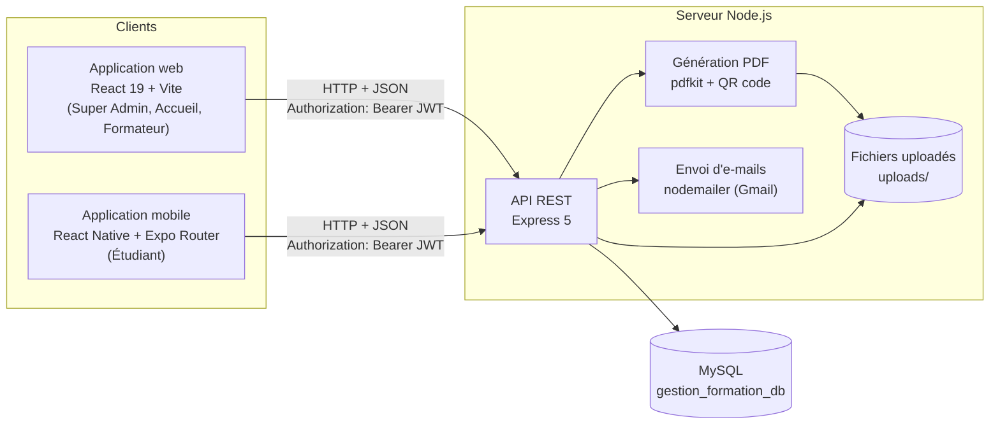

### 2.2 Technologies

| Couche | Technologie | Rôle |
|---|---|---|
| Base de données | MySQL (pilote `mysql2`, pool de connexions) | Stockage relationnel, transactions |
| Backend | Node.js 22, Express 5 | API REST |
| Authentification | JSON Web Token (`jsonwebtoken`) + table `sessions` | Identification et révocation des connexions |
| Mots de passe | `bcryptjs` (hachage) | Les mots de passe ne sont jamais stockés en clair |
| Fichiers | `multer` | Upload (photos, pièces justificatives, supports de cours) |
| Documents | `pdfkit`, `qrcode` | Fiche d'inscription, facture, attestation avec QR code de vérification |
| Protection des documents | `pdf-lib`, `sharp` | Filigrane dynamique (nom, e-mail, date) ajouté aux PDF et images au moment de leur consultation |
| E-mails | `nodemailer` | Réinitialisation du mot de passe, factures, relances |
| Web | React 19, React Router 7, Vite | Interface d'administration |
| Mobile | React Native 0.86, Expo 57, Expo Router, TypeScript | Application étudiant |
| Lecteur mobile | `react-native-webview` + pdf.js, `expo-screen-capture` | Affichage des supports dans l'app, captures d'écran bloquées |
| Tests | Runner intégré de Node (`node --test`) | Tests automatisés du backend |

### 2.3 Communication client ↔ serveur

Côté client, aucun écran n'appelle le serveur directement : tout passe par **une seule
fonction**, `apiRequest` (dans `web/src/utils/api.js` et `mobile/src/utils/api.ts`). L'intérêt
est de régler une bonne fois pour toutes ce qui se répète à chaque appel. Cette fonction :

1. ajoute le token tout seul (`Authorization: Bearer <token>`) ;
2. envoie du JSON, ou un `FormData` quand il y a des fichiers ;
3. lit la réponse, même quand ce n'est pas du JSON ;
4. **si le serveur répond 401** (session expirée ou révoquée), efface la session locale et
   ramène l'utilisateur à l'écran de connexion ;
5. transforme toute erreur en exception qui porte le message du serveur, pour que l'écran
   n'ait plus qu'à l'afficher.

De son côté, l'API répond toujours sous la même forme :

```json
{ "status": "success", "data": { } }
{ "status": "error", "message": "Explication lisible par l'utilisateur" }
```

---

## 3. Architecture du backend en couches

### 3.1 Les couches

Le backend est rangé **en couches**. L'idée est simple : chaque couche a un seul travail, et
quand on cherche où se trouve une règle ou une requête, on sait tout de suite dans quel dossier
regarder.

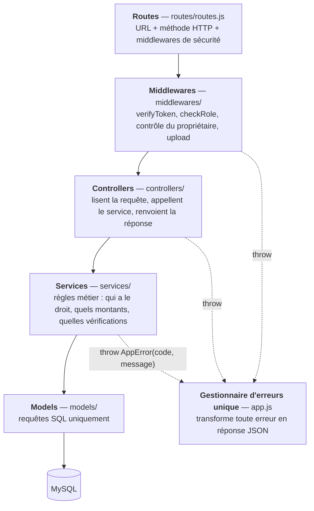

| Couche | Ce qu'elle fait | Ce qu'elle ne fait **pas** |
|---|---|---|
| Routes | Associe une URL à un controller et déclare les rôles autorisés | Aucune logique |
| Middlewares | Authentification, rôle, propriétaire, upload de fichiers | Accès métier aux données |
| Controllers | Extraient les champs de la requête, vérifient les champs obligatoires, formatent la réponse | SQL, règles métier |
| Services | Règles métier, transactions, contrôles de propriété | SQL brut, `req` / `res` |
| Models | Requêtes SQL paramétrées (`?`) | Décisions métier |

### 3.2 Cycle de vie d'une requête

Prenons un cas concret : un étudiant ouvre l'écran qui résume ses paiements. Voici tout ce qui
se passe entre le moment où il touche l'écran et celui où les chiffres s'affichent.

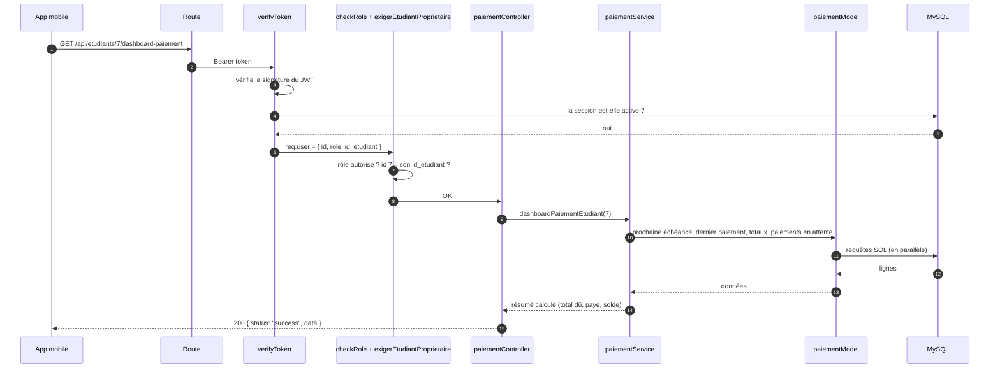

Si quelque chose cloche en route (pas de token, session révoquée, mauvais étudiant, erreur
SQL), l'étape concernée **lève une erreur** et s'arrête là. C'est le gestionnaire unique de
`app.js` qui se charge de renvoyer la bonne réponse (voir [§9](#9-gestion-des-erreurs)).

---

## 4. Acteurs, rôles et droits

### 4.1 Les acteurs

| Rôle | Application | Responsabilités |
|---|---|---|
| **Super Admin** | Web (+ mobile) | Gère tout : utilisateurs, rôles, formations, et toutes les actions de l'Accueil |
| **Accueil** | Web | Crée les dossiers étudiants, inscrit, encaisse, **valide les paiements reçus depuis le mobile**, envoie les rappels et les attestations, **résout les demandes d'assistance** |
| **Formateur** | Web | Consulte ses formations et ses étudiants, publie des supports de cours (tout de suite ou **à une heure programmée**), modère les commentaires, **fixe la note d'attestation** (à partir de la note suggérée) |
| **Étudiant** | Mobile | Consulte ses formations et supports, commente, réagit, **paie ses échéances** (paiement à valider), **écrit à l'assistance**, reçoit des notifications |

### 4.2 Matrice des droits (résumé)

| Fonction | Super Admin | Accueil | Formateur | Étudiant |
|---|:-:|:-:|:-:|:-:|
| Gérer les comptes utilisateurs et les rôles | ✅ | — | — | — |
| Modifier son propre profil | ✅ | ✅ | ✅ | ✅ |
| Créer / modifier un dossier étudiant | ✅ | ✅ | — | — |
| Créer / modifier une formation | ✅ | — | — | — |
| Voir les étudiants d'une formation | ✅ | ✅ | ses formations | — |
| Inscrire un étudiant, valider une inscription | ✅ | ✅ | — | — |
| Enregistrer un paiement validé (guichet) | ✅ | ✅ | — | — |
| Envoyer un paiement (en attente) | — | — | — | sa propre échéance |
| Valider / refuser un paiement | ✅ | ✅ | — | — |
| Voir les paiements | tous | tous | — | les siens |
| Générer fiche / facture / attestation | ✅ | ✅ | — | — |
| Publier un support de cours | — | — | ses formations | — |
| Programmer / modifier / envoyer un support programmé | ✅ (modifier, envoyer) | — | les siens | — |
| Supprimer un support | ✅ | — | les siens | — |
| Commenter / répondre / réagir (dont 👎) | ✅ | — | ✅ | ✅ |
| Supprimer un commentaire | tous | — | dans ses formations | les siens |
| Tableau de bord et export CSV | ✅ | ✅ | — | — |
| Envoyer un rappel de paiement / une attestation | ✅ | ✅ | — | — |
| Envoyer une demande d'assistance | — | — | — | ✅ |
| Voir / résoudre les demandes d'assistance | ✅ | ✅ | — | les siennes (lecture) |
| Voir le classement et la note système | ✅ | ✅ | ses formations | — |
| Voir l'avis des étudiants sur les formateurs | ✅ | ✅ | — | — |
| Voir la vitrine et s'inscrire en ligne | — | — | — | visiteur non connecté |
| Noter la présentation (sur 10) | ✅ | — | ses formations | — |
| Être marqué présent (automatique) | — | — | — | ✅ |
| Recherche globale | tout sauf supports | sans comptes utilisateurs | ses formations, étudiants, supports | ses formations et supports (mobile) |

Un point important : ces droits sont vérifiés **par le serveur**. Les menus du web et du mobile
cachent ce qu'un rôle n'a pas le droit de faire, mais cacher un bouton ne protège rien ; quelqu'un
d'un peu curieux peut toujours appeler l'API à la main. Le serveur contrôle donc deux choses :

1. **Le rôle** (`checkRole`) : « un étudiant n'a rien à faire sur cette route ».
2. **Le propriétaire** (`exigerEtudiantProprietaire`, `exigerSoiOuAdmin`, et des contrôles dans
   les services) : « un étudiant peut utiliser cette route, mais **uniquement pour ses propres
   données** ».

Sur le web, chaque rôle n'ouvre que les pages de **son menu**, même s'il tape l'adresse à la main
(`utils/navigation.js` : `NAVIGATION` liste les pages et leurs rôles, `peutOuvrir(role, page)`).
Un Accueil qui tape `/dashboard/utilisateurs`, ou un formateur qui tape `/dashboard/paiements`,
est simplement ramené au tableau de bord. Ce n'est pas là que se joue la sécurité : c'est surtout
pour éviter de tomber sur une page vide ou pleine d'erreurs. La vraie barrière reste le serveur.

---

## 5. Modèle de données

### 5.1 Schéma simplifié

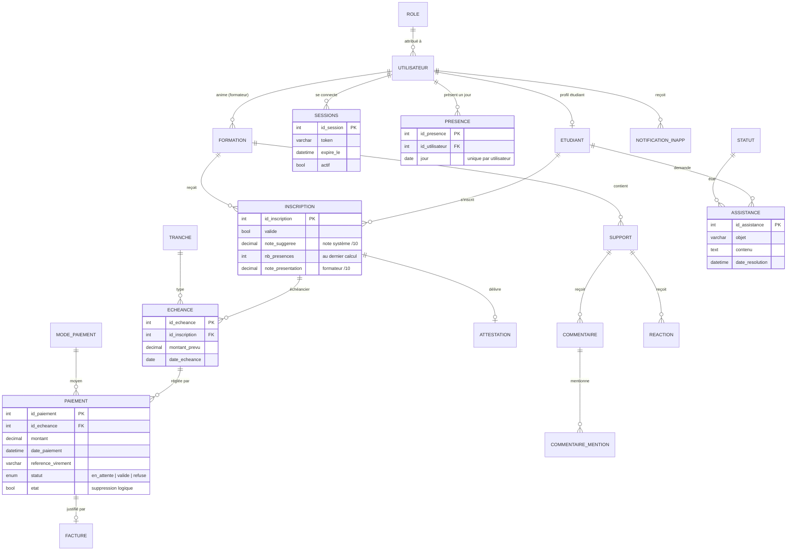

### 5.2 Conventions

| Convention | Signification |
|---|---|
| `etat` (booléen) | **Suppression logique** : une ligne « supprimée » passe à `etat = false` mais reste en base (historique, intégrité des paiements et factures) |
| `paiement.statut` | **Cycle de validation** d'un paiement (voir [§7.6](#76-paiement-dune-échéance-par-létudiant-mobile--validation-par-laccueil)) |
| `sessions.actif` | Une connexion ; passer à `0` déconnecte réellement l'appareil |
| `alerte_envoyee` | Mémorise les alertes automatiques déjà envoyées à l'Accueil (une seule fois chacune) |
| Montants | `DECIMAL(10,2)` en Ariary (MGA) |

### 5.3 Scripts SQL

| Fichier | Usage |
|---|---|
| `backend-imtech/base.sql` | Création complète de la base (schéma à jour) |
| `backend-imtech/donneesTest.sql` | Jeu de données de démonstration complet (voir ci-dessous) ; mot de passe de tous les comptes : `admin123` |
| `backend-imtech/scripts/fichiersDemo.js` | Fichiers des données de démonstration : photos de profil (téléchargées sur randomuser.me), pièces de dossier factices, supports PDF générés |
| `backend-imtech/alter2.sql` | Toutes les évolutions du schéma (blocs 001 à 007, puis les suivantes à la fin), à appliquer sur une base existante |
| `backend-imtech/reinit.sql` | Vide **toutes** les tables et remet les compteurs à 1 (structure conservée) |

Toutes les modifications du schéma vivent dans **un seul fichier**, `alter2.sql`. Chaque évolution y forme un bloc
numéroté (001, 002...) qu'on n'exécute qu'une fois. Quand le schéma change, on ajoute un nouveau
bloc à la fin et on ne lance que celui-là sur une base existante. En parallèle, `base.sql` est mis
à jour pour qu'une installation neuve parte directement du bon schéma.

#### Remettre la base en état de démonstration

```bash
cd backend-imtech
mysql -u root -p < reinit.sql          # vide toutes les tables
mysql -u root -p < donneesTest.sql     # recharge les données de démonstration
node scripts/fichiersDemo.js           # photos, pièces du dossier, supports (relançable)
```

Pendant le vidage, `reinit.sql` désactive les contrôles de clés étrangères
(`SET FOREIGN_KEY_CHECKS = 0`), ce qui évite d'avoir à vider les tables dans un ordre précis. Il faut
seulement penser à y ajouter chaque nouvelle table.

Les dates de `donneesTest.sql` sont calculées **à partir du jour où on charge les données**
(`CURDATE()`, `NOW()`). Ainsi, que la démonstration ait lieu aujourd'hui ou dans un mois, il y aura
toujours des retards, des échéances proches et une formation qui vient de se terminer. Les échéances
y sont calculées avec la même formule que `echeanceService.calculerEcheancier` (tranche n à
J + n × durée / nb, la dernière absorbant l'arrondi).

| Comptes (mot de passe `admin123`) | Rôle |
|---|---|
| `tljelia374@gmail.com` (Elia) | Super Admin |
| `hanitra.rasoanaivo@imtech.test`, `mamy.andriamanana@imtech.test` | Accueil |
| `tiana.randrianarisoa@imtech.test`, `voahangy.rakotomalala@imtech.test`, `hery.rajaonarison@imtech.test`, `lalaina.razafindrabe@imtech.test` | Formateurs |
| `prenom.nom@imtech.test` (Andry Rakotoarisoa, Miora Randriamampionona, Toky Ravelojaona…) | 12 étudiants |

Les adresses se terminent en `.test`, un domaine réservé (RFC 2606) qui n'existe pas : comme ça,
aucun e-mail de test ne risque d'atterrir dans la boîte d'une vraie personne.

| Scénario de démonstration | Données |
|---|---|
| Avis sur les formateurs | Tiana et Voahangy « Compétent », Hery « Non compétent », Lalaina « Pas assez d'avis » |
| Paiements | Validés, 3 en attente (2e tranche de Sitraka payée sur mobile, 2 inscriptions en ligne), 1 refusé (Toky) |
| Retards | Toky (Développement web) et Fano (Réseaux) : 2e tranche échue non payée |
| Inscriptions à valider | Mahery et Miora (en ligne, paiement déclaré), Haja (Accueil, pas encore payé) |
| Fin de formation | Fitiavana a terminé Bureautique (attestation à envoyer) ; Nomena termine dans 4 jours |
| Supports | 10 PDF + 1 image ; « Projet : site vitrine » programmé dans 2 jours à 8 h |
| Échanges | Fils de discussion avec réponses et mentions, 5 demandes d'assistance (3 en attente), notifications |
| Présence | Jours ouvrés depuis la première inscription, assiduité différente par étudiant (de 3 à 10 jours sur 10) |

---

## 6. Flux par page

**Page → action → fonctions métier → base de données.**

Ici, on parcourt l'application **écran par écran**. Pour chaque bouton ou presque, on suit la
requête de bout en bout : de l'interface jusqu'aux tables MySQL qu'elle lit ou modifie. Les règles
elles-mêmes (barèmes, cas particuliers, raisons des choix techniques) sont expliquées plus en
détail dans la section 7.

### 6.1 Comment lire les tableaux

```
Page (web / mobile)  →  Action  →  Route API  →  Fonctions métier  →  Tables
                                    (rôles)      controller → service → model     L = lecture, É = écriture
```

- **Page** : écran React (web) ou React Native (mobile), qui appelle l'API par un *hook*
  (`web/src/hooks/useXxx.js`, `mobile/src/hooks/use-xxx.ts`).
- **Route API** : préfixe `/api` omis ; entre crochets, les rôles autorisés (SA = Super Admin,
  AC = Accueil, FO = Formateur, ET = Étudiant, *public* = sans connexion, *connecté* = tout rôle).
- **Fonctions métier** : la fonction du **service** (là où sont les règles), puis celles du
  **model** (requêtes SQL). Le controller ne fait que lire la requête et appeler le service.
- **Tables** : **L** = lues, **É** = écrites. Toute route protégée lit aussi `sessions`
  (vérification du token à chaque requête, `authMiddleware`).
- **Adresse (web)** : entre parenthèses après le nom de la page, l'URL de chaque vue quand elle
  en a une (ex. fiche étudiant `/dashboard/etudiants/:id`, voir [§7.19](#719-fiches-dans-lurl-web)).
- **Liste paginée** : `?page=&limite=` dans la route = le serveur ne renvoie qu'une page de
  20 lignes et le total (voir [§7.20](#720-pagination-côté-serveur)).

Pour fixer les idées, voici le chemin complet quand un étudiant paie une échéance depuis son
téléphone :

```
Mobile « Paiements »  →  « Payer »  →  POST /paiements [SA, AC, ET]
  → paiementController.enregistrerPaiementController
  → paiementService.enregistrerPaiement   (montant imposé, échéance de l'étudiant, pas de double paiement)
  → paiementModel.getEcheanceAvecSituation, paiementModel.insererPaiement (statut « en attente »)
  → notifModel.insertNotificationsInApp (l'Accueil est prévenu)
  → Tables : L echeance, inscription · É paiement, notification_inapp
```

### 6.2 Pages communes (web et mobile)

**Connexion** (`web/src/pages/auth/Login.jsx`, `mobile/src/app/login.tsx`)

| Action | Route API | Fonctions métier | Tables |
|---|---|---|---|
| Se connecter | `POST /auth/login` [public, essais limités : §7.1] | `limiteRequetes` (échecs seulement) → `authService.authentifier` (bcrypt, JWT) → `userModel.findUserByEmail`, `etudiantModel.getIdEtudiantByUtilisateur`, `userModel.createSession` | L utilisateur, role, etudiant · É sessions |
| Mot de passe oublié | `POST /auth/forgot-password` [public, limité : §7.1] | `limiteRequetes` → `userService.demanderReinitialisation` → `userModel.insertResetToken` + e-mail (`utils/mailer`) | L utilisateur · É reset_password |
| Nouveau mot de passe | `POST /auth/reset-password` [public, limité : §7.1] | `limiteRequetes` (échecs seulement) → `userService.reinitialiserMotDePasse` → `findValidResetToken`, `updatePasswordHash`, `marquerTokenUtilise`, `deactivateAllSessions` | É reset_password, utilisateur, sessions |
| Se déconnecter | `POST /auth/logout` [connecté] | `authService.deconnecter` → `userModel.deactivateSession` | É sessions |
| Vérification de session (toutes les minutes) | `GET /auth/profil` [connecté] | `authService.recupererProfil` → `userModel.findUserById` ; 401 → retour à la connexion | L sessions, utilisateur |

**Profil** (fenêtre « Mon profil »)

| Action | Route API | Fonctions métier | Tables |
|---|---|---|---|
| Voir son profil | `GET /utilisateurs/:id` [soi-même ou SA] | `userService.recupererUtilisateur` → `userModel.findUserById` | L utilisateur, role |
| Modifier (nom, photo…) | `PUT /utilisateurs/:id` [soi-même ou SA] | `userService.modifierUtilisateur` → `userModel.updateUser` (photo dans `uploads/utilisateurs`) | É utilisateur |

**Paramètres > Sécurité**

| Action | Route API | Fonctions métier | Tables |
|---|---|---|---|
| Changer le mot de passe | `PUT /auth/change-password` [connecté] | `authService.changerMotDePasse` → `findUserWithPassword`, `updatePasswordHash`, `deactivateAllExcept` | É utilisateur, sessions |
| Voir les sessions / dernière connexion | `GET /auth/sessions`, `GET /auth/last-login` | `userModel.findSessionsByUser`, `findLastActiveSession` (le token n'est jamais renvoyé) | L sessions |
| Se déconnecter partout | `PUT /auth/logout-all` [connecté] | `userModel.deactivateAllExcept` (garde la session courante) | É sessions |

**Notifications** (web : tous les rôles du personnel ; mobile : étudiant)

| Action | Route API | Fonctions métier | Tables |
|---|---|---|---|
| Lister | `GET /notifications` [connecté] | `notifService.listerNotifications` → `notifModel.notifFindByUtilisateur` | L notification_inapp |
| Marquer comme lue / supprimer | `PUT /notifications/:id/lu`, `DELETE /notifications/:id` | `notifService.marquerCommeLue`, `supprimerNotification` (seulement les siennes) | É notification_inapp |

### 6.3 Web — Super Admin et Accueil

**Tableau de bord** (`components/dashboard/DashboardContent.jsx`)

| Action | Route API | Fonctions métier | Tables |
|---|---|---|---|
| Indicateurs (encaissé, reste à payer, retards…) | `GET /dashboard/kpi` [SA, AC] | `dashboardService.recupererKPI` → `dashboardModel.getKPI` (paiements **validés** seulement) | L paiement, echeance, formation |
| Courbe des encaissements | `GET /dashboard/evolution?periode=` | `recupererEvolution` → `getEvolution`, `getEvolutionParJour` | L paiement |
| Inscriptions par mois / top formations | `GET /dashboard/inscriptionParMois`, `/topInscription` | `dashboardModel.getDonneesInscriptionsParMois`, `getTopInscriptions` | L inscription, formation |
| Export CSV | `GET /dashboard/export-csv` | `dashboardService.genererExportCSV` | L inscription, etudiant, utilisateur, formation |
| Avis sur les formateurs | `GET /formateurs/avis` [SA, AC] | `reactionService.avisFormateurs` → `reactionModel.getReactionsParFormateur` | L reaction, support, utilisateur |

**Étudiants** (`pages/etudiants/` ; liste `/dashboard/etudiants`, fiche `/dashboard/etudiants/:id`, création `/nouveau`, modification `/:id/modifier`)

| Action | Route API | Fonctions métier | Tables |
|---|---|---|---|
| Lister / rechercher (20 par page) | `GET /etudiants?page=&limite=&recherche=` [SA, AC, FO] | `etudiantService.listerEtudiants` → `etudiantModel.getAllEtudiants` (`LIMIT / OFFSET`) + `compterEtudiants` (total) ; recherche dans nom, prénom, e-mail, téléphone | L etudiant, utilisateur |
| Fiche | `GET /etudiants/:id`, `GET /etudiants/:id/formations` | `recupererEtudiant`, `recupererFormationsEtudiant` | L etudiant, utilisateur, inscription, formation |
| Créer un dossier (+ pièces) | `POST /etudiants` [SA, AC] | `etudiantService.creerEtudiant` → `etudiantModel.insertUtilisateurEtEtudiant` (compte + dossier, fichiers dans `uploads/etudiants`) | É utilisateur, etudiant |
| Modifier / supprimer | `PUT` / `DELETE /etudiants/:id` | `modifierEtudiant` → `updateEtudiant` ; `supprimerEtudiant` → `deleteEtudiant` (suppression logique) | É etudiant, utilisateur |

**Utilisateurs** (Super Admin seulement, `pages/users/` ; liste `/dashboard/utilisateurs`, modification `/:id/modifier`)

| Action | Route API | Fonctions métier | Tables |
|---|---|---|---|
| Lister | `GET /utilisateurs` [SA] | `userService.listerUtilisateurs` → `userModel.findAllUsers` | L utilisateur, role |
| Créer un compte (Accueil, Formateur…) | `POST /utilisateurs` [SA] | `userService.creerUtilisateur` (mot de passe haché) → `userModel.insertUser` | É utilisateur |
| Désactiver | `DELETE /utilisateurs/:id` [SA] | `supprimerUtilisateur` → `deleteUser`, `deactivateAllSessions` | É utilisateur, sessions |

**Formations** (`pages/formations/` ; liste `/dashboard/formations`, fiche `/:id`, création `/nouvelle`, modification `/:id/modifier`)

| Action | Route API | Fonctions métier | Tables |
|---|---|---|---|
| Lister / fiche / étudiants | `GET /formations`, `/formations/:id`, `/formations/:id/etudiants` | `formationService.listerFormations`, `recupererFormation`, `recupererEtudiantsFormation` (un FO : seulement les siennes) | L formation, utilisateur, inscription, etudiant |
| Créer / modifier | `POST /formations`, `PUT /formations/:id` [SA] | `creerFormation` / `modifierFormation` (durée en jours vérifiée) → `insertFormation` / `updateFormation` | É formation |
| Image de couverture | `PUT /formations/:id/image` [SA] | `modifierImageFormation` → `updateImageFormation` (`uploads/formations`, public) | É formation |
| Désactiver | `DELETE /formations/:id` [SA] | `supprimerFormation` → `deleteFormation` (suppression logique) | É formation |

**Inscriptions** (`pages/inscriptions/` ; liste `/dashboard/inscriptions`, fiche `/:id`, création `/nouvelle`)

| Action | Route API | Fonctions métier | Tables |
|---|---|---|---|
| Lister (20 par page ; recherche, validée ou non, accueil / en ligne) | `GET /inscriptions?page=&recherche=&valide=oui\|non&origine=accueil\|en_ligne` [SA, AC] | `inscriptionService.listerInscriptions` → `getAllInscriptions` + `compterInscriptions` | L inscription, etudiant, utilisateur, formation, echeance, paiement |
| Inscrire un étudiant | `POST /inscriptions` [SA, AC] | `inscriptionService.creerInscription` (transaction) → `findFormationActive`, `inscriptionActiveExiste`, `insertInscription` + **échéancier** (1 à 4 tranches) | L formation, tranche · É inscription, echeance |
| Valider (premier paiement) | `POST /inscriptions/:id/valid` [SA, AC] | `validerInscription` → `setInscriptionValidee`, `validerPaiementDeclare` ou `insererPaiement` | É inscription, paiement |
| Échéancier d'une inscription | `GET /inscriptions/:id/echeances` | `echeanceService.listerEcheancesInscription` | L echeance, tranche |
| Fiche d'inscription (PDF) | `POST /fiche/:id_inscription/generer` | `documentService.creerFiche` → `documentModel.findInscriptionPourFiche` + `utils/pdf` | L inscription, etudiant, formation |
| Annuler | `DELETE /inscriptions/:id` | `supprimerInscription` → `deleteInscription` | É inscription |

**Paiements** (`pages/paiements/`)

| Action | Route API | Fonctions métier | Tables |
|---|---|---|---|
| Lister (20 par page ; statut, mode, recherche) | `GET /paiements?page=&statut=&mode=&recherche=` [SA, AC, ET] | `paiementService.listerPaiements` (un ET : seulement les siens) → `paiementModel.getAllPaiements` + `compterPaiements` (total, et nombre **en attente** sur toute la base pour le bandeau « à valider ») | L paiement, mode_paiement, echeance, inscription, etudiant, utilisateur, formation |
| Enregistrer au guichet | `POST /paiements` [SA, AC] | `enregistrerPaiement` (montant ≤ reste, pas de double paiement) → `getEcheanceAvecSituation`, `insererPaiement` | L echeance · É paiement |
| Valider / refuser un paiement en attente | `PUT /paiements/:id/valider` · `/refuser` [SA, AC] | `traiterPaiementEnAttente` → `paiementModel.changerStatutPaiementEnAttente` + notification à l'étudiant | É paiement, notification_inapp |
| Facture (PDF + QR) | `POST /factures/:id_paiement/generer` | `documentService.creerFacture` → `findPaiementPourFacture`, `insertFacture` | L paiement… · É facture |

**Échéances** (`pages/echeances/`)

| Action | Route API | Fonctions métier | Tables |
|---|---|---|---|
| Lister (20 par page ; recherche, couleur de suivi) | `GET /echeances?page=&recherche=&statut=VERT\|JAUNE\|ROUGE` [SA, AC] | `echeanceService.listerToutesEcheances` → `getAllEcheances` (couleur calculée en SQL) + `compterEcheances` | L echeance, inscription, etudiant, utilisateur, formation, paiement |
| Modifier date / montant | `PUT /echeances/:id` | `modifierEcheance` → `updateEcheance` | É echeance |
| Rappeler l'étudiant | `POST /echeances/:id/rappeler` | `rappelerEcheance` → `getEcheancePourRappel`, `marquerRappelEnvoye` + notification + e-mail | É echeance, notification_inapp |

**Documents, Assistance, Notifications envoyées, Paramètres**

| Page | Action | Route API | Fonctions métier | Tables |
|---|---|---|---|---|
| Documents | Lister / déposer / supprimer | `GET`, `POST /documents`, `DELETE /documents/:id` | `documentService.obtenirDocuments`, `creerDocument`, `supprimerDocument` | L/É document_administratif |
| Documents | Attestation (générer / envoyer) | `POST /attestations/:id/generer`, `/envoyer` | `creerAttestation` (note finale /20 calculée) → `getActiviteFormation`, `insertAttestation` | L presence, paiement · É attestation |
| — (QR code) | Vérifier une attestation | `GET /verification/:uuid` [public] | `documentService.verifierAuthenticite` → `findAttestationParUuid` | L attestation, inscription, formation |
| Assistance | Lister / résoudre une demande | `GET /assistances`, `PUT /assistances/:id/resoudre` | `assistanceService.listerDemandes`, `resoudreDemande` → `resoudreAssistance` + notification à l'étudiant | L/É assistance, notification_inapp |
| Notifications | Envoyer (in-app, e-mail, pièce jointe) | `POST /notifications/in-app`, `/email`, `/email/piece-jointe` [SA, AC] | `notifService.notifierInApp`, `notifierEmail`, `notifierEmailAvecPieceJointe` | É notification_inapp, notification_email |
| Paramètres (SA) | Fond de la vitrine mobile | `PUT` / `DELETE /vitrine/fond` [SA] | `vitrineService.modifierFondVitrine`, `reinitialiserFondVitrine` → `parametreModel.setParametre` | É parametre_application |

**Recherche globale** (bouton du header ou Ctrl+K, `components/recherche/RechercheGlobale.jsx`)

| Action | Route API | Fonctions métier | Tables |
|---|---|---|---|
| Chercher, puis ouvrir un résultat (adresse de la fiche : `utils/navigation.cheminResultat`) | `GET /recherche?q=` [SA, AC, FO ; ET : voir 6.5] | `rechercheService.rechercher` (groupes selon le rôle) → `rechercheModel.chercherEtudiants`, `chercherFormations`, `chercherInscriptions`, `chercherUtilisateurs` (SA), `chercherSupports` (FO) | L etudiant, utilisateur, role, formation, inscription, support |

### 6.4 Web — Formateur

**Espace formateur** (`pages/formateur/AccueilFormateur.jsx`)

| Action | Route API | Fonctions métier | Tables |
|---|---|---|---|
| Voir ses formations et leurs étudiants (fenêtre) | `GET /formations`, `GET /formations/:id/etudiants` [FO] | `formationService.recupererEtudiantsFormation` (seulement ses formations) | L formation, inscription, etudiant, utilisateur |
| Classement et note système | `GET /formations/:id/classement` | `classementService.classementFormation` → `getActiviteFormation`, `enregistrerSuggestions` | L presence, paiement, echeance, inscription · É inscription (note suggérée) |
| Noter la présentation (/10) | `PUT /inscriptions/:id/note` [SA, FO] | `classementService.definirNote` (≤ 10, sa formation) → `setNotePresentation` | É inscription |

**Supports** (`pages/formateur/SupportsFormateur.jsx`)

| Action | Route API | Fonctions métier | Tables |
|---|---|---|---|
| Publier ou programmer | `POST /supports` [FO] | `supportService.creerSupports` (HTML nettoyé par `utils/contenuRiche`, fichier 50 Mo max) → `createSupport` + notifications aux inscrits | É support, notification_inapp |
| Lister ses supports | `GET /formations/:id/supports` | `listerSupportsFormation` → `getSupportsByFormation` (recherche, filtres, tri côté navigateur) | L support, formation, utilisateur |
| Supprimer | `DELETE /supports/:id` [FO, SA] | `supprimerSupport` (auteur seulement) → `deleteSupport` | É support |
| Commenter / répondre / mentionner | `GET /supports/:id/commentaires`, `POST /commentaires` | `commentaireService.creerCommentaire` → `insertCommentaire`, `insertMentions` + notifications | L/É commentaire, commentaire_mention, notification_inapp |
| Réagir 👍 / 👎 | `POST` / `DELETE /supports/:id/reactions` | `reactionService.ajouterOuModifReaction` → `ajouterOuModifierReaction` | É reaction |

**Supports programmés** (`pages/formateur/ProgrammesFormateur.jsx`)

| Action | Route API | Fonctions métier | Tables |
|---|---|---|---|
| Lister | `GET /supports/programmes` [FO, SA] | `listerSupportsProgrammes` → `getSupportsProgrammes` | L support, formation |
| Modifier (titre, texte, heure, fichier) | `PUT /supports/:id` | `modifierSupportProgramme` → `updateSupportProgramme` | É support |
| Envoyer maintenant | `POST /supports/:id/envoyer` | `envoyerMaintenant` → `publierSupport` (mise à jour atomique) + notifications | É support, notification_inapp |

### 6.5 Mobile — Étudiant et visiteur

| Écran | Action | Route API | Fonctions métier | Tables |
|---|---|---|---|---|
| Découvrir (`app/decouvrir.tsx`, sans compte) | Voir la vitrine | `GET /public/vitrine` [public] | `vitrineService.contenuVitrine` → `getFormationsPubliques`, `getReactionsParFormateur`, `getModesPaiement`, `getParametre` | L formation, inscription, reaction, mode_paiement, parametre_application |
| Découvrir | S'inscrire en ligne (1 à n formations) | `POST /public/inscriptions` [public, 5 / h / IP] | `vitrineService.inscriptionEnLigne` (une transaction : compte, inscriptions, échéanciers, 1ᵉʳ paiement **en attente**) | É utilisateur, etudiant, inscription, echeance, paiement, notification_inapp |
| Accueil (`app/(tabs)/index.tsx`) | Résumé des paiements | `GET /etudiants/:id/dashboard-paiement` [ET : le sien] | `paiementService.dashboardPaiementEtudiant` | L paiement, echeance, inscription, formation |
| Formations | Mes formations / détail | `GET /etudiants/:id/formations`, `GET /formations/:id` | `recupererFormationsEtudiant`, `recupererFormation` | L inscription, formation |
| Documents (supports) | Liste, détail, commentaires, réactions | `GET /formations/:id/supports`, `/supports/:id`, `/supports/:id/commentaires`, `POST /commentaires`, `POST /supports/:id/reactions` | comme en 6.4 (l'étudiant ne voit que ses formations) | L support · É commentaire, reaction |
| Lecteur (`app/lecteur.tsx`) | Ouvrir un PDF / une image | `GET /supports/<fichier>?token=` | `fichierMiddleware` : droits (`fichierModel.etudiantPeutVoirSupport`) puis **filigrane** (`utils/filigrane`) | L sessions, inscription, support |
| Paiements (`app/paiements.tsx`) | Payer une échéance | `POST /paiements` [ET] | `paiementService.enregistrerPaiement` (montant imposé, **en attente**) + notification à l'Accueil | L echeance · É paiement, notification_inapp |
| Assistance (`app/assistance.tsx`) | Envoyer / suivre une demande | `POST /assistances` [ET], `GET /assistances` | `assistanceService.creerDemande` → `insertAssistance` + notification à l'Accueil | É assistance, notification_inapp |
| En-tête (🔍 de l'Accueil et de chaque écran, `components/recherche/recherche-globale.tsx`) | Recherche globale : écrans de l'app (sur place), ses formations, ses supports | `GET /recherche?q=` [ET] | `rechercheService.rechercher` → `rechercheModel.chercherFormationsEtudiant`, `chercherSupportsEtudiant` (supports **publiés** des inscriptions **validées**) | L formation, inscription, support |
| Notifications, Profil, Paramètres | voir 6.2 | | | |

### 6.6 Traitements automatiques (sans page)

Certaines choses se font sans que personne ne clique nulle part : le serveur s'en occupe seul,
en arrière-plan.

| Déclencheur | Fonctions métier | Tables |
|---|---|---|
| Chaque requête d'un étudiant | `authMiddleware.authentifier` → `presenceModel.marquerPresence` (un jour = une ligne) | É presence |
| Vérification périodique des supports programmés | `supportProgrammeService.verifierSupportsProgrammes` → `getSupportsAAnnoncer` (annonce 1 h avant), `getSupportsAPublier`, `publierSupport` | É support, notification_inapp |
| Vérification périodique des alertes | `alerteService` → `getEcheancesARappeler`, `getFormationsTerminees` (une seule alerte par objet) | É alerte_envoyee, notification_inapp |

---

## 7. Règles métier détaillées

Pour chaque fonctionnalité, on retrouve qui intervient, comment cela se déroule, quelles règles
s'appliquent et pourquoi.

### 7.1 Connexion, session et déconnexion

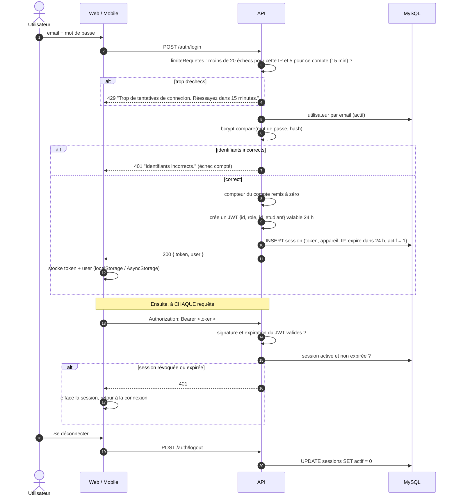

**Autour de la connexion :**
- *Paramètres → Sessions* : l'utilisateur voit la liste de ses appareils connectés (navigateur,
  IP, date), avec celui qu'il utilise en ce moment mis en évidence. **Les tokens, eux, ne sont
  jamais renvoyés.**
- *Déconnecter les autres appareils* (`PUT /auth/logout-all`) : toutes les sessions sont fermées
  sauf celle en cours. Les appareils concernés s'en rendent compte **en moins d'une minute**, car
  le web et le mobile revérifient la session (`GET /auth/profil`) chaque minute et à chaque retour
  au premier plan. Le 401 les renvoie alors à l'écran de connexion (sur mobile, avec l'alerte
  « Session fermée »). Deux onglets du même navigateur partagent une seule session, ils ne comptent
  donc pas comme des « autres appareils ».
- *Changer le mot de passe* : l'ancien est d'abord vérifié, le nouveau est enregistré (8 caractères
  minimum) et **les autres appareils sont déconnectés**, au cas où le changement viendrait d'un
  doute sur la sécurité du compte.

Vérifier seulement la signature du JWT ne suffirait pas : un token resterait valable 24 h même
après une déconnexion. C'est pourquoi chaque requête passe aussi par la table `sessions` : se
déconnecter déconnecte vraiment, et la durée de la session suit celle du JWT.

#### Limite des essais de connexion

Le but : empêcher quelqu'un d'essayer des mots de passe à l'infini (attaque par **force brute**),
sans pour autant bloquer l'utilisateur qui se trompe une ou deux fois.

| Route | Limite | Ce qui est compté | Regroupement |
|---|---|---|---|
| `POST /auth/login` | **5** échecs / 15 min | Seulement les **échecs** (réponse 4xx / 5xx) ; une connexion réussie remet le compteur à zéro | Adresse IP **+ e-mail** (un compte visé) ; l'e-mail est mis en minuscules et sans espaces |
| `POST /auth/login` | **20** échecs / 15 min | Seulement les échecs | Adresse IP seule (plusieurs comptes essayés depuis le même poste) |
| `POST /auth/forgot-password` | **5** demandes / heure | **Toutes** les demandes (chacune envoie un e-mail) | Adresse IP |
| `POST /auth/reset-password` | **10** échecs / 15 min | Seulement les échecs (code invalide ou expiré) | Adresse IP |

Une fois la limite atteinte, le serveur répond **429** avec un message clair (« Trop de tentatives
de connexion. Réessayez dans 15 minutes. »), que l'écran de connexion affiche tel quel, sur le web
comme sur le mobile.

Pourquoi deux limites ? Une limite par compte seule ne suffirait pas : l'attaquant n'aurait qu'à
changer d'e-mail. Une limite par IP seule serait trop brutale : tout un bureau qui sort par la
même adresse se retrouverait bloqué à cause d'une seule personne. En combinant les deux, on bloque
l'attaque sans pénaliser les autres.

```
Requête  →  limiteRequetes (IP)  →  limiteRequetes (IP + e-mail)  →  auth.login
                 │ 20 échecs ?            │ 5 échecs ?                    │
                 └──────── 429 ───────────┘                               └→ 401 : échec compté
                                                                             200 : compteur remis à zéro
```

- Middleware : `middlewares/limiteRequetes.js`, le même que pour l'inscription en ligne
  ([§7.17](#717-vitrine-publique-et-inscription-en-ligne)), avec deux options en plus : `cle(req)`
  (regroupement des essais) et `echecsSeulement` (le résultat est lu à la fin de la réponse,
  `res.on('finish')`).
- Les compteurs sont **en mémoire** et nettoyés régulièrement (une adresse dont tous les essais
  ont expiré est oubliée : pas de fuite de mémoire). Ils repartent à zéro au redémarrage du
  serveur (voir [§12](#12-limites-et-perspectives)).
- Déclarées dans `routes/routes.js` ; testées dans `tests/limiteConnexion.test.js`.

### 7.2 Mot de passe oublié

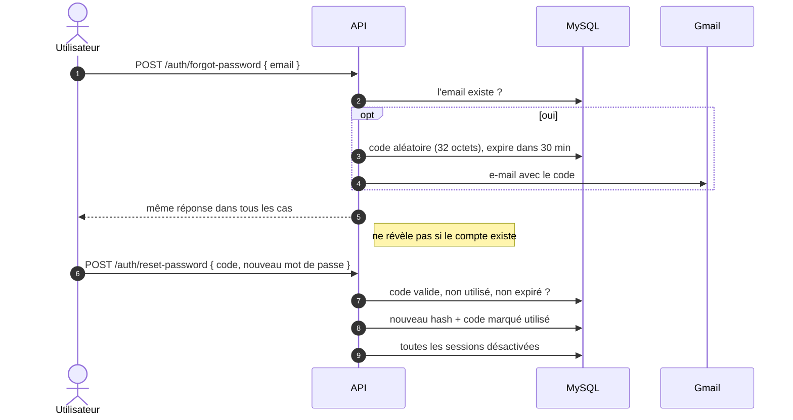

Le serveur répond la même chose que l'e-mail existe ou non : sinon, n'importe qui pourrait
s'en servir pour savoir qui a un compte chez IMTECH. Les deux routes sont aussi limitées
(réponse 429) : voir *Limite des essais de connexion* en [§7.1](#71-connexion-session-et-déconnexion).

### 7.3 Création d'un dossier étudiant (Accueil)

1. L'étudiant se présente à l'accueil. L'Accueil remplit le formulaire : identité, e-mail, mot
   de passe de départ, photo et pièces justificatives (photos, certificat de résidence, copie de
   CIN).
2. Le formulaire part vers `POST /etudiants` (multipart) ; `multer` enregistre les fichiers
   (images, PDF, Office ou texte, avec une taille maximale).
3. Le service crée le compte `utilisateur` et le profil `etudiant` **dans une même transaction** :
   soit les deux sont créés, soit aucun, jamais un compte sans dossier.
4. Le rôle **Étudiant** est fixé par le serveur, quoi que contienne le formulaire : sinon, il
   suffirait de modifier la requête pour qu'un compte Accueil crée un Super Admin.
5. Modifier un dossier ne touche que les champs envoyés (`COALESCE`) : les autres gardent leur
   valeur.

### 7.4 Inscription à une formation et génération de l'échéancier

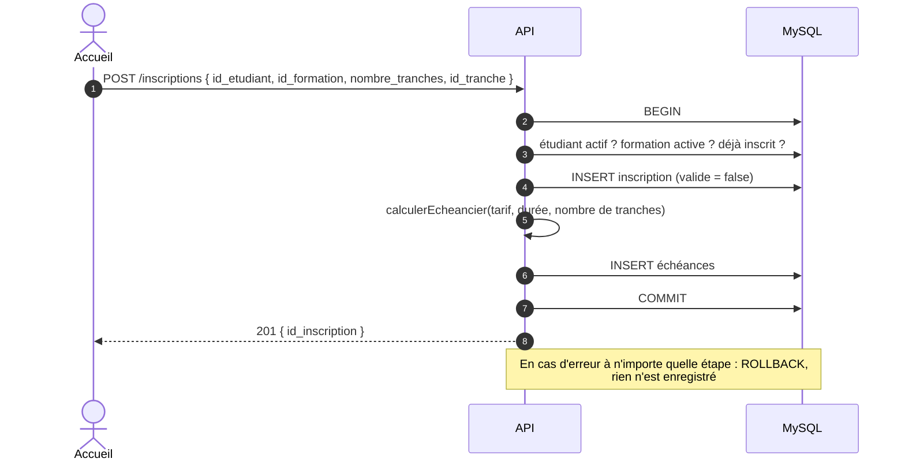

**Comment l'échéancier est calculé** (`services/echeanceService.js → calculerEcheancier`) :

- chaque tranche vaut le tarif divisé par le nombre de tranches, arrondi au centime ;
- la **dernière tranche récupère l'écart d'arrondi**, si bien que le total retombe toujours
  exactement sur le tarif ;
- l'échéance n° *n* tombe à la date du jour + *n* × (durée de la formation en jours ÷ nombre de
  tranches).

*Exemple :* une formation à 100 000 MGA sur 90 jours, payée en 3 fois :

| Tranche | Montant | Date |
|---|---|---|
| 1 | 33 333,33 | J + 30 |
| 2 | 33 333,33 | J + 60 |
| 3 | 33 333,34 | J + 90 |
| **Total** | **100 000,00** | |

L'inscription et son échéancier sont enregistrés dans la **même transaction** : il ne peut pas
exister d'inscription sans échéances. Le calcul est une fonction pure, vérifiée par des tests
automatisés.

### 7.5 Validation de l'inscription et premier paiement

1. L'étudiant paie sa première tranche ; l'Accueil clique sur *Valider* et indique le mode de
   paiement (espèces, virement…).
2. `POST /inscriptions/:id/valid` fait deux choses **dans une même transaction** : l'inscription
   passe à `valide = true`, **et** le paiement de la première échéance est enregistré (statut
   `valide`).
3. Si l'inscription est déjà validée, la demande est refusée (409). Un double clic ne peut donc
   pas faire payer deux fois la première échéance.
4. L'étudiant reçoit sa confirmation (notification dans l'application + e-mail).

### 7.6 Paiement d'une échéance par l'étudiant (mobile) → validation par l'Accueil

Un étudiant ne peut pas déclarer lui-même un paiement comme réglé : ce qu'il envoie depuis son
téléphone reste « en attente » tant que l'Accueil n'a pas vérifié que l'argent est bien arrivé.

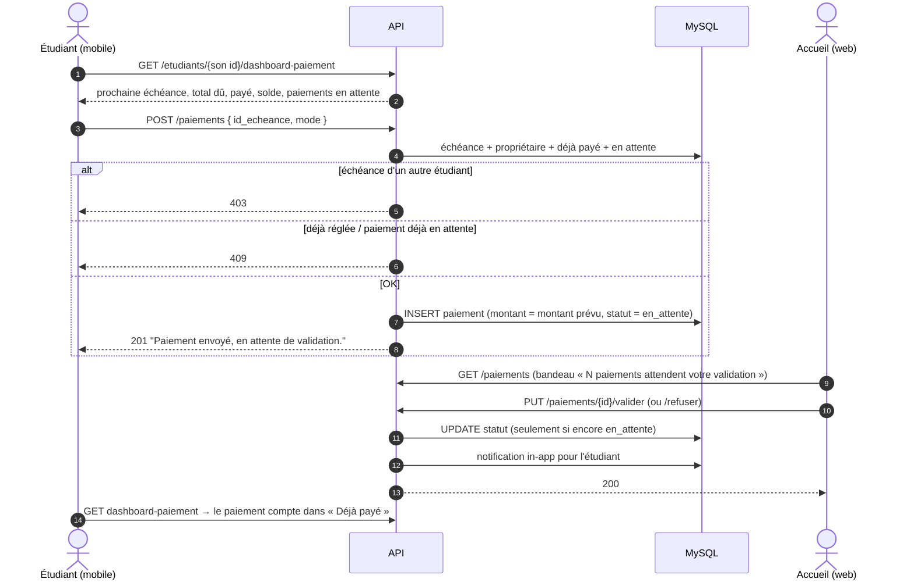

**Cycle de vie d'un paiement :**

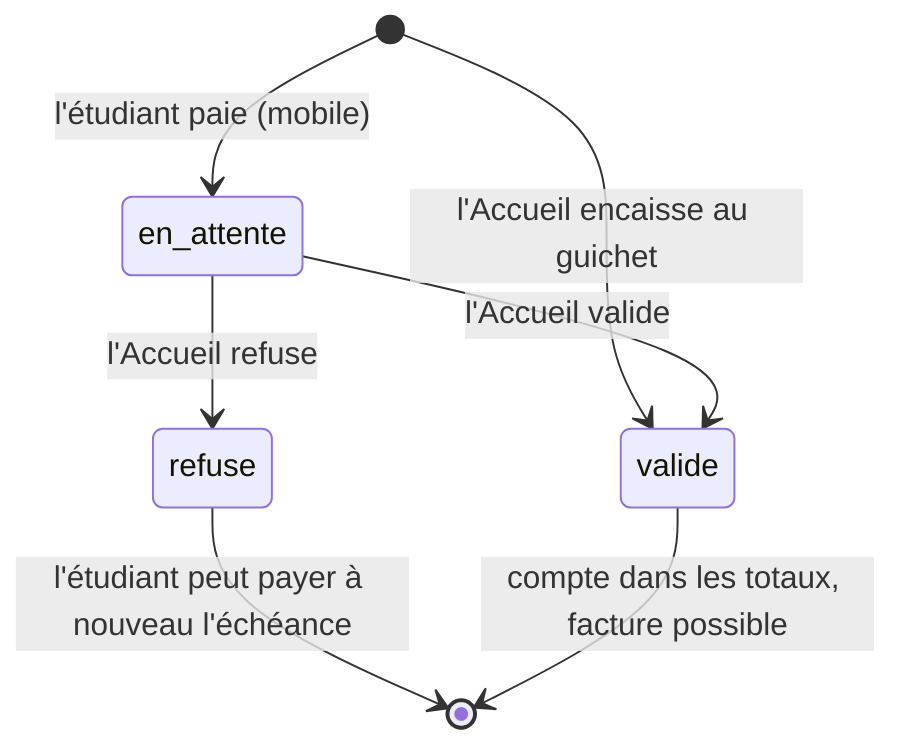

**Règles métier :**

| Règle | Étudiant | Accueil / Super Admin |
|---|---|---|
| Sur quelle échéance ? | Uniquement **la sienne** | Toutes |
| Montant | **Imposé** par le serveur (montant prévu) | Libre, paiement partiel autorisé, **plafonné au reste à payer** |
| Statut créé | `en_attente` | `valide` |
| Double paiement | Refusé si un paiement est déjà en attente | Refusé si l'échéance est soldée |

Tant qu'un paiement n'est pas `valide`, il ne compte pas dans l'argent encaissé : ni dans le
total payé et le solde de l'étudiant, ni dans les indicateurs du tableau de bord, ni pour émettre
une facture. (Pour la couleur des échéances, en revanche, un paiement envoyé compte déjà : voir
§7.7.)

Un étudiant ne voit que **ses propres** paiements. Sur le mobile, ses envois apparaissent dans
une section « En attente de validation » ; sur le web, l'Accueil dispose des boutons Valider /
Refuser.

### 7.7 Suivi des échéances et rappels de paiement

La page *Échéances* sert à l'Accueil à repérer d'un coup d'œil qui est à jour et qui ne l'est
pas. Pour chaque échéance, elle calcule ce qui a été payé (paiements validés), ce qui reste, et
lui donne une couleur :

| Couleur | Condition |
|---|---|
| 🟢 VERT « À jour » | Payée (paiement envoyé, même en attente de validation), ou date d'échéance encore loin (plus de 2 jours) |
| 🟡 JAUNE « À rappeler » | Non soldée, à J-2, J-1 ou le jour J → **le système notifie l'Accueil** |
| 🔴 ROUGE « En retard » | Date dépassée et non soldée |

Le rappel se fait **en deux temps** : le système prévient l'Accueil, et c'est l'Accueil qui décide
d'envoyer ou non le rappel à l'étudiant. Une personne garde donc la main : elle sait peut-être déjà
que l'étudiant passe payer demain.

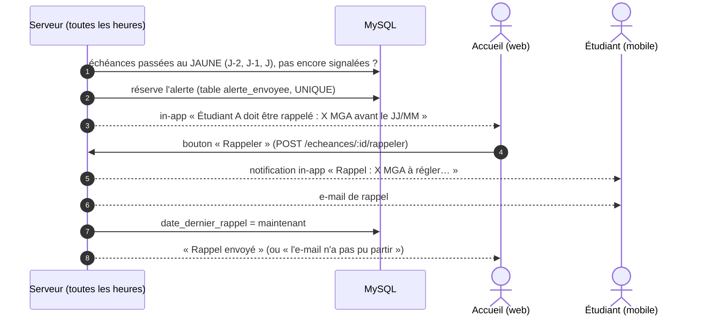

Un détail qui a son importance : dès qu'un étudiant **envoie** un paiement, celui-ci compte pour
la couleur, les alertes et le critère « paie à temps ». Ce serait injuste de le signaler en retard,
ou de lui envoyer un rappel, simplement parce que l'Accueil n'a pas encore eu le temps de valider.
La page Échéances affiche alors « Payé, à valider ». Les **montants encaissés** (totaux, reste à
payer, tableau de bord, factures) ne comptent, eux, que les paiements **validés**.

Le bouton **« Rappeler »** est présent sur toute échéance qui n'est pas soldée (et mis en avant
sur les lignes JAUNE et ROUGE). Celui du tableau de bord mène directement à la page Échéances.

La couleur et l'alerte reposent sur une seule règle partagée (`ECHEANCE_PROCHE` dans
`models/echeanceModel.js`). Ouvrir la page n'envoie rien : un rappel ne part que lorsque quelqu'un
clique sur « Rappeler ».

### 7.8 Documents officiels

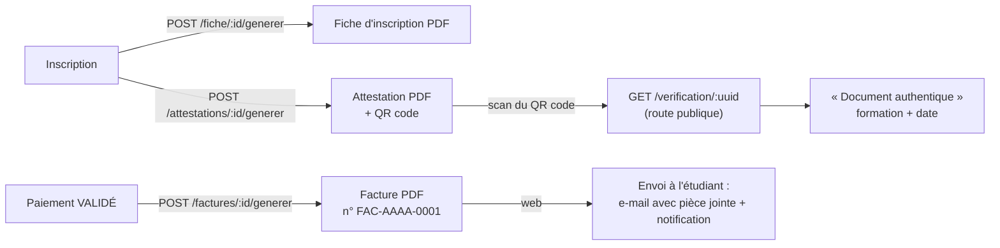

- Les PDF sont produits par `pdfkit` et rangés dans `uploads/documents/`.
- Chaque attestation porte un **identifiant unique (UUID)** et un QR code. Un employeur, par
  exemple, peut le scanner pour vérifier que le document est authentique, sans avoir besoin de
  compte.
- On ne peut faire une facture que pour un paiement **validé** : pas de facture pour de l'argent
  qui n'est pas encore arrivé.
- **Attestation de fin de formation** : quand la formation est terminée (date d'inscription + durée
  en jours), le système prévient l'Accueil : « Étudiant A a fini sa formation, envoyez-lui son
  attestation ». L'Accueil clique alors sur **« Attestation »** (page Inscriptions). La note est
  recalculée, le PDF est généré avec la ligne « Note obtenue : X / 20 », puis envoyé à l'étudiant
  (notification dans l'application + e-mail avec le PDF en pièce jointe).
- Les PDF sont écrits **jusqu'au bout** avant d'être renvoyés ou joints à un e-mail, pour
  qu'aucune pièce jointe ne parte incomplète.

### 7.9 Supports de cours, commentaires, mentions et réactions

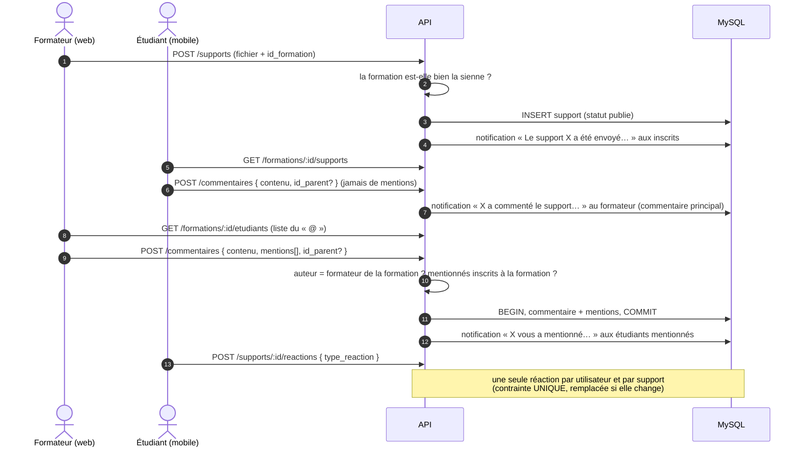

**Qui peut mentionner.** La mention sert à interpeller un étudiant précis ; c'est
donc le rôle du formateur, pas celui des étudiants :

| Auteur | Mention `@` | Comment il interpelle quelqu'un | Qui est notifié |
|---|---|---|---|
| Formateur de la formation, Super Admin | oui, **uniquement** les étudiants inscrits à la formation du support | `@` ouvre la liste des inscrits (web) | les étudiants mentionnés |
| Étudiant | **non** (403 si l'API reçoit des mentions) | il **répond** au commentaire visé | l'auteur du commentaire auquel il répond |
| Étudiant, commentaire principal | — | rien à faire | le **formateur de la formation**, automatiquement |

- `commentaire_mention` ne contient que `id_etudiant_mentionne` : c'est suffisant puisqu'on ne
  mentionne que des étudiants. L'étudiant n'a jamais besoin de mentionner le formateur, qui est
  prévenu de chaque nouveau commentaire principal sous ses supports (`notifierCommentaireFormateur`).
- Contrôles serveur (`commentaireService.verifierMentions`) : étudiant → 403 ; formateur d'une autre
  formation → 403 ; étudiant non inscrit à la formation → 400. Les applications n'ouvrent la liste
  `@` que pour le formateur du support et le Super Admin (même règle).
- Côté web, le texte garde « @Prénom Nom » ; au moment d'envoyer, seuls les étudiants dont le nom
  figure encore dans le texte sont envoyés dans `mentions` (effacer le nom retire la mention).
- Si l'auteur du commentaire auquel on répond est aussi mentionné, il reçoit une seule
  notification (la mention), pas deux.

**Modération :** le Super Admin peut supprimer n'importe quel commentaire ; un formateur, ceux
qui sont postés sous les supports de ses formations ; un étudiant, seulement les siens.

Un formateur ne publie que dans **ses** formations et ne supprime que **ses** supports. Les
notifications de mention ne partent qu'une fois le commentaire réellement enregistré.

Un support peut aussi être **programmé** pour partir plus tard : voir [§7.15](#715-envoi-programmé-des-supports).
Pour les réponses en fil de discussion, la réaction 👎 et l'avis sur les formateurs, voir [§7.16](#716-fil-de-discussion-réaction--je-naime-pas--et-avis-sur-les-formateurs).

### 7.10 Notifications

| Événement | Étudiant (mobile) | Accueil / Super Admin (web) | Déclenchement |
|---|---|---|---|
| Inscription confirmée | in-app + e-mail | — | Accueil valide l'inscription |
| Paiement envoyé depuis le mobile | — | in-app « Étudiant A a payé X MGA… à valider » | automatique |
| Paiement validé / refusé | in-app | — | Accueil valide / refuse |
| Échéance passée au JAUNE (J-2, J-1 ou J) | — | in-app « Étudiant A doit être rappelé » | automatique (toutes les heures) |
| Rappel de paiement | in-app + e-mail | — | bouton « Rappeler » |
| Facture | in-app + e-mail (PDF) | — | Accueil génère la facture |
| Formation terminée | — | in-app « Étudiant A a fini sa formation, envoyez-lui son attestation » | automatique |
| Attestation | in-app + e-mail (PDF avec la note) | — | bouton « Attestation » |
| Mention dans un commentaire (par le formateur) | in-app | — | automatique |
| Réponse à son commentaire | in-app | in-app (formateur) | automatique |
| Nouveau commentaire principal d'un étudiant | — | in-app « X a commenté le support… » au **formateur** de la formation | automatique |
| Nouvelle demande d'assistance | — | in-app « Étudiant A a envoyé une demande d'assistance » | automatique |
| Demande d'assistance résolue | in-app | — | bouton « Résoudre » |

- Les notifications destinées au personnel arrivent chez **tous** les comptes Accueil et Super
  Admin actifs : la première personne disponible peut s'en occuper.
- Si l'e-mail n'arrive pas à partir, la notification dans l'application est envoyée quand même,
  et l'écran prévient que l'e-mail a échoué.
- Chacun ne voit, ne marque comme lues et ne supprime **que ses propres** notifications.
- **Cloche avec compteur.** Web : cloche dans la barre du haut, seul accès à la page
  Notifications (aussi trouvable par la recherche Ctrl+K) ; mobile : onglet Notifications. Le
  nombre de non lues est affiché, **« 9+ »** au-delà de 9, et rien quand tout est lu. Il se met à
  jour au changement de page / d'onglet, toutes les minutes, au retour dans l'application et dès
  qu'une notification est lue ou supprimée.
- Le web et le mobile devinent la catégorie (Paiement, Attestation, Assistance…) à partir du texte
  du message, pour choisir l'icône et la couleur.

### 7.11 Tableau de bord (Super Admin, Accueil)

| Indicateur | Calcul |
|---|---|
| Montant encaissé | Somme des paiements **validés** |
| Reste à encaisser | Somme des échéances − montant encaissé |
| Paiements en retard | Échéances dépassées dont la **somme** des paiements validés est inférieure au montant prévu |
| Évolution | Encaissements par jour (semaine), mois ou année |
| Inscriptions par mois, top des formations | Statistiques d'inscription |
| Export CSV | Export des inscriptions |

### 7.12 Assistance

Quand un étudiant a un souci (un paiement qui n'apparaît pas, un support qui ne s'ouvre pas…), il
peut écrire à l'Accueil directement depuis l'application, sans devoir se déplacer ni chercher un
numéro de téléphone.

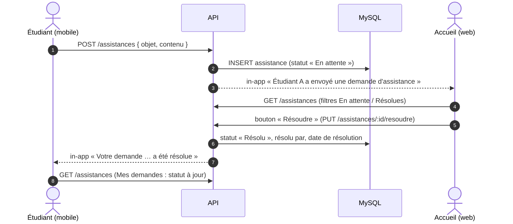

- Sur le mobile : menu ⋮ → **Assistance**, avec le formulaire et la liste « Mes demandes » qui
  montre où en est chacune.
- Sur le web : page **Assistance** (Accueil, Super Admin), avec la liste, le détail et le bouton
  **Résoudre**.
- Une demande déjà résolue ne peut pas l'être une seconde fois (409).

### 7.13 Présence, classement et note d'attestation

À la fin de sa formation, chaque étudiant reçoit une note **sur 20**, inscrite sur son
attestation. Elle se partage en deux moitiés : l'une est calculée par le système à partir de
deux critères qu'on peut mesurer objectivement (**paiement** et **présence**), l'autre est laissée
à l'appréciation du formateur (**présentation**), parce que certaines choses ne se calculent pas.
Les commentaires et les réactions ne comptent pas : un étudiant qui commente beaucoup n'est pas
forcément celui qui travaille le plus.

#### a) Présence automatique

Pas d'appel à faire en début de cours : **un étudiant qui utilise l'application un jour est
considéré présent ce jour-là**. À chaque requête d'un étudiant connecté, le serveur enregistre une
ligne `(étudiant, jour)` dans la table `presence`, une seule par jour grâce à une contrainte
`UNIQUE`.

On aurait pu se servir de la table `sessions`, mais elle ne convient pas. Une session n'est créée
qu'au moment de la **connexion** et dure 24 h. Un étudiant qui se connecte lundi à 18 h puis rouvre
l'application mardi matin ne crée pas de nouvelle session : il n'aurait pas été compté présent le
mardi. D'où une table dédiée.

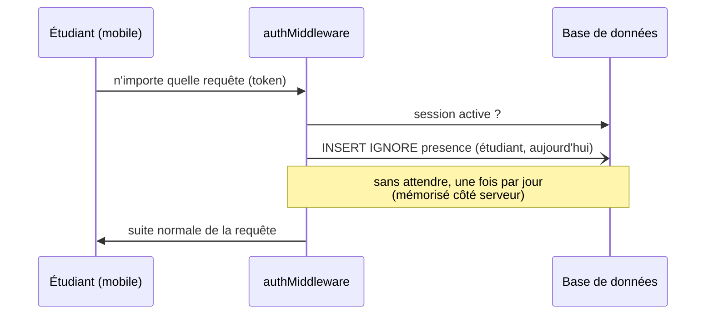

#### b) Jours de cours

La formation démarre à la **date d'inscription** et dure `duree_jours` jours. On ne compte que
les jours **du lundi au vendredi**, aussi bien pour les jours de cours que pour les présences : un
étudiant ne va pas perdre des points parce qu'il ne s'est pas connecté un dimanche.

Les week-ends sont comptés **sur le vrai calendrier**, pas estimés. Trois mois, ce n'est pas
exactement 3 × 4 = 12 semaines, mais plutôt 12,9 : l'approximation finirait par fausser le calcul.

| Exemple : formation de 90 jours commençant un lundi | Jours |
|---|:-:|
| Jours calendaires | 90 |
| Week-ends (12 semaines complètes × 2 + 1 samedi) | 25 |
| **Jours de cours** | **65** |
| Moitié des jours de cours | 32,5 |
| Jours de cours jusqu'à 2 semaines (14 jours) avant la fin | 55 |

(L'estimation 90 − 2 × 4 × 3 = 66 donne un jour de trop ; selon le jour de début, il y a 25 ou 26
jours de week-end dans 90 jours.)

#### c) Barème

| Partie | Condition | Points |
|---|---|:-:|
| **Paiement** | régulier : aucune échéance déjà due impayée ou payée après sa date (**date d'envoi** du paiement, même en attente de validation ; refusé = ignoré) | **5** |
| | sinon | **2** |
| **Présence** | moins de la moitié des jours de cours | **+2** |
| | au moins la moitié, mais pas présent jusqu'à 2 semaines avant la fin | **+3** |
| | présent au moins autant de jours que les jours de cours jusqu'à 2 semaines avant la fin | **+5** |
| = **Note système** | calculée, sur 10 (de 4 à 10) | **/10** |
| **Présentation** | libre, donnée par le formateur | **/10** |
| = **Note d'attestation** | note système + présentation | **/20** |

Si le formateur tape une note au-dessus de 10, le système la refuse en expliquant pourquoi :
*« Vous devez attribuer une note de 10 au maximum : les 10 autres points sont calculés par le
système (paiement et présence). »*

**Classement :** les étudiants sont rangés par note système, puis par nombre de jours de
présence. Deux étudiants à égalité partagent le même rang.

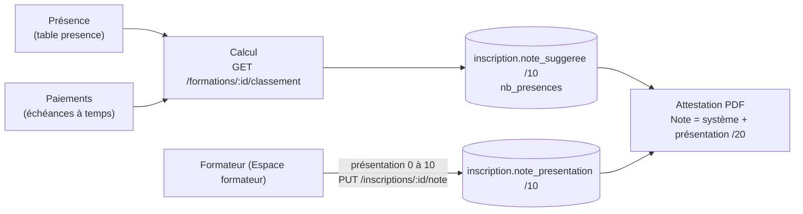

- La note système est recalculée chaque fois qu'on affiche le classement, et une dernière fois
  juste avant de générer l'attestation. Elle est **enregistrée en base**.
- Tant que le formateur n'a pas noté la présentation, l'attestation **ne peut pas être générée**
  (erreur 409, avec un message qui explique ce qui manque).
- Dans l'Espace formateur, le tableau montre pour chaque étudiant son rang, ses jours de présence
  sur le nombre de jours de cours, ses points de paiement et de présence, sa note système, la case
  pour saisir la présentation (avec un bouton **Effacer**) et sa note finale sur 20.
- Un formateur ne voit et ne note que les étudiants **de ses propres formations**.

### 7.14 Consultation sécurisée des documents

Les supports de cours sont le travail des formateurs, et les pièces des étudiants (copies de CIN,
certificats) sont des données personnelles. Il fallait donc deux choses : que ces documents ne
soient lisibles **que par les personnes autorisées**, et que si l'un d'eux sort quand même
d'IMTECH, la fuite soit **difficile et qu'on puisse en retrouver l'origine**.

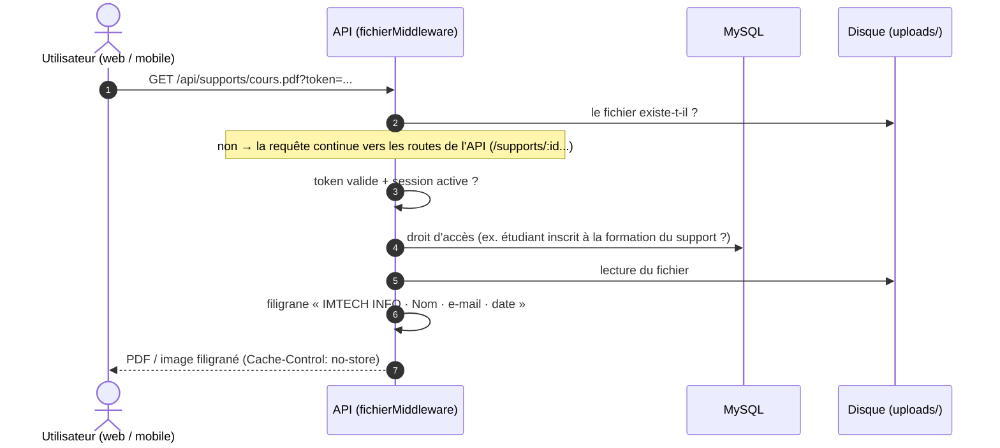

**1. Accès protégé.** Les fichiers ne sont pas servis « en statique », c'est-à-dire à qui
connaît l'adresse. `middlewares/fichierMiddleware.js` répond aux URL des fichiers
(`/api/supports/...`, `/api/documents/...`) mais demande d'être connecté. Le token peut être placé dans l'URL
(`?token=...`), parce qu'un simple lien, une balise image ou une WebView ne savent pas envoyer
l'en-tête `Authorization`. Les fonctions `getFileUrl` / `fileUrl` (web et mobile) s'en chargent
toutes seules. Conséquence pratique : un lien copié cesse de fonctionner dès qu'on se déconnecte.

| Dossier | Qui peut ouvrir le fichier | Filigrane |
|---|---|:-:|
| `supports/` | Personnel et formateurs ; un **étudiant uniquement s'il est inscrit** à la formation du support | Oui |
| `documents/` | Super Admin, Accueil, Formateur | Oui, sauf fiches, factures et attestations générées par IMTECH (documents officiels remis à l'étudiant) |
| `etudiants/` (CIN, certificats, photos) | Super Admin, Accueil ; l'étudiant pour **ses propres** pièces | Oui |
| `utilisateurs/` (photos de profil) | Tout utilisateur connecté | Non |

**2. Filigrane dynamique** (`utils/filigrane.js`). Au moment d'envoyer le fichier, le serveur
écrit en diagonale, sur toute la page, le nom et l'e-mail de la personne qui le consulte, ainsi
que la date. Le fichier stocké sur le disque, lui, n'est jamais modifié. Si une capture ou une
photo circule un jour hors d'IMTECH, on saura de quel compte elle vient. C'est d'ailleurs la seule
protection qui tienne face à quelqu'un qui photographie l'écran avec un autre téléphone.

**3. Formats des supports.** Un fichier de support doit être un **PDF ou une image** (PNG, JPEG,
WEBP, GIF), les formats qu'on sait filigraner et afficher dans le lecteur sécurisé, ou un **audio /
vidéo**, accepté sans filigrane (voir [§7.18](#718-supports-mis-en-forme--texte-riche-audio-vidéo-et-liens)).
Un autre format est refusé dès l'envoi (400).

**4. Lecteur sécurisé sur le mobile** (`app/lecteur.tsx`). Le support s'ouvre **dans
l'application** (WebView), et pas dans le navigateur du téléphone, d'où il serait trop facile de
le télécharger :
- PDF affiché page par page avec pdf.js, image affichée directement ;
- le fond autour du document suit le thème clair / sombre de l'application (couleur passée à la page HTML du lecteur) ;
- pas de téléchargement, pas d'appui long « Enregistrer l'image », pas de navigation vers une autre page ;
- **captures d'écran et enregistrements vidéo bloqués** tant que le lecteur est ouvert
  (`usePreventScreenCapture`) : écran noir sur Android, bloqué sur iOS 13+ ;
- aucun cache : rien n'est conservé sur le téléphone après la lecture.
- dans la version navigateur de l'app mobile (Expo web, utilisée pour le développement), la WebView
  n'existe pas : le lecteur passe par une `<iframe>`, et les captures ne peuvent pas y être bloquées.

**Pas de lecture hors ligne** pour l'instant. Il faudrait pour cela garder le fichier sur le
téléphone (chiffré, et lu par un lecteur natif) ; c'est noté dans les perspectives
([§12](#12-limites-et-perspectives)).

### 7.15 Envoi programmé des supports

Un formateur n'a pas toujours le temps de publier son support pile au début du cours. Il peut
donc le préparer à l'avance et choisir l'heure à laquelle il partira. Les étudiants, eux, sont
**prévenus une heure avant**, pour avoir le temps de s'organiser.

**Cycle de vie d'un support**

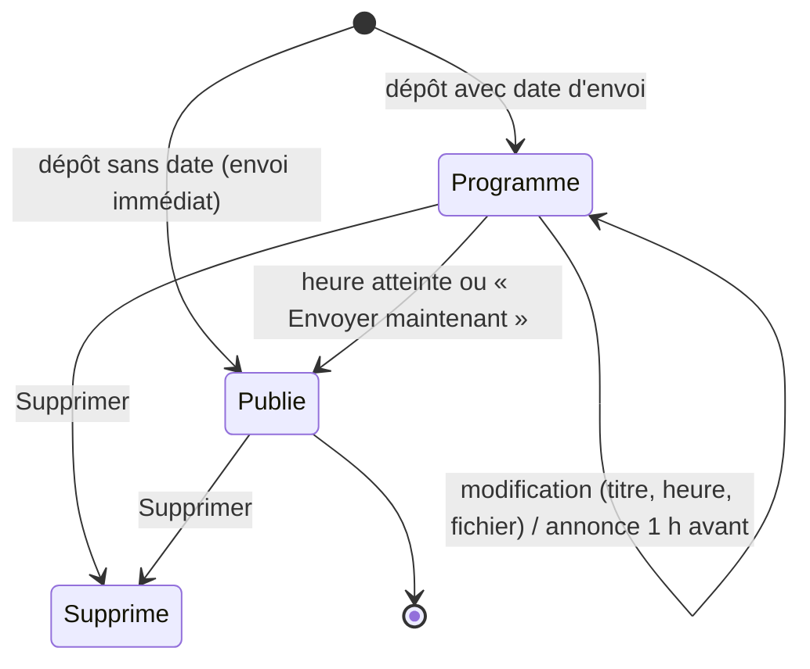

- Un support **programmé** (`support.statut = 'programme'`) est en fait un **brouillon** : les
  étudiants n'en voient rien (ni dans la liste, ni le détail, ni le fichier, ni les commentaires,
  ni les réactions). Le formateur le retrouve dans la page « Supports programmés », où il peut le
  **modifier** (titre, heure, fichier), l'**envoyer tout de suite** ou le **supprimer**.
- Un support **publié** (`'publie'`) est visible par les étudiants inscrits. À partir de là, on ne
  peut plus le modifier (409) : ce serait déroutant pour ceux qui l'ont déjà lu.

**Le planificateur.** Au démarrage du serveur, puis **toutes les minutes**,
`supportProgrammeService` passe en revue les supports programmés :

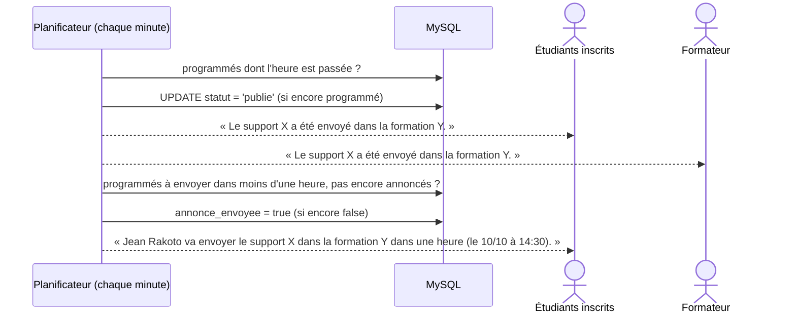

| Notification | Quand | Destinataires |
|---|---|---|
| « *Formateur* va envoyer le support « X » dans la formation Y **dans une heure** (le … à …) » | 1 h avant l'heure prévue (ou dès la programmation si l'envoi est dans moins d'une heure : « dans 20 minutes ») | Étudiants inscrits |
| « Le support « X » a été envoyé dans la formation Y. » | À l'envoi automatique | Étudiants inscrits **et** formateur |
| Même message | Envoi immédiat ou « Envoyer maintenant » | Étudiants inscrits |

- **Pas de doublon** : l'annonce et l'envoi sont « réservés » par un `UPDATE ... WHERE` qui ne
  peut réussir qu'une fois. Même si deux vérifications tombent en même temps, les étudiants ne
  reçoivent pas deux fois le même message.
- **Heure changée après l'annonce** : une nouvelle annonce part avec la bonne heure.
- L'heure choisie dans le navigateur est convertie en **ISO (UTC)** avant d'être envoyée, pour que
  le serveur reçoive l'instant exact, quel que soit son fuseau horaire.
- Si le serveur était éteint à l'heure prévue, le support part à la **première vérification**
  après son redémarrage : il n'est pas perdu.

### 7.16 Fil de discussion, réaction « Je n'aime pas » et avis sur les formateurs

#### a) Commentaires en fil de discussion

Les commentaires d'un support s'affichent **comme sur les réseaux sociaux**, ce qui évite aux
étudiants d'avoir à apprendre un fonctionnement nouveau : un commentaire principal, et juste en
dessous un lien « **Voir les N réponses** » qui déplie la conversation.

- `commentaire.id_parent` : `NULL` pour un commentaire principal, sinon l'id du commentaire
  principal auquel il répond.
- **Un seul niveau** de réponses : répondre à une réponse la rattache au même commentaire
  principal, avec « @Prénom Nom » pré-rempli (comme Facebook).
- L'API renvoie directement le fil : commentaires principaux **du plus récent au plus ancien**,
  chacun avec `reponses` (dans l'ordre chronologique) et `nb_reponses`.
- Web : 3 commentaires principaux affichés, puis « **Voir plus de commentaires** » ; les
  réponses sont repliées par défaut. Mobile : réponses repliées, bandeau « Réponse à X » au-dessus
  du champ de saisie (croix pour annuler).
- L'auteur du commentaire reçoit une notification « *X* a répondu à votre commentaire sur le
  support … ».
- Supprimer un commentaire principal supprime aussi ses réponses (elles ne s'affichent plus).

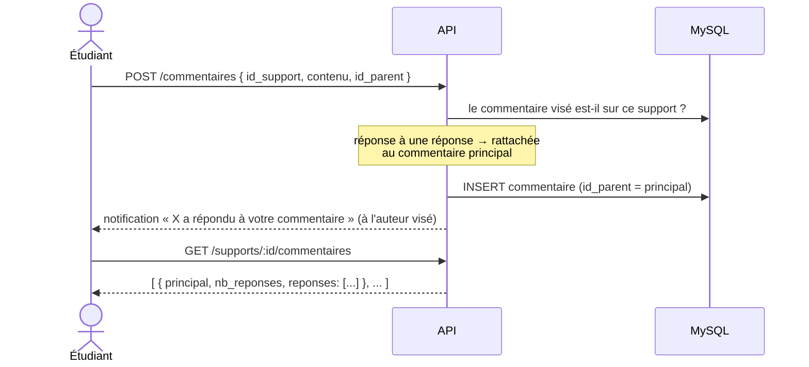

#### b) Réaction « Je n'aime pas » (👎)

C'est le quatrième type de réaction (`type_reaction.nom = 'dislike'`), à côté de 👍 J'aime,
❤️ J'adore et 💡 Utile : il permet aux étudiants de dire quand un support ne les a pas aidés. Les
applications envoient le **nom** du type (`{ type_reaction: 'dislike' }`) plutôt que son id, qui
peut changer d'une base à l'autre. On ne peut réagir qu'à un support **publié**.

#### c) Avis des étudiants sur les formateurs (back-office)

Ces réactions servent à quelque chose : sur le **tableau de bord** (Super Admin, Accueil), le
panneau « Avis des étudiants sur les formateurs » reprend chaque formateur avec les réactions
reçues sur ses supports publiés. La direction a ainsi un premier retour des étudiants, sans
questionnaire à faire remplir.

| Indicateur | Calcul |
|---|---|
| Réactions positives | 👍 + ❤️ + 💡 |
| Réactions négatives | 👎 |
| % positif | positives / (positives + négatives) |
| **Compétent** | au moins **5 réactions** et au moins **60 %** de positives |
| **Non compétent** | au moins 5 réactions et moins de 60 % de positives |
| **Pas assez d'avis** | moins de 5 réactions : on ne conclut pas |

Présentation (même tableau que la page Paiements, composants communs `Tableau` et `SearchFilterBar`) :

| Colonne | Contenu |
|---|---|
| # | Rang dans le classement affiché |
| Formateur | Photo, nom, nombre de supports publiés |
| Réactions | Pastilles 👍 ❤️ 💡 👎 avec leur nombre (👎 en rouge) |
| Total | Nombre total de réactions |
| Positif | Barre de progression + % (vert ≥ 60 %, orange ≥ 40 %, rouge en dessous) |
| Avis | Badge Compétent (vert) / Non compétent (rouge) / Pas assez d'avis (gris) |

- Tri par défaut : compétents, puis non compétents, puis pas assez d'avis (à avis égal : meilleur %).
- Barre au-dessus du tableau : recherche d'un formateur, filtre par avis, tri par type de réaction
  (👍, ❤️, 💡, 👎), par % positif, par nombre de réactions ou de supports ; bouton Réinitialiser.
- Les seuils sont des constantes (`AVIS_MINIMUM`, `TAUX_COMPETENT` dans `services/reactionService.js`).

### 7.17 Vitrine publique et inscription en ligne

Une personne **non inscrite** qui télécharge l'application découvre l'offre d'IMTECH INFO dès
l'ouverture (un peu comme la page d'accueil de Wattpad) et peut
s'inscrire elle-même, à une ou plusieurs formations. L'inscription suit **exactement le même
chemin qu'à l'accueil** : compte, inscription + échéancier, premier paiement, puis **validation
par l'Accueil**.

#### a) La vitrine (`app/decouvrir.tsx`, sans connexion)

C'est le premier écran qu'on voit quand personne n'est connecté (avec un lien « Se connecter » en
haut ; l'écran de connexion permet aussi de revenir à la vitrine).

| Bloc | Contenu | Source |
|---|---|---|
| Bandeau | Logo, slogan, présentation, nombre de formations et de formateurs reconnus | `config/vitrine.js` (.env) |
| Formations disponibles | Couvertures colorées en carrousel : nom, formateur, tarif, badge « Formateur compétent » ; « + » pour en choisir plusieurs | `GET /public/vitrine` |
| Fiche d'une formation | Description, formateur et % d'avis positifs, durée, tarif, **engagement de disponibilité du formateur** ; boutons « Ajouter à ma sélection » et « S'inscrire » | `formation.engagement_formateur` (saisi dans le back-office) |
| Formateurs les mieux notés | Formateurs jugés **compétents** (voir 7.16) et leurs formations | `reactionService.avisFormateurs` |
| Notre engagement | Disponibilité, supports dans l'app, attestation vérifiable, paiement en tranches | texte fixe |
| Nous contacter | Facebook, e-mail, WhatsApp (ouverts dans l'application correspondante) | `.env` : `IMTECH_FACEBOOK_URL`, `IMTECH_EMAIL`, `IMTECH_WHATSAPP`... |

Cette page étant publique, elle n'affiche aucune donnée personnelle d'étudiant : on y voit
seulement le nombre d'inscrits.

#### b) L'inscription en ligne (une ou plusieurs formations)

```mermaid
sequenceDiagram
    actor V as Visiteur (mobile)
    participant API
    participant DB as MySQL
    actor A as Accueil (web)
    V->>API: POST /public/inscriptions { identité, mot de passe, formations[], mode, référence }
    API->>API: formulaire valide ? e-mail libre ? (5 essais / heure / appareil)
    API->>DB: BEGIN
    API->>DB: compte utilisateur + dossier étudiant
    loop pour chaque formation choisie
        API->>DB: inscription (origine en_ligne, non validée) + échéancier (même fonction que l'Accueil)
        API->>DB: premier paiement EN ATTENTE (montant de la 1re échéance)
    end
    API->>DB: COMMIT (tout ou rien)
    API-->>A: notification « Nouvelle inscription en ligne… »
    API-->>V: « Inscription envoyée » + total à payer ; il peut se connecter
    A->>API: Inscriptions → filtre « En ligne » → Valider (pour CHAQUE inscription)
    API->>DB: inscription validée + paiement déclaré validé (pas de second paiement)
```

- **La même fonction que pour l'Accueil** : plutôt que de réécrire la logique,
  `inscriptionService.creerInscriptionDans` (inscription + échéancier) est appelée une fois par
  formation choisie, le tout dans une seule transaction. Si une étape échoue, rien n'est gardé.
- **Chaque inscription est validée à part** par l'Accueil, avec le bouton « Valider » habituel.
  À ce moment-là, c'est le paiement déjà déclaré qui est validé (le mode et la référence peuvent
  être corrigés), pour éviter d'enregistrer un deuxième paiement.
- **Le compte existe tout de suite** : l'étudiant peut se connecter (son e-mail est pré-rempli).
  Ses formations affichent « En attente de validation par l'accueil », et **les fichiers des
  supports ne s'ouvrent qu'une fois l'inscription validée**.
- Les pièces du dossier (CIN, certificat de résidence, photos) ne sont pas demandées en ligne ;
  l'Accueil les complète au moment de la validation.
- Quelques garde-fous : une formation choisie deux fois ne compte qu'une fois, 1 à 4 tranches par
  formation, mot de passe de 8 caractères minimum, et un e-mail déjà utilisé est refusé (409).

#### c) Images de la vitrine

- En haut de l'écran, le titre **« Découvrir »** s'affiche sur une image de réseau de neurones
  (`mobile/assets/images/fond-decouvrir.jpg`, embarquée dans l'application), sous un voile bleu
  nuit qui garde le texte lisible. Le bandeau occupe tout le haut de l'écran, barre d'état
  comprise.
- **Le Super Admin peut changer ce fond** depuis le web : Paramètres > Apparence > « Fond de la
  vitrine mobile » → `PUT /vitrine/fond`. L'image est rangée dans `uploads/vitrine/` et son chemin
  est gardé dans la table `parametre_application` (clé `fond_vitrine`). Le bouton « Par défaut »
  appelle `DELETE /vitrine/fond`. `GET /public/vitrine` renvoie ce chemin dans `presentation.fond` ;
  l'application l'affiche, ou reprend l'image embarquée si `fond` vaut `null`. Le logo du web, lui,
  est gardé dans le navigateur ; le fond, au contraire, doit être sur le serveur, puisque c'est
  l'application mobile qui l'affiche.
- Chaque formation a sa **photo de couverture** (colonne `formation.image`, fichier
  `formations/xxx.jpg` dans `uploads/`). Le Super Admin la choisit dans le formulaire de la
  formation sur le web (`PUT /formations/:id/image`). Sans photo, la couverture affiche une couleur
  avec les initiales de la formation.
- Ces images sont **publiques** : la vitrine se consulte sans être connecté, donc les dossiers
  `uploads/formations` et `uploads/vitrine` sont servis sans token ni filigrane, à la différence
  des supports et des documents.
- Pour la démonstration, les images sont des photos libres de droits trouvées sur Wikimedia
  Commons, téléchargées et recadrées par `node scripts/fichiersDemo.js`.

| Image | Fichier Wikimedia Commons | Auteur | Licence |
|---|---|---|---|
| Fond « Découvrir » (`mobile/assets/images/fond-decouvrir.jpg`) | Neural network - Midjourney and Grok.png | Midjourney (prompt suggéré par Grok) | Domaine public |
| Développement web | Colorful code (Unsplash).jpg | Markus Spiske | CC0 |
| Bureautique | Working in open office space (Unsplash).jpg | Crew | CC0 |
| Réseaux informatiques | EthernetSwitch.jpg | Raysonho (Open Grid Scheduler) | CC0 |
| Infographie | Math tools utensils (Unsplash).jpg | Jazmin Quaynor | CC0 |
| Python pour débutants | Laptop coding programs (Unsplash).jpg | Tirza van Dijk | CC0 |
| Excel avancé | Desktop with laptop and calculator (Unsplash).jpg | Auteur inconnu | CC0 |

### 7.18 Supports mis en forme : texte riche, audio, vidéo et liens

Un support ne se limite pas à un fichier : le formateur peut écrire des consignes, mettre un lien
ou partager un enregistrement. Il s'écrit comme dans un petit CMS : un **titre**, puis au choix un
**texte mis en forme**, une **pièce jointe** (PDF, image, audio, vidéo), ou les deux. L'envoi
immédiat ou programmé ([§7.15](#715-envoi-programmé-des-supports)), les commentaires et les
réactions s'appliquent à tous les supports.

#### a) Rédaction (web, page « Supports » du formateur)

Le menu du formateur compte trois pages : **Espace formateur** (ses formations, la liste des
étudiants, le classement et les notes d'attestation), **Supports** (pour publier, et retrouver
les supports déjà publiés avec recherche, filtres et tri) et **Supports programmés** (les
brouillons qui attendent leur heure).

1. Le formateur choisit la formation et saisit le titre.
2. Il rédige dans l'éditeur (`components/editeur/EditeurTexte.jsx`) : **gras**, *italique*,
   souligné, barré, titre / sous-titre, listes à puces ou numérotées, citation, **lien** (sur le
   texte sélectionné ; `www.site.com` devient `https://www.site.com`).
3. Il joint éventuellement un fichier (50 Mo max) : PDF, image, audio (MP3, M4A, OGG, WAV) ou
   vidéo (MP4, WEBM, MOV).
4. Le formulaire envoie `titre`, `contenu` (le HTML de l'éditeur) et `fichier` à `POST /supports`.
   Un brouillon programmé se modifie de la même façon (`PUT /supports/:id`).

#### b) Contrôles du serveur

```
contenu (HTML du navigateur)
   │  utils/contenuRiche.js — sanitize-html, liste blanche
   ▼
<p> <br> <strong> <em> <u> <s> <h2> <h3> <ul> <ol> <li> <blockquote> <a href="http(s)|mailto">
   │  tout le reste supprimé (script, style, attributs on*, images, iframes, javascript:...)
   ▼
support.contenu (MEDIUMTEXT)   ← HTML toujours propre en base
```

- Il faut au moins un texte **ou** un fichier ; sans fichier, le titre devient obligatoire. Le
  « texte vide » que laisse parfois l'éditeur (`<p><br></p>`) est traité comme une absence de texte.
- Un brouillon sans fichier ne peut pas se retrouver sans texte, sinon il ne resterait rien.
- Pourquoi ce nettoyage se fait-il sur le serveur ? Parce que ce texte s'affiche chez **tous** les
  étudiants de la formation. Sans liste blanche, un `<script>` glissé dans le texte (par un
  formateur mal intentionné, ou par quelqu'un qui aurait volé son compte) s'exécuterait chez chacun
  d'eux : c'est la faille **XSS**, qui permettrait par exemple de voler leur session. Nettoyer dans
  le navigateur ne suffirait pas, puisqu'on peut toujours contourner l'interface.

#### c) Lecture

| | Web (`SupportItem` → `ContenuSupport`) | Mobile (détail du support) |
|---|---|---|
| Texte | HTML injecté tel quel (déjà nettoyé) | `TexteRiche` : balises converties en composants natifs `<Text>` / `<View>` |
| Liens | Nouvel onglet, `rel="noopener noreferrer"` | Ouverts dans le navigateur (`Linking`), http(s) / mailto seulement |
| Audio / vidéo | Lecteur intégré, sans bouton « Télécharger » ni clic droit | Lecteur sécurisé (`app/lecteur.tsx`) : lecteur HTML5 dans la WebView, captures bloquées |
| PDF / image | Inchangé (lien, fichier filigrané) | Inchangé (lecteur sécurisé, filigrane) |

L'audio et la vidéo passent par le même contrôle d'accès que les autres supports
([§7.14](#714-consultation-sécurisée-des-documents)), mais **sans filigrane** : on ne sait pas en
ajouter un à la volée sur ce type de fichier. Le serveur les envoie par morceaux (`Range`), ce qui
permet d'avancer ou de reculer dans la lecture sans tout télécharger. Dans la liste des documents
(web), un support qui n'a que du texte n'apparaît pas, puisqu'il n'a pas de fichier.

### 7.19 Fiches dans l'URL (web)

Chaque vue du back-office a **sa propre adresse** : un rechargement (F5) garde la fiche ouverte,
« Précédent » revient à la vue précédente, et on peut envoyer le lien d'une fiche à un collègue.

| Section | Liste | Fiche | Création | Modification |
|---|---|---|---|---|
| Étudiants | `/dashboard/etudiants` | `/dashboard/etudiants/12` | `/dashboard/etudiants/nouveau` | `/dashboard/etudiants/12/modifier` |
| Formations | `/dashboard/formations` | `/dashboard/formations/3` | `/dashboard/formations/nouvelle` | `/dashboard/formations/3/modifier` |
| Inscriptions | `/dashboard/inscriptions` | `/dashboard/inscriptions/40` | `/dashboard/inscriptions/nouvelle` | — |
| Utilisateurs (SA) | `/dashboard/utilisateurs` | — | `/dashboard/utilisateurs/nouveau` | `/dashboard/utilisateurs/5/modifier` |

```mermaid
flowchart LR
    URL["/dashboard/etudiants/12"] --> DL["DashboardLayout<br/>route etudiants/*"]
    DL -->|"pageAutorisee : le rôle a-t-il ce menu ?"| SR["EtudiantsRoutes<br/>(SectionsRoutes.jsx)"]
    DL -->|non| TB["retour au tableau de bord"]
    SR -->|":id numérique"| F["EtudiantDetail<br/>studentId = 12"]
    SR -->|"id invalide (abc) ou chemin inconnu"| L["liste /dashboard/etudiants"]
    F -->|"GET /etudiants/12"| API[(API)]
```

Déroulement :
1. `DashboardLayout` déclare une route par section (`etudiants/*`, `formations/*`…), toujours
   protégée par la vérification du rôle ([§4](#4-acteurs-rôles-et-droits)) : un Accueil qui tape
   `/dashboard/utilisateurs/5/modifier` revient au tableau de bord.
2. `pages/dashboard/SectionsRoutes.jsx` contient les sous-routes de chaque section (liste,
   fiche `:id`, `nouveau`, `:id/modifier`). L'identifiant est lu avec `useParams` ; s'il n'est pas
   numérique, retour à la liste.
3. Les boutons des pages (« Voir », « Modifier », « Retour ») appellent `navigate()` avec les
   adresses de `utils/navigation.js` (`CHEMINS.etudiant(id)`, `CHEMINS.modifierFormation(id)`…).
   La recherche globale ([§7.22](#722-recherche-globale-web-et-mobile))
   utilise les mêmes adresses.
4. Lien ouvert **sans être connecté** : `App.jsx` envoie vers `/login` en gardant l'adresse
   demandée (`state.depuis`) ; après la connexion, on arrive directement sur la fiche.

Côté serveur, la fiche appelle les routes habituelles (`GET /etudiants/:id`…), et les contrôles
d'accès restent dans l'API. Un lien partagé n'ouvre donc rien à quelqu'un qui n'a pas le droit de
voir la fiche. `DashboardLayout` ne s'occupe que du menu, des préférences d'affichage
(`hooks/usePreferences.js`) et du compteur de notifications.

### 7.20 Pagination côté serveur

Au bout de quelques années, le centre aura des milliers de paiements. Les listes les plus longues
(étudiants, paiements, inscriptions, échéances) ne chargent donc pas **toute la table** à chaque
ouverture : le serveur renvoie une page de 20 lignes et le nombre total, et l'écran reste rapide
quelle que soit la taille de la base. Le bandeau « paiements à valider » compte, lui, sur toute la
base.

```mermaid
sequenceDiagram
    autonumber
    actor A as Accueil
    participant Page as Page Paiements (web)
    participant API
    participant DB as MySQL

    A->>Page: tape « rabe » dans la recherche
    Page->>Page: useListePaginee : attend 250 ms après la dernière frappe, retour à la page 1
    Page->>API: GET /paiements?page=1&limite=20&recherche=rabe&statut=en_attente
    API->>API: lirePagination → { page 1, limite 20, offset 0 } (limite ≤ 100)
    par en parallèle
        API->>DB: SELECT … WHERE filtres ORDER BY date DESC LIMIT 20 OFFSET 0
        API->>DB: SELECT COUNT(*) … WHERE mêmes filtres
        API->>DB: COUNT(*) des paiements en attente (bandeau « à valider »)
    end
    API-->>Page: { data: [20 lignes], pagination: { page, limite, total, pages }, compteurs }
    Page->>A: tableau + « 1–20 sur 57 » + boutons de pages
```

**Règles**

| Point | Règle |
|---|---|
| Paramètres | `?page=` (1 par défaut), `?limite=` (20 par défaut, **100 au maximum**) ; une valeur invalide est corrigée (page 0 ou « abc » → page 1) |
| Réponse | `{ status, data, pagination: { page, limite, total, pages } }` (+ `compteurs` pour les paiements) |
| Sans `?page=` | La route renvoie **toute la liste** (utilisé par l'application mobile et le tableau de bord) |
| Filtres | Appliqués **dans la requête SQL** (avant le `LIMIT`), donc le total et les pages correspondent au filtre. Une valeur de filtre inconnue est ignorée (ex. `statut=VIOLET`) |
| Recherche | `LIKE` sur nom, prénom, « prénom nom », « nom prénom » (+ e-mail et téléphone pour les étudiants, nom de la formation pour les autres listes) ; `%` et `_` tapés par l'utilisateur sont cherchés tels quels ; 100 caractères max |
| Tri | Stable (un identifiant en dernier critère) : une ligne n'apparaît pas sur deux pages |
| Étudiant | `GET /paiements` paginé reste limité à **ses** paiements |

**Filtres par liste**

| Liste | Filtres envoyés par la page | Fonctions métier |
|---|---|---|
| Étudiants | `recherche` | `etudiantService.listerEtudiants` → `etudiantModel.getAllEtudiants`, `compterEtudiants` |
| Paiements | `recherche`, `statut` (en_attente / valide / refuse), `mode` | `paiementService.listerPaiements` → `paiementModel.getAllPaiements`, `compterPaiements` |
| Inscriptions | `recherche`, `valide` (oui / non), `origine` (accueil / en_ligne) | `inscriptionService.listerInscriptions` → `inscriptionModel.getAllInscriptions`, `compterInscriptions` |
| Échéances | `recherche`, `statut` (VERT / JAUNE / ROUGE, calculé en SQL comme sur la page) | `echeanceService.listerToutesEcheances` → `echeanceModel.getAllEcheances`, `compterEcheances` |

**Côté web**
- `hooks/useListePaginee.js` : envoie la page et les filtres, revient à la page 1 quand un filtre
  change, attend 250 ms après la dernière frappe, **ignore une réponse dépassée** (filtre changé
  entre-temps) et recule d'une page si la dernière ligne d'une page est supprimée. Après une action
  (valider un paiement, supprimer…), `recharger()` redemande la page courante.
- `components/pagination/Pagination.jsx` : pied de tableau « 21–40 sur 95 » et boutons
  (`1 … 5 6 7 … 12`, calculés par `utils/pagination.numerosDePages`).
- Côté serveur, le code commun est dans `utils/pagination.js` (`lirePagination`, `clauseLimite`,
  `motifLike`, `reponsePaginee`) ; chaque model a une fonction de filtres partagée par la requête
  de la page et celle du total.
- Le formateur, dans la page Étudiants, n'est pas paginé : il ne voit que les étudiants de ses
  formations, chargés formation par formation.

### 7.21 Apparence : thème clair / sombre et couleur principale

Chacun peut adapter l'interface à son goût dans **Paramètres > Apparence** : thème clair ou
sombre, couleur principale (7 choix), taille du texte, densité, menu réduit, logo. Sur le web, ces
choix sont appliqués sur `<html>` (attributs `data-*` et variables CSS) et gardés dans le
navigateur (`hooks/usePreferences.js`) ; sur le mobile, c'est `SettingsContext` qui transmet la
palette à tous les styles.

Pour que tout cela fonctionne, une règle a été suivie partout : **aucune couleur écrite en dur**
dans les pages. Tout passe par des variables du thème. Sans cela, il suffit d'un seul bleu oublié
pour qu'un texte devienne invisible en mode sombre.

| Variable (web) / palette (mobile) | Rôle |
|---|---|
| `--accent` / `palette.accent` | Couleur principale. En sombre, une **version vive** de la couleur choisie est utilisée (Bleu IMTECH `#063a5c` → `#38bdf8`), sinon un bleu nuit sur fond sombre serait invisible (`utils/theme.js`) |
| `--on-accent` / `onAccent` | Texte posé sur un fond de couleur principale (boutons, onglets) |
| `--success`, `--danger`, `--warning` | Couleurs d'état (payé, retard, attention), avec une version claire pour le thème sombre |
| `color-scheme: dark` | Listes déroulantes, calendriers et barres de défilement du navigateur en sombre |

Contrastes mesurés en mode sombre (le seuil recommandé pour un texte est de 4,5:1) :

| Couleur | Contraste |
|---|---|
| Couleur principale (Bleu IMTECH) | **6,8:1** |
| Succès / Erreur | **8,4:1 / 5,3:1** |
| Texte sur bouton principal | **8,3:1** |

Le **Super Admin** choisit aussi le fond du bandeau « Découvrir » de l'application mobile
(enregistré sur le serveur, [§7.17](#717-vitrine-publique-et-inscription-en-ligne)).

### 7.22 Recherche globale (web et mobile)

Plutôt que de naviguer de menu en menu pour retrouver un étudiant, on peut le chercher
directement. En haut de chaque page, il y a un bouton **Rechercher…** (raccourci **Ctrl+K**). La
fenêtre qui s'ouvre cherche à la fois dans les **pages du menu** (sans appeler le serveur) et dans
les données (`GET /recherche`, selon le rôle). On choisit avec ↑ ↓ et on ouvre avec Entrée.
Chaque résultat mène directement à la bonne fiche : étudiant, formation, inscription, compte
utilisateur ; pour un formateur, son espace avec la liste des étudiants de la formation, ou la page
Supports filtrée sur le support trouvé. Comme chaque fiche a sa propre adresse
([§7.19](#719-fiches-dans-lurl-web)), ouvrir un résultat revient simplement à aller à cette adresse
(`navigate(cheminResultat(resultat, role))`).

**Sur le mobile (étudiant)**, la loupe 🔍 de l'Accueil et de l'en-tête de chaque écran (`DetailHeader`) ouvre une fenêtre plein écran, qui cherche dans :

| Groupe | Où | Règle | Un toucher ouvre |
|---|---|---|---|
| Écrans | Sur place (sans serveur), sans tenir compte des accents | Titre et mots-clés (« payer » → Paiements, « theme » → Paramètres) | L'écran |
| Mes formations | `GET /recherche` | Formations où l'étudiant a une inscription active, avec « En attente de validation » si l'Accueil ne l'a pas encore validée | Détail de la formation |
| Supports de cours | `GET /recherche` | Titre ou texte des supports **publiés** des formations dont l'inscription est **validée** (mêmes droits que la lecture des fichiers, [§7.14](#714-consultation-sécurisée-des-documents)) ; type (PDF, vidéo…), formation et date affichés | Fiche du support |

Les règles sont les mêmes que sur le web : il faut au moins 2 caractères, la requête part 250 ms
après la dernière touche tapée (pour ne pas interroger le serveur à chaque lettre), une réponse
arrivée trop tard est ignorée (`hooks/use-recherche.ts`), et on affiche 5 résultats par groupe.
Un compte étudiant sans fiche étudiant ne reçoit aucun résultat, et un étudiant ne voit jamais les
groupes réservés au personnel (étudiants, inscriptions, comptes).

---

## 8. Sécurité

L'application manipule de l'argent, des pièces d'identité et des documents qui ont de la valeur.
Le tableau suivant résume, pour chaque risque qu'on a identifié, ce qui a été mis en place pour
s'en protéger.

| Menace | Protection mise en place |
|---|---|
| Vol de mot de passe en base | Hachage `bcrypt` ; les hashs ne sont jamais renvoyés ni journalisés |
| Utilisation d'un token après déconnexion | Vérification de la session active à chaque requête |
| Accès à une fonction non autorisée | `checkRole` sur chaque route |
| Accès aux données d'un autre utilisateur (IDOR) | Contrôles de propriétaire (étudiant, formateur, compte) |
| Élévation de privilèges | Seul le Super Admin peut changer un rôle ; rôle Étudiant imposé à la création d'un dossier |
| Fraude sur les paiements | Montant imposé, échéance vérifiée, validation humaine par l'Accueil |
| Injection SQL | Requêtes paramétrées (`?`) dans tous les models |
| Fuite d'informations techniques | Les erreurs 500 renvoient un message générique |
| Énumération des comptes | « Mot de passe oublié » renvoie la même réponse que l'e-mail existe ou non |
| Essais de mots de passe à l'infini (force brute) | Échecs de connexion limités par compte et par adresse IP, demandes « mot de passe oublié » limitées ; réponse 429 ([§7.1](#71-connexion-session-et-déconnexion)) |
| Liste énorme demandée pour ralentir le serveur | Pagination plafonnée à 100 lignes par page ([§7.20](#720-pagination-côté-serveur)) |
| Fichiers malveillants | Liste blanche des types de fichiers et taille maximale à l'upload |
| Script injecté dans le texte d'un support (XSS) | HTML nettoyé à l'enregistrement par une liste blanche de balises (`sanitize-html`), liens http(s) / mailto uniquement ([§7.18](#718-supports-mis-en-forme--texte-riche-audio-vidéo-et-liens)) |
| Accès aux fichiers par URL | Fichiers servis uniquement à un utilisateur connecté ayant le droit de les voir ([§7.14](#714-consultation-sécurisée-des-documents)) |
| Fuite des documents hors d'IMTECH | Filigrane au nom de la personne, lecteur mobile sans téléchargement, captures bloquées sur mobile |
| Secret JWT faible ou absent | Le serveur refuse de démarrer sans `JWT_SECRET` |

> **Limite connue** : sur le **web**, aucun navigateur ne permet d'empêcher une capture d'écran.
> Là, c'est le filigrane qui fait l'essentiel du travail. Voir [§12](#12-limites-et-perspectives).

---

## 9. Gestion des erreurs

Quelle que soit l'erreur, elle suit toujours le même chemin : la couche qui repère le problème
**lève** une erreur, puis un **gestionnaire unique** (dans `app.js`) se charge de construire la
réponse. Chaque code HTTP a un sens précis, ce qui permet aux applications d'afficher le bon
message à l'utilisateur :

| Code | Signification | Exemple |
|---|---|---|
| 400 | Requête invalide | Champ obligatoire manquant, montant négatif, JSON mal formé, fichier trop lourd |
| 401 | Non authentifié | Token absent, expiré, ou session révoquée |
| 403 | Interdit | Mauvais rôle, ou ressource appartenant à quelqu'un d'autre |
| 404 | Introuvable | Paiement, étudiant, formation inexistants |
| 409 | Conflit | E-mail déjà utilisé, échéance déjà réglée, paiement déjà traité, inscription déjà validée |
| 429 | Trop de requêtes | Trop d'échecs de connexion, trop de demandes « mot de passe oublié » ou d'inscriptions en ligne |
| 500 | Erreur inattendue | Message générique ; le détail est écrit uniquement dans les logs du serveur |

Les services lèvent une `AppError(code, message)` (`utils/errors.js`) : les controllers n'ont donc
pas de `try/catch`, et le code HTTP ne dépend jamais du texte du message.

---

## 10. Qualité et tests

### 10.1 Tests automatisés du backend

Pour les lancer : `cd backend-imtech && npm test`. Il y en a 101, et ils n'ont pas besoin de base
de données : les models sont remplacés par des simulations, ce qui permet de les exécuter en
quelques secondes, sur n'importe quel poste.

| Fichier | Ce qui est vérifié |
|---|---|
| `tests/echeancier.test.js` | Somme exacte des tranches, arrondi, dates, refus d'un nombre de tranches invalide |
| `tests/paiementService.test.js` | Paiement étudiant en attente au montant imposé, refus sur l'échéance d'un autre, double paiement, plafond du reste à payer, validation unique, liste limitée à l'étudiant |
| `tests/classement.test.js` | Jours de cours sans les week-ends, points de paiement (5 / 2) et de présence (2 / 3 / 5), note système de 4 à 10, note finale /20, égalités au classement |
| `tests/supportProgramme.test.js` | Annonce 1 h avant (texte, destinataires), envoi automatique (étudiants + formateur), pas de doublon, date d'envoi invalide ou passée refusée, brouillon d'un autre formateur ou déjà envoyé non modifiable |
| `tests/commentairesReactions.test.js` | Fil de discussion (ordre, réponses rattachées, réponses orphelines masquées), réponse refusée sur un autre support, réaction inconnue ou sur un support non publié refusée, 👎 enregistré, avis compétent / non compétent / pas assez d'avis et tri |
| `tests/vitrine.test.js` | Formulaire d'inscription en ligne (champs, mot de passe, tranches, doublons), inscription à 2 formations (2 inscriptions « en ligne », 2 paiements en attente, total), e-mail déjà utilisé, validation qui reprend le paiement déclaré, route publique limitée à 5 essais par heure, fond du bandeau (enregistrement, retour au fond par défaut, modification refusée sans connexion) |
| `tests/recherche.test.js` | Recherche globale : rien sous 2 caractères, `%` / `_` échappés, groupes selon le rôle (SA avec utilisateurs, Accueil sans, formateur limité à ses formations / étudiants / supports, étudiant limité à ses formations et aux supports de ses formations, étudiant sans fiche = aucun résultat), route 401 sans connexion, 200 pour un étudiant sans groupes du personnel |
| `tests/fichiers.test.js` | Fichier refusé sans connexion, support refusé à un étudiant non inscrit, PDF et image filigranés et sans cache, token accepté dans l'URL, documents administratifs refusés aux étudiants, routes `/supports/:id` toujours accessibles, `../` impossible, support Word refusé à l'upload, couverture de formation publique sans filigrane |
| `tests/contenuRiche.test.js` | Texte mis en forme : balises gardées ou converties, XSS supprimé (script, `onclick`, `javascript:`), liens en nouvel onglet, texte vide ; support texte seul, support vide ou sans titre refusé, texte d'un brouillon sans fichier non supprimable |
| `tests/limiteConnexion.test.js` | Connexion : 429 après 5 mauvais mots de passe sur un compte (même avec majuscules / espaces), autre compte encore possible, réussite qui remet le compteur à zéro, blocage de tous les comptes après 20 échecs depuis une IP ; mot de passe oublié : 429 après 5 demandes |
| `tests/pagination.test.js` | Sans `?page` : liste complète ; page et limite bornées (max 100) et converties en offset, nombre de pages ; filtres transmis au model (recherche nettoyée, statut, mode), nombre de paiements en attente, étudiant limité à ses paiements, valeurs de filtre inconnues ignorées |
| `tests/autorisations.test.js` | Tests HTTP de bout en bout : 401 sans token, session révoquée refusée, étudiant ne pouvant pas modifier un autre compte ni changer son rôle, accès au tableau de paiement d'autrui refusé, tokens jamais renvoyés, erreur 500 sans fuite |

### 10.2 Analyse statique

| Projet | Outil | Résultat |
|---|---|---|
| Web | ESLint | 0 erreur (avertissements restants : dépendances de hooks) |
| Mobile | ESLint (config Expo) + TypeScript (`tsc --noEmit`) | 0 erreur, typage valide |
| Web | Build de production (`vite build`) | OK |

---

## 11. Organisation du code

```
gestionFormation_stage/
├── FLUX-APPLICATION.md         ← ce document (support de référence)
├── SCENARIOS-TESTS.md          ← scénarios de test de chaque fonctionnalité (recette, soutenance)
├── CHEAT-SHEET.md              ← aide-mémoire du projet (sans IA)
├── cheat-sheets/               ← aide-mémoires généraux : node.md, react.md, mysql.md
├── A-FAIRE.md                  ← reste à faire
│
├── backend-imtech/             API REST (Node.js / Express 5)
│   ├── app.js                  configuration Express, fichiers protégés, gestionnaire d'erreurs
│   ├── api.md                  liste des routes et des droits
│   ├── config/
│   │   ├── db.js               pool MySQL
│   │   └── roles.js            constantes des rôles
│   ├── routes/routes.js        toutes les routes /api/...
│   ├── middlewares/            authMiddleware (token, rôle, propriétaire), docUpload (multer),
│   │                           fichierMiddleware (accès protégé aux fichiers + filigrane),
│   │                           limiteRequetes (essais de connexion, inscription en ligne)
│   ├── controllers/            un fichier par domaine (paiement, inscription, support...)
│   ├── services/               règles métier
│   ├── models/                 requêtes SQL
│   ├── utils/                  errors, transaction, mailer, pdf, qrcode, filigrane, pagination
│   ├── tests/                  tests automatisés
│   ├── scripts/fichiersDemo.js fichiers des données de démonstration
│   └── base.sql, alter2.sql, donneesTest.sql, reinit.sql
│
├── web/                        back-office (React + Vite)
│   └── src/
│       ├── utils/api.js        apiRequest + gestion de la session
│       ├── utils/navigation.js menus par rôle, adresses des fiches (CHEMINS)
│       ├── hooks/              un hook par ressource (usePaiement, useEtudiant...),
│       │                       useListePaginee (listes paginées), usePreferences (apparence)
│       ├── components/         composants réutilisables (Tableau, Modal, Filter, Sidebar, Pagination...)
│       └── pages/              une page par menu (paiements, inscriptions, échéances...)
│           ├── dashboard/SectionsRoutes.jsx  sous-routes liste / fiche / formulaire
│           └── parametres/       Parametres.jsx (menu) + un composant par onglet
│                                 (OngletApparence, OngletSecurite, FormulaireMotDePasse, FondVitrine)
│
└── mobile/                     application étudiant (React Native + Expo)
    └── src/
        ├── app/                écrans (Expo Router : navigation par fichiers)
        │   ├── (tabs)/         Accueil, Formations, Documents, Notifications, Profil
        │   ├── decouvrir.tsx   vitrine publique et inscription en ligne (sans connexion)
        │   ├── login.tsx, paiements.tsx, parametres.tsx
        │   ├── assistance.tsx  demandes d'assistance à l'Accueil
        │   └── lecteur.tsx     lecteur sécurisé des supports (WebView, captures bloquées)
        ├── constants/api.ts    URL de l'API et liste des endpoints
        ├── context/            AuthContext (utilisateur connecté), SettingsContext (thème)
        ├── hooks/              un hook par ressource (use-paiement, use-support...)
        ├── components/         composants (modal de paiement, commentaires, réactions,
        │                       recherche/recherche-globale.tsx, detail-header avec 🔍...)
        ├── styles/             styles séparés des écrans, dépendants du thème
        └── utils/              api.ts, format.ts
```

---

## 12. Limites et perspectives

L'application n'est pas terminée, et certaines limites sont connues. Plutôt que de les cacher,
elles sont listées ici avec, pour chacune, une piste pour aller plus loin.

| Priorité | Limite actuelle | Piste d'amélioration |
|---|---|---|
| Moyenne | Pas de consultation des supports hors ligne sur le mobile | Téléchargement dans le stockage privé de l'app, **chiffré** (clé dans `expo-secure-store`), lu par un lecteur natif, avec une durée de validité hors ligne |
| Moyenne | Captures d'écran impossibles à bloquer sur le web, et photo de l'écran toujours possible | Le filigrane permet d'identifier l'origine d'une fuite ; journal des consultations (`acces_document`) |
| Basse | Token de session visible dans l'URL des fichiers (historique du navigateur, logs) | Liens signés de courte durée (quelques minutes) dédiés aux fichiers |
| Basse | pdf.js chargé depuis un CDN par le lecteur mobile | L'embarquer dans l'application |
| Moyenne | Paiement mobile déclaratif (aucun paiement réel en ligne) | Intégration d'un opérateur de Mobile Money avec confirmation automatique (webhook) |
| Moyenne | Chargement des données dans des `useEffect` (avertissements de lint) | Bibliothèque de gestion des requêtes (TanStack Query) : cache, rechargement, états |
| Moyenne | Pas de tests sur le web et le mobile | Vitest + React Testing Library (web), Jest (mobile) |
| Basse | Validation des entrées au cas par cas | Schémas de validation (`zod`) partagés |
| Basse | Pas de journal d'audit | Tracer qui valide / refuse un paiement et quand |
| Basse | Annonce et envoi des supports : notifications in-app seulement | Notification push sur le téléphone (Expo Notifications) pour prévenir même application fermée |
| Basse | Alertes vérifiées toutes les heures par le serveur lui-même | Planificateur dédié (cron) si l'API est déployée sur plusieurs serveurs |
| Basse | Présence = « a utilisé l'application ce jour-là », pas une vraie présence en cours | Pointage par QR code affiché en salle, ou durée minimale d'utilisation par jour |
| Basse | Jours fériés comptés comme jours de cours | Table des jours fériés retirés du calcul |
| Moyenne | Avis sur les formateurs basé uniquement sur les réactions (un étudiant peut réagir sans avoir lu le support) | Combiner avec un questionnaire de satisfaction en fin de formation ; ne compter que les réactions des étudiants inscrits |
| Moyenne | Inscription en ligne sans vérification de l'e-mail ni pièces justificatives | Code de confirmation envoyé par e-mail ; envoi des pièces depuis l'application |
| Basse | Limites anti-abus (inscription en ligne, essais de connexion) gardées en mémoire : remises à zéro au redémarrage, et propres à chaque serveur | Limiteur partagé (Redis) si l'API est déployée sur plusieurs serveurs |
| Basse | Pagination par `OFFSET` : lente au-delà de centaines de milliers de lignes ; listes formations, documents, utilisateurs, notifications encore chargées en entier | Pagination « par curseur » (après tel identifiant) si besoin ; étendre `useListePaginee` aux autres listes si elles grossissent |
| Basse | Assistance sans réponse écrite | Ajouter un message de réponse de l'Accueil, visible sur le mobile |
| Moyenne | Audio et vidéo sans filigrane (un enregistrement peut circuler sans trace de son origine) | Filigrane incrusté une fois à l'envoi (ffmpeg), ou diffusion en streaming chiffré (HLS) |
| Basse | Un support n'a qu'une pièce jointe | Table `support_fichier` pour plusieurs pièces jointes, ou insertion des médias dans le texte |
| Basse | Éditeur basé sur `document.execCommand` (ancienne API, encore prise en charge par les navigateurs) | Éditeur dédié (TipTap / ProseMirror) |
| Basse | Déploiement manuel | Intégration continue (tests + lint à chaque push) et environnement de production |

---

## 13. Glossaire

| Terme | Définition |
|---|---|
| **API REST** | Interface par laquelle les applications communiquent avec le serveur via des URL et des méthodes HTTP (GET, POST, PUT, DELETE) |
| **JWT** | *JSON Web Token* : jeton signé remis à la connexion, prouvant l'identité et le rôle de l'utilisateur |
| **Session** | Ligne de la table `sessions` représentant une connexion d'un appareil ; peut être révoquée |
| **Présence** | Jour (du lundi au vendredi) où l'étudiant a utilisé l'application, enregistré automatiquement |
| **Fil de discussion** | Commentaire principal suivi de ses réponses (un seul niveau), repliées derrière « Voir les réponses » |
| **Avis sur un formateur** | Compétent / non compétent selon la part de réactions positives reçues sur ses supports |
| **Vitrine** | Écran public de l'application mobile présentant les formations, les formateurs compétents et les contacts |
| **Inscription en ligne** | Inscription faite par l'étudiant lui-même depuis la vitrine ; validée ensuite par l'Accueil |
| **Note système** | Partie de la note d'attestation calculée par l'application (paiement + présence), sur 10 |
| **Middleware** | Fonction exécutée avant le controller (authentification, contrôle de rôle, upload) |
| **IDOR** | *Insecure Direct Object Reference* : accéder aux données d'un autre en changeant un identifiant dans l'URL |
| **Transaction** | Groupe d'opérations SQL appliquées entièrement ou pas du tout (`COMMIT` / `ROLLBACK`) |
| **Suppression logique** | Masquer une ligne (`etat = false`) au lieu de l'effacer |
| **Échéance** | Montant à payer à une date donnée pour une inscription |
| **Échéancier** | Ensemble des échéances d'une inscription |
| **Tranche** | Type de découpage d'un paiement (référentiel `tranche`) |
| **Statut de paiement** | `en_attente`, `valide` ou `refuse` |
| **Filigrane** | Texte (nom, e-mail, date) imprimé en transparence sur un document pour identifier la personne qui l'a consulté |
| **WebView** | Composant qui affiche une page web à l'intérieur de l'application mobile |
| **FLAG_SECURE** | Option Android qui rend l'écran noir dans les captures et les enregistrements vidéo |
| **Hachage (bcrypt)** | Transformation irréversible d'un mot de passe avant stockage |
| **Force brute** | Attaque qui essaie automatiquement un grand nombre de mots de passe jusqu'à trouver le bon |
| **429 (Too Many Requests)** | Code HTTP renvoyé quand un client a dépassé la limite de requêtes autorisée |
| **Pagination côté serveur** | Le serveur ne renvoie qu'une page de résultats (`LIMIT` / `OFFSET`) et le total, au lieu de toute la table |
| **Adresse (URL) d'une fiche** | Adresse web propre à une vue (ex. `/dashboard/etudiants/12`), qui permet de la recharger ou de la partager |
