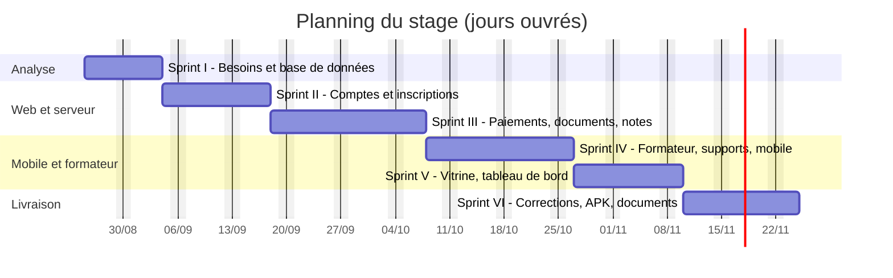
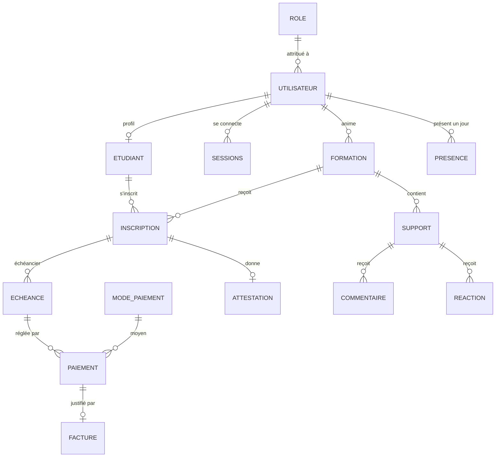
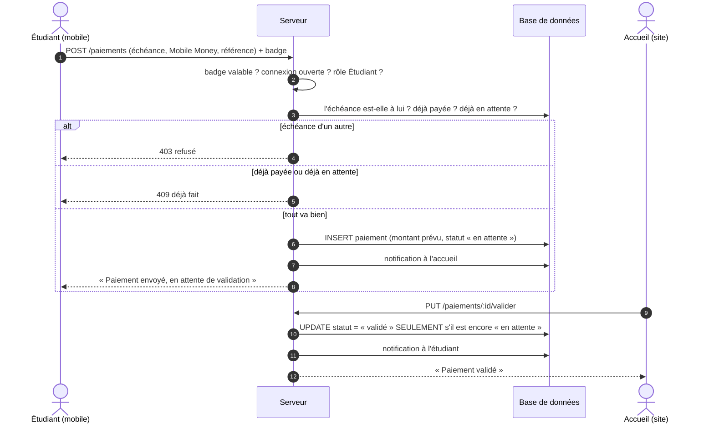
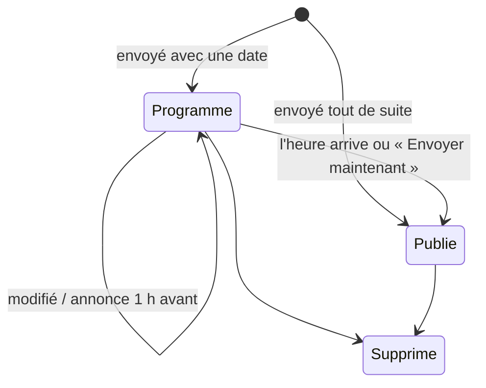
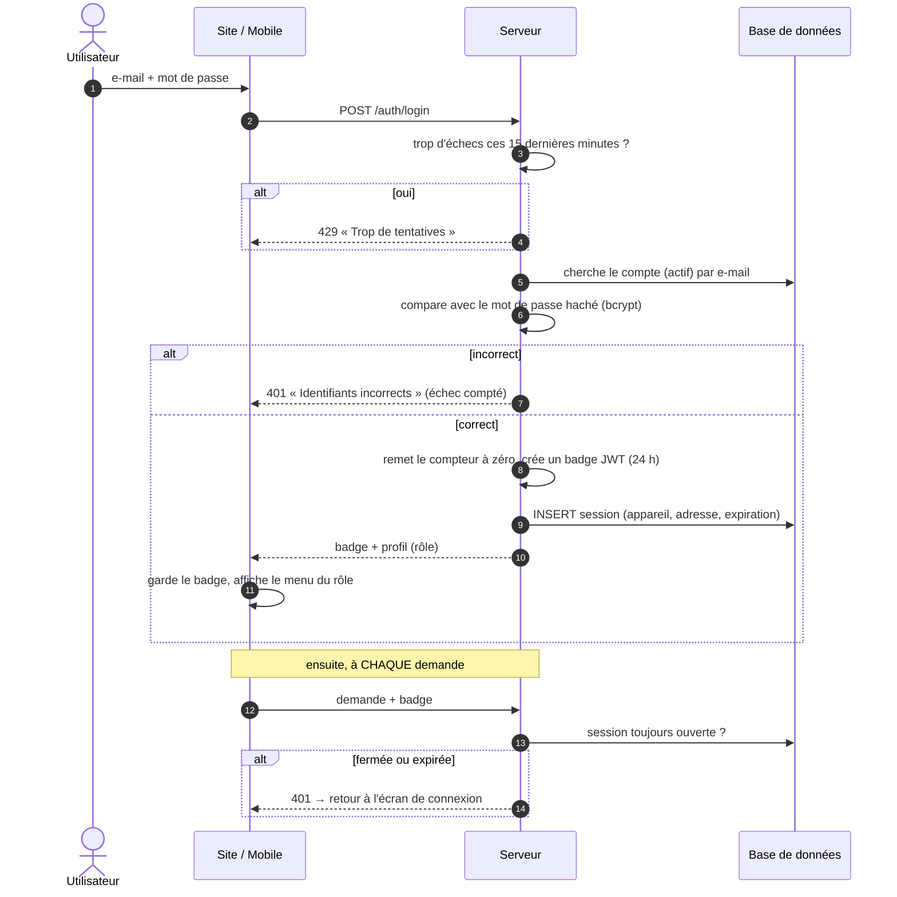
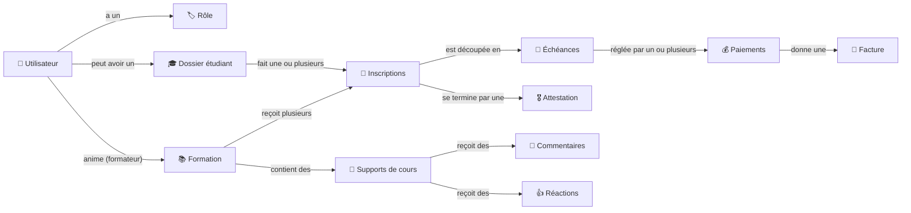

# IMTECH INFO — Plateforme de gestion de formation
## Second support de rédaction du mémoire (plan `planMemoire.txt`, 35 pages)

> Ce document est le **second support** du mémoire. Le premier,
> [`FLUX-APPLICATION.md`](FLUX-APPLICATION.md), décrit **toute** l'application (17 modules,
> 55 tableaux, 23 figures) : c'est la référence complète. Celui-ci suit **exactement le plan
> resserré** de [`planMemoire.txt`](planMemoire.txt) : **35 pages** de l'avant-propos à la
> bibliographie, **8 tableaux**, **18 figures**, et seulement **4 modules** détaillés.
>
> Chaque partie indique son **nombre de pages visé** (📄). Le texte est déjà à la bonne longueur :
> on peut le reporter presque tel quel dans le modèle Word, en ajoutant les captures.
>
> - ✍️ = à écrire moi-même (ITU, entreprise, remerciements, avis personnel) ;
> - 📷 = capture d'écran à placer (le nom du fichier proposé est indiqué quand il existe déjà) ;
> - 🔗 = où trouver plus de détails dans `FLUX-APPLICATION.md`.
>
> Les schémas sont en **Mermaid** (aperçu dans VS Code ou sur <https://mermaid.live>, puis
> « Export PNG » pour Word). Les figures 2, 3 et 4 existent déjà en image : `architecture.PNG`,
> `conceptionMetier.PNG`, `mcd.PNG`.

### Budget de pages

| Partie | Pages |
|---|:-:|
| Avant-propos | 2 |
| Introduction | 1 |
| 1 Présentation du projet | 5 |
| 2 Réalisation de l'application | 22 |
| 3 Évaluation du projet et connaissances acquises | 3 |
| Conclusion | 1 |
| Bibliographie | 1 |
| **Total compté** | **35** |
| Page de garde, table des matières, listes, glossaire, annexes | en plus |

---

## Page de garde

| Champ du modèle | Valeur |
|---|---|
| Titre | Conception et réalisation d'une plateforme web et mobile de gestion de formation |
| Par | Tolojanahary Elia Nantenaina |
| Grade | Licence en Informatique — option ✍️ |
| Entreprise d'accueil | IMTECH INFO |
| Encadreur professionnel | M. Valisoa |
| Jury | ✍️ |
| Période du stage | du 25 août 2026 au 24 novembre 2026 (3 mois) |

---

## Table des matières

- Liste des tableaux
- Liste des figures
- Glossaire
- [Avant-propos](#avant-propos)
  - L'IT University
  - L'entreprise d'accueil : IMTECH INFO
  - Remerciements
- [Introduction](#introduction)
- [1 Présentation du projet](#1-présentation-du-projet)
  - [1.1 Objectifs du projet](#11-objectifs-du-projet)
  - [1.2 Planning de réalisation](#12-planning-de-réalisation)
  - [1.3 Technologies utilisées](#13-technologies-utilisées)
    - 1.3.1 Partie affichage : web et mobile
    - 1.3.2 Partie traitement : serveur
    - 1.3.3 Base de données
- [2 Réalisation de l'application](#2-réalisation-de-lapplication)
  - [2.1 Analyse et conception](#21-analyse-et-conception)
    - 2.1.1 Analyse de l'existant
    - 2.1.2 Conception de l'application
      - 2.1.2.1 Conception affichage
      - 2.1.2.2 Conception métier
      - 2.1.2.3 Modèle conceptuel de données
  - [2.2 Développement par fonctionnalité ou module](#22-développement-par-fonctionnalité-ou-module)
    - [2.2.1 Vitrine et inscription de l'étudiant](#221-vitrine-et-inscription-de-létudiant)
    - [2.2.2 Échéances et paiements](#222-échéances-et-paiements)
    - [2.2.3 Supports de cours](#223-supports-de-cours)
    - [2.2.4 Utilisateurs et sécurité](#224-utilisateurs-et-sécurité)
  - [2.3 États d'analyse et statistiques](#23-états-danalyse-et-statistiques)
    - 2.3.1 État : tableau de bord
    - 2.3.2 Statistique : note d'attestation et classement
    - 2.3.3 Statistique : avis des étudiants sur les formateurs
  - [2.4 Problèmes rencontrés et solutions](#24-problèmes-rencontrés-et-solutions)
- [3 Évaluation du projet et connaissances acquises](#3-évaluation-du-projet-et-connaissances-acquises)
  - 3.1 Bilan pour l'entreprise
  - 3.2 Bilan personnel
  - 3.3 Extension et évolution de l'application
- [Conclusion](#conclusion)
- [Bibliographie](#bibliographie)
- [Annexes](#annexes)
  - Annexe A : Sécurité
  - Annexe B : Modèle logique de données complet
  - Annexe C : Conception affichage : les écrans un par un
  - Annexe D : Conception métier : les données échangées
  - Annexe E : La base de données, expliquée simplement

---

## Liste des tableaux

- Tableau 1 : Objectifs du projet et ce qui y répond
- Tableau 2 : Comparaison entre React et Vue
- Tableau 3 : Comparaison entre React Native et Flutter
- Tableau 4 : Comparaison entre Node.js et Spring Boot
- Tableau 5 : Comparaison entre MySQL et PostgreSQL
- Tableau 6 : Avant le projet, et ce qui posait problème
- Tableau 7 : Analyse des besoins par utilisateur
- Tableau 8 : Problèmes rencontrés et solutions

## Liste des figures

- Figure 1 : Diagramme de Gantt
- Figure 2 : Architecture : web et mobile → serveur → base de données
- Figure 3 : Diagramme de cas d'utilisation
- Figure 4 : Modèle conceptuel de données
- Figure 5 : Vitrine et inscription
- Figure 6 : Validation de l'inscription par l'Accueil
- Figure 7 : Liste des échéances
- Figure 8 : Paiement depuis le téléphone puis validation par l'Accueil
- Figure 9 : Diagramme de séquence d'un paiement
- Figure 10 : Publication d'un support
- Figure 11 : Support programmé, vu par le formateur et par l'étudiant
- Figure 12 : Commentaires et réactions
- Figure 13 : Liste des sessions
- Figure 14 : Filigrane et capture d'écran bloquée
- Figure 15 : Diagramme de séquence de la connexion
- Figure 16 : Tableau de bord
- Figure 17 : Tableau des notes et classement d'une formation
- Figure 18 : Tri des formateurs par compétence

---

## Glossaire

| Terme | Ce que ça veut dire |
|---|---|
| **API** | La partie « serveur » : le site et l'application mobile lui posent des questions, elle répond. |
| **Back-office** | Le site web réservé au personnel du centre (Super Admin, Accueil, Formateur). |
| **Échéance / échéancier** | Une somme à payer à une date précise / la liste de toutes les échéances d'une inscription. |
| **Filigrane** | Un texte écrit en transparence sur un document (ici : le nom du lecteur et la date). |
| **Jeton de connexion (JWT)** | Un badge remis à l'utilisateur quand il se connecte ; il le montre à chaque demande. |
| **Merise** | Une méthode pour dessiner la base de données avant de la créer (MCD, MLD). |
| **Mot de passe haché** | Le mot de passe transformé en une suite illisible avant d'être enregistré. |
| **Scrum / sprint** | Travailler par petites étapes (sprints) avec une démonstration à la fin de chacune. |
| **Session** | Une connexion ouverte sur un appareil. On peut la fermer à distance. |
| **Statut d'un paiement** | « En attente » (envoyé par l'étudiant), « validé » ou « refusé » (par l'accueil). |
| **Tout ou rien (transaction)** | Plusieurs enregistrements liés : soit tout passe, soit rien n'est gardé. |
| **Tranche** | Une partie du prix total quand on paie en plusieurs fois. |
| **Vitrine** | L'écran de l'application mobile qui présente les formations aux visiteurs sans compte. |

---

## Avant-propos

📄 **2 pages**

Le présent mémoire présente les résultats du travail effectué lors de mon stage de fin d'études
de Licence en Informatique de l'IT University ; stage effectué au sein de la société
**IMTECH INFO** durant **trois mois**, du **25 août 2026** au **24 novembre 2026**.

Afin de poser clairement le contexte de ce mémoire, je vais présenter succinctement d'une part
l'IT University et d'autre part mon entreprise d'accueil.

### L'IT University

✍️ *À écrire (≈ ½ page ; le modèle Word contient déjà un texte de présentation de l'ITU).*

### L'entreprise d'accueil : IMTECH INFO

✍️ *À écrire (≈ ½ page). Éléments repris du cahier des charges :*

| Champ | Détail |
|---|---|
| Nom | IMTECH INFO |
| Site web | www.imtechinfo.com |
| Domaines d'activité | Informatique, énergie, maintenance, langues |
| Formation | Une grande partie de l'activité : bureautique, développement web, réseaux, infographie, langues… |
| Encadreur | M. Valisoa |

### Remerciements

✍️ *À écrire (≈ ½ page, rester simple comme l'exemple du modèle).*

---

## Introduction

📄 **1 page** — thème et intérêt, existant et ses problèmes, résultats, structure du mémoire.

**Thème et intérêt.** Pendant ce stage, j'ai travaillé sur le thème **« Conception et réalisation
d'une plateforme web et mobile de gestion de formation »** pour le centre de formation d'IMTECH
INFO. Dans un centre de formation, chaque étudiant suit le même chemin : il découvre les
formations, s'inscrit, paie en une ou plusieurs fois, suit ses cours et reçoit une attestation.
Ce chemin paraît simple, mais il demande de suivre beaucoup de choses : dossiers, dates de
paiement, argent reçu, documents à remettre.

**L'existant et ses problèmes.** Chez IMTECH INFO, tout cela se faisait **sur papier et dans des
tableaux remplis à la main**. Personne ne savait, à un instant donné, combien d'argent était
rentré ; les retards de paiement étaient vus trop tard ; les supports de cours circulaient par
message ; et l'étudiant devait se déplacer pour savoir où il en était.

**Les résultats.** En trois mois, j'ai réalisé :

- un **site web** pour l'équipe (direction, accueil, formateurs) ;
- une **application mobile** Android pour les étudiants et les visiteurs ;
- un **serveur** commun, qui applique les règles du centre, crée les PDF et envoie les e-mails ;
- une base de données de **26 tables**.

**Structure du mémoire.** Le **premier chapitre** présente le projet : objectifs, planning et
technologies choisies. Le **deuxième** raconte la réalisation : l'analyse de l'existant, la
conception, puis quatre modules importants, les statistiques et les problèmes rencontrés. Le
**troisième** fait le bilan pour l'entreprise et pour moi, et propose des évolutions.

---

## 1 Présentation du projet

📄 **5 pages**

### 1.1 Objectifs du projet

📄 **1 page**

**Objectif général.** Créer une application qui suit l'étudiant de la découverte des formations
jusqu'à son attestation, et qui donne à l'équipe une vue claire et à jour de l'activité du centre.

*Tableau 1 : Objectifs du projet et ce qui y répond*

| # | Objectif | Ce qui y répond dans l'application |
|:-:|---|---|
| 1 | Tout regrouper au même endroit : formations, étudiants, inscriptions, paiements | Le site web du personnel |
| 2 | Attirer de nouveaux étudiants et leur permettre de s'inscrire à distance | Vitrine et inscription depuis le téléphone ([§2.2.1](#221-vitrine-et-inscription-de-létudiant)) |
| 3 | Ne plus rater un paiement et payer sans se déplacer | Échéancier automatique, couleurs de suivi, paiement mobile validé par l'accueil ([§2.2.2](#222-échéances-et-paiements)) |
| 4 | Donner les cours aux étudiants sans que les supports circulent partout | Supports dans l'application, programmés, commentés ([§2.2.3](#223-supports-de-cours)) |
| 5 | Que chacun n'accède qu'à ce qui le concerne, et protéger les documents | Rôles, sessions, limite d'essais, filigrane ([§2.2.4](#224-utilisateurs-et-sécurité)) |
| 6 | Créer les documents officiels sans recopie | Fiche, facture et attestation PDF avec QR code de vérification |
| 7 | Donner des chiffres à la direction | Tableau de bord, note d'attestation, avis sur les formateurs ([§2.3](#23-états-danalyse-et-statistiques)) |

**Ce que le projet ne fait pas** : la comptabilité de l'entreprise, la paie des formateurs, le
vrai paiement en ligne (l'étudiant déclare son paiement, l'accueil vérifie), les cours en visio et
la gestion de plusieurs centres.

### 1.2 Planning de réalisation

📄 **1 page**

J'ai travaillé en **six sprints**. À la fin de chacun, je montrais le résultat à mon encadreur.
Le total représente **66 jours de travail** (détail des tâches :
`Gantt - Estimation ETU003230.csv` et `Estimation Fiche de stage - ETU003230`).

| Sprint | Contenu | Jours |
|---|---|:-:|
| I | Recueil des besoins, prise en main des outils, conception de la base | 7,5 |
| II | Serveur, connexion, comptes, étudiants, formations, inscriptions | 10,5 |
| III | Paiements, échéances, documents PDF, présence et notes | 13,5 |
| IV | Espace formateur, supports de cours, application mobile | 13 |
| V | Vitrine et inscription en ligne, tableau de bord, recherche | 10 |
| VI | Corrections, application Android, documentation, essais avec l'équipe | 11,5 |



*Figure 1 : Diagramme de Gantt*

> 💡 Dans Word, mettre la figure sur une page en paysage ou réduire le tableau au-dessus si la
> page déborde.

### 1.3 Technologies utilisées

📄 **3 pages**

Pour chaque partie, plusieurs outils étaient possibles. J'ai comparé les deux candidats les plus
sérieux à chaque fois, en gardant en tête trois contraintes : **je travaillais seul** sur le site,
le mobile et le serveur ; j'avais **trois mois** ; et l'application gère **de l'argent**, donc
les données doivent toujours rester justes.

#### 1.3.1 Partie affichage : web et mobile

Le **site web** est un ensemble d'écrans remplis de listes, de fiches et de formulaires (23 écrans).
J'ai comparé **React** et **Vue.js**.

*Tableau 2 : Comparaison entre React et Vue*

| Critère | React | Vue.js |
|---|---|---|
| Principe | Écran construit avec des composants réutilisables, écrits en JSX | Composants aussi, écrits dans des fichiers `.vue` (modèle HTML + script) |
| Prise en main | Un peu plus de concepts au départ (hooks, état) | Réputé plus simple au départ |
| Communauté et bibliothèques | Très large, beaucoup d'exemples et de bibliothèques | Large, mais plus petite |
| Passage au mobile | **React Native** reprend les mêmes idées (composants, hooks) | Pas d'équivalent aussi répandu pour le mobile |
| Ce qui a compté pour moi | **Une seule façon de penser pour le web et le mobile** | — |

L'**application mobile** sert aux étudiants et aux visiteurs (13 écrans). J'ai comparé
**React Native** (avec Expo) et **Flutter**.

*Tableau 3 : Comparaison entre React Native et Flutter*

| Critère | React Native (Expo) | Flutter |
|---|---|---|
| Langage | JavaScript / TypeScript, comme le site et le serveur | Dart, un langage de plus à apprendre |
| Affichage | Composants natifs du téléphone | Moteur de dessin propre à Flutter, très fluide |
| Mise en route | Expo simplifie la création du fichier Android (APK) | Outils complets, mais installation plus lourde |
| Fonctions utiles au projet | `react-native-webview` (lecteur), `expo-screen-capture` (bloquer les captures) | Équivalents disponibles |
| Ce qui a compté pour moi | **Réutiliser ce que je connais de React**, même langage partout | — |

#### 1.3.2 Partie traitement : serveur

Le serveur applique les règles du centre (montants, droits, dates), crée les PDF et envoie les
e-mails. J'ai comparé **Node.js (Express)** et **Spring Boot (Java)**.

*Tableau 4 : Comparaison entre Node.js et Spring Boot*

| Critère | Node.js + Express | Spring Boot |
|---|---|---|
| Langage | JavaScript, le même que le site et le mobile | Java |
| Légèreté | Démarrage rapide, peu de configuration | Plus lourd, beaucoup de choses fournies d'office |
| Structure | Libre : il faut s'imposer une organisation (routes → contrôles → controllers → services → models) | Structure très cadrée dès le départ |
| Bibliothèques utiles | `jsonwebtoken`, `bcryptjs`, `multer`, `pdfkit`, `nodemailer`, `pdf-lib`, `sharp` | Équivalents nombreux |
| Ce qui a compté pour moi | **Un seul langage pour tout le projet**, travail plus rapide seul | Aurait demandé d'apprendre un second écosystème |

#### 1.3.3 Base de données

Les données sont très liées entre elles (un étudiant a des inscriptions, une inscription a des
échéances, une échéance a des paiements) et touchent à de l'argent. Il fallait donc une base
**relationnelle**. J'ai comparé **MySQL** et **PostgreSQL**.

*Tableau 5 : Comparaison entre MySQL et PostgreSQL*

| Critère | MySQL (MariaDB) | PostgreSQL |
|---|---|---|
| Transactions « tout ou rien » | Oui (moteur InnoDB) | Oui |
| Clés étrangères, contraintes d'unicité | Oui | Oui, et contraintes plus riches |
| Installation sur poste | Très simple avec XAMPP, outil phpMyAdmin inclus | Installation à part, outil pgAdmin |
| Connaissance préalable | Déjà utilisée en cours | Moins pratiquée |
| Ce qui a compté pour moi | **Simple à installer et à montrer**, suffisant pour le besoin | Plus puissante, mais pas nécessaire ici |

**Mes choix.** J'ai retenu **React** pour le site, **React Native avec Expo** pour le mobile,
**Node.js avec Express** pour le serveur et **MySQL** pour la base. Le point commun est simple :
**un seul langage, JavaScript, du clic à la base de données**. Seul sur le projet et en trois
mois, c'est ce qui m'a permis d'aller vite sans sacrifier la justesse des données, garantie par
les transactions de MySQL.

---

## 2 Réalisation de l'application

📄 **22 pages**

### 2.1 Analyse et conception

📄 **4 pages**

#### 2.1.1 Analyse de l'existant

Avant le projet, tout se faisait à la main à l'accueil, et l'étudiant devait venir ou appeler
pour la moindre question.

*Tableau 6 : Avant le projet, et ce qui posait problème*

| Tâche | Comment ça se passait | Ce qui posait problème |
|---|---|---|
| Inscription | Fiche papier remplie à l'accueil, aux heures d'ouverture | Fiches perdues, informations recopiées, pas d'inscription à distance |
| Échéances et paiements | Tableau rempli à la main | Erreurs de recopie, personne ne sait combien d'argent est rentré |
| Retards | Vus en relisant le tableau | Vus trop tard ; les relances dépendent de la mémoire de chacun |
| Supports de cours | Donnés en classe ou envoyés par message | Les copies circulent partout, rien n'est rangé au même endroit |
| Documents (fiche, facture, attestation) | Écrits un par un | Long, risque d'erreur, attestation impossible à vérifier |
| Suivi de l'activité | Pas de chiffres fiables | Décisions prises « au feeling » |

À partir de ces constats et des échanges avec mon encadreur, j'ai listé ce dont chaque
utilisateur a besoin.

*Tableau 7 : Analyse des besoins par utilisateur*

| Utilisateur | Où | Ses besoins |
|---|---|---|
| **Visiteur** | Mobile | Découvrir les formations, les formateurs et les prix ; s'inscrire sans se déplacer |
| **Étudiant** | Mobile | Suivre ses formations et ses échéances ; payer depuis son téléphone ; lire ses supports ; poser ses questions |
| **Formateur** | Site web | Publier ses supports (tout de suite ou plus tard) ; échanger avec ses étudiants ; noter la présentation |
| **Accueil** | Site web | Créer les dossiers et inscriptions ; encaisser et **valider** les paiements ; repérer et relancer les retards ; produire les documents |
| **Super Admin** | Site web | Tout ce que fait l'accueil ; gérer les comptes et les formations ; voir les chiffres et l'avis des étudiants |

#### 2.1.2 Conception de l'application

**Pourquoi concevoir avant de coder.** L'application touche à de l'argent et à des documents
officiels. Une erreur dans l'organisation des données (une inscription sans ses échéances, un
paiement rattaché au mauvais étudiant) est très difficile à réparer une fois que l'équipe a
commencé à saisir. J'ai donc d'abord décidé **comment les écrans parlent au serveur**, **qui a le
droit de faire quoi** et **où ranger chaque information**.

**Le projet en chiffres.** 23 écrans web, 13 écrans mobiles (+ 4 fenêtres), 86 adresses sur le
serveur, 26 tables, 4 rôles (+ le visiteur).

##### 2.1.2.1 Conception affichage

Le projet est fait de trois parties. Le site web et l'application mobile ne parlent **jamais**
directement à la base : ils passent toujours par le serveur, et toujours par une seule fonction
(`apiRequest`) qui joint le badge de connexion, envoie la demande et affiche le message d'erreur
s'il y en a un.


*Figure 2 : Architecture : web et mobile → serveur → base de données*
📷 *Image existante : `architecture.PNG`.*

Le serveur répond toujours sous la même forme, ce qui simplifie l'affichage côté web et mobile :
`{ "status": "success", "data": … }` ou `{ "status": "error", "message": "…" }`.

🔗 *Chaque écran décrit (boutons, messages d'erreur) : [Annexe C](#annexe-c--conception-affichage--les-écrans-un-par-un).*

##### 2.1.2.2 Conception métier

La conception métier dit **qui fait quoi**. Le diagramme de cas d'utilisation montre les actions
principales de chaque acteur ; le Super Admin peut faire tout ce que fait l'accueil.


*Figure 3 : Diagramme de cas d'utilisation*
📷 *Image existante : `conceptionMetier.PNG`.*

Les droits sont vérifiés **par le serveur**, pas seulement en cachant des boutons. À chaque
demande, il contrôle **le rôle** (« un étudiant n'a rien à faire ici ») et **à qui appartiennent
les données** (« un étudiant ne voit que **ses** paiements »). Les règles du centre sont toutes
écrites au même endroit, dans les **services** du serveur.

🔗 *Tableau complet des droits : `FLUX-APPLICATION.md`, Tableau 11. Données échangées entre
l'affichage et le serveur (équivalent des DTO) : [Annexe D](#annexe-d--conception-métier--les-données-échangées).*

##### 2.1.2.3 Modèle conceptuel de données

La base a été dessinée avec la méthode **Merise**. Elle contient **26 tables**, sans vue, sans
procédure stockée ni trigger : toutes les règles restent dans le serveur. Le schéma ci-dessous
montre les tables principales.



*Figure 4 : MCD*
📷 *Image existante : `mcd.PNG`.*

Deux habitudes guident la base : **on n'efface jamais vraiment** (une colonne `etat` cache la
ligne, l'historique des paiements reste), et tout ce qui va ensemble (inscription + échéances,
compte + dossier) est enregistré **en tout ou rien**. Le modèle logique complet est en
[Annexe B](#annexe-b--modèle-logique-de-données-complet) ; la base expliquée simplement est en
[Annexe E](#annexe-e--la-base-de-données-expliquée-simplement).

---

### 2.2 Développement par fonctionnalité ou module

📄 **13 pages**

L'application compte une quinzaine de modules. Les modules **dossiers étudiants**,
**formations**, **documents officiels** (fiche, facture, attestation avec QR code),
**notifications**, **assistance**, **recherche globale** et **apparence** sont en place mais ne
sont pas détaillés ici (🔗 `FLUX-APPLICATION.md`, §2.2.2 à §2.2.17). Ce chapitre détaille les
**quatre modules les plus représentatifs** du travail. Pour chacun : **ce qu'il fait**,
**pourquoi** il est utile, un **scénario clé**, **l'écran**, et pour les plus techniques un
**diagramme de séquence**.

#### 2.2.1 Vitrine et inscription de l'étudiant

📄 **2 pages**

**Description.** Une personne **sans compte** qui ouvre l'application arrive sur l'écran
**Découvrir** : formations disponibles (photo, formateur, prix, durée), formateurs les mieux
notés, engagements du centre et contacts. Elle peut choisir **une ou plusieurs formations** et
s'inscrire elle-même : identité, mot de passe, nombre de tranches (1 à 4), moyen de paiement et
référence. L'**Accueil** confirme ensuite chaque inscription depuis le site.

**Pourquoi.** L'application devient un moyen d'**attirer de nouveaux étudiants** : on peut
s'inscrire le soir depuis chez soi, sans attendre l'ouverture de l'accueil. Et l'accueil garde
le contrôle, puisque rien n'est définitif sans sa validation.

**Scénario clé.**

1. Mahery ouvre l'application, parcourt la vitrine et ajoute « Développement web » et
   « Python » à sa sélection.
2. Il remplit le formulaire et choisit de payer en 3 fois par Mobile Money.
3. Le serveur crée, **en une seule fois (tout ou rien)** : le compte, le dossier, les deux
   inscriptions « en ligne », leurs échéanciers et le premier paiement « en attente ». Il reçoit
   « Inscription envoyée » et le total à payer.
4. Sur le site, l'accueil filtre les inscriptions sur **« En ligne »**, vérifie le paiement et
   clique **« Valider »** : l'inscription est confirmée, le premier paiement passe à « validé ».
5. Les supports de la formation s'ouvrent pour Mahery.

📷 *Figure 5 : Vitrine et inscription — écran Découvrir + fiche d'une formation + formulaire
(captures mobile ; `Détail formation mobile.png` existe déjà).*

📷 *Figure 6 : Validation de l'inscription par l'Accueil — liste des inscriptions filtrée
« En ligne » avec le bouton Valider (`Inscriptions.png` existe déjà).*

**Règles à retenir.**

- L'inscription en ligne utilise **le même calcul d'échéancier** qu'une inscription faite à
  l'accueil : la logique n'est écrite qu'une fois.
- Tant que l'accueil n'a pas validé, la formation affiche « En attente de validation » et **les
  supports restent fermés**.
- Garde-fous : e-mail déjà utilisé refusé, mot de passe de 8 caractères minimum, une formation
  choisie deux fois ne compte qu'une fois, **5 inscriptions par heure** au maximum depuis un même
  appareil.
- Valider deux fois la même inscription est refusé : on ne paie pas deux fois la première tranche.

#### 2.2.2 Échéances et paiements

📄 **4 pages**

**Description.** Dès qu'une inscription est créée, le serveur calcule **automatiquement
l'échéancier** : le prix est divisé par le nombre de tranches, et chaque tranche reçoit une date.
La page **Échéances** montre ensuite chaque échéance avec une **couleur** de suivi. L'étudiant
peut **payer une échéance depuis son téléphone** : le paiement reste **« en attente »** jusqu'à ce
que l'accueil le **valide** ou le **refuse**. Au guichet, l'accueil peut aussi encaisser
directement (paiement validé tout de suite).

**Pourquoi.** C'est le cœur de l'argent du centre. Le calcul automatique supprime les erreurs de
recopie ; les couleurs montrent les retards **avant** qu'ils arrivent ; et la validation par une
personne empêche de tricher en disant simplement « j'ai payé ».

**L'échéancier automatique.** Chaque tranche vaut le prix ÷ le nombre de tranches, arrondi au
centime ; la **dernière tranche récupère les centimes manquants**, pour que le total tombe
toujours pile. La tranche n° *n* tombe *n* × (durée ÷ nombre de tranches) jours après
l'inscription. Exemple : 100 000 Ar sur 90 jours en 3 fois → 33 333,33 Ar à J+30,
33 333,33 Ar à J+60 et 33 333,34 Ar à J+90.

**Le suivi par couleurs.**

| Couleur | Signification | Quand |
|---|---|---|
| 🟢 VERT | À jour | Payée (même si le paiement attend encore la validation) ou date à plus de 2 jours |
| 🟡 JAUNE | À rappeler | Pas réglée et la date est dans 2 jours, demain ou aujourd'hui → **l'accueil est prévenu** |
| 🔴 ROUGE | En retard | Date passée et pas réglée |

Chaque heure, le serveur repère les échéances qui passent au jaune et prévient l'accueil, **une
seule fois** par échéance. C'est ensuite une personne qui décide de cliquer **« Rappeler »**
(notification + e-mail à l'étudiant) : elle sait peut-être déjà qu'il passe payer demain.

📷 *Figure 7 : Liste des échéances — page Échéances avec les trois couleurs et le filtre.*

**Scénario clé : un paiement depuis le téléphone.**

1. Toky ouvre **Paiements** sur son téléphone : il voit sa prochaine échéance, le total, ce qu'il
   a déjà payé et ce qui reste.
2. Il appuie sur **« Payer »**, choisit Mobile Money et saisit la référence. Le **montant est
   imposé** : c'est celui de l'échéance.
3. Le serveur vérifie que l'échéance est **bien à lui**, qu'elle n'est pas déjà payée et qu'aucun
   paiement n'attend déjà. Il enregistre le paiement **« en attente »** et prévient l'accueil.
4. Sur le site, la page Paiements affiche « 1 paiement attend votre validation ». L'accueil
   vérifie sur son relevé et clique **« Valider »**.
5. Toky reçoit « Votre paiement a été validé » ; la somme passe dans « Déjà payé ».

📷 *Figure 8 : Paiement depuis le téléphone puis validation par l'Accueil — à gauche l'écran
Paiements du mobile (« En attente de validation »), à droite la page Paiements du site avec le
bandeau et les boutons Valider / Refuser (`Paiements.png` existe déjà).*



*Figure 9 : Diagramme de séquence d'un paiement*

**Règles à retenir.**

- Un paiement **en attente** compte déjà pour la **couleur** (l'étudiant n'est pas marqué en
  retard parce que l'accueil n'a pas encore vérifié), mais **pas** pour l'argent reçu, le tableau
  de bord ni la facture.
- Si deux employés cliquent « Valider » en même temps, **une seule validation passe** : le
  serveur ne change le statut que s'il est encore « en attente ».
- Au guichet, l'accueil peut encaisser une partie de l'échéance, mais **jamais plus que ce qui
  reste à payer**.
- Une facture PDF (numérotée FAC-AAAA-0001) ne peut être créée que pour un paiement **validé**.

#### 2.2.3 Supports de cours

📄 **4 pages**

**Description.** Le formateur publie un **support** dans une de ses formations : un titre, un
**texte mis en forme** (gras, listes, titres, liens) et, s'il le souhaite, un **fichier** (PDF,
image, audio ou vidéo, 50 Mo maximum). Il peut le publier tout de suite ou le **programmer** pour
une date précise. Les étudiants inscrits le lisent dans l'application, peuvent le **commenter**,
**répondre** aux autres et **réagir** (👍 J'aime, ❤️ J'adore, 💡 Utile, 👎 Je n'aime pas).

**Pourquoi.** Les supports sont le travail des formateurs : ils doivent rester chez IMTECH. Les
mettre dans l'application évite qu'ils circulent par message, les range au même endroit, et
permet aux étudiants de poser leurs questions juste sous le cours. Les réactions donnent aussi à
la direction un premier avis sur chaque formateur ([§2.3.3](#233-statistique--avis-des-étudiants-sur-les-formateurs)).

**Publication.** Le formateur choisit la formation, écrit le titre et le texte, joint un fichier
et clique sur **Publier**. Les étudiants inscrits reçoivent une notification. Avant
d'enregistrer, le serveur **nettoie le texte** : il ne garde qu'une liste précise de mises en
forme autorisées et supprime tout le reste. Sans cela, un programme malveillant caché dans le
texte pourrait se lancer chez **tous** les étudiants de la formation.

📷 *Figure 10 : Publication d'un support — page Supports du formateur avec l'éditeur de texte et
le fichier joint.*

**Scénario clé : un support programmé.**

1. Dimanche soir, le formateur prépare « Projet : site vitrine » et le **programme** pour mardi
   8 h. Il le retrouve dans la page **Supports programmés**, où il peut encore le modifier ou
   l'**envoyer tout de suite**.
2. Lundi, les étudiants **ne voient rien** : un support programmé est un brouillon.
3. Mardi à 7 h, ils reçoivent « … va envoyer le support dans une heure ».
4. À 8 h, le serveur (qui vérifie chaque minute) publie le support et prévient étudiants et
   formateur. S'il était éteint à 8 h, le support part dès son redémarrage.



📷 *Figure 11 : Support programmé, vu par le formateur et par l'étudiant — à gauche la page
Supports programmés du site (date, bouton Envoyer maintenant), à droite l'annonce « dans une
heure » reçue sur le téléphone. Le schéma d'états ci-dessus peut accompagner la figure.*

**Commentaires et réactions.**

- **Un seul niveau de réponses**, comme sur Facebook ; les réponses sont repliées derrière « Voir
  les N réponses ».
- Le **formateur** peut mentionner un étudiant de sa formation avec `@` ; l'étudiant mentionné
  est prévenu. Un **étudiant** ne mentionne pas : il répond, et l'auteur du commentaire est
  prévenu. Un nouveau commentaire d'étudiant prévient automatiquement le formateur.
- **Une seule réaction** par personne et par support (on peut la changer ou la retirer) ; la base
  refuse les doublons.
- Qui peut supprimer : le Super Admin tout, le formateur les commentaires de ses formations,
  l'étudiant les siens.

📷 *Figure 12 : Commentaires et réactions — fil de commentaires sous un support (réponses
repliées, mention `@`) et barre de réactions, sur le téléphone.*

**Règles à retenir.**

- Un étudiant ne voit que les supports **publiés** des formations où son inscription est
  **confirmée**.
- Un support publié ne se modifie plus (ce serait déroutant pour ceux qui l'ont déjà lu).
- L'ouverture du fichier lui-même est protégée (droits + filigrane) : voir [§2.2.4](#224-utilisateurs-et-sécurité).

#### 2.2.4 Utilisateurs et sécurité

📄 **3 pages**

**Description.** L'application connaît **quatre rôles** (Super Admin, Accueil, Formateur,
Étudiant) et le visiteur sans compte. Chacun se connecte avec son e-mail et son mot de passe ;
le menu et surtout les **droits vérifiés par le serveur** dépendent du rôle. Chaque connexion est
une **session** qu'on peut voir et fermer à distance. Les essais de mot de passe sont **limités**,
et les documents sont **protégés** à l'ouverture. Par ailleurs, l'étudiant peut envoyer une
**demande d'assistance** que l'accueil marque comme résolue, et chacun peut **personnaliser
l'apparence** du site (thème clair ou sombre, couleur, taille du texte).

**Pourquoi.** L'application contient des pièces d'identité, de l'argent et des documents
officiels. Chacun ne doit voir que ce qui le concerne, on doit pouvoir couper un accès à tout
moment (téléphone perdu, employé qui part), et un document qui fuit doit pouvoir être retracé.

**Les sessions.** Le badge de connexion (JWT) seul ne suffit pas : il resterait valable 24 h même
après une déconnexion. Le serveur garde donc la liste des connexions (table `sessions`) et vérifie
**à chaque demande** que la connexion est toujours ouverte. Dans *Paramètres → Sécurité*, chacun
voit ses appareils (navigateur, adresse, date, appareil actuel mis en avant) et peut **déconnecter
les autres appareils**. Le site et l'application revérifient la connexion chaque minute : les
autres appareils reviennent à l'écran de connexion en moins d'une minute. Désactiver un compte ou
changer son mot de passe ferme aussi les autres sessions.

📷 *Figure 13 : Liste des sessions — Paramètres > Sécurité avec les appareils connectés et le
bouton « Déconnecter les autres appareils ».*

**La limite des essais.**

| Où | Limite |
|---|---|
| Connexion, par compte et par appareil | 5 échecs en 15 min (une réussite remet à zéro) |
| Connexion, par appareil | 20 échecs en 15 min |
| Mot de passe oublié | 5 demandes par heure |

Deux limites, car une limite par compte seule laisserait le pirate changer de compte, et une
limite par appareil seule bloquerait tout un bureau à cause d'une personne. Le serveur répond
« Trop de tentatives. Réessayez dans 15 minutes. » (code 429). Pour un mot de passe oublié, il
répond **la même chose que le compte existe ou non**, pour ne pas révéler qui a un compte.

**La protection des documents.**

1. **Il faut être connecté et avoir le droit** pour ouvrir un fichier : connaître son adresse ne
   suffit pas, et un lien copié ne marche plus après la déconnexion. Un étudiant n'ouvre un
   support que s'il est inscrit et confirmé ; ses pièces d'identité ne sont visibles que par lui,
   l'accueil et le Super Admin.
2. **Le nom du lecteur est écrit en filigrane** (« IMTECH INFO · Nom · e-mail · date ») sur le PDF
   ou l'image au moment où il l'ouvre ; le fichier d'origine ne change pas. C'est la seule
   protection qui marche même si quelqu'un photographie l'écran avec un autre téléphone.
3. **Sur le téléphone**, le support s'ouvre dans un lecteur interne : pas de bouton télécharger,
   **captures et enregistrements d'écran bloqués** (écran noir sur Android), rien n'est gardé
   après la lecture.

📷 *Figure 14 : Filigrane et capture d'écran bloquée — un PDF ouvert avec le nom du lecteur en
transparence, et l'écran noir obtenu en tentant une capture sur Android.*

**Scénario clé : la connexion.**



*Figure 15 : Diagramme de séquence de la connexion*

🔗 *Liste complète des risques et protections : [Annexe A](#annexe-a--sécurité).*

---

### 2.3 États d'analyse et statistiques

📄 **3 pages**

Ces écrans transforment ce que l'équipe saisit chaque jour en chiffres utiles à la direction.
Les captures sont à prendre sur les **données de démonstration** (`donneesTest.sql`) et chaque
figure doit être **commentée** : le modèle de mémoire insiste sur l'explication des chiffres.

#### 2.3.1 État : tableau de bord

Le tableau de bord (Super Admin, Accueil) réunit les indicateurs principaux :

| Indicateur | Calcul |
|---|---|
| Argent reçu | Total des paiements **validés** |
| Reste à recevoir | Total des échéances − argent reçu |
| Paiements en retard | Échéances dont la date est passée et qui ne sont pas entièrement payées |
| Évolution | Argent reçu par jour, mois ou année (courbe) |
| Inscriptions | Par mois, et formations les plus demandées |
| Export | Inscriptions au format CSV (Excel) |

📷 *Figure 16 : Tableau de bord (`dashboard-administrateur.png` existe déjà). À commenter :
l'argent reçu et ce qui reste, le nombre de retards (dans la démo : Toky et Fano n'ont pas payé
leur 2ᵉ tranche), la forme de la courbe, la formation la plus demandée.*

#### 2.3.2 Statistique : note d'attestation et classement

À la fin de la formation, chaque étudiant reçoit une **note sur 20**, écrite sur son attestation.
La moitié est **calculée par l'application**, l'autre est donnée par le formateur.

| Partie | Condition | Points |
|---|---|:-:|
| **Paiement** | A toujours payé à temps | 5 |
| | Sinon | 2 |
| **Présence** | Présent moins de la moitié des jours de cours | +2 |
| | Au moins la moitié, mais pas jusqu'au bout | +3 |
| | Présent jusqu'à 2 semaines avant la fin | +5 |
| = Note calculée | | **/10** |
| **Présentation** | Donnée par le formateur (10 maximum) | **/10** |
| = **Note d'attestation** | paiement + présence + présentation | **/20** |

La **présence** est notée toute seule : un étudiant qui utilise l'application un jour est compté
présent ce jour-là (une ligne par jour dans la table `presence`). Seuls les jours **du lundi au
vendredi** comptent, sur le vrai calendrier. Le **classement** trie par note calculée, puis par
jours de présence ; deux étudiants à égalité ont le même rang. Sans note de présentation,
l'attestation ne peut pas être créée, et une note de présentation au-dessus de 10 est refusée avec
un message explicatif.

📷 *Figure 17 : Tableau des notes et classement d'une formation — Espace formateur
(`Dashboard formateur.png` existe déjà). À commenter : les écarts de présence (de 3 à 10 jours
sur 10 dans la démo) et leur effet sur la note finale.*

#### 2.3.3 Statistique : avis des étudiants sur les formateurs

Les réactions laissées sur les supports donnent un avis sur chaque formateur :

| Élément | Calcul |
|---|---|
| Positives | 👍 + ❤️ + 💡 |
| % positif | positives ÷ toutes les réactions |
| **Compétent** | au moins 5 réactions et au moins 60 % de positives |
| **Non compétent** | au moins 5 réactions et moins de 60 % de positives |
| **Pas assez d'avis** | moins de 5 réactions : on ne juge pas |

Le tableau des avis peut être **trié** par type de réaction et **filtré** par avis. Les
formateurs compétents sont aussi mis en avant dans la vitrine ([§2.2.1](#221-vitrine-et-inscription-de-létudiant)).

📷 *Figure 18 : Tri des formateurs par compétence. Dans la démo : Tiana et Voahangy
« Compétent », Hery « Non compétent », Lalaina « Pas assez d'avis ». À commenter : en dessous de
5 réactions, on ne juge pas un formateur, pour rester juste.*

---

### 2.4 Problèmes rencontrés et solutions

📄 **2 pages**

*Tableau 8 : Problèmes rencontrés et solutions*

| # | Problème | Solution |
|:-:|---|---|
| 1 | Se déconnecter ne coupait pas l'accès : le badge JWT restait valable 24 h | Table `sessions` vérifiée à chaque demande ; site et mobile revérifient chaque minute |
| 2 | Un étudiant pouvait dire « j'ai payé » sans que l'argent soit arrivé | Paiement « en attente » validé par l'accueil, montant imposé |
| 3 | Un double clic ou deux employés en même temps validaient deux fois | Le statut ne change que s'il est encore dans l'état attendu ; la base refuse les doublons |
| 4 | Diviser un prix en tranches laisse des centimes qui ne tombent pas juste | La dernière tranche récupère les centimes manquants |
| 5 | Une inscription pouvait être créée sans ses échéances si une erreur survenait au milieu | Enregistrement en transaction « tout ou rien » |
| 6 | Compter la présence avec les sessions oubliait des jours (une session dure 24 h) | Table `presence` dédiée, une ligne par jour |
| 7 | Le texte d'un support pouvait cacher un programme malveillant | Nettoyage côté serveur : seules les mises en forme autorisées sont gardées |
| 8 | Impossible d'empêcher quelqu'un de photographier son écran | Filigrane avec le nom du lecteur ; sur mobile, pas de téléchargement et captures bloquées |

> 💡 Pour remplir les 2 pages : ajouter sous le tableau un court paragraphe sur les problèmes 1
> et 2, les plus parlants. 🔗 18 problèmes au total : `FLUX-APPLICATION.md`, Tableau 48.

---

## 3 Évaluation du projet et connaissances acquises

📄 **3 pages**

### 3.1 Bilan pour l'entreprise

> ✍️ *À faire valider par mon encadreur (M. Valisoa). Propositions :*

- Tout le parcours de l'étudiant est maintenant dans l'application, de la vitrine à
  l'attestation.
- La direction voit **à tout moment** l'argent reçu, ce qui reste et les retards, signalés
  **avant** d'arriver.
- Les étudiants s'inscrivent, paient et lisent leurs cours depuis leur téléphone : moins de
  déplacements à l'accueil.
- Les supports des formateurs sont protégés et les documents officiels se font en un clic, avec
  une attestation vérifiable par QR code.
- Il reste à livrer l'application Android et à faire les essais avec l'équipe
  (`SCENARIOS-TESTS.md`).

### 3.2 Bilan personnel

> ✍️ *À écrire avec mes propres mots. Pistes :*

- J'ai mené seul un projet complet (site, mobile, serveur, base), du cahier des charges à la
  livraison.
- J'ai appris à concevoir une base avec Merise et à garantir la justesse des données
  (transactions, contraintes).
- J'ai appris à organiser le code d'un serveur en couches et à sécuriser une application
  (sessions, droits, limite d'essais, protection des documents).
- J'ai découvert le développement mobile et ses contraintes propres (captures d'écran, APK).
- J'ai appris à transformer un besoin du centre (paiement, note d'attestation) en règles précises,
  validées avec l'encadreur avant de coder.

### 3.3 Extension et évolution de l'application

| Ce qui manque aujourd'hui | Évolution possible |
|---|---|
| Pas de vrai paiement en ligne | Brancher Mobile Money avec confirmation automatique |
| Pas de notification quand l'application est fermée | Notifications « push » |
| Pas de lecture des supports sans internet | Stockage chiffré des supports sur le téléphone |
| Avis sur les formateurs basé seulement sur les réactions | Questionnaire de fin de formation |
| Inscription en ligne sans vérification de l'e-mail ni des pièces | Code par e-mail, envoi des pièces depuis le téléphone |
| Pas de tests automatiques | Tests des règles importantes à chaque modification |
| Tout tourne sur un poste, installé à la main | Mise en ligne en HTTPS, déploiement automatique |

---

## Conclusion

📄 **1 page**

> ✍️ *Proposition à adapter. Le modèle demande : la satisfaction de l'entreprise, mes impressions
> personnelles, les perspectives, et ce que mon travail apporte par rapport à avant.*

Ce stage chez IMTECH INFO avait un but simple : remplacer le papier par une application qui suit
l'étudiant de la découverte des formations jusqu'à son attestation. Les objectifs sont atteints :
un site web pour l'équipe, une application mobile pour les étudiants et les visiteurs, et un
serveur commun qui applique les règles du centre.

Par rapport à avant, le changement est concret. Un visiteur peut s'inscrire depuis chez lui. Les
échéances sont calculées au lieu d'être recopiées, et les retards sont signalés avant d'arriver.
L'étudiant paie depuis son téléphone, sous le contrôle de l'accueil. Les supports des formateurs
restent dans l'application et portent le nom de celui qui les lit. Et la direction dispose de
chiffres fiables. ✍️ *Ajouter ici l'avis de l'encadreur.*

Sur le plan personnel, ✍️ *(ce qui m'a le plus appris, ce que j'ai aimé).*

L'application peut encore grandir : vrai paiement par Mobile Money, notifications application
fermée, lecture hors connexion et mise en ligne pour que tout le centre l'utilise au quotidien.

---

## Bibliographie

📄 **1 page**

> Format du modèle : livre `NOM, Prénom initiale., Titre, Lieu : Éditeur, année.` ; site
> `Auteur, Titre [en ligne]. Disponible sur : URL (consultée le JJ-MM-AAAA)`.
> ✍️ *Remplacer « JJ-MM-2026 » par la vraie date de consultation.*

- NANCI, D., ESPINASSE, B., *Ingénierie des systèmes d'information : Merise deuxième génération*,
  4ᵉ éd., Paris : Vuibert, 2001.
- SCHWABER, K., SUTHERLAND, J., *The Scrum Guide* [en ligne], 2020. Disponible sur :
  https://scrumguides.org/scrum-guide.html (consultée le JJ-MM-2026)
- Meta, *React — Documentation* [en ligne]. Disponible sur : https://react.dev (consultée le JJ-MM-2026)
- Vue.js, *Vue.js — Guide* [en ligne]. Disponible sur : https://vuejs.org/guide/ (consultée le JJ-MM-2026)
- Meta, *React Native — Documentation* [en ligne]. Disponible sur :
  https://reactnative.dev/docs/getting-started (consultée le JJ-MM-2026)
- Google, *Flutter — Documentation* [en ligne]. Disponible sur : https://docs.flutter.dev (consultée le JJ-MM-2026)
- Expo, *Expo Documentation* [en ligne]. Disponible sur : https://docs.expo.dev (consultée le JJ-MM-2026)
- OpenJS Foundation, *Express — API Reference* [en ligne]. Disponible sur :
  https://expressjs.com/en/5x/api.html (consultée le JJ-MM-2026)
- VMware, *Spring Boot — Reference Documentation* [en ligne]. Disponible sur :
  https://docs.spring.io/spring-boot/ (consultée le JJ-MM-2026)
- Oracle, *MySQL 8.0 Reference Manual* [en ligne]. Disponible sur :
  https://dev.mysql.com/doc/refman/8.0/en/ (consultée le JJ-MM-2026)
- PostgreSQL Global Development Group, *PostgreSQL Documentation* [en ligne]. Disponible sur :
  https://www.postgresql.org/docs/ (consultée le JJ-MM-2026)
- JONES, M., BRADLEY, J., SAKIMURA, N., *RFC 7519 : JSON Web Token (JWT)* [en ligne], IETF, 2015.
  Disponible sur : https://www.rfc-editor.org/rfc/rfc7519 (consultée le JJ-MM-2026)
- OWASP Foundation, *OWASP Top Ten* [en ligne]. Disponible sur :
  https://owasp.org/www-project-top-ten/ (consultée le JJ-MM-2026)

---

## Annexes

*(hors pages comptées)*

### Annexe A — Sécurité

| Le risque | Ce qui protège |
|---|---|
| Vol de la base et lecture des mots de passe | Mots de passe hachés (bcrypt) avant enregistrement |
| Réutilisation d'un badge après déconnexion | Session vérifiée en base à chaque demande |
| Accès à une fonction réservée à un autre rôle | Chaque adresse du serveur déclare les rôles autorisés |
| Un étudiant change un numéro dans l'adresse pour voir les données d'un autre | Le serveur vérifie à qui appartiennent les données |
| Se donner plus de droits | Seul le Super Admin change un rôle ; un dossier étudiant a toujours le rôle Étudiant |
| Faux paiement | Montant imposé, échéance vérifiée, validation par l'accueil |
| Injection SQL | Requêtes préparées : les valeurs ne sont jamais mélangées aux commandes |
| Message d'erreur trop bavard | Message général à l'utilisateur, détail gardé sur le serveur |
| Savoir qui a un compte | « Mot de passe oublié » répond pareil dans tous les cas |
| Essais de milliers de mots de passe | Limite d'échecs par compte et par appareil, blocage 15 min |
| Liste énorme pour ralentir le serveur | 100 lignes maximum par page |
| Fichier dangereux envoyé | Types de fichiers autorisés et taille maximale |
| Programme caché dans le texte d'un support | Nettoyage du texte côté serveur |
| Ouverture d'un fichier par son adresse | Connexion et droit obligatoires |
| Fuite d'un document | Filigrane au nom du lecteur ; sur mobile, pas de téléchargement et captures bloquées |
| Clé secrète des badges oubliée | Le serveur refuse de démarrer sans elle |

> **Limite** : sur le site web, aucun navigateur ne permet de bloquer une capture d'écran ; c'est
> le filigrane qui protège.

**Codes de réponse du serveur** : 400 demande mal remplie · 401 pas connecté · 403 pas le droit ·
404 introuvable · 409 déjà fait ou en conflit · 429 trop d'essais · 500 problème imprévu.

### Annexe B — Modèle logique de données complet

La première colonne est l'identifiant ; celles qui commencent par `#` renvoient à une autre table.

```
ROLE (id_role, nom, etat)
UTILISATEUR (id_utilisateur, nom, prenom, email, mot_de_passe, photo, telephone, date_creation, #id_role, etat)
SESSIONS (id_session, #id_utilisateur, token, user_agent, ip, cree_le, expire_le, actif)
ETUDIANT (id_etudiant, #id_utilisateur, photo_1, photo_2, certificat_residence, photocopie_cin, etat)
FORMATION (id_formation, #id_utilisateur, nom, description, engagement_formateur, image, tarif, duree, duree_jours, etat)
INSCRIPTION (id_inscription, #id_etudiant, #id_formation, #id_utilisateur, date_inscription, valide, origine,
             note_suggeree, nb_presences, note_presentation, etat)
TRANCHE (id_tranche, code, nom, etat)
ECHEANCE (id_echeance, #id_inscription, #id_tranche, montant_prevu, date_echeance, genere_auto, date_dernier_rappel, etat)
MODE_PAIEMENT (id_mode_paiement, nom, etat)
PAIEMENT (id_paiement, #id_echeance, #id_mode_paiement, montant, date_paiement, reference_virement, statut, etat)
FACTURE (id_facture, #id_paiement, numero_facture, date_emission, fichier_pdf)
ATTESTATION (id_attestation, #id_inscription, uuid_verification, date_delivrance, fichier_pdf)
DOCUMENT_ADMINISTRATIF (id_document, #id_utilisateur, nom_document, fichier, date_creation, etat)
SUPPORT (id_support, #id_formation, #id_utilisateur, titre, contenu, fichier, statut, date_envoi_prevue,
         annonce_envoyee, date_publication, etat)
COMMENTAIRE (id_commentaire, #id_support, #id_parent, #id_etudiant, #id_utilisateur, contenu, date_commentaire, etat)
COMMENTAIRE_MENTION (id_mention, #id_commentaire, #id_etudiant_mentionne)
TYPE_REACTION (id_type_reaction, nom, icone, etat)
REACTION (id_reaction, #id_support, #id_utilisateur, #id_type_reaction, date_reaction)
PRESENCE (id_presence, #id_utilisateur, jour)
STATUT (id_statut, nom, etat)
ASSISTANCE (id_assistance, #id_etudiant, #id_utilisateur, #id_statut, objet, contenu, date_envoi, date_resolution, etat)
NOTIFICATION_INAPP (id_notification, #id_utilisateur, message, lu, date_creation, etat)
NOTIFICATION_EMAIL (id_notification_email, #id_utilisateur, email, contenu, date_creation)
ALERTE_ENVOYEE (id_alerte, type, id_reference, date_envoi)
RESET_PASSWORD (id_reset, #id_utilisateur, token, date_expiration, utilise, date_creation)
PARAMETRE_APPLICATION (cle, valeur, modifie_le)
```

Contraintes d'unicité : une réaction par personne et par support, une présence par personne et
par jour, une alerte par sujet.

### Annexe C — Conception affichage : les écrans un par un

**1. Connexion (web et mobile)** 📷 `connexion-defaut.png`
- → Bouton **« Se connecter »** : vérifie l'e-mail et le mot de passe, ouvre l'espace du rôle.
- → Bouton **« Mot de passe oublié ? »** : envoie un code par e-mail.
- → Case **« Se souvenir de moi »** : reste connecté après fermeture du navigateur.
- → Messages d'erreur : « Veuillez renseigner votre adresse e-mail et votre mot de passe. » ·
  « Identifiants incorrects. » · « Trop de tentatives de connexion. Réessayez dans 15 minutes. »

**2. Vitrine et inscription en ligne (mobile)** 📷 `Détail formation mobile.png`
- → Bouton **« Ajouter à ma sélection »** : choisit une ou plusieurs formations.
- → Bouton **« Envoyer mon inscription »** : crée le compte et l'inscription « en attente ».
- → Message de succès : « Merci … ! » avec le montant du premier paiement.
- → Messages d'erreur : « Un compte existe déjà avec cette adresse e-mail… » ·
  « Le mot de passe doit contenir au moins 8 caractères. » · « Choisissez au moins une formation. »

**3. Inscriptions (web)** 📷 `Inscriptions.png`
- → Badge **« En ligne »** : inscription faite depuis le téléphone.
- → Bouton **« Valider »** : confirme l'inscription et le premier paiement.
- → Boutons **« Fiche »** / **« Attestation »** : créent le PDF.
- → Messages d'erreur : « Inscription introuvable ou déjà validée. » ·
  « Cet étudiant est déjà inscrit à cette formation. »

**4. Paiements (mobile)**
- → Affiche : Total dû · Déjà payé · Reste · prochaine tranche (en rouge « EN RETARD » si dépassée).
- → Bouton **« Payer »** puis **« Envoyer le paiement »** : le paiement part « en attente ».
- → Message de succès : « Paiement envoyé… Il apparaîtra comme réglé dès que l'accueil l'aura validé. »
- → Messages d'erreur : « Cette échéance est déjà réglée. » ·
  « Un paiement est déjà en attente de validation pour cette échéance. »

**5. Paiements (web)** 📷 `Paiements.png`
- → Bandeau : « 2 paiements … attendent votre validation » (un clic filtre la liste).
- → Boutons **« Valider »** / **« Refuser »** : changent le statut et préviennent l'étudiant.
- → Bouton **« Facture »** : seulement pour un paiement validé.
- → Message d'erreur : « Ce paiement a déjà été traité. »

**6. Échéances (web)** 📷 `listeEcheance.PNG`
- → Couleurs : 🟢 À jour · 🟡 À rappeler (2 jours ou moins) · 🔴 En retard.
- → Bouton **« Payer »** : encaissement au guichet.
- → Bouton **« Rappeler »** : notification + e-mail à l'étudiant.
- → Message d'erreur : « Le montant dépasse le reste à payer. »

**7. Supports (espace formateur, web)** 📷 `publicationSupport.PNG`
- → Case **« Programmer l'envoi »** : choisit une date et une heure.
- → Bouton **« Envoyer maintenant »** ou **« Programmer l'envoi »**.
- → Messages d'erreur : « Écrivez un texte ou joignez un fichier. » · « Le titre est obligatoire. » ·
  « La date d'envoi programmé doit être dans le futur. »

**8. Sécurité (Paramètres, web)** 📷 `sessions.PNG`
- → Liste des connexions : appareil, adresse IP, date.
- → Bouton **« Se déconnecter partout »** : ferme les autres appareils.
- → Message d'erreur (sur tous les écrans) : « Session expirée ou révoquée. Veuillez vous reconnecter. »

### Annexe D — Conception métier : les données échangées

En Java, chaque échange serait décrit par une **classe DTO** (*Data Transfer Object*). En
Node.js, l'écran et le serveur s'échangent directement un **objet JSON**, qui joue le même rôle :
c'est le « formulaire » qui voyage entre le frontend et le backend. Toutes les réponses ont la
même forme : `status` (success / error), `message` (phrase affichée) et `data` (les données).

**1. Connexion** — `POST /auth/login`
- → Envoyé par l'écran : `email`, `mot_de_passe`.
- → Renvoyé par le serveur : `token` (badge de connexion), `user` (id, nom, prénom, rôle).
- → Règle : après 5 essais ratés, blocage de 15 minutes.

**2. Inscription en ligne** — `POST /public/inscriptions`
- → Envoyé par l'écran : `nom`, `prenom`, `email`, `telephone`, `mot_de_passe`, `formations`
  (formation + nombre de tranches), `id_mode_paiement`.
- → Renvoyé par le serveur : `inscriptions`, `total_premier_paiement`.
- → Règle : tout ou rien ; l'e-mail doit être unique.

**3. Validation d'une inscription** — `POST /inscriptions/:id/valid`
- → Envoyé par l'écran : `id_mode_paiement`, `reference_virement`.
- → Renvoyé par le serveur : un message de confirmation.
- → Règle : impossible de valider deux fois la même inscription.

**4. Paiement** — `POST /paiements`
- → Envoyé par l'écran : `id_echeance`, `id_mode_paiement` (+ `montant` au guichet).
- → Renvoyé par le serveur : `id_paiement`.
- → Règle : le montant est imposé ; un étudiant ne paie que ses propres échéances.

**5. Validation d'un paiement** — `PUT /paiements/:id/valider`
- → Envoyé par l'écran : rien, seulement le numéro du paiement.
- → Renvoyé par le serveur : le paiement avec son `statut` = validé.
- → Règle : seulement s'il est encore « en attente ».

**6. Résumé des paiements** — `GET /etudiants/:id/dashboard-paiement`
- → Envoyé par l'écran : rien, seulement le numéro de l'étudiant.
- → Renvoyé par le serveur : `total_du`, `total_paye`, `solde`, `prochaine` échéance.
- → Règle : l'étudiant ne voit que ses propres paiements.

**7. Support de cours** — `POST /supports`
- → Envoyé par l'écran : `id_formation`, `titre`, `contenu`, `fichier`, `date_envoi_prevue`.
- → Renvoyé par le serveur : `ids` des supports créés.
- → Règle : un texte ou un fichier est obligatoire ; la date doit être dans le futur.

**8. Note de présentation** — `PUT /inscriptions/:id/note`
- → Envoyé par l'écran : `note_presentation`.
- → Renvoyé par le serveur : la note enregistrée.
- → Règle : 10 au maximum.

### Annexe E — La base de données, expliquée simplement

**Une image pour comprendre : l'armoire à classeurs.** La base de données est une grande armoire
bien rangée.

| Dans une armoire | Dans la base de données | Exemple |
|---|---|---|
| Un **tiroir** par sujet | Une **table** | Le tiroir « Étudiants », le tiroir « Paiements » |
| Une **fiche** dans le tiroir | Une **ligne** | La fiche de Toky |
| Une **case** sur la fiche | Une **colonne** | Nom, téléphone, e-mail |
| Le **numéro** en haut de la fiche | L'**identifiant** | Étudiant n° 7 |
| « Voir fiche n° 7 du tiroir Étudiants » | Un **lien** entre deux tables | Le paiement renvoie à l'échéance n° 61 |

Au lieu de recopier le nom de l'étudiant sur chaque paiement, on écrit simplement **son numéro**.
Si l'étudiant change de téléphone, on le corrige **à un seul endroit** et tout reste juste.

**Les 26 tiroirs, rangés par thème.**

| Thème | Tiroir (table) | Ce qu'il contient |
|---|---|---|
| **Personnes et accès** | `utilisateur` | Toute personne qui a un compte : nom, e-mail, mot de passe (rendu illisible), téléphone |
| | `role` | Les 4 rôles : Super Admin, Accueil, Formateur, Étudiant |
| | `sessions` | Chaque appareil connecté ; on peut le déconnecter à distance |
| | `reset_password` | Les demandes « mot de passe oublié » en cours |
| **Étudiants et formations** | `etudiant` | Le dossier de l'étudiant : photos, certificat de résidence, copie de la CIN |
| | `formation` | Chaque formation : nom, prix, durée, formateur |
| | `inscription` | « Tel étudiant suit telle formation », avec ses notes |
| | `presence` | Les jours où la personne a ouvert l'application |
| | `document_administratif` | Les autres documents rangés pour une personne |
| **Argent et documents** | `tranche` | Les parts du prix (1ʳᵉ, 2ᵉ, 3ᵉ, 4ᵉ tranche) |
| | `echeance` | Chaque somme à payer et sa date |
| | `mode_paiement` | Espèces, Mobile Money, virement… |
| | `paiement` | Chaque argent versé, avec son état : en attente, validé, refusé |
| | `facture` | La facture PDF d'un paiement validé |
| | `attestation` | L'attestation PDF de fin de formation et son code de vérification |
| **Cours** | `support` | Les cours publiés ou programmés par les formateurs |
| | `commentaire` | Les questions et réponses sous un cours |
| | `commentaire_mention` | Qui a été cité (@) dans un commentaire |
| | `type_reaction` | Les réactions possibles : 👍 ❤️ 💡 👎 |
| | `reaction` | Qui a réagi à quel cours, et comment |
| **Messages et aide** | `notification_inapp` | Les messages affichés dans l'application (la cloche) |
| | `notification_email` | La trace des e-mails envoyés |
| | `alerte_envoyee` | Se souvient des alertes déjà parties, pour ne pas les envoyer deux fois |
| | `assistance` | Les demandes d'aide des étudiants |
| | `statut` | Où en est une demande d'aide |
| **Réglages** | `parametre_application` | Les réglages généraux de la plateforme |

**Comment les tiroirs sont reliés.** Le schéma suivant se lit comme des phrases.



*Figure E1 : Les liens entre les principales tables, en phrases*

À lire ainsi : « un **étudiant** fait **une ou plusieurs inscriptions** ; chaque **inscription**
est découpée en **échéances** ; chaque **échéance** est réglée par **un ou plusieurs
paiements** ; un **paiement validé** donne **une facture** ».

**Lire le MCD (Figure 4).** Le schéma officiel utilise de petits symboles au bout des traits :

| Symbole | Se lit | Exemple |
|---|---|---|
| `\|\|` | exactement un | Un paiement appartient à **une seule** échéance |
| `o\|` | zéro ou un | Un paiement a **au plus une** facture (aucune tant qu'il n'est pas validé) |
| `o{` | zéro, un ou plusieurs | Une formation peut avoir **aucun, un ou plusieurs** inscrits |

**Exemple : Toky dans la base.** Voici ce que la base contient pour un seul étudiant, Toky,
inscrit en « Développement web » (100 000 Ar en 3 fois). *(Numéros donnés à titre d'exemple.)*

| Tiroir | Fiche | Ce qu'elle dit |
|---|---|---|
| `utilisateur` | n° 12 | Toky, son e-mail, rôle = Étudiant |
| `etudiant` | n° 7 | Renvoie à l'utilisateur n° 12 ; photos et CIN |
| `formation` | n° 3 | Développement web, 100 000 Ar, 90 jours |
| `inscription` | n° 21 | Étudiant n° 7 + formation n° 3, validée |
| `echeance` | n° 61, 62, 63 | Inscription n° 21 : 33 333,33 Ar à J+30, 33 333,33 Ar à J+60, 33 333,34 Ar à J+90 |
| `paiement` | n° 90 | Échéance n° 61, Mobile Money, **validé** |
| `facture` | n° 40 | Paiement n° 90, numéro FAC-2026-0040 |

**Trois habitudes qui protègent les données.**

| Habitude | En clair | Pourquoi |
|---|---|---|
| **On ne jette jamais rien** | Une fiche « supprimée » est seulement cachée (colonne `etat`) | On garde l'historique de l'argent et des factures, même après une erreur de clic |
| **Tout ou rien** | Une inscription et ses échéances sont enregistrées ensemble : si une seule chose échoue, rien n'est gardé | Jamais d'inscription « à moitié » sans ses dates de paiement |
| **Pas de doublons** | La base refuse elle-même deux présences le même jour, deux réactions au même cours… | Les chiffres et les notes restent justes |

Le détail technique de chaque table (toutes ses colonnes) est en
[Annexe B](#annexe-b--modèle-logique-de-données-complet).
