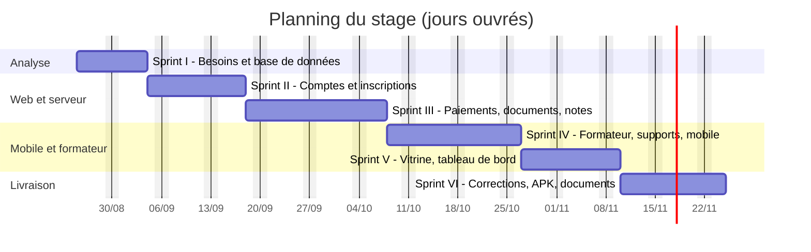
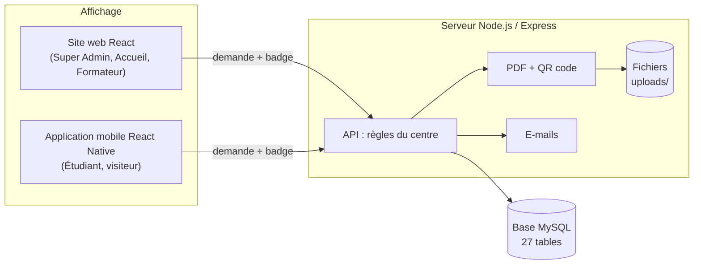
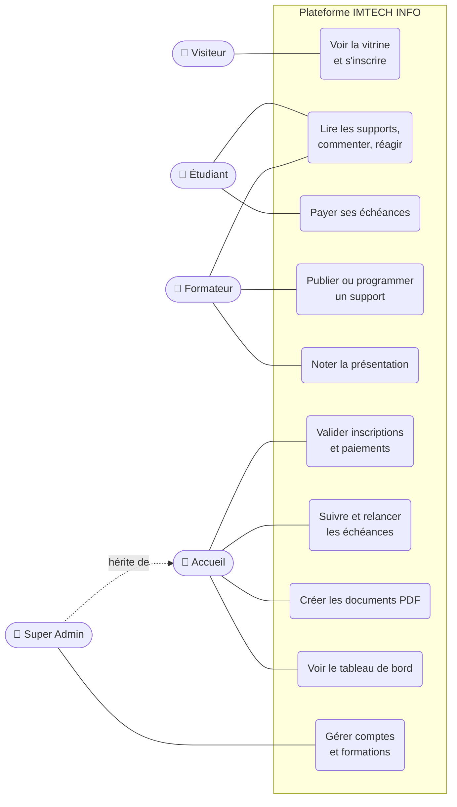
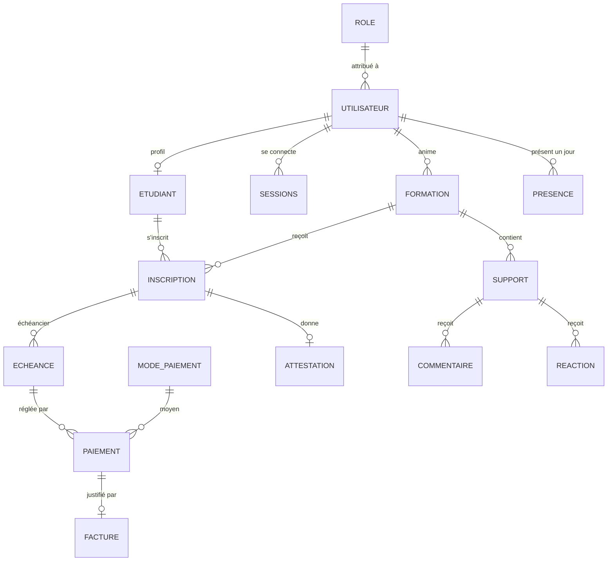
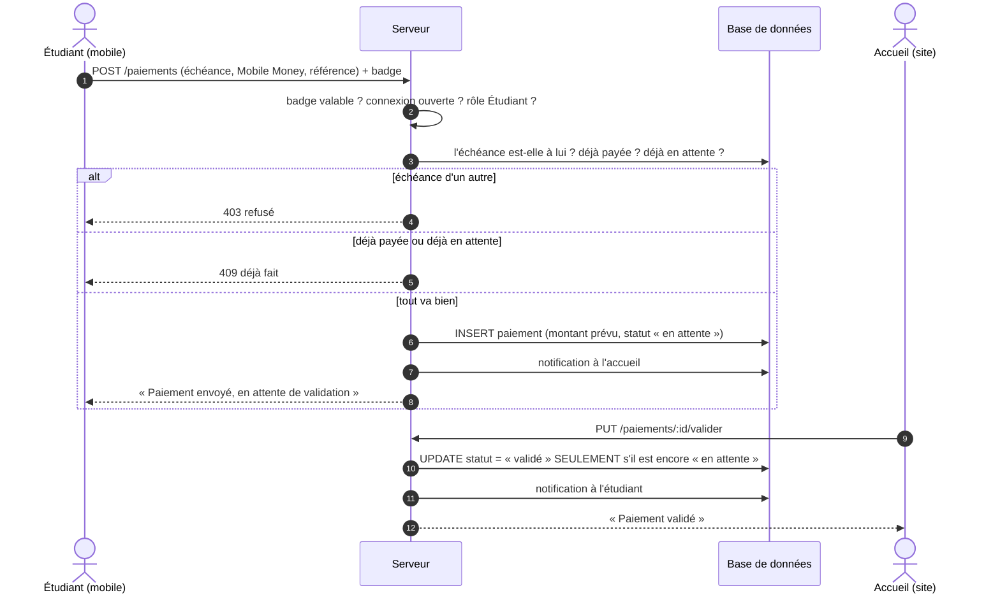
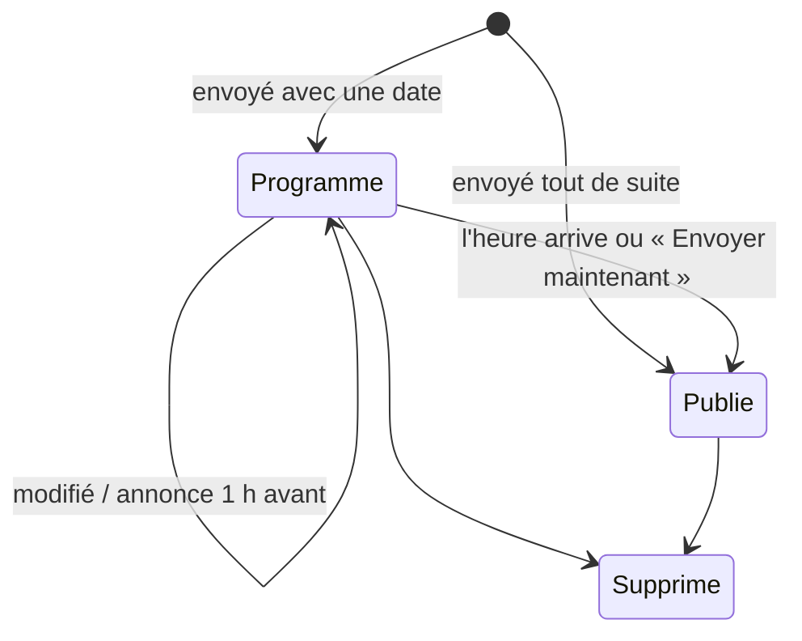
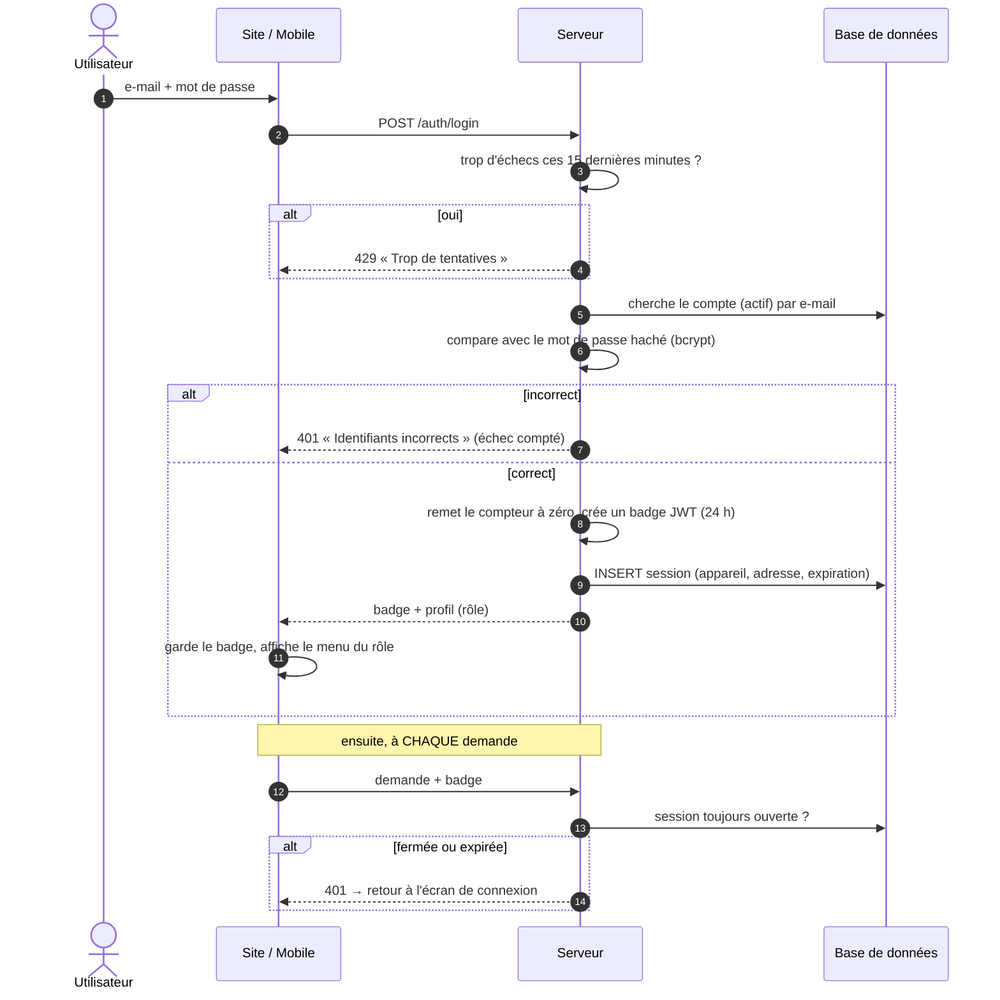
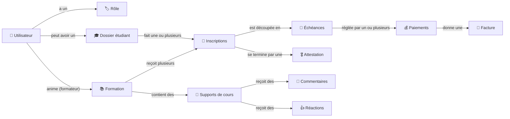

# IMTECH INFO — Plateforme de gestion de formation
## Second support de rédaction du mémoire (plan `planMemoire.txt`, 35 pages)

> Ce document est le **support du mémoire**. Le fonctionnement technique de l'application (démarrage,
> code, parcours A → Z avec pages, routes et fonctions, modules, règles) est dans
> [`FLUX-APPLICATION.md`](FLUX-APPLICATION.md), le document de reprise. Celui-ci suit **exactement le plan
> resserré** de [`planMemoire.txt`](planMemoire.txt) : **35 pages** de l'avant-propos à la
> bibliographie, **9 tableaux**, **19 figures**, et seulement **4 modules** détaillés.
>
> Chaque partie indique son **nombre de pages visé** (📄). Le texte est déjà à la bonne longueur :
> on peut le reporter presque tel quel dans le modèle Word, en ajoutant les captures.
>
> - ✍️ = à écrire moi-même (ITU, entreprise, remerciements, avis personnel) ;
> - 📷 = capture d'écran à placer (le nom du fichier proposé est indiqué quand il existe déjà) ;
> - 🔗 = où trouver plus de détails dans `FLUX-APPLICATION.md`.
>
> Les schémas sont en **Mermaid** (aperçu dans VS Code ou sur <https://mermaid.live>, puis
> « Export PNG » pour Word). Les figures 2, 3 et 4 existent déjà en image : `architecture.PNG`,
> `conceptionMetier.PNG`, `mcd.PNG`.

### Budget de pages

| Partie | Pages |
|---|:-:|
| Avant-propos | 2 |
| Introduction | 1 |
| 1 Présentation du projet | 5 |
| 2 Réalisation de l'application | 22 |
| 3 Évaluation du projet et connaissances acquises | 3 |
| Conclusion | 1 |
| Bibliographie | 1 |
| **Total compté** | **35** |
| Page de garde, table des matières, listes, glossaire, annexes | en plus |

---

## Page de garde

| Champ du modèle | Valeur |
|---|---|
| Titre | Conception et réalisation d'une plateforme web et mobile de gestion de formation |
| Par | Tolojanahary Elia Nantenaina |
| Grade | Licence en Informatique — option ✍️ |
| Entreprise d'accueil | IMTECH INFO |
| Encadreur professionnel | M. Valisoa |
| Jury | ✍️ |
| Période du stage | du 25 août 2026 au 24 novembre 2026 (3 mois) |

---

## Table des matières

- Liste des tableaux
- Liste des figures
- Glossaire
- [Avant-propos](#avant-propos)
  - L'IT University
  - L'entreprise d'accueil : IMTECH INFO
  - Remerciements
- [Introduction](#introduction)
- [1 Présentation du projet](#1-présentation-du-projet)
  - [1.1 Objectifs du projet](#11-objectifs-du-projet)
  - [1.2 Planning de réalisation](#12-planning-de-réalisation)
  - [1.3 Technologies utilisées](#13-technologies-utilisées)
    - 1.3.1 Partie affichage : web et mobile
    - 1.3.2 Partie traitement : serveur
    - 1.3.3 Base de données
- [2 Réalisation de l'application](#2-réalisation-de-lapplication)
  - [2.1 Analyse et conception](#21-analyse-et-conception)
    - 2.1.1 Analyse de l'existant
    - 2.1.2 Conception de l'application
      - 2.1.2.1 Conception affichage
      - 2.1.2.2 Conception métier
      - 2.1.2.3 Modèle conceptuel de données
  - [2.2 Développement par fonctionnalité ou module](#22-développement-par-fonctionnalité-ou-module)
    - [2.2.1 Vitrine et inscription de l'étudiant](#221-vitrine-et-inscription-de-létudiant)
    - [2.2.2 Échéances et paiements](#222-échéances-et-paiements)
    - [2.2.3 Supports de cours](#223-supports-de-cours)
    - [2.2.4 Utilisateurs et sécurité](#224-utilisateurs-et-sécurité)
  - [2.3 États d'analyse et statistiques](#23-états-danalyse-et-statistiques)
    - 2.3.1 État E1 : indicateurs financiers (tableau de bord)
    - 2.3.2 État E2 : évolution des encaissements et des inscriptions
    - 2.3.3 État E3 : notes d'attestation et classement d'une formation
    - 2.3.4 État E4 : avis des étudiants sur les formateurs
    - 2.3.5 État E5 : échéances en retard et à rappeler
    - 2.3.6 Bilan des états
  - [2.4 Problèmes rencontrés et solutions](#24-problèmes-rencontrés-et-solutions)
- [3 Évaluation du projet et connaissances acquises](#3-évaluation-du-projet-et-connaissances-acquises)
  - 3.1 Bilan pour l'entreprise
  - 3.2 Bilan personnel
  - 3.3 Extension et évolution de l'application
- [Conclusion](#conclusion)
- [Bibliographie](#bibliographie)
- [Annexes](#annexes)
  - Annexe A : Sécurité
  - Annexe B : Modèle logique de données complet
  - Annexe C : Conception affichage : les écrans un par un
  - Annexe D : Conception métier : les données échangées
  - Annexe E : La base de données, expliquée simplement
  - Annexe F : Requêtes des états d'analyse
  - Annexe G : Détail des états d'analyse

---

## Liste des tableaux

- Tableau 1 : Objectifs du projet et ce qui y répond
- Tableau 2 : Comparaison entre React et Vue
- Tableau 3 : Comparaison entre React Native et Flutter
- Tableau 4 : Comparaison entre Node.js et Spring Boot
- Tableau 5 : Comparaison entre MySQL et PostgreSQL
- Tableau 6 : Avant le projet, et ce qui posait problème
- Tableau 7 : Analyse des besoins par utilisateur
- Tableau 8 : Catalogue des états produits par l'application
- Tableau 9 : Problèmes rencontrés et solutions

## Liste des figures

- Figure 1 : Diagramme de Gantt
- Figure 2 : Architecture : web et mobile → serveur → base de données
- Figure 3 : Diagramme de cas d'utilisation
- Figure 4 : Modèle conceptuel de données
- Figure 5 : Vitrine et inscription
- Figure 6 : Validation de l'inscription par l'Accueil
- Figure 7 : Liste des échéances
- Figure 8 : Paiement depuis le téléphone puis validation par l'Accueil
- Figure 9 : Diagramme de séquence d'un paiement
- Figure 10 : Publication d'un support
- Figure 11 : Support programmé, vu par le formateur et par l'étudiant
- Figure 12 : Commentaires et réactions
- Figure 13 : Liste des sessions
- Figure 14 : Filigrane et capture d'écran bloquée
- Figure 15 : Diagramme de séquence de la connexion
- Figure 16 : Tableau de bord — indicateurs financiers
- Figure 17 : Évolution mensuelle des encaissements et formations les plus demandées
- Figure 18 : Notes et classement d'une formation
- Figure 19 : Avis des étudiants sur les formateurs
- Figure 20 : Échéances en retard et à rappeler

---

## Glossaire

| Terme | Ce que ça veut dire |
|---|---|
| **API** | La partie « serveur » : le site et l'application mobile lui posent des questions, elle répond. |
| **Back-office** | Le site web réservé au personnel du centre (Super Admin, Accueil, Formateur). |
| **Échéance / échéancier** | Une somme à payer à une date précise / la liste de toutes les échéances d'une inscription. |
| **Filigrane** | Un texte écrit en transparence sur un document (ici : le nom du lecteur et la date). |
| **Jeton de connexion (JWT)** | Un badge remis à l'utilisateur quand il se connecte ; il le montre à chaque demande. |
| **Merise** | Une méthode pour dessiner la base de données avant de la créer (MCD, MLD). |
| **Mot de passe haché** | Le mot de passe transformé en une suite illisible avant d'être enregistré. |
| **Scrum / sprint** | Travailler par petites étapes (sprints) avec une démonstration à la fin de chacune. |
| **Session** | Une connexion ouverte sur un appareil. On peut la fermer à distance. |
| **Statut d'un paiement** | « En attente » (envoyé par l'étudiant), « validé » ou « refusé » (par l'accueil). |
| **Tout ou rien (transaction)** | Plusieurs enregistrements liés : soit tout passe, soit rien n'est gardé. |
| **Tranche** | Une partie du prix total quand on paie en plusieurs fois. |
| **Vitrine** | L'écran de l'application mobile qui présente les formations aux visiteurs sans compte. |

---

## Avant-propos

📄 **2 pages**

Le présent mémoire présente les résultats du travail effectué lors de mon stage de fin d'études
de Licence en Informatique de l'IT University ; stage effectué au sein de la société
**IMTECH INFO** durant **trois mois**, du **25 août 2026** au **24 novembre 2026**.

Afin de poser clairement le contexte de ce mémoire, je vais présenter succinctement d'une part
l'IT University et d'autre part mon entreprise d'accueil.

### L'IT University

✍️ *À écrire (≈ ½ page ; le modèle Word contient déjà un texte de présentation de l'ITU).*

### L'entreprise d'accueil : IMTECH INFO

✍️ *À écrire (≈ ½ page). Éléments repris du cahier des charges :*

| Champ | Détail |
|---|---|
| Nom | IMTECH INFO |
| Site web | www.imtechinfo.com |
| Domaines d'activité | Informatique, énergie, maintenance, langues |
| Formation | Une grande partie de l'activité : bureautique, développement web, réseaux, infographie, langues… |
| Encadreur | M. Valisoa |

### Remerciements

✍️ *À écrire (≈ ½ page, rester simple comme l'exemple du modèle).*

---

## Introduction

📄 **1 page** — thème et intérêt, existant et ses problèmes, résultats, structure du mémoire.

**Thème et intérêt.** Pendant ce stage, j'ai travaillé sur le thème **« Conception et réalisation
d'une plateforme web et mobile de gestion de formation »** pour le centre de formation d'IMTECH
INFO. Dans un centre de formation, chaque étudiant suit le même chemin : il découvre les
formations, s'inscrit, paie en une ou plusieurs fois, suit ses cours et reçoit une attestation.
Ce chemin paraît simple, mais il demande de suivre beaucoup de choses : dossiers, dates de
paiement, argent reçu, documents à remettre.

**L'existant et ses problèmes.** Chez IMTECH INFO, tout cela se faisait **sur papier et dans des
tableaux remplis à la main**. Personne ne savait, à un instant donné, combien d'argent était
rentré ; les retards de paiement étaient vus trop tard ; les supports de cours circulaient par
message ; et l'étudiant devait se déplacer pour savoir où il en était.

**Les résultats.** En trois mois, j'ai réalisé :

- un **site web** pour l'équipe (direction, accueil, formateurs) ;
- une **application mobile** Android pour les étudiants et les visiteurs ;
- un **serveur** commun, qui applique les règles du centre, crée les PDF et envoie les e-mails ;
- une base de données de **27 tables**.

**Structure du mémoire.** Le **premier chapitre** présente le projet : objectifs, planning et
technologies choisies. Le **deuxième** raconte la réalisation : l'analyse de l'existant, la
conception, puis quatre modules importants, les statistiques et les problèmes rencontrés. Le
**troisième** fait le bilan pour l'entreprise et pour moi, et propose des évolutions.

---

## 1 Présentation du projet

📄 **5 pages**

### 1.1 Objectifs du projet

📄 **1 page**

**Objectif général.** Créer une application qui suit l'étudiant de la découverte des formations
jusqu'à son attestation, et qui donne à l'équipe une vue claire et à jour de l'activité du centre.

*Tableau 1 : Objectifs du projet et ce qui y répond*

| # | Objectif | Ce qui y répond dans l'application |
|:-:|---|---|
| 1 | Tout regrouper au même endroit : formations, étudiants, inscriptions, paiements | Le site web du personnel |
| 2 | Attirer de nouveaux étudiants et leur permettre de s'inscrire à distance | Vitrine et inscription depuis le téléphone ([§2.2.1](#221-vitrine-et-inscription-de-létudiant)) |
| 3 | Ne plus rater un paiement et payer sans se déplacer | Échéancier automatique, couleurs de suivi, paiement mobile validé par l'accueil ([§2.2.2](#222-échéances-et-paiements)) |
| 4 | Donner les cours aux étudiants sans que les supports circulent partout | Supports dans l'application, programmés, commentés ([§2.2.3](#223-supports-de-cours)) |
| 5 | Que chacun n'accède qu'à ce qui le concerne, et protéger les documents | Rôles, sessions, limite d'essais, filigrane ([§2.2.4](#224-utilisateurs-et-sécurité)) |
| 6 | Créer les documents officiels sans recopie | Fiche, facture et attestation PDF avec QR code de vérification |
| 7 | Donner des chiffres à la direction | Tableau de bord, note d'attestation, avis sur les formateurs ([§2.3](#23-états-danalyse-et-statistiques)) |

**Ce que le projet ne fait pas** : la comptabilité de l'entreprise, la paie des formateurs, le
vrai paiement en ligne (l'étudiant déclare son paiement, l'accueil vérifie), les cours en visio et
la gestion de plusieurs centres.

### 1.2 Planning de réalisation

📄 **1 page**

J'ai travaillé en **six sprints**. À la fin de chacun, je montrais le résultat à mon encadreur.
Le total représente **66 jours de travail** (détail des tâches :
`Gantt - Estimation ETU003230.csv` et `Estimation Fiche de stage - ETU003230`).

| Sprint | Contenu | Jours |
|---|---|:-:|
| I | Recueil des besoins, prise en main des outils, conception de la base | 7,5 |
| II | Serveur, connexion, comptes, étudiants, formations, inscriptions | 10,5 |
| III | Paiements, échéances, documents PDF, présence et notes | 13,5 |
| IV | Espace formateur, supports de cours, application mobile | 13 |
| V | Vitrine et inscription en ligne, tableau de bord, recherche | 10 |
| VI | Corrections, application Android, documentation, essais avec l'équipe | 11,5 |



*Figure 1 : Diagramme de Gantt*

> 💡 Dans Word, mettre la figure sur une page en paysage ou réduire le tableau au-dessus si la
> page déborde.

### 1.3 Technologies utilisées

📄 **3 pages**

Pour chaque partie, plusieurs outils étaient possibles. J'ai comparé les deux candidats les plus
sérieux à chaque fois, en gardant en tête trois contraintes : **je travaillais seul** sur le site,
le mobile et le serveur ; j'avais **trois mois** ; et l'application gère **de l'argent**, donc
les données doivent toujours rester justes.

#### 1.3.1 Partie affichage : web et mobile

Le **site web** est un ensemble d'écrans remplis de listes, de fiches et de formulaires (23 écrans).
J'ai comparé **React** et **Vue.js**.

*Tableau 2 : Comparaison entre React et Vue*

| Critère | React | Vue.js |
|---|---|---|
| Principe | Écran construit avec des composants réutilisables, écrits en JSX | Composants aussi, écrits dans des fichiers `.vue` (modèle HTML + script) |
| Prise en main | Un peu plus de concepts au départ (hooks, état) | Réputé plus simple au départ |
| Communauté et bibliothèques | Très large, beaucoup d'exemples et de bibliothèques | Large, mais plus petite |
| Passage au mobile | **React Native** reprend les mêmes idées (composants, hooks) | Pas d'équivalent aussi répandu pour le mobile |
| Ce qui a compté pour moi | **Une seule façon de penser pour le web et le mobile** | — |

L'**application mobile** sert aux étudiants et aux visiteurs (13 écrans). J'ai comparé
**React Native** (avec Expo) et **Flutter**.

*Tableau 3 : Comparaison entre React Native et Flutter*

| Critère | React Native (Expo) | Flutter |
|---|---|---|
| Langage | JavaScript / TypeScript, comme le site et le serveur | Dart, un langage de plus à apprendre |
| Affichage | Composants natifs du téléphone | Moteur de dessin propre à Flutter, très fluide |
| Mise en route | Expo simplifie la création du fichier Android (APK) | Outils complets, mais installation plus lourde |
| Fonctions utiles au projet | `react-native-webview` (lecteur), `expo-screen-capture` (bloquer les captures) | Équivalents disponibles |
| Ce qui a compté pour moi | **Réutiliser ce que je connais de React**, même langage partout | — |

#### 1.3.2 Partie traitement : serveur

Le serveur applique les règles du centre (montants, droits, dates), crée les PDF et envoie les
e-mails. J'ai comparé **Node.js (Express)** et **Spring Boot (Java)**.

*Tableau 4 : Comparaison entre Node.js et Spring Boot*

| Critère | Node.js + Express | Spring Boot |
|---|---|---|
| Langage | JavaScript, le même que le site et le mobile | Java |
| Légèreté | Démarrage rapide, peu de configuration | Plus lourd, beaucoup de choses fournies d'office |
| Structure | Libre : il faut s'imposer une organisation (routes → contrôles → controllers → services → models) | Structure très cadrée dès le départ |
| Bibliothèques utiles | `jsonwebtoken`, `bcryptjs`, `multer`, `pdfkit`, `nodemailer`, `pdf-lib`, `sharp` | Équivalents nombreux |
| Ce qui a compté pour moi | **Un seul langage pour tout le projet**, travail plus rapide seul | Aurait demandé d'apprendre un second écosystème |

#### 1.3.3 Base de données

Les données sont très liées entre elles (un étudiant a des inscriptions, une inscription a des
échéances, une échéance a des paiements) et touchent à de l'argent. Il fallait donc une base
**relationnelle**. J'ai comparé **MySQL** et **PostgreSQL**.

*Tableau 5 : Comparaison entre MySQL et PostgreSQL*

| Critère | MySQL (MariaDB) | PostgreSQL |
|---|---|---|
| Transactions « tout ou rien » | Oui (moteur InnoDB) | Oui |
| Clés étrangères, contraintes d'unicité | Oui | Oui, et contraintes plus riches |
| Installation sur poste | Très simple avec XAMPP, outil phpMyAdmin inclus | Installation à part, outil pgAdmin |
| Connaissance préalable | Déjà utilisée en cours | Moins pratiquée |
| Ce qui a compté pour moi | **Simple à installer et à montrer**, suffisant pour le besoin | Plus puissante, mais pas nécessaire ici |

**Mes choix.** J'ai retenu **React** pour le site, **React Native avec Expo** pour le mobile,
**Node.js avec Express** pour le serveur et **MySQL** pour la base. Le point commun est simple :
**un seul langage, JavaScript, du clic à la base de données**. Seul sur le projet et en trois
mois, c'est ce qui m'a permis d'aller vite sans sacrifier la justesse des données, garantie par
les transactions de MySQL.

---

## 2 Réalisation de l'application

📄 **22 pages**

### 2.1 Analyse et conception

📄 **4 pages**

#### 2.1.1 Analyse de l'existant

Avant le projet, tout se faisait à la main à l'accueil, et l'étudiant devait venir ou appeler
pour la moindre question.

*Tableau 6 : Avant le projet, et ce qui posait problème*

| Tâche | Comment ça se passait | Ce qui posait problème |
|---|---|---|
| Inscription | Fiche papier remplie à l'accueil, aux heures d'ouverture | Fiches perdues, informations recopiées, pas d'inscription à distance |
| Échéances et paiements | Tableau rempli à la main | Erreurs de recopie, personne ne sait combien d'argent est rentré |
| Retards | Vus en relisant le tableau | Vus trop tard ; les relances dépendent de la mémoire de chacun |
| Supports de cours | Donnés en classe ou envoyés par message | Les copies circulent partout, rien n'est rangé au même endroit |
| Documents (fiche, facture, attestation) | Écrits un par un | Long, risque d'erreur, attestation impossible à vérifier |
| Suivi de l'activité | Pas de chiffres fiables | Décisions prises « au feeling » |

À partir de ces constats et des échanges avec mon encadreur, j'ai listé ce dont chaque
utilisateur a besoin.

*Tableau 7 : Analyse des besoins par utilisateur*

| Utilisateur | Où | Ses besoins |
|---|---|---|
| **Visiteur** | Mobile | Découvrir les formations, les formateurs et les prix ; s'inscrire sans se déplacer |
| **Étudiant** | Mobile | Suivre ses formations et ses échéances ; payer depuis son téléphone ; lire ses supports ; poser ses questions |
| **Formateur** | Site web | Publier ses supports (tout de suite ou plus tard) ; échanger avec ses étudiants ; noter la présentation |
| **Accueil** | Site web | Créer les dossiers et inscriptions ; encaisser et **valider** les paiements ; repérer et relancer les retards ; produire les documents |
| **Super Admin** | Site web | Tout ce que fait l'accueil ; gérer les comptes et les formations ; voir les chiffres et l'avis des étudiants |

#### 2.1.2 Conception de l'application

**Pourquoi concevoir avant de coder.** L'application touche à de l'argent et à des documents
officiels. Une erreur dans l'organisation des données (une inscription sans ses échéances, un
paiement rattaché au mauvais étudiant) est très difficile à réparer une fois que l'équipe a
commencé à saisir. J'ai donc d'abord décidé **comment les écrans parlent au serveur**, **qui a le
droit de faire quoi** et **où ranger chaque information**.

**Le projet en chiffres.** 23 écrans web, 13 écrans mobiles (+ 4 fenêtres), 86 adresses sur le
serveur, 27 tables, 4 rôles (+ le visiteur).

##### 2.1.2.1 Conception affichage

Le projet est fait de trois parties. Le site web et l'application mobile ne parlent **jamais**
directement à la base : ils passent toujours par le serveur, et toujours par une seule fonction
(`apiRequest`) qui joint le badge de connexion, envoie la demande et affiche le message d'erreur
s'il y en a un, toujours en français compréhensible (« Impossible de joindre le serveur… » plutôt
qu'un code technique).



*Figure 2 : Architecture : web et mobile → serveur → base de données*
📷 *Image existante : `architecture.PNG`.*

Le serveur répond toujours sous la même forme, ce qui simplifie l'affichage côté web et mobile :
`{ "status": "success", "data": … }` ou `{ "status": "error", "message": "…" }`.

🔗 *Chaque écran décrit (boutons, messages d'erreur) : [Annexe C](#annexe-c--conception-affichage--les-écrans-un-par-un).*

##### 2.1.2.2 Conception métier

La conception métier dit **qui fait quoi**. Le diagramme de cas d'utilisation montre les actions
principales de chaque acteur ; le Super Admin peut faire tout ce que fait l'accueil.



*Figure 3 : Diagramme de cas d'utilisation*
📷 *Image existante : `conceptionMetier.PNG`.*

Les droits sont vérifiés **par le serveur**, pas seulement en cachant des boutons. À chaque
demande, il contrôle **le rôle** (« un étudiant n'a rien à faire ici ») et **à qui appartiennent
les données** (« un étudiant ne voit que **ses** paiements »). Les règles du centre sont toutes
écrites au même endroit, dans les **services** du serveur.

🔗 *Droits de chaque adresse du serveur : [`backend-imtech/api.md`](backend-imtech/api.md). Données échangées entre
l'affichage et le serveur (équivalent des DTO) : [Annexe D](#annexe-d--conception-métier--les-données-échangées).*

##### 2.1.2.3 Modèle conceptuel de données

La base a été dessinée avec la méthode **Merise**. Elle contient **27 tables**, sans vue, sans
procédure stockée ni trigger : toutes les règles restent dans le serveur. Le schéma ci-dessous
montre les tables principales.



*Figure 4 : MCD*
📷 *Image existante : `mcd.PNG`.*

Deux habitudes guident la base : **on n'efface jamais vraiment** (une colonne `etat` cache la
ligne, l'historique des paiements reste), et tout ce qui va ensemble (inscription + échéances,
compte + dossier) est enregistré **en tout ou rien**. Le modèle logique complet est en
[Annexe B](#annexe-b--modèle-logique-de-données-complet) ; la base expliquée simplement est en
[Annexe E](#annexe-e--la-base-de-données-expliquée-simplement).

---

### 2.2 Développement par fonctionnalité ou module

📄 **13 pages**

L'application compte une quinzaine de modules. Les modules **dossiers étudiants**,
**formations**, **documents officiels** (fiche, facture, attestation avec QR code),
**notifications**, **assistance**, **recherche globale** et **apparence** sont en place mais ne
sont pas détaillés ici (🔗 `FLUX-APPLICATION.md`, parties 4 et 5). Ce chapitre détaille les
**quatre modules les plus représentatifs** du travail. Pour chacun : **ce qu'il fait**,
**pourquoi** il est utile, un **scénario clé**, **l'écran**, et pour les plus techniques un
**diagramme de séquence**.

#### 2.2.1 Vitrine et inscription de l'étudiant

📄 **2 pages**

**Description.** Une personne **sans compte** qui ouvre l'application arrive sur l'écran
**Découvrir** : formations disponibles (photo, formateur, prix, durée), formateurs les mieux
notés, engagements du centre et contacts. Formations et formateurs défilent **5 par 5** : les
suivants arrivent quand on fait glisser jusqu'au bout. Elle peut choisir **une ou plusieurs
formations** et s'inscrire elle-même : identité, mot de passe, nombre de tranches (1 à 4), moyen
de paiement et référence. L'**Accueil** confirme ensuite chaque inscription depuis le site.
Un étudiant **déjà inscrit** peut, depuis l'onglet Formations, ouvrir le même écran (« Voir plus
de formations ») : il n'y voit que les formations qu'il ne suit pas encore, et s'inscrit sans
ressaisir son identité ni son dossier.

**Pourquoi.** L'application devient un moyen d'**attirer de nouveaux étudiants** : on peut
s'inscrire le soir depuis chez soi, sans attendre l'ouverture de l'accueil. Et l'accueil garde
le contrôle, puisque rien n'est définitif sans sa validation.

**Scénario clé.**

1. Mahery ouvre l'application, parcourt la vitrine et ajoute « Développement web » et
   « Python » à sa sélection.
2. Il remplit le formulaire (mot de passe saisi deux fois), choisit de payer en 3 fois par Mobile
   Money et photographie tout de suite ses pièces (photos d'identité, CIN, certificat de
   résidence). Il aurait pu choisir « Plus tard » et les déposer après connexion, dans
   **Mon dossier** (menu ⋮).
3. Le serveur crée, **en une seule fois (tout ou rien)** : le compte, le dossier, les deux
   inscriptions « en ligne », leurs échéanciers et le premier paiement « en attente ». Il reçoit
   « Inscription envoyée » et le total à payer.
4. Sur le site, l'accueil filtre les inscriptions sur **« En ligne »**, vérifie le paiement et
   clique **« Valider »** : l'inscription est confirmée, le premier paiement passe à « validé ».
   Si une pièce manquait, la validation serait refusée avec la liste des pièces à fournir.
5. Les supports de la formation s'ouvrent pour Mahery.
6. Trois mois plus tard, Mahery veut aussi « Excel avancé ». Depuis l'onglet Formations, il
   touche « Voir plus de formations », coche Excel, choisit ses tranches et son paiement : son
   compte et son dossier existent déjà. L'accueil valide comme d'habitude.

📷 *Figure 5 : Vitrine et inscription — écran Découvrir + fiche d'une formation + formulaire
(captures mobile ; `Détail formation mobile.png` existe déjà).*

📷 *Figure 6 : Validation de l'inscription par l'Accueil — liste des inscriptions filtrée
« En ligne » avec le bouton Valider (`Inscriptions.png` existe déjà).*

**Règles à retenir.**

- L'inscription en ligne utilise **le même calcul d'échéancier** qu'une inscription faite à
  l'accueil : la logique n'est écrite qu'une fois.
- Tant que l'accueil n'a pas validé, la formation affiche « En attente de validation » et **les
  supports restent fermés**.
- **Pas de validation sans dossier complet** : le serveur sait qu'une inscription vient du
  mobile grâce à son origine (« en ligne »). Il refuse de la valider tant que les 4 pièces ne
  sont pas déposées. L'étudiant peut remplacer une pièce à tout moment ; l'accueil est prévenu.
  Sur le site, les inscriptions à valider s'affichent en premier, un filtre « Dossier » (complet /
  incomplet) les retrouve et le détail d'une inscription montre les pièces manquantes.
- **Inscription faite à l'accueil** : jamais bloquée, puisque c'est l'accueil qui complète le
  dossier. La fenêtre de validation le prévient (« Dossier incomplet (2/4 pièces) ») et le bouton
  devient « Valider quand même ».
- Un étudiant déjà inscrit ne peut pas s'inscrire deux fois à la même formation : toute la demande
  est alors refusée, rien n'est créé.
- Garde-fous : e-mail déjà utilisé refusé, mot de passe de 8 caractères minimum et saisi deux fois, une formation
  choisie deux fois ne compte qu'une fois, **5 inscriptions par heure** au maximum depuis un même
  appareil.
- Valider deux fois la même inscription est refusé : on ne paie pas deux fois la première tranche.

#### 2.2.2 Échéances et paiements

📄 **4 pages**

**Description.** Dès qu'une inscription est créée, le serveur calcule **automatiquement
l'échéancier** : le prix est divisé par le nombre de tranches, et chaque tranche reçoit une date.
La page **Échéances** montre ensuite chaque échéance avec une **couleur** de suivi. L'étudiant
peut **payer une échéance depuis son téléphone** : le paiement reste **« en attente »** jusqu'à ce
que l'accueil le **valide** ou le **refuse**. Au guichet, l'accueil peut aussi encaisser
directement (paiement validé tout de suite).

**Pourquoi.** C'est le cœur de l'argent du centre. Le calcul automatique supprime les erreurs de
recopie ; les couleurs montrent les retards **avant** qu'ils arrivent ; et la validation par une
personne empêche de tricher en disant simplement « j'ai payé ».

**L'échéancier automatique.** Chaque tranche vaut le prix ÷ le nombre de tranches, arrondi au
centime ; la **dernière tranche récupère les centimes manquants**, pour que le total tombe
toujours pile. La tranche n° *n* tombe *n* × (durée ÷ nombre de tranches) jours après
l'inscription. Exemple : 100 000 Ar sur 90 jours en 3 fois → 33 333,33 Ar à J+30,
33 333,33 Ar à J+60 et 33 333,34 Ar à J+90.

**Le suivi par couleurs.**

| Couleur | Signification | Quand |
|---|---|---|
| 🟢 VERT | À jour | Payée (même si le paiement attend encore la validation) ou date à plus de 2 jours |
| 🟡 JAUNE | À rappeler | Pas réglée et la date est dans 2 jours, demain ou aujourd'hui → **l'accueil est prévenu** |
| 🔴 ROUGE | En retard | Date passée et pas réglée |

Chaque heure, le serveur repère les échéances qui passent au jaune et prévient l'accueil, **une
seule fois** par échéance. C'est ensuite une personne qui décide de cliquer **« Rappeler »**
(notification + e-mail à l'étudiant) : elle sait peut-être déjà qu'il passe payer demain.

📷 *Figure 7 : Liste des échéances — page Échéances avec les trois couleurs et le filtre.*

**Scénario clé : un paiement depuis le téléphone.**

1. Toky ouvre **Paiements** sur son téléphone : il voit sa prochaine échéance, le total, ce qu'il
   a déjà payé et ce qui reste.
2. Il appuie sur **« Payer »**, choisit Mobile Money et saisit la référence. Le **montant est
   imposé** : c'est celui de l'échéance.
3. Le serveur vérifie que l'échéance est **bien à lui**, qu'elle n'est pas déjà payée et qu'aucun
   paiement n'attend déjà. Il enregistre le paiement **« en attente »** et prévient l'accueil.
4. Sur le site, la page Paiements affiche « 1 paiement attend votre validation ». L'accueil
   vérifie sur son relevé et clique **« Valider »**.
5. Toky reçoit « Votre paiement a été validé » ; la somme passe dans « Déjà payé ».

📷 *Figure 8 : Paiement depuis le téléphone puis validation par l'Accueil — à gauche l'écran
Paiements du mobile (« En attente de validation »), à droite la page Paiements du site avec le
bandeau et les boutons Valider / Refuser (`Paiements.png` existe déjà).*



*Figure 9 : Diagramme de séquence d'un paiement*

**Règles à retenir.**

- Un paiement **en attente** compte déjà pour la **couleur** (l'étudiant n'est pas marqué en
  retard parce que l'accueil n'a pas encore vérifié), mais **pas** pour l'argent reçu, le tableau
  de bord ni la facture.
- Si deux employés cliquent « Valider » en même temps, **une seule validation passe** : le
  serveur ne change le statut que s'il est encore « en attente ».
- Au guichet, l'accueil peut encaisser une partie de l'échéance, mais **jamais plus que ce qui
  reste à payer**.
- Une facture PDF (numérotée FAC-AAAA-0001) ne peut être créée que pour un paiement **validé**.

#### 2.2.3 Supports de cours

📄 **4 pages**

**Description.** Le formateur publie un **support** dans une de ses formations : un titre, un
**texte mis en forme** (gras, listes, titres, liens) et, s'il le souhaite, un **fichier** (PDF,
image, audio ou vidéo, 50 Mo maximum). Il peut le publier tout de suite ou le **programmer** pour
une date précise. Les étudiants inscrits le lisent dans l'application, peuvent le **commenter**,
**répondre** aux autres et **réagir** (👍 J'aime, ❤️ J'adore, 💡 Utile, 👎 Je n'aime pas).

**Pourquoi.** Les supports sont le travail des formateurs : ils doivent rester chez IMTECH. Les
mettre dans l'application évite qu'ils circulent par message, les range au même endroit, et
permet aux étudiants de poser leurs questions juste sous le cours. Les réactions donnent aussi à
la direction un premier avis sur chaque formateur ([§2.3.4](#234-état-e4--avis-des-étudiants-sur-les-formateurs)).

**Publication.** Le formateur choisit la formation, écrit le titre et le texte, joint un fichier
et clique sur **Publier**. Les étudiants inscrits reçoivent une notification. Avant
d'enregistrer, le serveur **nettoie le texte** : il ne garde qu'une liste précise de mises en
forme autorisées et supprime tout le reste. Sans cela, un programme malveillant caché dans le
texte pourrait se lancer chez **tous** les étudiants de la formation.

📷 *Figure 10 : Publication d'un support — page Supports du formateur avec l'éditeur de texte et
le fichier joint.*

**Scénario clé : un support programmé.**

1. Dimanche soir, le formateur prépare « Projet : site vitrine » et le **programme** pour mardi
   8 h. Il le retrouve dans la page **Supports programmés**, où il peut encore le modifier ou
   l'**envoyer tout de suite**.
2. Lundi, les étudiants **ne voient rien** : un support programmé est un brouillon.
3. Mardi à 7 h, ils reçoivent « … va envoyer le support dans une heure ».
4. À 8 h, le serveur (qui vérifie chaque minute) publie le support et prévient étudiants et
   formateur. S'il était éteint à 8 h, le support part dès son redémarrage.



📷 *Figure 11 : Support programmé, vu par le formateur et par l'étudiant — à gauche la page
Supports programmés du site (date, bouton Envoyer maintenant), à droite l'annonce « dans une
heure » reçue sur le téléphone. Le schéma d'états ci-dessus peut accompagner la figure.*

**Commentaires et réactions.**

- **Un seul niveau de réponses**, comme sur Facebook ; les réponses sont repliées derrière « Voir
  les N réponses ».
- Le **formateur** peut mentionner un étudiant de sa formation avec `@` ; l'étudiant mentionné
  est prévenu. Un **étudiant** ne mentionne pas : il répond, et l'auteur du commentaire est
  prévenu. Un nouveau commentaire d'étudiant prévient automatiquement le formateur.
- **Une seule réaction** par personne et par support (on peut la changer ou la retirer) ; la base
  refuse les doublons.
- Qui peut supprimer : le Super Admin tout, le formateur les commentaires de ses formations,
  l'étudiant les siens.
- **Affichage 5 par 5.** Supports et commentaires arrivent par paquets de 5 : le serveur n'envoie
  que ce qui s'affiche, et « Voir plus » demande la suite. Avec des milliers de commentaires, le
  téléphone reste rapide et consomme peu de données. La suite est demandée « à partir du dernier
  reçu » (et non « page 3 ») : un commentaire publié pendant la lecture ne fait ni doublon ni trou.

📷 *Figure 12 : Commentaires et réactions — fil de commentaires sous un support (réponses
repliées, mention `@`) et barre de réactions, sur le téléphone.*

**Règles à retenir.**

- Un étudiant ne voit que les supports **publiés** des formations où son inscription est
  **confirmée**.
- Un support publié ne se modifie plus (ce serait déroutant pour ceux qui l'ont déjà lu).
- L'ouverture du fichier lui-même est protégée (droits + filigrane) : voir [§2.2.4](#224-utilisateurs-et-sécurité).

#### 2.2.4 Utilisateurs et sécurité

📄 **3 pages**

**Description.** L'application connaît **quatre rôles** (Super Admin, Accueil, Formateur,
Étudiant) et le visiteur sans compte. Chacun se connecte avec son e-mail et son mot de passe ;
le menu et surtout les **droits vérifiés par le serveur** dépendent du rôle. Chaque connexion est
une **session** qu'on peut voir et fermer à distance. Les essais de mot de passe sont **limités**,
et les documents sont **protégés** à l'ouverture. Par ailleurs, l'étudiant peut envoyer une
**demande d'assistance** que l'accueil marque comme résolue, et chacun peut **personnaliser
l'apparence** du site (thème clair ou sombre, couleur, taille du texte).

**Pourquoi.** L'application contient des pièces d'identité, de l'argent et des documents
officiels. Chacun ne doit voir que ce qui le concerne, on doit pouvoir couper un accès à tout
moment (téléphone perdu, employé qui part), et un document qui fuit doit pouvoir être retracé.

**Les sessions.** Le badge de connexion (JWT) seul ne suffit pas : il resterait valable 24 h même
après une déconnexion. Le serveur garde donc la liste des connexions (table `sessions`) et vérifie
**à chaque demande** que la connexion est toujours ouverte. Dans *Paramètres → Sécurité*, chacun
voit ses appareils (navigateur, adresse, date, appareil actuel mis en avant) et peut **déconnecter
les autres appareils**. Le site et l'application revérifient la connexion chaque minute : les
autres appareils reviennent à l'écran de connexion en moins d'une minute. Désactiver un compte ou
changer son mot de passe ferme aussi les autres sessions. Un compte désactivé n'est pas effacé :
le Super Admin le retrouve dans la page Utilisateurs avec le filtre « Désactivés » et peut le
réactiver (un employé qui revient, une erreur de manipulation).

📷 *Figure 13 : Liste des sessions — Paramètres > Sécurité avec les appareils connectés et le
bouton « Déconnecter les autres appareils ».*

**La limite des essais.**

| Où | Limite |
|---|---|
| Connexion, par compte et par appareil | 5 échecs en 15 min (une réussite remet à zéro) |
| Connexion, par appareil | 20 échecs en 15 min |
| Mot de passe oublié | 5 demandes par heure |

Deux limites, car une limite par compte seule laisserait le pirate changer de compte, et une
limite par appareil seule bloquerait tout un bureau à cause d'une personne. Le serveur répond
« Trop de tentatives. Réessayez dans 15 minutes. » (code 429). Pour un mot de passe oublié, il
répond **la même chose que le compte existe ou non**, pour ne pas révéler qui a un compte.

**La protection des documents.**

1. **Il faut être connecté et avoir le droit** pour ouvrir un fichier : connaître son adresse ne
   suffit pas, et un lien copié ne marche plus après la déconnexion. Un étudiant n'ouvre un
   support que s'il est inscrit et confirmé ; ses pièces d'identité ne sont visibles que par lui,
   l'accueil et le Super Admin.
2. **Le nom du lecteur est écrit en filigrane** (« IMTECH INFO · Nom · e-mail · date ») sur le PDF
   ou l'image au moment où il l'ouvre ; le fichier d'origine ne change pas. C'est la seule
   protection qui marche même si quelqu'un photographie l'écran avec un autre téléphone.
3. **Sur le téléphone**, le support s'ouvre dans un lecteur interne : pas de bouton télécharger,
   **captures et enregistrements d'écran bloqués** (écran noir sur Android), rien n'est gardé
   après la lecture.

📷 *Figure 14 : Filigrane et capture d'écran bloquée — un PDF ouvert avec le nom du lecteur en
transparence, et l'écran noir obtenu en tentant une capture sur Android.*

**Scénario clé : la connexion.**



*Figure 15 : Diagramme de séquence de la connexion*

🔗 *Liste complète des risques et protections : [Annexe A](#annexe-a--sécurité).*

---

### 2.3 États d'analyse et statistiques

📄 **3 pages** (4 au plus avec les captures). Le détail des chiffres, des règles de calcul et des
vérifications est en [Annexe G](#annexe-g--détail-des-états-danalyse) ; les requêtes SQL en
[Annexe F](#annexe-f--requêtes-des-états-danalyse).

Cette partie montre ce que l'application **rend** à ceux qui la font tourner : ce qu'elle calcule
à partir des saisies de tous les jours pour aider à **contrôler** (qui doit encore payer ?),
**suivre** (l'activité progresse-t-elle ?) et **décider** (quel étudiant mérite son attestation,
quel formateur accompagner ?).

> **Données fictives.** IMTECH INFO n'autorise pas la diffusion des données de ses étudiants. Les
> captures et les chiffres viennent du **jeu de démonstration** (`donneesTest.sql` : 10 étudiants,
> 25 inscriptions sur 7 formations, de juillet à octobre 2026, avec les vrais tarifs du centre),
> lus **au 26/10/2026**. Sous chaque capture, ajouter la mention :
> *« Données fictives — reproduction des données réelles non autorisée par l'entreprise. »*

*Tableau 8 : Catalogue des états produits par l'application*

| N° | Nom de l'état | Utilisateur cible | Question à laquelle il répond | Type | Format |
|:-:|---|---|---|---|---|
| **E1** | Indicateurs financiers | Direction (Super Admin), Accueil | Combien avons-nous encaissé, combien reste-t-il à recevoir, et combien d'échéances sont en retard ? | Tableau de bord | Écran |
| **E2** | Évolution des encaissements et des inscriptions | Direction | Notre activité progresse-t-elle d'un mois à l'autre, et quelles formations attirent le plus ? | Analyse | Écran (courbe, barres) |
| **E3** | Notes d'attestation et classement d'une formation | Formateur, Direction | Quelle note mérite chaque étudiant, et qui décroche ? | Synthèse | Écran |
| **E4** | Avis des étudiants sur les formateurs | Direction | Quels formateurs sont appréciés, lesquels faut-il accompagner ? | Synthèse | Écran |
| E5 | Échéances en retard et à rappeler | Accueil | Qui dois-je relancer aujourd'hui ? | Opérationnel | Écran (rouge / jaune) |
| E6 | Export des inscriptions | Accueil, Direction | Comment retravailler la liste des inscrits dans Excel ? | Opérationnel | CSV (Excel) |
| E7 | Fiche d'inscription, facture | Accueil, étudiant | Que l'étudiant a-t-il acheté et payé ? | Opérationnel | PDF |
| E8 | Attestation de formation | Étudiant, employeur | Cet étudiant a-t-il réellement suivi la formation, avec quelle note ? | Opérationnel | PDF + QR code |

Cinq états sont détaillés ci-dessous : les quatre états d'aide à la décision, E1 à E4, et E5,
l'état de travail le plus utilisé par l'Accueil. Les fiches de E6 à E8, sur le même plan, sont en
[Annexe G](#annexe-g--détail-des-états-danalyse) (G.7 à G.9). Chaque fiche suit le même plan : besoin,
données et calcul, restitution, lecture, vérification.

#### 2.3.1 État E1 : indicateurs financiers (tableau de bord)

**Besoin.** La direction et l'Accueil veulent savoir chaque matin si l'argent rentre et qui
relancer. Avant le projet, il fallait recompter le cahier des paiements.

**Données et calcul.** Tables `paiement` et `echeance`. **Filtre de période** : deux dates
libres « Du … au … », chacune facultative (sans date : depuis l'ouverture). Ce filtre, en haut du
tableau de bord, s'applique aussi aux inscriptions de E2 et aux avis de E4 : les trois états sont
donc toujours lus sur la même période. Le **montant
encaissé** est la somme des paiements validés **dont la date de paiement** est dans la période. Le
**reste à encaisser** est calculé sur les échéances **dont la date** est dans la période : leur
total moins ce qui a déjà été validé sur elles (un paiement en avance ne fausse donc pas le
calcul). Une échéance de la période est **en retard** quand sa date est passée et que les
paiements envoyés ne la couvrent pas. Sous les cartes, une barre en trois couleurs détaille ce
reste en trois montants dont la somme redonne le total : **à venir** (date pas encore arrivée),
**à valider** (payé par l'étudiant, en attente de l'Accueil) et **en retard**, chacun avec son
nombre d'échéances.

📷 *Figure 16 : Tableau de bord — indicateurs financiers au 26/10/2026
(`dashboard-administrateur.png`).*
*Données fictives — reproduction des données réelles non autorisée par l'entreprise.*

**Lecture.** Le centre a encaissé **4 671 667 Ar** et il lui reste **2 698 333 Ar** à recevoir :
il a déjà reçu plus que ce qu'il attend encore. Ce reste n'est pas un retard : la barre de détail
montre **1 900 000 Ar** à venir (13 échéances dont la date n'est pas encore arrivée),
**265 000 Ar** à valider (2 échéances déjà payées depuis le téléphone) et **533 333 Ar** vraiment
en retard, soit **4 échéances** seulement. L'Accueil n'a donc pas à relancer tout le monde, mais quatre échéances
(deux étudiants), qu'il retrouve en rouge dans la liste des échéances (E5). Filtré **du 01/07 au
30/09/2026** (3ᵉ trimestre), le tableau de bord montre **3 096 667 Ar** encaissés et seulement
**266 667 Ar** restant dus sur les échéances du trimestre, qui correspondent tous à **2 échéances en
retard** : le trimestre est presque entièrement recouvré.

**Vérification.** Le montant encaissé est égal à la somme des quatre mois de E2. Les trois
montants du détail redonnent le reste à encaisser (1 900 000 + 265 000 + 533 333 = 2 698 333 Ar).
Encaissé + reste (7 370 000 Ar) est égal à la somme des tarifs calculée dans Excel sur l'export
CSV (E6). Les 4 retards sont
les 4 lignes rouges de E5, et leur montant a été additionné à la main ([Annexe G.2](#annexe-g--détail-des-états-danalyse)).

#### 2.3.2 État E2 : évolution des encaissements et des inscriptions

**Besoin.** La direction veut savoir si le centre **grandit**, et quelles formations ouvrir de
nouveau ou mettre en avant dans la vitrine.

**Données et calcul.** Tables `paiement`, `inscription` et `formation`. L'état contient trois
graphiques :
- **Encaissements (barres)** : pour chaque période, la somme des paiements validés. Des boutons
  au-dessus du graphique choisissent la période : jour, semaine, mois ou année. Chaque barre
  affiche son montant et, en dessous, l'évolution par rapport à la barre précédente :
  (mois − mois précédent) ÷ mois précédent.
- **Inscriptions (courbe)** : pour chaque mois, le nombre d'inscriptions.
- **Formations les plus suivies** : le nombre d'inscriptions de chaque formation, du plus grand au
  plus petit ; seules les 5 premières sont affichées.

Les deux derniers graphiques suivent le filtre « Du … au … » du tableau de bord : seules les
inscriptions faites entre ces deux dates sont comptées.

📷 *Figure 17 : Évolution mensuelle des encaissements et formations les plus demandées (choisir la
vue « mensuel » avant la capture).*
*Données fictives — reproduction des données réelles non autorisée par l'entreprise.*

**Lecture.** Les barres des encaissements **montent chaque mois** : 750 000 Ar en juillet, puis
**+42 %** en août, **+21 %** en septembre et **+23 %** en octobre (1 575 000 Ar au 26), soit
**4 671 667 Ar** sur la période (« Total période » sous le graphique). La courbe des inscriptions, elle, reste **à peu près plate** (6,
8, 5 puis 6 par mois) : l'argent augmente sans que les inscriptions augmentent. La hausse vient
donc des **tranches qui s'accumulent**, chaque étudiant payant en plusieurs fois. Parmi les
formations, le **Développement web** est la plus suivie (5 inscrits sur 25), devant la
**Bureautique** et l'**Excel avancé** (4 chacune). Ce sont les formations à rouvrir en priorité et
à mettre en avant dans la vitrine.

**Vérification.** La somme des quatre mois (à l'ariary près, à cause des centimes des tranches)
est égale au montant encaissé de E1. Les 25 inscriptions sont égales au nombre de lignes de
l'export CSV (E6).

#### 2.3.3 État E3 : notes d'attestation et classement d'une formation

**Besoin.** Le formateur doit donner une note sur 20 pour l'attestation, et repérer à temps qui
décroche. La même règle doit valoir pour tous.

**Données et calcul.** Tables `inscription`, `presence`, `echeance` et `paiement`. **Filtres** :
la formation (un formateur ne voit que les siennes) ; la période est celle de la formation. La
note fait 20 points. **10 sont calculés** par l'application : on part de 10, on retire jusqu'à −4
pour les absences (un étudiant est présent un jour de semaine s'il a utilisé l'application) et
jusqu'à −4 pour les échéances payées en retard ou non réglées. **Les 10 autres** sont la note de
présentation donnée par le formateur. Le classement trie par note calculée.

📷 *Figure 18 : Notes et classement de la formation Développement web — espace formateur
(`Dashboard formateur.png`).*
*Données fictives — reproduction des données réelles non autorisée par l'entreprise.*

**Lecture.** Quatre étudiants sur cinq ont 9 ou 10 sur 10 : la formation se passe bien. **Toky**
tombe à **2/10** : présent 40 % des jours seulement (−4) et deux échéances non réglées (−4). Sa
note finale est de 8/20. Le formateur sait donc qui appeler : Toky, et non toute la promotion.

**Vérification.** Trois contrôles ont été faits :
- **Calcul à la main** : la note de Toky a été refaite sans l'application, à partir du barème :
  10 − 4 (présent 40 % des jours) − 4 (deux échéances non réglées) = 2, la même note qu'à l'écran.
- **Comparaison avec E1** : les deux échéances non réglées de Toky font partie des 4 échéances en
  retard du tableau de bord. Les deux états, calculés séparément, sont donc d'accord.
- **Tests automatiques** : 9 tests (`classement.test.js`) vérifient le barème à chaque
  modification du code (paliers de présence, retenue de paiement limitée à −4, week-ends,
  ex æquo).

#### 2.3.4 État E4 : avis des étudiants sur les formateurs

**Besoin.** La direction n'assiste pas aux cours. Elle a besoin d'un premier signal pour savoir
quel formateur **mettre en avant** dans la vitrine et lequel **accompagner**.

**Données et calcul.** Tables `reaction`, `type_reaction`, `support` et `utilisateur`. **Filtres** :
par avis, tri par type de réaction et **période** (le filtre « Du … au … » de E1) : seules les réactions
**données pendant la période** sont comptées, pour voir si un formateur progresse d'un trimestre
à l'autre. On compte les réactions des étudiants sur
les supports publiés : 👍 ❤️ 💡 sont positives, 👎 négative. Un formateur est jugé **compétent** avec au moins 5 réactions et au moins
60 % de positives ; sous 5 réactions, l'application ne juge pas.

📷 *Figure 19 : Avis des étudiants sur les formateurs, triés par compétence.*
*Données fictives — reproduction des données réelles non autorisée par l'entreprise.*

**Lecture.** Trois formateurs sur cinq sont jugés compétents (Tiana en tête : 94 % sur 18
réactions). **Hery** est le seul jugé non compétent : 5 de ses 7 réactions sont des 👎, soit
29 % de positif seulement. C'est lui que la direction doit rencontrer en priorité pour revoir ses
supports. **Lalaina** a 100 % de positif, mais sur 4 réactions seulement : l'application refuse
de conclure sur si peu d'avis.

**Vérification.** Trois contrôles ont été faits :
- **Comptage direct dans la base** : une requête de contrôle compte les lignes de la table
  `reaction` (47 lignes). L'écran donne le même total : 18 + 12 + 6 + 7 + 4 = 47 réactions.
- **Calcul à la main** : l'avis de Hery a été refait à partir de la règle. Il a 2 réactions
  positives sur 7, soit 29 %. Il a au moins 5 réactions mais moins de 60 % de positives, donc il est
  « non compétent », comme à l'écran. Lalaina n'a que 4 réactions, moins de 5 : pas d'avis.
- **Tests automatiques** : 2 tests (`commentairesReactions.test.js`) vérifient les seuils et
  l'ordre d'affichage, avec un cas pile à la limite (6 sur 10 = 60 %, jugé compétent).

#### 2.3.5 État E5 : échéances en retard et à rappeler

**Besoin.** Chaque matin, l'Accueil doit savoir **qui relancer aujourd'hui** : ceux dont
l'échéance arrive (pour éviter le retard) et ceux qui sont déjà en retard (pour récupérer l'argent).
Avant le projet, il fallait relire le cahier des paiements ligne par ligne.

**Données et calcul.** Tables `echeance`, `paiement`, `inscription`, `formation` et `utilisateur`.
**Filtres** : couleur, recherche (étudiant ou formation) et **période** « Du … au … » sur la date
d'échéance. Pour chaque échéance, l'application calcule le **reste** (montant prévu − paiements
validés) et lui donne une couleur :
- 🔴 **en retard** : la date est passée et l'échéance n'est pas réglée ;
- 🟡 **à rappeler** : elle n'est pas réglée et tombe aujourd'hui, demain ou après-demain ;
- 🟢 **à jour** : elle est réglée, ou sa date est dans plus de 2 jours.

Un paiement envoyé depuis le téléphone mais pas encore validé compte comme réglé pour la couleur :
on ne relance pas un étudiant qui a déjà payé.

📷 *Figure 20 : Page Échéances au 26/10/2026, filtrée sur « En retard » puis sur « À rappeler »
(`echeances.png`).*
*Données fictives — reproduction des données réelles non autorisée par l'entreprise.*

**Lecture.** Sur **49 échéances**, 4 seulement sont en retard (**8 %**), pour **533 333 Ar** :
elles concernent **deux étudiants**, Toky et Fanomezantsoa. Ils ont déjà reçu un rappel par e-mail
le 20/10, sans réponse depuis six jours : l'Accueil doit maintenant les **appeler**. Les
**3 échéances jaunes** (Tsiory aujourd'hui, Andry et Onja le 28/10, 390 000 Ar en tout) sont à
rappeler dès ce matin pour qu'elles ne passent pas au rouge. Les 42 autres sont à jour : l'Accueil
passe donc 5 appels au lieu de relire 49 lignes.

**Vérification.** 32 réglées + 10 à venir + 3 jaunes + 4 rouges = 49 échéances, autant que la
somme des tranches des 25 inscriptions. Les 4 lignes rouges sont les 4 retards du tableau de bord
(E1), pour le même montant (150 000 + 150 000 + 116 666,67 + 116 666,66 = 533 333 Ar). Jaunes et
vertes à venir font 390 000 + 1 510 000 = 1 900 000 Ar, le montant « à venir » de E1 (détail en
[Annexe G.6](#annexe-g--détail-des-états-danalyse)).

#### 2.3.6 Bilan des états

Ces états répondent à l'objectif n° 7 du projet, **donner des chiffres à la direction**
([Tableau 1](#11-objectifs-du-projet)), et soutiennent l'objectif n° 3, ne plus rater un paiement.

**Ils se recoupent entre eux**, ce qui a servi à les vérifier : le montant encaissé de E1 est la
somme des mois de E2, les retards de E1 sont les lignes rouges de E5 et se retrouvent dans les
notes de E3, et le total facturé
est égal à la somme de l'export CSV faite dans Excel. Les règles des notes et des avis sont en plus
contrôlées par 11 tests automatiques, et les filtres de période par 3 autres (détail en
[Annexe G](#annexe-g--détail-des-états-danalyse)).
La direction sait désormais combien rentre, qui relancer, quelles formations développer et quels
formateurs accompagner, sans recompter de cahier.

Tous les états d'aide à la décision ont un **filtre de période** : E1, les inscriptions de E2 et E4
par deux dates libres, les encaissements de E2 par jour, semaine, mois ou année, E3 sur la durée
de la formation, E5 par deux dates sur la date d'échéance. La direction peut
donc comparer un trimestre à un autre.

Deux besoins restent à couvrir :
- le **montant facturé par formation** affiché directement à l'écran (aujourd'hui calculé dans
  Excel à partir de l'export) ;
- un **export PDF ou Excel** des états E1 à E4 pour les réunions de direction.

---

### 2.4 Problèmes rencontrés et solutions

📄 **2 pages**

*Tableau 9 : Problèmes rencontrés et solutions*

| # | Problème | Solution |
|:-:|---|---|
| 1 | Se déconnecter ne coupait pas l'accès : le badge JWT restait valable 24 h | Table `sessions` vérifiée à chaque demande ; site et mobile revérifient chaque minute |
| 2 | Un étudiant pouvait dire « j'ai payé » sans que l'argent soit arrivé | Paiement « en attente » validé par l'accueil, montant imposé |
| 3 | Un double clic ou deux employés en même temps validaient deux fois | Le statut ne change que s'il est encore dans l'état attendu ; la base refuse les doublons |
| 4 | Diviser un prix en tranches laisse des centimes qui ne tombent pas juste | La dernière tranche récupère les centimes manquants |
| 5 | Une inscription pouvait être créée sans ses échéances si une erreur survenait au milieu | Enregistrement en transaction « tout ou rien » |
| 6 | Compter la présence avec les sessions oubliait des jours (une session dure 24 h) | Table `presence` dédiée, une ligne par jour |
| 7 | Le texte d'un support pouvait cacher un programme malveillant | Nettoyage côté serveur : seules les mises en forme autorisées sont gardées |
| 8 | Impossible d'empêcher quelqu'un de photographier son écran | Filigrane avec le nom du lecteur ; sur mobile, pas de téléchargement et captures bloquées |
| 9 | Supports et commentaires chargés en entier : de plus en plus lent avec les années d'utilisation | Le serveur les envoie 5 par 5 (« Voir plus »), à partir du dernier reçu, avec des index en base |
| 10 | Page Échéances et alerte de rappel : les paiements de toutes les échéances étaient additionnés à chaque affichage, puis chaque heure | Le serveur choisit d'abord les 10 échéances de la page, puis calcule leurs montants ; index sur la date d'échéance et sur les paiements, sans changer les tables |
| 11 | Tableau de bord : tout l'historique des paiements recalculé à chaque ouverture, pour chaque employé | Échéances lues une seule fois, calculs faits dans les index, résultat gardé une minute et partagé par tout le personnel |
| 12 | Des écrans chargeaient une table entière : menu de tous les étudiants pour une inscription, toutes les échéances pour 5 lignes du tableau de bord, exports sans limite | L'étudiant se cherche en tapant son nom ; le serveur n'envoie que les lignes affichées ; export plafonné à 10 000 lignes avec un message |

> 💡 Pour remplir les 2 pages : ajouter sous le tableau un court paragraphe sur les problèmes 1
> et 2, les plus parlants. 🔗 Autres problèmes rencontrés : `FLUX-APPLICATION.md`, partie 9.

---

## 3 Évaluation du projet et connaissances acquises

📄 **3 pages**

### 3.1 Bilan pour l'entreprise

> ✍️ *À faire valider par mon encadreur (M. Valisoa). Propositions :*

- Tout le parcours de l'étudiant est maintenant dans l'application, de la vitrine à
  l'attestation.
- La direction voit **à tout moment** l'argent reçu, ce qui reste et les retards, signalés
  **avant** d'arriver.
- Les étudiants s'inscrivent, paient et lisent leurs cours depuis leur téléphone : moins de
  déplacements à l'accueil.
- Les supports des formateurs sont protégés et les documents officiels se font en un clic, avec
  une attestation vérifiable par QR code.
- Il reste à livrer l'application Android et à faire les essais avec l'équipe
  (`SCENARIOS-TESTS.md`).

### 3.2 Bilan personnel

> ✍️ *À écrire avec mes propres mots. Pistes :*

- J'ai mené seul un projet complet (site, mobile, serveur, base), du cahier des charges à la
  livraison.
- J'ai appris à concevoir une base avec Merise et à garantir la justesse des données
  (transactions, contraintes).
- J'ai appris à organiser le code d'un serveur en couches et à sécuriser une application
  (sessions, droits, limite d'essais, protection des documents).
- J'ai découvert le développement mobile et ses contraintes propres (captures d'écran, APK).
- J'ai appris à transformer un besoin du centre (paiement, note d'attestation) en règles précises,
  validées avec l'encadreur avant de coder.

### 3.3 Extension et évolution de l'application

| Ce qui manque aujourd'hui | Évolution possible |
|---|---|
| Pas de vrai paiement en ligne | Brancher Mobile Money avec confirmation automatique |
| Pas de notification quand l'application est fermée | Notifications « push » |
| Pas de lecture des supports sans internet | Stockage chiffré des supports sur le téléphone |
| Avis sur les formateurs basé seulement sur les réactions | Questionnaire de fin de formation |
| Inscription en ligne sans vérification de l'e-mail | Code de confirmation envoyé par e-mail |
| Tests automatiques seulement pour les notes et les avis | Ajouter des tests pour les paiements et les inscriptions |
| Tout tourne sur un poste, installé à la main | Mise en ligne en HTTPS, déploiement automatique |

---

## Conclusion

📄 **1 page**

> ✍️ *Proposition à adapter. Le modèle demande : la satisfaction de l'entreprise, mes impressions
> personnelles, les perspectives, et ce que mon travail apporte par rapport à avant.*

Ce stage chez IMTECH INFO avait un but simple : remplacer le papier par une application qui suit
l'étudiant de la découverte des formations jusqu'à son attestation. Les objectifs sont atteints :
un site web pour l'équipe, une application mobile pour les étudiants et les visiteurs, et un
serveur commun qui applique les règles du centre.

Par rapport à avant, le changement est concret. Un visiteur peut s'inscrire depuis chez lui. Les
échéances sont calculées au lieu d'être recopiées, et les retards sont signalés avant d'arriver.
L'étudiant paie depuis son téléphone, sous le contrôle de l'accueil. Les supports des formateurs
restent dans l'application et portent le nom de celui qui les lit. Et la direction dispose de
chiffres fiables. ✍️ *Ajouter ici l'avis de l'encadreur.*

Sur le plan personnel, ✍️ *(ce qui m'a le plus appris, ce que j'ai aimé).*

L'application peut encore grandir : vrai paiement par Mobile Money, notifications application
fermée, lecture hors connexion et mise en ligne pour que tout le centre l'utilise au quotidien.

---

## Bibliographie

📄 **1 page**

> Format du modèle : livre `NOM, Prénom initiale., Titre, Lieu : Éditeur, année.` ; site
> `Auteur, Titre [en ligne]. Disponible sur : URL (consultée le JJ-MM-AAAA)`.
> ✍️ *Remplacer « JJ-MM-2026 » par la vraie date de consultation.*

- NANCI, D., ESPINASSE, B., *Ingénierie des systèmes d'information : Merise deuxième génération*,
  4ᵉ éd., Paris : Vuibert, 2001.
- SCHWABER, K., SUTHERLAND, J., *The Scrum Guide* [en ligne], 2020. Disponible sur :
  https://scrumguides.org/scrum-guide.html (consultée le JJ-MM-2026)
- Meta, *React — Documentation* [en ligne]. Disponible sur : https://react.dev (consultée le JJ-MM-2026)
- Vue.js, *Vue.js — Guide* [en ligne]. Disponible sur : https://vuejs.org/guide/ (consultée le JJ-MM-2026)
- Meta, *React Native — Documentation* [en ligne]. Disponible sur :
  https://reactnative.dev/docs/getting-started (consultée le JJ-MM-2026)
- Google, *Flutter — Documentation* [en ligne]. Disponible sur : https://docs.flutter.dev (consultée le JJ-MM-2026)
- Expo, *Expo Documentation* [en ligne]. Disponible sur : https://docs.expo.dev (consultée le JJ-MM-2026)
- OpenJS Foundation, *Express — API Reference* [en ligne]. Disponible sur :
  https://expressjs.com/en/5x/api.html (consultée le JJ-MM-2026)
- VMware, *Spring Boot — Reference Documentation* [en ligne]. Disponible sur :
  https://docs.spring.io/spring-boot/ (consultée le JJ-MM-2026)
- Oracle, *MySQL 8.0 Reference Manual* [en ligne]. Disponible sur :
  https://dev.mysql.com/doc/refman/8.0/en/ (consultée le JJ-MM-2026)
- PostgreSQL Global Development Group, *PostgreSQL Documentation* [en ligne]. Disponible sur :
  https://www.postgresql.org/docs/ (consultée le JJ-MM-2026)
- JONES, M., BRADLEY, J., SAKIMURA, N., *RFC 7519 : JSON Web Token (JWT)* [en ligne], IETF, 2015.
  Disponible sur : https://www.rfc-editor.org/rfc/rfc7519 (consultée le JJ-MM-2026)
- OWASP Foundation, *OWASP Top Ten* [en ligne]. Disponible sur :
  https://owasp.org/www-project-top-ten/ (consultée le JJ-MM-2026)

---

## Annexes

*(hors pages comptées)*

### Annexe A — Sécurité

| Le risque | Ce qui protège |
|---|---|
| Vol de la base et lecture des mots de passe | Mots de passe hachés (bcrypt) avant enregistrement |
| Réutilisation d'un badge après déconnexion | Session vérifiée en base à chaque demande |
| Accès à une fonction réservée à un autre rôle | Chaque adresse du serveur déclare les rôles autorisés |
| Un étudiant change un numéro dans l'adresse pour voir les données d'un autre | Le serveur vérifie à qui appartiennent les données |
| Se donner plus de droits | Seul le Super Admin change un rôle ; un dossier étudiant a toujours le rôle Étudiant |
| Faux paiement | Montant imposé, échéance vérifiée, validation par l'accueil |
| Injection SQL | Requêtes préparées : les valeurs ne sont jamais mélangées aux commandes |
| Message d'erreur trop bavard | Message général à l'utilisateur, détail gardé sur le serveur |
| Savoir qui a un compte | « Mot de passe oublié » répond pareil dans tous les cas |
| Essais de milliers de mots de passe | Limite d'échecs par compte et par appareil, blocage 15 min |
| Liste énorme pour ralentir le serveur | 100 lignes maximum par page |
| Fichier dangereux envoyé | Types de fichiers autorisés et taille maximale |
| Programme caché dans le texte d'un support | Nettoyage du texte côté serveur |
| Ouverture d'un fichier par son adresse | Connexion et droit obligatoires |
| Fuite d'un document | Filigrane au nom du lecteur ; sur mobile, pas de téléchargement et captures bloquées |
| Clé secrète des badges oubliée | Le serveur refuse de démarrer sans elle |

> **Limite** : sur le site web, aucun navigateur ne permet de bloquer une capture d'écran ; c'est
> le filigrane qui protège.

**Codes de réponse du serveur** : 400 demande mal remplie · 401 pas connecté · 403 pas le droit ·
404 introuvable · 409 déjà fait ou en conflit · 429 trop d'essais · 500 problème imprévu.

### Annexe B — Modèle logique de données complet

La première colonne est l'identifiant ; celles qui commencent par `#` renvoient à une autre table.

```
ROLE (id_role, nom, etat)
UTILISATEUR (id_utilisateur, nom, prenom, email, mot_de_passe, photo, telephone, date_creation, #id_role, etat)
SESSIONS (id_session, #id_utilisateur, token, user_agent, ip, cree_le, expire_le, actif)
ETUDIANT (id_etudiant, #id_utilisateur, photo_1, photo_2, certificat_residence, photocopie_cin, etat)
FORMATION (id_formation, #id_utilisateur, nom, description, engagement_formateur, image, tarif, duree, duree_jours, etat)
INSCRIPTION (id_inscription, #id_etudiant, #id_formation, #id_utilisateur, date_inscription, valide, origine,
             note_suggeree, nb_presences, note_presentation, etat)
TRANCHE (id_tranche, code, nom, etat)
ECHEANCE (id_echeance, #id_inscription, #id_tranche, montant_prevu, date_echeance, genere_auto, date_dernier_rappel, etat)
MODE_PAIEMENT (id_mode_paiement, nom, etat)
PAIEMENT (id_paiement, #id_echeance, #id_mode_paiement, montant, date_paiement, reference_virement, statut, etat)
FACTURE (id_facture, #id_paiement, numero_facture, date_emission, fichier_pdf)
ATTESTATION (id_attestation, #id_inscription, uuid_verification, date_delivrance, fichier_pdf)
DOCUMENT_ADMINISTRATIF (id_document, #id_utilisateur, nom_document, fichier, date_creation, etat)
SUPPORT (id_support, #id_formation, #id_utilisateur, titre, contenu, fichier, statut, date_envoi_prevue,
         annonce_envoyee, date_publication, etat)
COMMENTAIRE (id_commentaire, #id_support, #id_parent, #id_etudiant, #id_utilisateur, contenu, date_commentaire, etat)
COMMENTAIRE_MENTION (id_mention, #id_commentaire, #id_etudiant_mentionne)
TYPE_REACTION (id_type_reaction, nom, icone, etat)
REACTION (id_reaction, #id_support, #id_utilisateur, #id_type_reaction, date_reaction)
PRESENCE (id_presence, #id_utilisateur, jour)
STATUT (id_statut, nom, etat)
ASSISTANCE (id_assistance, #id_etudiant, #id_utilisateur, #id_statut, objet, contenu, date_envoi, date_resolution, etat)
NOTIFICATION_INAPP (id_notification, #id_utilisateur, message, lu, date_creation, etat)
NOTIFICATION_EMAIL (id_notification_email, #id_utilisateur, email, contenu, date_creation)
ALERTE_ENVOYEE (id_alerte, type, id_reference, date_envoi)
RESET_PASSWORD (id_reset, #id_utilisateur, token, date_expiration, utilise, date_creation)
PARAMETRE_APPLICATION (cle, valeur, modifie_le)
HISTORIQUE_ETAT (id_historique, table_origine, id_origine, actif, date_action)
```

Contraintes d'unicité : une réaction par personne et par support, une présence par personne et
par jour, une alerte par sujet.

### Annexe C — Conception affichage : les écrans un par un

**1. Connexion (web et mobile)** 📷 `connexion-defaut.png`
- → Bouton **« Se connecter »** : vérifie l'e-mail et le mot de passe, ouvre l'espace du rôle.
- → Bouton **« Mot de passe oublié ? »** : envoie un code par e-mail.
- → Case **« Se souvenir de moi »** : reste connecté après fermeture du navigateur.
- → Messages d'erreur : « Veuillez renseigner votre adresse e-mail et votre mot de passe. » ·
  « Identifiants incorrects. » · « Trop de tentatives de connexion. Réessayez dans 15 minutes. »

**2. Vitrine et inscription en ligne (mobile)** 📷 `Détail formation mobile.png`
- → Bouton **« Ajouter à ma sélection »** : choisit une ou plusieurs formations.
- → Champ **« Confirmer le mot de passe »** et bouton œil pour afficher le mot de passe.
- → Étape **« Votre dossier »** : **« Les ajouter maintenant »** (photo avec l'appareil ou la galerie) ou
  **« Plus tard »**.
- → Bouton **« Envoyer mon inscription »** : crée le compte et l'inscription « en attente ».
- → Message de succès : « Merci … ! » avec le montant du premier paiement et, s'il en manque, le nombre de
  pièces à déposer dans Mon dossier.
- → Messages d'erreur : « Un compte existe déjà avec cette adresse e-mail… » ·
  « Le mot de passe doit contenir au moins 8 caractères. » · « Les deux mots de passe ne correspondent pas. » ·
  « Choisissez au moins une formation. »

**3. Inscriptions (web)** 📷 `Inscriptions.png`
- → Les inscriptions **pas encore validées** s'affichent en premier.
- → Badge **« En ligne »** : inscription faite depuis le téléphone.
- → Filtre **Dossier** (Complet / Incomplet) : retrouve les dossiers à compléter.
- → **Détail** : badge **« Dossier incomplet · 2/4 »** (orange) ou **« Dossier complet · 4/4 »** (vert) à côté du titre, les 4 pièces de l'étudiant (aperçu ou « Non fourni ») et la liste de celles qui manquent.
- → Bouton **« Valider »** : confirme l'inscription et le premier paiement.
- → Boutons **« Fiche »** / **« Attestation »** : créent le PDF.
- → Messages d'erreur : « Inscription introuvable ou déjà validée. » ·
  « Cet étudiant est déjà inscrit à cette formation. » ·
  « Dossier incomplet : Photocopie de la CIN, Certificat de résidence… » (inscription en ligne)

**4. Paiements (mobile)**
- → Affiche : Total dû · Déjà payé · Reste · prochaine tranche (en rouge « EN RETARD » si dépassée).
- → Bouton **« Payer »** puis **« Envoyer le paiement »** : le paiement part « en attente ».
- → Message de succès : « Paiement envoyé… Il apparaîtra comme réglé dès que l'accueil l'aura validé. »
- → Messages d'erreur : « Cette échéance est déjà réglée. » ·
  « Un paiement est déjà en attente de validation pour cette échéance. »

**5. Paiements (web)** 📷 `Paiements.png`
- → Bandeau : « 2 paiements … attendent votre validation » (un clic filtre la liste).
- → Boutons **« Valider »** / **« Refuser »** : changent le statut et préviennent l'étudiant.
- → Bouton **« Facture »** : seulement pour un paiement validé.
- → Message d'erreur : « Ce paiement a déjà été traité. »

**6. Échéances (web)** 📷 `listeEcheance.PNG`
- → Couleurs : 🟢 À jour · 🟡 À rappeler (2 jours ou moins) · 🔴 En retard.
- → Bouton **« Payer »** : encaissement au guichet.
- → Bouton **« Rappeler »** : notification + e-mail à l'étudiant.
- → Message d'erreur : « Le montant dépasse le reste à payer. »

**7. Supports (espace formateur, web)** 📷 `publicationSupport.PNG`
- → Case **« Programmer l'envoi »** : choisit une date et une heure.
- → Bouton **« Envoyer maintenant »** ou **« Programmer l'envoi »**.
- → Messages d'erreur : « Écrivez un texte ou joignez un fichier. » · « Le titre est obligatoire. » ·
  « La date d'envoi programmé doit être dans le futur. »

**8. Sécurité (Paramètres, web)** 📷 `sessions.PNG`
- → Liste des connexions : appareil, adresse IP, date.
- → Bouton **« Se déconnecter partout »** : ferme les autres appareils.
- → Message d'erreur (sur tous les écrans) : « Session expirée ou révoquée. Veuillez vous reconnecter. »

**9. Mon dossier (mobile, menu ⋮)**
- → Bandeau : **« Dossier complet »** (vert) ou **« Dossier incomplet : 2/4 pièces »** (orange) ; sur l'accueil
  de l'appli, un bandeau **« Compléter mon dossier »** tant qu'il manque une pièce.
- → Pour chaque pièce : aperçu, état (Fournie / À déposer), boutons **appareil photo** et **galerie**.
- → Bouton **« Enregistrer »** : envoie les pièces choisies et prévient l'accueil (dépôt ou remplacement).
- → Message d'erreur : « Une pièce du dossier doit être une photo (JPEG, PNG, WEBP) ou un PDF. »

### Annexe D — Conception métier : les données échangées

En Java, chaque échange serait décrit par une **classe DTO** (*Data Transfer Object*). En
Node.js, l'écran et le serveur s'échangent directement un **objet JSON**, qui joue le même rôle :
c'est le « formulaire » qui voyage entre le frontend et le backend. Toutes les réponses ont la
même forme : `status` (success / error), `message` (phrase affichée) et `data` (les données).

**1. Connexion** — `POST /auth/login`
- → Envoyé par l'écran : `email`, `mot_de_passe`.
- → Renvoyé par le serveur : `token` (badge de connexion), `user` (id, nom, prénom, rôle).
- → Règle : après 5 essais ratés, blocage de 15 minutes.

**2. Inscription en ligne** — `POST /public/inscriptions`
- → Envoyé par l'écran : `nom`, `prenom`, `email`, `telephone`, `mot_de_passe`, `formations`
  (formation + nombre de tranches), `id_mode_paiement`.
- → Renvoyé par le serveur : `inscriptions`, `total_premier_paiement`.
- → Règle : tout ou rien ; l'e-mail doit être unique.

**3. Validation d'une inscription** — `POST /inscriptions/:id/valid`
- → Envoyé par l'écran : `id_mode_paiement`, `reference_virement`.
- → Renvoyé par le serveur : un message de confirmation.
- → Règle : impossible de valider deux fois la même inscription.

**4. Paiement** — `POST /paiements`
- → Envoyé par l'écran : `id_echeance`, `id_mode_paiement` (+ `montant` au guichet).
- → Renvoyé par le serveur : `id_paiement`.
- → Règle : le montant est imposé ; un étudiant ne paie que ses propres échéances.

**5. Validation d'un paiement** — `PUT /paiements/:id/valider`
- → Envoyé par l'écran : rien, seulement le numéro du paiement.
- → Renvoyé par le serveur : le paiement avec son `statut` = validé.
- → Règle : seulement s'il est encore « en attente ».

**6. Résumé des paiements** — `GET /etudiants/:id/dashboard-paiement`
- → Envoyé par l'écran : rien, seulement le numéro de l'étudiant.
- → Renvoyé par le serveur : `total_du`, `total_paye`, `solde`, `prochaine` échéance.
- → Règle : l'étudiant ne voit que ses propres paiements.

**7. Support de cours** — `POST /supports`
- → Envoyé par l'écran : `id_formation`, `titre`, `contenu`, `fichier`, `date_envoi_prevue`.
- → Renvoyé par le serveur : `ids` des supports créés.
- → Règle : un texte ou un fichier est obligatoire ; la date doit être dans le futur.

**8. Note de présentation** — `PUT /inscriptions/:id/note`
- → Envoyé par l'écran : `note_presentation`.
- → Renvoyé par le serveur : la note enregistrée.
- → Règle : 10 au maximum.

### Annexe E — La base de données, expliquée simplement

**Une image pour comprendre : l'armoire à classeurs.** La base de données est une grande armoire
bien rangée.

| Dans une armoire | Dans la base de données | Exemple |
|---|---|---|
| Un **tiroir** par sujet | Une **table** | Le tiroir « Étudiants », le tiroir « Paiements » |
| Une **fiche** dans le tiroir | Une **ligne** | La fiche de Toky |
| Une **case** sur la fiche | Une **colonne** | Nom, téléphone, e-mail |
| Le **numéro** en haut de la fiche | L'**identifiant** | Étudiant n° 7 |
| « Voir fiche n° 7 du tiroir Étudiants » | Un **lien** entre deux tables | Le paiement renvoie à l'échéance n° 61 |

Au lieu de recopier le nom de l'étudiant sur chaque paiement, on écrit simplement **son numéro**.
Si l'étudiant change de téléphone, on le corrige **à un seul endroit** et tout reste juste.

**Les 27 tiroirs, rangés par thème.**

| Thème | Tiroir (table) | Ce qu'il contient |
|---|---|---|
| **Personnes et accès** | `utilisateur` | Toute personne qui a un compte : nom, e-mail, mot de passe (rendu illisible), téléphone |
| | `role` | Les 4 rôles : Super Admin, Accueil, Formateur, Étudiant |
| | `sessions` | Chaque appareil connecté ; on peut le déconnecter à distance |
| | `reset_password` | Les demandes « mot de passe oublié » en cours |
| **Étudiants et formations** | `etudiant` | Le dossier de l'étudiant : photos, certificat de résidence, copie de la CIN |
| | `formation` | Chaque formation : nom, prix, durée, formateur |
| | `inscription` | « Tel étudiant suit telle formation », avec ses notes |
| | `presence` | Les jours où la personne a ouvert l'application |
| | `document_administratif` | Les autres documents rangés pour une personne |
| **Argent et documents** | `tranche` | Les parts du prix (1ʳᵉ, 2ᵉ, 3ᵉ, 4ᵉ tranche) |
| | `echeance` | Chaque somme à payer et sa date |
| | `mode_paiement` | Espèces, Mobile Money, virement… |
| | `paiement` | Chaque argent versé, avec son état : en attente, validé, refusé |
| | `facture` | La facture PDF d'un paiement validé |
| | `attestation` | L'attestation PDF de fin de formation et son code de vérification |
| **Cours** | `support` | Les cours publiés ou programmés par les formateurs |
| | `commentaire` | Les questions et réponses sous un cours |
| | `commentaire_mention` | Qui a été cité (@) dans un commentaire |
| | `type_reaction` | Les réactions possibles : 👍 ❤️ 💡 👎 |
| | `reaction` | Qui a réagi à quel cours, et comment |
| **Messages et aide** | `notification_inapp` | Les messages affichés dans l'application (la cloche) |
| | `notification_email` | La trace des e-mails envoyés |
| | `alerte_envoyee` | Se souvient des alertes déjà parties, pour ne pas les envoyer deux fois |
| | `assistance` | Les demandes d'aide des étudiants |
| | `statut` | Où en est une demande d'aide |
| **Réglages** | `parametre_application` | Les réglages généraux de la plateforme |
| **Suivi** | `historique_etat` | Chaque désactivation et réactivation : quel élément, dans quel sens, quand |

**Comment les tiroirs sont reliés.** Le schéma suivant se lit comme des phrases.



*Figure E1 : Les liens entre les principales tables, en phrases*

À lire ainsi : « un **étudiant** fait **une ou plusieurs inscriptions** ; chaque **inscription**
est découpée en **échéances** ; chaque **échéance** est réglée par **un ou plusieurs
paiements** ; un **paiement validé** donne **une facture** ».

**Lire le MCD (Figure 4).** Le schéma officiel utilise de petits symboles au bout des traits :

| Symbole | Se lit | Exemple |
|---|---|---|
| `\|\|` | exactement un | Un paiement appartient à **une seule** échéance |
| `o\|` | zéro ou un | Un paiement a **au plus une** facture (aucune tant qu'il n'est pas validé) |
| `o{` | zéro, un ou plusieurs | Une formation peut avoir **aucun, un ou plusieurs** inscrits |

**Exemple : Toky dans la base.** Voici ce que la base contient pour un seul étudiant, Toky,
inscrit en « Développement web » (100 000 Ar en 3 fois). *(Numéros donnés à titre d'exemple.)*

| Tiroir | Fiche | Ce qu'elle dit |
|---|---|---|
| `utilisateur` | n° 12 | Toky, son e-mail, rôle = Étudiant |
| `etudiant` | n° 7 | Renvoie à l'utilisateur n° 12 ; photos et CIN |
| `formation` | n° 3 | Développement web, 100 000 Ar, 90 jours |
| `inscription` | n° 21 | Étudiant n° 7 + formation n° 3, validée |
| `echeance` | n° 61, 62, 63 | Inscription n° 21 : 33 333,33 Ar à J+30, 33 333,33 Ar à J+60, 33 333,34 Ar à J+90 |
| `paiement` | n° 90 | Échéance n° 61, Mobile Money, **validé** |
| `facture` | n° 40 | Paiement n° 90, numéro FAC-2026-0040 |

**Trois habitudes qui protègent les données.**

| Habitude | En clair | Pourquoi |
|---|---|---|
| **On ne jette jamais rien** | Une fiche « supprimée » est seulement cachée (colonne `etat`), et chaque désactivation ou réactivation est notée dans `historique_etat` | On garde l'historique de l'argent et des factures, même après une erreur de clic |
| **Tout ou rien** | Une inscription et ses échéances sont enregistrées ensemble : si une seule chose échoue, rien n'est gardé | Jamais d'inscription « à moitié » sans ses dates de paiement |
| **Pas de doublons** | La base refuse elle-même deux présences le même jour, deux réactions au même cours… | Les chiffres et les notes restent justes |

Le détail technique de chaque table (toutes ses colonnes) est en
[Annexe B](#annexe-b--modèle-logique-de-données-complet).

---

### Annexe F — Requêtes des états d'analyse

Requêtes utilisées par les états de [§2.3](#23-états-danalyse-et-statistiques), reprises de
`dashboardModel.js`, `classementModel.js` et `reactionModel.js` (légèrement simplifiées pour la
lecture). « Validé » signifie `statut = 'valide'` ; « envoyé » signifie validé ou en attente (un
paiement refusé ne compte jamais).

**E1 — Indicateurs financiers**

`dans_periode(colonne)` est écrit ici pour la lisibilité : c'est la condition
`(:debut IS NULL OR colonne >= :debut) AND (:fin IS NULL OR colonne < :fin + 1 jour)`, toujours
vraie quand on choisit « Tout » (`utils/periode.js`).

```sql
SELECT
  (SELECT IFNULL(SUM(p.montant), 0) FROM paiement p
    WHERE p.etat = true AND p.statut = 'valide'
      AND dans_periode(p.date_paiement))                              AS montant_encaisse,
  (SELECT IFNULL(SUM(e.montant_prevu), 0) FROM echeance e
    WHERE e.etat = true AND dans_periode(e.date_echeance))
  - (SELECT IFNULL(SUM(p.montant), 0) FROM paiement p
      JOIN echeance e ON e.id_echeance = p.id_echeance
      WHERE p.etat = true AND p.statut = 'valide' AND e.etat = true
        AND dans_periode(e.date_echeance))                            AS reste_a_encaisser,
  (SELECT COUNT(*) FROM echeance e
    WHERE e.etat = true AND dans_periode(e.date_echeance)
      AND CURDATE() > e.date_echeance
      AND (SELECT IFNULL(SUM(p.montant), 0) FROM paiement p
            WHERE p.id_echeance = e.id_echeance AND p.etat = true
              AND p.statut IN ('valide', 'en_attente')) < e.montant_prevu) AS paiements_en_retard;
```

Détail du reste à encaisser affiché sous les cartes (`valide` = paiements validés de l'échéance,
`envoye` = validés + en attente) ; la somme des trois colonnes redonne `reste_a_encaisser` :

```sql
SELECT
  SUM(LEAST(envoye, prevu) - LEAST(valide, prevu))                                    AS a_valider,
  SUM(CASE WHEN CURDATE() > date_echeance THEN prevu - LEAST(envoye, prevu) ELSE 0 END) AS en_retard,
  SUM(CASE WHEN CURDATE() > date_echeance THEN 0 ELSE prevu - LEAST(envoye, prevu) END) AS a_venir
FROM (
  SELECT e.montant_prevu AS prevu, e.date_echeance,
    (SELECT IFNULL(SUM(p.montant), 0) FROM paiement p WHERE p.id_echeance = e.id_echeance
       AND p.etat = true AND p.statut = 'valide')                       AS valide,
    (SELECT IFNULL(SUM(p.montant), 0) FROM paiement p WHERE p.id_echeance = e.id_echeance
       AND p.etat = true AND p.statut IN ('valide', 'en_attente'))      AS envoye
  FROM echeance e
  WHERE e.etat = true AND dans_periode(e.date_echeance)
) detail;
```

**E2 — Évolution des encaissements** (exemple par semaine ; par jour, mois ou année, `periode`
vaut `DATE_FORMAT(date_paiement, '%Y-%m-%d')`, `'%Y-%m'` ou `'%Y'`). `?` est le début de la
fenêtre affichée ; le serveur complète ensuite les périodes sans paiement par 0.

```sql
-- une semaine est désignée par son lundi
SELECT DATE_FORMAT(DATE_SUB(DATE(date_paiement), INTERVAL WEEKDAY(date_paiement) DAY), '%Y-%m-%d') AS periode,
       SUM(montant) AS total
FROM paiement
WHERE etat = true AND statut = 'valide' AND date_paiement >= ?
GROUP BY periode ORDER BY periode;
```

**E2 — Inscriptions par mois et formations les plus demandées**

```sql
SELECT DATE_FORMAT(date_inscription, '%Y-%m') AS periode, COUNT(*) AS total
FROM inscription
WHERE etat = true AND dans_periode(date_inscription)
GROUP BY periode ORDER BY periode;

SELECT f.nom AS formation, COUNT(i.id_inscription) AS total_inscriptions
FROM formation f
LEFT JOIN inscription i ON i.id_formation = f.id_formation AND i.etat = true
                        AND dans_periode(i.date_inscription)
WHERE f.etat = true
GROUP BY f.id_formation, f.nom
ORDER BY total_inscriptions DESC, f.nom
LIMIT 5;
```

**E3 — Activité des étudiants d'une formation** (la note est ensuite calculée par
`classementService.calculerClassement`, selon le barème du [Tableau G2](#annexe-g--détail-des-états-danalyse))

```sql
SELECT i.id_inscription, u.nom, u.prenom, i.note_presentation,
       DATE(i.date_inscription) AS date_debut, f.duree_jours,
       -- jours de semaine où l'étudiant a utilisé l'application pendant la formation
       (SELECT COUNT(*) FROM presence p
         WHERE p.id_utilisateur = u.id_utilisateur
           AND p.jour >= DATE(i.date_inscription)
           AND p.jour <  DATE_ADD(DATE(i.date_inscription), INTERVAL f.duree_jours DAY)
           AND DAYOFWEEK(p.jour) NOT IN (1, 7))                         AS nb_presences,
       -- échéances soldées le jour suivant seulement (−1)
       (SELECT COUNT(*) FROM echeance e
         WHERE e.id_inscription = i.id_inscription AND e.etat = true
           AND DATE_ADD(e.date_echeance, INTERVAL 1 DAY) < CURDATE()
           AND envoye(e, e.date_echeance) < e.montant_prevu
           AND envoye(e, DATE_ADD(e.date_echeance, INTERVAL 1 DAY)) >= e.montant_prevu) AS nb_payees_en_retard,
       -- échéances toujours pas soldées le jour suivant (−2)
       (SELECT COUNT(*) FROM echeance e
         WHERE e.id_inscription = i.id_inscription AND e.etat = true
           AND DATE_ADD(e.date_echeance, INTERVAL 1 DAY) < CURDATE()
           AND envoye(e, DATE_ADD(e.date_echeance, INTERVAL 1 DAY)) < e.montant_prevu) AS nb_non_reglees
FROM inscription i
JOIN formation f    ON f.id_formation = i.id_formation
JOIN etudiant et    ON et.id_etudiant = i.id_etudiant
JOIN utilisateur u  ON u.id_utilisateur = et.id_utilisateur
WHERE i.id_formation = ? AND i.etat = true;
```

*`envoye(e, jour)` est écrit ici pour la lisibilité : c'est la somme des paiements envoyés (validés
ou en attente) de l'échéance `e` jusqu'à `jour` inclus.*

**E4 — Réactions reçues par chaque formateur** (l'avis « compétent » est ensuite calculé par
`reactionService.evaluerFormateurs`)

```sql
SELECT u.nom, u.prenom,
       COUNT(DISTINCT s.id_support)             AS nb_supports,
       COALESCE(SUM(tr.nom = 'like'), 0)        AS nb_like,
       COALESCE(SUM(tr.nom = 'coeur'), 0)       AS nb_coeur,
       COALESCE(SUM(tr.nom = 'utile'), 0)       AS nb_utile,
       COALESCE(SUM(tr.nom = 'dislike'), 0)     AS nb_dislike
FROM utilisateur u
JOIN role ro ON ro.id_role = u.id_role
LEFT JOIN support s        ON s.id_utilisateur = u.id_utilisateur
                          AND s.etat = true AND s.statut = 'publie'
LEFT JOIN reaction r       ON r.id_support = s.id_support
                          AND dans_periode(r.date_reaction)
LEFT JOIN type_reaction tr ON tr.id_type_reaction = r.id_type_reaction
WHERE ro.nom = 'Formateur' AND u.etat = true
GROUP BY u.id_utilisateur, u.nom, u.prenom;
```

---

### Annexe G — Détail des états d'analyse

Complément de [§2.3](#23-états-danalyse-et-statistiques) : les chiffres
lus sous chaque capture, les règles de calcul détaillées et les vérifications faites à la main.
Données fictives (`donneesTest.sql`) : 10 étudiants, 25 inscriptions sur 7 formations,
33 paiements et 47 réactions, de juillet à octobre 2026, lus au 26/10/2026.

#### G.1 Catalogue des états

Le catalogue complet des huit états (type et format compris) est le [Tableau 8](#23-états-danalyse-et-statistiques).

#### G.2 E1 : indicateurs financiers

Tables `paiement`, `echeance`, `formation`. **Filtre de période** : deux dates libres
« Du … au … » (`?debut=&fin=`, bornes incluses, chacune facultative). Les chiffres ci-dessous sont
lus sans date (cumul depuis l'ouverture, au 26/10/2026).

| Indicateur | Calcul |
|---|---|
| Montant encaissé | Somme des paiements **validés** par l'Accueil, dont la date de paiement est dans la période |
| Reste à encaisser | Somme des échéances de la période − ce qui a été validé sur ces mêmes échéances |
| Paiements en retard | Nombre d'échéances de la période dont la date est passée et dont le montant envoyé (validé ou en attente, hors refusé) est inférieur au montant prévu |
| Nombre de formations | Formations proposées au catalogue |

| Montant encaissé | Reste à encaisser | Paiements en retard | Nombre de formations |
|:-:|:-:|:-:|:-:|
| 4 671 667 Ar | 2 698 333 Ar | 4 | 7 |

Les 4 retards : Toky (2ᵉ et 3ᵉ tranches de Développement web, dont un virement refusé) et
Fanomezantsoa (2ᵉ et 3ᵉ tranches de Réseaux informatiques). Les 265 000 Ar en attente
correspondent à 2 paiements mobiles pas encore validés.

**Calcul détaillé.** Pour chaque échéance, l'application lit trois montants : le **prévu**,
le **validé** (paiements validés par l'Accueil) et l'**envoyé** (validés + en attente ; un paiement
refusé ne compte pas). Elle en tire :

| Montant | Formule, par échéance | Somme sur les échéances de la période |
|---|---|:-:|
| Reste à encaisser | prévu − validé | 2 698 333 Ar |
| dont à valider | envoyé − validé (sans dépasser le prévu) | 265 000 Ar |
| dont en retard | prévu − envoyé, si la date est passée | 533 333 Ar |
| dont à venir | prévu − envoyé, si la date n'est pas encore arrivée | 1 900 000 Ar |

Les trois parts ne se recouvrent pas : ce qui est envoyé mais pas validé est « à valider », ce qui
n'est pas envoyé est « en retard » ou « à venir » selon la date. Leur somme redonne donc le reste :

- 265 000 + 533 333 + 1 900 000 = **2 698 333 Ar** ;
- en retard : 150 000 + 150 000 (Toky, tranches de 450 000 ÷ 3) + 116 666,67 + 116 666,66
  (Fanomezantsoa, tranches de 350 000 ÷ 3) = 533 333,33 Ar, affiché **533 333 Ar** ;
- à valider : 175 000 (Sitraka) + 90 000 (Miora) = **265 000 Ar**.

Le total facturé se retrouve de deux façons :

- par la base : encaissé + reste = 4 671 667 + 2 698 333 = **7 370 000 Ar** ;
- par le catalogue (tarif × inscrits, [G.3](#g3-e2--évolution-des-encaissements-et-des-inscriptions)) :
  2 250 000 + 800 000 + 720 000 + 900 000 + 750 000 + 900 000 + 1 050 000 = **7 370 000 Ar**.

Part déjà encaissée : 4 671 667 ÷ 7 370 000 = **63 %** ; part en retard : 533 333 ÷ 7 370 000 =
**7 %** du total facturé.

**Vérification.**
- Le montant encaissé (4 671 667 Ar) est égal, à l'ariary près (arrondis), à la **somme des
  quatre mois** de E2 (750 000 + 1 063 333 + 1 283 333 + 1 575 000).
- Le total facturé (7 370 000 Ar) est égal à la **somme de la colonne « Tarif »** de l'export CSV
  (E6), faite dans Excel sur les 25 inscriptions.
- Les 4 retards sont les **4 lignes rouges** de la liste des échéances (E5) ; leur montant a été
  additionné à la main : 150 000 + 150 000 + 116 666,67 + 116 666,66 = 533 333,33 Ar (la dernière
  tranche de Réseaux informatiques récupère les centimes).
- Le reste à encaisser se décompose ainsi : 533 333 Ar en retard + 265 000 Ar en attente de
  validation (Sitraka 175 000, Miora 90 000, échéances pas encore en retard) + 1 900 000 Ar de
  tranches pas encore dues = 2 698 333 Ar.

#### G.3 E2 : évolution des encaissements et des inscriptions

Tables `paiement`, `inscription`, `formation`.
- **Filtre de période des encaissements** : par jour (7 derniers jours), par semaine (8 dernières
  semaines, du lundi au dimanche), par mois (12 derniers mois) ou par année (tout l'historique). Une
  période sans paiement est affichée à 0.
- **Filtre de période des inscriptions** : le filtre « Du … au … » du tableau de bord, sur la date
  d'inscription, pour le graphe des inscriptions par mois et pour les formations les plus suivies.
- Encaissements : somme des paiements validés, regroupée par jour, semaine, mois ou année de paiement.
- Inscriptions : nombre d'inscriptions par mois d'inscription.
- Formations les plus demandées : nombre d'inscriptions par formation, les 5 premières.

| Mois 2026 | Juillet | Août | Septembre | Octobre (au 26) |
|---|:-:|:-:|:-:|:-:|
| Encaissé (Ar) | 750 000 | 1 063 333 | 1 283 333 | 1 575 000 |
| Inscriptions | 6 | 8 | 5 | 6 |

Progression des encaissements : +42 %, +21 %, +23 %. Les montants mensuels sont arrondis à
l'ariary : leur somme affichée (4 671 666 Ar) diffère d'1 Ar du montant encaissé de E1
(4 671 667 Ar) à cause des centimes des tranches.

**Calcul détaillé de l'évolution.** Évolution = (mois − mois précédent) ÷ mois précédent × 100,
arrondie à l'unité :

| Mois | Calcul | Évolution |
|---|---|:-:|
| Août | (1 063 333 − 750 000) ÷ 750 000 = 313 333 ÷ 750 000 = 0,418 | **+42 %** |
| Septembre | (1 283 333 − 1 063 333) ÷ 1 063 333 = 220 000 ÷ 1 063 333 = 0,207 | **+21 %** |
| Octobre | (1 575 000 − 1 283 333) ÷ 1 283 333 = 291 667 ÷ 1 283 333 = 0,227 | **+23 %** |

- Sur la période : (1 575 000 − 750 000) ÷ 750 000 = **+110 %** : octobre (au 26) encaisse plus
  du double de juillet.
- Total : 750 000 + 1 063 333 + 1 283 333 + 1 575 000 = 4 671 666 Ar (4 671 667 Ar avec les
  centimes).
- Moyenne mensuelle : 4 671 667 ÷ 4 = **1 167 917 Ar**.
- Inscriptions : 6 + 8 + 5 + 6 = 25, soit **6,25 par mois** ; l'écart au plus haut (août, 8) est
  de 3 inscriptions seulement, d'où la lecture « courbe à peu près plate ».
- Montant encaissé par inscription : 4 671 667 ÷ 25 = **186 867 Ar**, pour un tarif moyen de
  7 370 000 ÷ 25 = **294 800 Ar** : les étudiants ont réglé en moyenne 63 % de leur formation.

| Formation | Inscriptions | Part des inscriptions | Montant facturé (Ar) | Part du montant |
|---|:-:|:-:|:-:|:-:|
| Développement web | 5 | 20 % | 2 250 000 | 31 % |
| Bureautique | 4 | 16 % | 800 000 | 11 % |
| Excel avancé | 4 | 16 % | 720 000 | 10 % |
| Infographie | 3 | 12 % | 900 000 | 12 % |
| Maintenance informatique | 3 | 12 % | 750 000 | 10 % |
| Python pour débutants | 3 | 12 % | 900 000 | 12 % |
| Réseaux informatiques | 3 | 12 % | 1 050 000 | 14 % |
| **Total** | **25** | **100 %** | **7 370 000** | **100 %** |

*Parts arrondies à l'unité ; montant facturé = tarif × nombre d'inscriptions. L'écran affiche les
5 premières lignes (à égalité, par ordre alphabétique).*

**Calcul détaillé des parts.** Part des inscriptions = inscrits ÷ 25 ; part du montant = montant
facturé ÷ 7 370 000.

| Formation | Tarif × inscrits | Part des inscriptions | Part du montant |
|---|---|:-:|:-:|
| Développement web | 450 000 × 5 = 2 250 000 | 5 ÷ 25 = 20 % | 2 250 000 ÷ 7 370 000 = 30,5 % → 31 % |
| Bureautique | 200 000 × 4 = 800 000 | 4 ÷ 25 = 16 % | 10,9 % → 11 % |
| Excel avancé | 180 000 × 4 = 720 000 | 4 ÷ 25 = 16 % | 9,8 % → 10 % |
| Infographie | 300 000 × 3 = 900 000 | 3 ÷ 25 = 12 % | 12,2 % → 12 % |
| Maintenance informatique | 250 000 × 3 = 750 000 | 3 ÷ 25 = 12 % | 10,2 % → 10 % |
| Python pour débutants | 300 000 × 3 = 900 000 | 3 ÷ 25 = 12 % | 12,2 % → 12 % |
| Réseaux informatiques | 350 000 × 3 = 1 050 000 | 3 ÷ 25 = 12 % | 14,2 % → 14 % |

Les parts arrondies totalisent bien 100 % des deux côtés. Lecture : le Développement web pèse
20 % des inscriptions mais 31 % du chiffre ; à l'inverse, Bureautique et Excel avancé ont 32 % des
inscrits pour 21 % du chiffre seulement (formations courtes et peu chères).

**Vérification.**
- La somme des quatre mois est égale au « montant encaissé » de E1 (à l'ariary près).
- 6 + 8 + 5 + 6 = 25 inscriptions, autant que de lignes dans l'export CSV (E6).
- Les montants par formation (que l'écran n'affiche pas) ont été obtenus par un tableau croisé
  dynamique sur l'export CSV ; leur total, 7 370 000 Ar, est le total facturé de E1.

#### G.4 E3 : notes d'attestation et classement

Tables `inscription`, `presence`, `echeance`, `paiement`. **Filtre** : la formation (un formateur
ne voit que les siennes) ; la période est celle de la formation, de la date d'inscription à la fin
de la durée.

*Tableau G2 : Barème de la note d'attestation*

| Partie | Condition | Points |
|---|---|:-:|
| **Départ** | Tout étudiant | 10 |
| **Présence** | Présent au moins 90 % des jours de cours | 0 |
| | De 75 à 90 % | −1 |
| | De 50 à 75 % | −2 |
| | Moins de 50 % | −4 |
| **Paiement** | Échéance payée le jour de sa date | 0 |
| | Échéance payée en retard (réglée le jour suivant) | −1 par échéance |
| | Échéance non réglée (pas réglée le jour suivant) | −2 par échéance |
| | Total des retenues de paiement | −4 au plus |
| = Note calculée | (jamais sous 0) | **/10** |
| **Présentation** | Donnée par le formateur (10 maximum) | **/10** |
| = **Note d'attestation** | note calculée + présentation | **/20** |

Un étudiant est **présent** un jour de semaine s'il a utilisé l'application ce jour-là (une ligne
par jour dans `presence`) ; les week-ends sont retirés sur le vrai calendrier. Pour le paiement,
c'est la **date d'envoi** qui compte, pas celle de la validation par l'Accueil. Le classement trie
par note calculée, puis par nombre de présences.

| Rang | Étudiant | Présence | Retenue présence | Retenue paiement | Note calculée /10 | Présentation /10 | Note /20 |
|:-:|---|:-:|:-:|:-:|:-:|:-:|:-:|
| 1 | Miora | 58 / 64 j (91 %) | 0 | 0 | 10 | 9 | 19 |
| 2 | Lova | 6 / 6 j (100 %) | 0 | 0 | 10 | — | en cours |
| 3 | Andry | 58 / 65 j (89 %) | −1 | 0 | 9 | 8 | 17 |
| 4 | Fitiavana | 46 / 51 j (90 %) | 0 | −1 | 9 | — | en cours |
| 5 | Toky | 26 / 65 j (40 %) | −4 | −4 | **2** | 6 | 8 |

Le seuil est strict : Andry perd un point avec 89 % de présence, quand Fitiavana, à 90 %, n'en
perd pas (mais perd un point pour une tranche réglée le lendemain).

**Calcul détaillé, étudiant par étudiant.**

1. **Jours de cours** = jours du lundi au vendredi entre la date d'inscription et la fin de la
   formation, comptés sur le vrai calendrier (pour une formation en cours, seulement les jours déjà
   passés : Lova et Fitiavana sont donc jugés sur 6 et 51 jours).
2. **Taux de présence** = présences ÷ jours de cours × 100, **arrondi à l'entier**, puis comparé
   aux paliers du Tableau G2.
3. **Retenue paiement** = (payées en retard × −1) + (non réglées × −2), sans descendre sous −4.
4. **Note calculée** = 10 + retenue présence + retenue paiement (jamais sous 0) ; **note /20** =
   note calculée + présentation.

| Étudiant | Taux de présence | Retenue présence | Retenue paiement | Note calculée | Note /20 |
|---|---|:-:|---|:-:|:-:|
| Miora | 58 ÷ 64 = 90,6 % → 91 % ≥ 90 | 0 | aucune → 0 | 10 + 0 + 0 = 10 | 10 + 9 = 19 |
| Lova | 6 ÷ 6 = 100 % | 0 | aucune → 0 | 10 | en cours |
| Andry | 58 ÷ 65 = 89,2 % → 89 % (75–90) | −1 | aucune → 0 | 10 − 1 + 0 = 9 | 9 + 8 = 17 |
| Fitiavana | 46 ÷ 51 = 90,2 % → 90 % ≥ 90 | 0 | 1 × −1 = −1 | 10 + 0 − 1 = 9 | en cours |
| Toky | 26 ÷ 65 = 40 % (< 50) | −4 | 2 × −2 = −4 | 10 − 4 − 4 = 2 | 2 + 6 = 8 |

**Rang** : on trie par note calculée, puis par nombre de présences. Miora et Lova ont 10 : Miora
(58 présences) passe devant Lova (6). Andry et Fitiavana ont 9 : Andry (58) passe devant
Fitiavana (46).

**Synthèse de la promotion** : note calculée moyenne (10 + 10 + 9 + 9 + 2) ÷ 5 = **8/10** ;
sans Toky, 9,5/10. Note /20 moyenne des trois étudiants notés : (19 + 17 + 8) ÷ 3 = **14,7/20**.

**Vérification.**
- La note de Toky a été recalculée à la main : 26 présences sur 65 jours de cours = 40 % (−4) ;
  échéances du 04/09 (virement refusé) et du 04/10 (rien envoyé) non réglées : 2 × −2 = −4 ;
  10 − 4 − 4 = **2**.
- **Recoupement avec E1** : les deux échéances de Toky font partie des 4 retards du tableau de bord.
- Les règles sont vérifiées par **9 tests automatiques** (`classement.test.js` : paliers de
  présence, plafond de −4, week-ends, égalités de rang, exemple 10 − 1 − 1 = 8 puis 15/20).

#### G.5 E4 : avis des étudiants sur les formateurs

Tables `reaction`, `type_reaction`, `support`, `utilisateur`. Seules les réactions sur les
supports **publiés** comptent. **Filtres** : tri par type de réaction, filtre par avis, et
**période** (le filtre « Du … au … » de E1) : seules les réactions dont la date (`date_reaction`)
est dans la période sont comptées. Les chiffres ci-dessous sont lus sans date (depuis le début).

| Élément | Calcul |
|---|---|
| Positives | 👍 + ❤️ + 💡 |
| % positif | positives ÷ toutes les réactions |
| **Compétent** | au moins 5 réactions et au moins 60 % de positives |
| **Non compétent** | au moins 5 réactions et moins de 60 % de positives |
| **Pas assez d'avis** | moins de 5 réactions : on ne juge pas |

| Formateur | Supports | 👍 | ❤️ | 💡 | 👎 | Total | % positif | Avis |
|---|:-:|:-:|:-:|:-:|:-:|:-:|:-:|---|
| Tiana | 5 | 8 | 4 | 5 | 1 | 18 | 94 % | Compétent |
| Voahangy | 5 | 5 | 3 | 2 | 2 | 12 | 83 % | Compétent |
| Rivo | 2 | 2 | 1 | 2 | 1 | 6 | 83 % | Compétent |
| Hery | 3 | 1 | 1 | 0 | 5 | 7 | 29 % | Non compétent |
| Lalaina | 2 | 2 | 1 | 1 | 0 | 4 | 100 % | Pas assez d'avis |
| **Total** | **17** | **18** | **10** | **10** | **9** | **47** | **81 %** | |

*À taux égal (Voahangy et Rivo, 83 %), l'écran place d'abord le formateur qui a le plus d'avis.*

**Calcul détaillé, formateur par formateur.** Positives = 👍 + ❤️ + 💡 ; total = positives + 👎 ;
% positif = positives ÷ total. L'avis compare le taux **exact** au seuil de 60 % (l'arrondi ne
sert qu'à l'affichage).

| Formateur | Positives | Total | % positif | Règle appliquée | Avis |
|---|---|:-:|---|---|---|
| Tiana | 8 + 4 + 5 = 17 | 17 + 1 = 18 | 17 ÷ 18 = 94,4 % | 18 ≥ 5 et 94,4 ≥ 60 | Compétent |
| Voahangy | 5 + 3 + 2 = 10 | 10 + 2 = 12 | 10 ÷ 12 = 83,3 % | 12 ≥ 5 et 83,3 ≥ 60 | Compétent |
| Rivo | 2 + 1 + 2 = 5 | 5 + 1 = 6 | 5 ÷ 6 = 83,3 % | 6 ≥ 5 et 83,3 ≥ 60 | Compétent |
| Hery | 1 + 1 + 0 = 2 | 2 + 5 = 7 | 2 ÷ 7 = 28,6 % | 7 ≥ 5 mais 28,6 < 60 | Non compétent |
| Lalaina | 2 + 1 + 1 = 4 | 4 + 0 = 4 | 4 ÷ 4 = 100 % | 4 < 5 | Pas assez d'avis |

- Total des colonnes : 👍 8 + 5 + 2 + 1 + 2 = 18 ; ❤️ 4 + 3 + 1 + 1 + 1 = 10 ; 💡 5 + 2 + 2 + 0 + 1
  = 10 ; 👎 1 + 2 + 1 + 5 + 0 = 9 ; soit 18 + 10 + 10 + 9 = **47 réactions**.
- % positif global : (18 + 10 + 10) ÷ 47 = 38 ÷ 47 = 80,9 % → **81 %**.
- Hery reçoit à lui seul 5 des 9 réactions négatives du centre (**56 %**), pour 7 des 47 réactions
  (15 %) : c'est ce déséquilibre qui justifie l'entretien.
- Pour que Lalaina soit jugé, il lui faut **1 réaction de plus** ; pour que Hery repasse au-dessus
  de 60 %, il lui faudrait, sans nouveau 👎, au moins 6 réactions positives de plus
  ((2 + 6) ÷ (7 + 6) = 61,5 %).

**Vérification.**
- Les comptes par formateur ont été refaits avec une requête de contrôle sur la table `reaction`
  (47 lignes) : les totaux 18 + 12 + 6 + 7 + 4 = 47 sont identiques à l'écran.
- Les seuils (5 réactions, 60 %) et l'ordre d'affichage sont vérifiés par **2 tests automatiques**
  (`commentairesReactions.test.js`).

#### G.6 E5 : échéances en retard et à rappeler

**Besoin.** L'Accueil ouvre la page **Échéances** chaque matin. Il doit décider **qui relancer
aujourd'hui** : les étudiants dont l'échéance arrive dans les 2 jours (pour éviter le retard) et
ceux qui sont déjà en retard (pour récupérer l'argent).

**Données et règles de calcul.** Tables `echeance`, `paiement`, `inscription`, `formation`,
`utilisateur`. **Filtres** : recherche (étudiant ou formation), couleur (à jour / à rappeler / en
retard), état (actives ou désactivées) et **période** « Du … au … » sur la date d'échéance. Pour
chaque échéance :

| Colonne | Calcul |
|---|---|
| Payé | somme des paiements **validés** de l'échéance |
| Reste | montant prévu − payé |
| Envoyé | paiements validés + en attente (un paiement refusé ne compte pas) |
| 🟢 À jour | envoyé ≥ prévu, ou date dans plus de 2 jours |
| 🟡 À rappeler | pas réglée, et la date est aujourd'hui, demain ou après-demain |
| 🔴 En retard | pas réglée, et la date est passée |

Une échéance payée depuis le téléphone mais pas encore validée reste verte, avec la mention
« Payé, à valider » : l'étudiant ne doit pas être relancé pour un paiement qu'il a déjà fait.

**Restitution.**

La capture est la [Figure 20](#235-état-e5--échéances-en-retard-et-à-rappeler) ; le décompte
complet par couleur :

| Couleur | Nombre d'échéances | Montant restant (Ar) | Étudiants |
|---|:-:|:-:|---|
| 🟢 Réglées (dont 2 « payé, à valider ») | 32 | 0 (265 000 à valider) | — |
| 🟢 À venir (date dans plus de 2 jours) | 10 | 1 510 000 | — |
| 🟡 À rappeler | 3 | 390 000 | Tsiory (aujourd'hui, 150 000), Andry (28/10, 150 000), Onja (28/10, 90 000) |
| 🔴 En retard | 4 | 533 333 | Toky (2 × 150 000), Fanomezantsoa (2 × 116 667) |
| **Total** | **49** | | |

**Lecture et interprétation.** Sur les 49 échéances du centre, **4 seulement sont en retard
(8 %)**, pour 533 333 Ar, soit 7 % du total facturé. Elles concernent **deux étudiants**, Toky et
Fanomezantsoa, déjà relancés par e-mail le 20/10 : six jours sans réponse, l'Accueil doit
maintenant les **appeler** plutôt que renvoyer un e-mail. Les 3 échéances jaunes (390 000 Ar) sont
à rappeler **aujourd'hui** pour qu'elles ne passent pas au rouge. Sitraka et Miora n'ont pas à être
relancés : ils ont déjà payé, c'est l'Accueil qui doit valider leurs 265 000 Ar.

**Vérification.**
- 32 + 10 + 3 + 4 = **49 échéances**, autant que la somme des tranches des 25 inscriptions.
- Les **4 lignes rouges** sont les 4 « paiements en retard » du tableau de bord (E1), et leur reste,
  150 000 + 150 000 + 116 666,67 + 116 666,66 = **533 333 Ar**, est le montant « en retard » de E1.
- Jaunes + vertes à venir : 390 000 + 1 510 000 = **1 900 000 Ar**, le montant « à venir » de E1.
- Le calcul des tranches (la dernière récupère les centimes) est vérifié par **4 tests
  automatiques** (`echeancier.test.js`).

#### G.7 E6 : export des inscriptions (CSV pour Excel)

**Besoin.** La direction veut parfois **retravailler les chiffres elle-même** : un tableau croisé
par formation, un total pour le comptable, une liste à imprimer. Plutôt que d'ajouter un écran pour
chaque besoin, l'application fournit les données brutes dans un fichier qu'Excel ouvre directement.

**Données et règles de calcul.** Tables `inscription`, `etudiant`, `utilisateur`, `formation`.
Bouton « Exporter CSV » du tableau de bord : **une ligne par inscription active**, avec 6 colonnes
(N° inscription, Nom, Prénom, Formation, Date d'inscription, Tarif). Le fichier est préparé pour
Excel en français : séparateur « ; », accents conservés, tarif écrit comme un **nombre** (pour
pouvoir faire des sommes). **Filtre de période** : l'export contient tout l'historique ; la période
se choisit dans Excel, avec le filtre de la colonne « Date d'inscription ». Les pages Échéances et
Inscriptions ont aussi leur propre bouton d'export, qui reprend la liste **avec les filtres choisis
à l'écran**.

**Restitution.**

📷 *Figure G1 : Fichier `inscriptions.csv` ouvert dans Excel, avec le tableau croisé dynamique
« inscriptions et montant facturé par formation » (`export-csv.png`).*
*Données fictives — reproduction des données réelles non autorisée par l'entreprise.*

Le tableau croisé obtenu est celui de [G.3](#g3-e2--évolution-des-encaissements-et-des-inscriptions)
(25 lignes, 7 formations, 7 370 000 Ar).

**Lecture et interprétation.** Le fichier compte **25 inscriptions** pour **7 370 000 Ar**
facturés, soit un tarif moyen de **294 800 Ar**. Le tableau croisé montre ce que l'écran ne donne
pas : le **Développement web** rapporte à lui seul 2 250 000 Ar (31 %), presque autant que
Bureautique, Excel avancé et Maintenance réunies (2 270 000 Ar pour 11 inscrits). Deux lignes sont
des inscriptions **pas encore validées** (Fitiavana et Miora, Excel avancé, 360 000 Ar) : il faut
les retirer pour un chiffre définitif.

**Vérification.**
- 25 lignes dans le fichier = 6 + 8 + 5 + 6 inscriptions par mois de E2.
- Somme de la colonne Tarif dans Excel : **7 370 000 Ar** = encaissé + reste à encaisser de E1
  (4 671 667 + 2 698 333).
- Le fichier a été ouvert dans Excel : accents corrects, tarifs reconnus comme des nombres (la
  somme fonctionne), dates lisibles.

#### G.8 E7 : fiche d'inscription et facture (PDF)

**Besoin.** L'étudiant doit avoir une **preuve** de ce qu'il a acheté (fiche d'inscription) et de
chaque somme versée (facture). L'Accueil, lui, ne doit plus rien écrire à la main : les documents
partent seuls, par e-mail, au bon moment.

**Données et règles de calcul.** Tables `inscription`, `formation`, `echeance`, `paiement`,
`facture`.

| Document | Quand il est créé | Ce qu'il contient |
|---|---|---|
| Fiche d'inscription | À la **validation** de l'inscription par l'Accueil | Étudiant (nom, e-mail, téléphone), formation, date d'inscription, tarif ; l'e-mail qui l'accompagne rappelle l'échéancier |
| Facture | À la **validation** d'un paiement (jamais pour un paiement en attente ou refusé) | Numéro `FAC-<année>-<n° du paiement sur 4 chiffres>`, étudiant, formation, mode de paiement, montant payé, **reste à payer** |

Reste à payer sur la facture = total des échéances de l'inscription − total des paiements
**validés** de cette inscription (celui de la facture compris). **Filtre** : un document par
inscription ou par paiement.

**Restitution.**

📷 *Figure G2 : Facture PDF de Sitraka, créée en validant son paiement envoyé depuis le téléphone
le 21/10/2026 (`facture.png`).*
*Données fictives — reproduction des données réelles non autorisée par l'entreprise.*

**Lecture et interprétation.** Sitraka est inscrit en **Réseaux informatiques** (350 000 Ar en
2 tranches de 175 000 Ar). La facture indique un paiement de **175 000 Ar** par virement bancaire
et un **reste à payer de 175 000 Ar** : Sitraka sait exactement ce qu'il doit encore, sans appeler
l'Accueil. Au 26/10/2026, **30 paiements validés** peuvent recevoir une facture, pour un total de
4 671 667 Ar ; les 2 paiements en attente et le virement refusé de Toky n'en ont pas, ce qui évite
de « prouver » un paiement que le centre n'a pas reçu.

**Vérification.**
- Reste de Sitraka refait à la main : 350 000 − 175 000 = **175 000 Ar**.
- Recoupement avec E1 : après la validation, le montant encaissé passe de 4 671 667 à
  **4 846 667 Ar** (+175 000) et le montant « à valider » de 265 000 à **90 000 Ar**.
- L'envoi automatique de la facture à chaque validation (au guichet ou depuis le téléphone) est
  vérifié par **3 tests automatiques** (`paiementService.test.js`).

#### G.9 E8 : attestation de formation (PDF + QR code)

**Besoin.** L'étudiant veut un document qui prouve sa formation et sa note. Un **employeur** doit
pouvoir vérifier qu'il n'est pas faux. La direction veut que seuls les étudiants qui ont **fini,
payé et été notés** reçoivent une attestation.

**Données et règles de calcul.** Tables `inscription`, `formation`, `echeance`, `paiement`,
`attestation`. Une attestation est **prête** quand trois conditions sont réunies :
1. la formation est **terminée** : date d'inscription + durée ≤ aujourd'hui ;
2. **tout est payé** : total des échéances − paiements validés = 0 ;
3. le formateur a donné la **note de présentation**.

Sinon elle est **bloquée** : chaque heure, le serveur envoie les attestations prêtes et prévient
l'Accueil ou le formateur de ce qui bloque les autres. La note imprimée est celle de E3 : note
calculée /10 + présentation /10. Chaque attestation reçoit un **code unique** (UUID) ; le QR code
mène à une page publique qui affiche la formation et la date de délivrance, ou « Document non
reconnu » pour un faux. **Filtres** : sur la page Inscriptions, le statut « Réussie » liste les
attestations délivrées ; la recherche et l'origine affinent la liste.

**Restitution.**

📷 *Figure G3 : Page Inscriptions filtrée sur « Réussie », et attestation PDF d'Andry avec son
QR code (`attestation.png`).*
*Données fictives — reproduction des données réelles non autorisée par l'entreprise.*

| Situation au 26/10/2026 | Nombre | Détail |
|---|:-:|---|
| Délivrées (« Réussie ») | 12 | dont 2 envoyées seules au démarrage du serveur (Rindra en Python, Onja en Maintenance) |
| Bloquées : reste à payer | 2 | Toky (300 000 Ar), Fanomezantsoa (233 333 Ar) |
| Bloquée : note manquante | 1 | Tsiory (Bureautique), en attente de la note de Voahangy |
| **Formations terminées** | **15** | |

**Lecture et interprétation.** **12 attestations sur 15 (80 %)** sont délivrées. Les 3 autres sont
bloquées pour deux raisons différentes : pour Toky et Fanomezantsoa, c'est l'**argent** (533 333 Ar
à récupérer, voir E5) ; pour Tsiory, c'est la **formatrice** qui doit encore noter. La direction
sait donc qui relancer : deux étudiants et une formatrice. L'attestation d'Andry porte **17/20**,
la même note que dans son classement (E3).

**Vérification.**
- 12 + 2 + 1 = **15** inscriptions dont la formation est terminée au 26/10/2026.
- Restes bloquants : 300 000 + 233 333 = **533 333 Ar**, le montant « en retard » de E1 et des
  lignes rouges de E5.
- Le QR code d'une attestation a été scanné avec un téléphone : la page affiche la bonne formation
  et la bonne date ; un code modifié à la main affiche « Document non reconnu ».
- Les conditions de blocage et l'envoi automatique sont vérifiés par **5 tests automatiques**
  (`attestationsAuto.test.js`).
