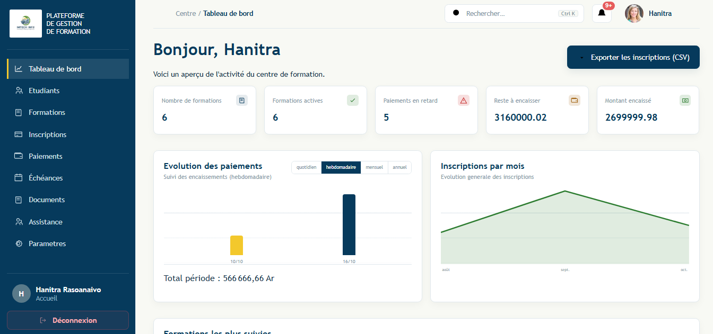
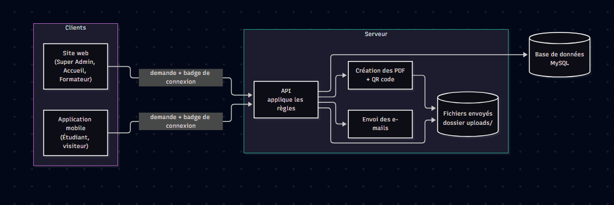

# IMTECH INFO — Plateforme de gestion de formation

Application qui remplace les cahiers et les fichiers Excel d'un centre de formation : **inscriptions**,
**paiements en plusieurs tranches**, **cours en ligne** et **attestations**, sur le web pour le
personnel et sur mobile pour les étudiants.



## Fonctionnalités

| Pour qui | Ce que l'application permet |
|---|---|
| **Super Admin** (web) | Comptes du personnel, formations, réglages de la vitrine (logo, fond), et tout ce que fait l'Accueil |
| **Accueil** (web) | Dossiers étudiants, inscriptions, paiements et échéances, rappels, factures et attestations PDF, demandes d'aide, export CSV |
| **Formateur** (web) | Ses formations, ses supports de cours (publiés tout de suite ou à une heure choisie), la note de présentation |
| **Étudiant** (mobile) | Suit ses cours, commente et réagit, paie ses tranches, reçoit ses notifications, demande de l'aide |
| **Visiteur** (mobile) | Sans compte : découvre les formations et s'inscrit en ligne |

Points notables : documents PDF avec QR code de vérification et filigrane, fichiers servis uniquement
aux personnes autorisées, recherche globale, pagination côté serveur, limitation des essais de
connexion, tâches automatiques (rappels d'échéance, publication programmée des supports, envoi des
attestations à la fin de la formation), facture envoyée automatiquement à chaque paiement validé,
suppression réversible (désactiver / réactiver, filtre « État ») avec un message clair quand un élément
dont dépend une action est désactivé, mode clair et sombre sur le web et le mobile.

## Architecture



| Partie | Dossier | Technologies |
|---|---|---|
| API REST | [`backend-imtech/`](backend-imtech/) | Node.js, Express 5, MySQL / MariaDB, JWT, Multer, PDFKit, Nodemailer |
| Site web | [`web/`](web/) | React 19, Vite, React Router |
| Application mobile | [`mobile/`](mobile/) | React Native, Expo, Expo Router, TypeScript |

Le backend suit un découpage en couches :
`route → middleware (connexion, rôle) → controller → service (règles métier) → model (SQL)`.

## Démarrer

**Prérequis** : Node.js 18 ou plus, MySQL ou MariaDB (XAMPP), et Expo Go sur un téléphone connecté
au même Wi-Fi que le PC.

**1. Variables d'environnement** : copier chaque `.env.example` en `.env` et le remplir.

| Fichier | À renseigner au minimum |
|---|---|
| `backend-imtech/.env` | `DB_*`, `JWT_SECRET` (obligatoire), `EMAIL_USER` / `EMAIL_PASSWORD` pour les e-mails |
| `web/.env` | `VITE_URL_BASE=http://localhost:3000/api` |
| `mobile/.env` | `EXPO_PUBLIC_API_URL=http://<IP-du-PC>:3000/api` |

**2. Base de données** (base neuve + données de démonstration) :

```bash
mysql -u root -e "CREATE DATABASE IF NOT EXISTS gestion_formation_db CHARACTER SET utf8mb4"
mysql -u root --default-character-set=utf8mb4 gestion_formation_db < backend-imtech/base.sql
mysql -u root < backend-imtech/donneesTest.sql
node backend-imtech/scripts/fichiersDemo.js
```

**3. Lancer les trois parties** (un terminal chacune) :

```bash
cd backend-imtech && npm install && npm run dev   # API     → http://localhost:3000/api
cd web            && npm install && npm run dev   # Site    → http://localhost:5173
cd mobile         && npm install && npx expo start # Mobile → scanner le QR code avec Expo Go
```

**Comptes de démonstration** (mot de passe `admin123`) :

| Rôle | E-mail |
|---|---|
| Accueil | `test123acceuil@gmail.com` |
| Formateur | `tolojanaharyelia845@gmail.com` |
| Étudiant | `andry.rakotoarisoa@imtech.test` |

## Tests

```bash
cd backend-imtech && npm test     # tests automatiques de l'API (node --test)
cd web            && npm run lint
cd mobile         && npx expo lint && npx tsc --noEmit
```

## Documentation

| Document | Contenu |
|---|---|
| [`FLUX-APPLICATION.md`](FLUX-APPLICATION.md) | Document de reprise : organisation du code, parcours complet de l'inscription à l'attestation, modules, règles, base de données |
| [`backend-imtech/api.md`](backend-imtech/api.md) | Toutes les routes de l'API et leurs droits |
| [`SCENARIOS-TESTS.md`](SCENARIOS-TESTS.md) | Un scénario de test par fonctionnalité |
| [`CHEAT-SHEET.md`](CHEAT-SHEET.md) | Aide-mémoire : commandes, ajout d'une fonctionnalité, dépannage |

## Auteur

Projet réalisé dans le cadre d'un stage à IMTECH INFO (ITU, S6).
